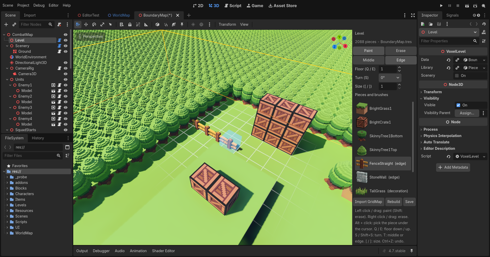

# Level editor

The level editor paints combat maps. It is a plugin for Godot's own editor
(`vcom/addons/level_editor/`) that places pieces of voxel terrain - the ground, crates, trees,
fences, stone walls, tall grass - into a map's `Level` node, in the middles of cells and on the edges
between them, as Godot's GridMap editor once painted blocks. This file is all of it: how to use it,
every control, how painting behaves, making a map, adding pieces, how it works inside, how to probe
it, what it does not do yet and what was decided. What a level is once painted (its pieces, the
voxels they add up to, how it is drawn, what the rules see of it, how it wears) is
`Docs/LEVELS.md`'s; `CLAUDE.md` keeps a summary of both. Written 2026-10-20, as the levels and the
editor were built (2026-10-19/20).



*BoundaryMap in Godot's editor, its `Level` node selected: the **Level** panel on the right of the 3D
view, its palette below; four lengths of fence just painted along an edge, the slot for the next
boxed in blue under the mouse, and the grid of the floor being painted round it.*

## In short

- Select a map's `Level` node in the Scene dock: the **Level** panel opens beside the 3D view.
- Choose a piece or a brush in its palette, and a floor, a turn, the middle of a cell or its edge,
  and a size.
- In the 3D view, **left click** or drag to paint, **right click** or drag to erase.
- Every stroke is one step of Godot's undo. Saving the scene saves the level's pieces to their own
  file in `vcom/Levels/`.

## Getting started

1. **The plugin is on.** `project.godot` enables it (`res://addons/level_editor/plugin.cfg`) beside
   the MagicaVoxel importer; Project > Project Settings > Plugins lists it as **Level Editor**. An
   editor opened before the plugin existed needs the project reopened to load it.
2. **Open a combat map:** `Scenes/BoundaryMap.tscn` (the battlefield is its `Level`, the forest round
   it `Scenery`), `Scenes/CombatMap.tscn` or `Scenes/LineOfSightTest.tscn`. A level is built as its
   scene opens, as it is in the game: BoundaryMap takes about a second.
3. **Select the `Level` node** in the Scene dock. The **Level** panel opens on the right of the 3D
   view (in the 3D view's own side container, never a tab behind the Inspector), headed by the
   level's name, how many pieces it has and its file.
4. **Move the mouse over the 3D view.** A faint grid shows the floor being painted round the cursor,
   with a ghost of whatever a click would place and a box round each slot it would fill.
5. **Choose a piece** in the palette, set the **Floor** (0 is the ground's own level, 1 the cells a
   unit stands in on it), and **left click**.
6. **Save the scene** (Ctrl + S): the level's pieces go to their own file, `vcom/Levels/<Map>.tres`.

## The ideas

**A level is pieces, each a kind, a slot and a turn.** A kind (`PieceKind`) is a voxel model a
block's size, 16 voxels a side: the ground, a crate, a tree's trunk or its crown, a fence, a course
of stone wall, tufts of tall grass. Every map shares one library of them, `vcom/Blocks/Pieces.tres`
(`PieceLibrary`), and that library is the panel's palette. A brush (`PieceBrush`) is a few kinds
placed together in one click: a whole tree, a wall two courses high. A map's pieces are its
`LevelData` (`vcom/Levels/<Map>.tres`), every piece in the order it was placed. As a map loads, in
the editor as in the game, its level stamps every piece into one grid of voxels and draws that; the
rules read the pieces.

The library as it is (2026-10-20):

| Palette entry | What it is | Where it goes |
|---|---|---|
| BrightGrass1 | the ground block, with the optional tile grid on it | a cell's middle |
| BrightCrate1 | the crate: breaks into boards, three in four leave a coin | a cell's middle |
| SkinnyTree1Bottom, SkinnyTree1Top | a tree's trunk and its crown, each a block | a cell's middle |
| FenceStraight (edge) | a split-rail fence, three quarters of a block high, stepped over | an edge |
| StoneWall (edge) | a course of masonry a block high | an edge |
| TallGrass (decoration) | tufts of grass, which the rules never see | a cell's middle |
| Brush: SkinnyTree1 (2) | a whole tree: the trunk, and the crown a level above it | a cell's middle |
| Brush: StoneWall2 (2) | two courses of wall, one on the other: full cover | an edge |

**A slot is the middle of a cell, or the edge between two.** A cell is one unit across (a metre,
sixteen voxels). A piece in the middle of a cell fills that cell, as a block did; a piece on an edge
stands half in each of the two cells it lies between, as a fence or a wall does. A cell's corner is
no slot. Seen from above, -z up the page and +x to the right:

```
        +-----------+-----------+
        |           |           |      M   the middle of a cell
        |     M     A     M     |      A   the edge between two cells side by side
        |           |           |          along x: it runs along z
        +-----B-----+-----B-----+      B   the edge between two cells side by side
        |           |           |          along z: it runs along x
        |     M     A     M     |      +   a cell's corner: no slot
        |           |           |
        +-----------+-----------+
```

**A floor is a level of cells**, counted up from the level's origin: floor 0 is the ground blocks'
level in every map (their tops at height 1), floor 1 the cells a unit stands in on the ground, floor 2
one up, and so on. A crate on the ground is a piece on floor 1, a second crate on top of it floor 2.
The editor paints one floor at a time, showing its grid at the floor's foot (floor 1's lies on the
ground's top), and a click goes to the slot the mouse points at on that floor.

**A turn is quarter turns about up**, counterclockwise seen from above: 0°, 90°, 180° or 270°. A
piece never tips over on to its side. On an edge that runs along z (between cells side by side along
x), a piece is turned a quarter more than the panel says, because a fence or a wall is drawn running
along x: so at turn 0 a fence always runs along the edge it is on, whichever way the edge runs.

**Pieces can share a slot or overlap, and the later wins, voxel by voxel.** A piece painted where
another stands is laid over it: wherever both have a voxel, the later one's is drawn, worn and
stained; where the later has none, the earlier shows through. Tall grass painted into a cell holding
something else layers its tufts over it. The pieces in a slot stay in the order they were placed,
and erasing takes the last of them.

**What the rules make of it.** A solid piece is whole to the rules until it breaks, however worn: one
in a cell fills the cell, one on an edge stands across the edge and is cover to both sides of it, and
a unit steps over an edge piece a level high or less, never a taller one (`Docs/LEVELS.md`, "What the
rules see"). A kind that is not solid (marked "(decoration)" in the palette) is only drawn: nothing in
the rules sees it. The battlefield's bounds are wherever its solid pieces are, so painting more ground
grows its tiles and the camera's pan limits with it.

## Controls

### In the 3D view

These are the level editor's while a `VoxelLevel` node is selected and the mouse is over the 3D view.

| Input | What it does |
|---|---|
| Left click | Paint the selection at the cursor: a square the panel's size across |
| Left drag | Paint every slot the cursor's square passes over, the whole drag one undo step |
| Right click, or drag | Erase: take the last piece placed out of each slot |
| `Shift` + left click, or drag | Erase, as the right button does |
| `Shift` held while the mouse moves | Show, in red, what an erase would take out |
| `Alt` + left click | Pick the kind of the last piece in the slot under the cursor: on the floor being painted, in a cell's middle or on an edge as the panel has it; the kind alone, never a brush nor its turn |
| `Q` / `E` | Go down / up a floor |
| `S` / `Shift` + `S` | Turn a quarter counterclockwise / clockwise, seen from above |
| `T` | Between the middle of a cell and its edge |
| `[` / `]` | Paint a smaller / bigger square, 1 to 15 cells a side |
| `Ctrl` + `Z` / `Ctrl` + `Shift` + `Z` | Undo / redo a stroke: Godot's own Undo and Redo |
| `Ctrl` + `S` | Save the scene, and the level's pieces with it |

The keys reach the level editor while the 3D view has the keyboard, which it takes as the mouse
moves over it, unless a text field has it (one of the panel's numbers just typed in, say). None of
them does anything with `Ctrl`, `Alt` or `Meta` held, which are left to Godot, and a key held down
does not repeat.

### What Godot's own 3D view does meanwhile

While a level is selected:

- **The left button paints instead of selecting.** A click in the view selects no other node and
  drags no gizmo, the level's own included. Select other nodes in the Scene dock, and move a level,
  if ever, by its Transform in the Inspector.
- **The right button erases instead of looking around.** Godot's freelook, on holding the right
  button, is not there while a level is selected. Orbit with the middle button, pan with `Shift` +
  middle, zoom with the wheel: the level editor leaves every other button and the wheel to Godot. A
  navigation scheme that orbits on `Alt` + left (Editor Settings) loses that to picking: use the
  middle button.
- **`Q`, `E` and `T` are the level editor's alone.** Godot gives them to its Select tool, its Rotate
  tool and its local space; they are Godot's again once another node is selected.
- Everything else is Godot's as always: the view's menus and toolbar, its other keys, `F` to focus,
  the Inspector.

### The Level panel

Top to bottom:

| Control | What it does |
|---|---|
| Title | The selected level's node name, "(scenery)" after a scenery level's |
| Count | How many pieces the level has, and its file (`BoundaryMap.tres`); "No level data" when it has none, and what to do |
| **Paint** / **Erase** | What the left button does. In Erase the left button erases too; the right always erases |
| **Middle** / **Edge** | Where a click goes: the middle of the cell under the cursor, or the edge of it nearest the cursor (`T`) |
| **Floor (Q / E)** | The floor painted, -8 to 32 |
| **Turn (S)** | 0°, 90°, 180° or 270°, counterclockwise seen from above |
| **Size ([ / ])** | The square a click paints, 1 to 15 cells a side |
| **Pieces and brushes** | The palette: every kind in the library with a picture of it (the editor's own previews, which can take a moment to appear), "(edge)" after a fence or a wall and "(decoration)" after one the rules never see; then every brush, "Brush: name (pieces)". Choosing a kind meant for edges, or a brush whose first piece is one, switches to Edge; any other switches to Middle. The first entry is chosen to begin with |
| **Import GridMap** | Makes the level from the first GridMap in the scene ("Importing a GridMap") |
| **Rebuild** | Builds the level afresh from its pieces |
| **Save** | Saves now every level's pieces painted since they were last saved |
| The help line | A reminder of the clicks and keys |

## How painting behaves

- **A stroke is press to release.** Everything a stroke paints or erases, however many slots it
  crosses, is one step of the scene's undo history, named for the level ("Paint Level", "Erase in
  Level"). Undo takes the whole stroke back, putting every erased piece back where it was in the
  order, so the level is exactly as it was; redo does it again.
- **Each slot once a stroke.** However often a drag's square passes over a slot, the stroke paints or
  erases there once: a drag never stacks a slot, nor empties it a piece at a time.
- **The same piece again changes nothing.** Painting a kind into a slot whose last piece is already
  that kind at that turn adds nothing: painting over ground already painted is harmless.
- **Anything else stacks.** Another kind, or the same kind turned another way, is laid over what is
  in the slot (later wins, above). To replace a piece, erase it first. The count at the top of the
  panel counts every piece, stacked or not.
- **Erasing takes the last piece placed in each slot**, one a stroke: a slot holding two pieces takes
  two strokes to empty.
- **A square is the size across**, round the slot under the cursor: odd sizes centred on it, even
  ones reaching a cell further toward +x and +z. On an edge it is a square of edges all running the
  same way: size 3 paints three lengths end to end along the edge, and the same along the parallel
  edges a cell to either side.
- **A brush places all its pieces at every slot of the square**, turned together, their offsets
  turned with them. With a brush chosen, erasing takes the last piece out of every slot its pieces
  would stand in: a tree's trunk and its crown.
- **An edge stroke keeps to one way.** A stroke begun on an edge keeps to edges running the same way,
  so dragging a fence along a row of cells past their corners never turns it across them. To paint
  the other way, start a new stroke.
- **Where the cursor is.** The mouse's ray meets the plane at the foot of the floor being painted, in
  the level's own space, in front of the camera; the slot is the cell there, or the edge of that cell
  nearest the point. A ray that meets that plane nowhere in front of the camera (the view looking up
  past it, or along it) shows nothing, and a click there paints nothing and selects nothing.
- **The cursor shows what a click would do:** a ghost of every piece a click would place, in its own
  colours, and a blue box round each slot it would fill; erasing (`Shift` held, the right button down,
  or Erase mode), a red box round each slot it would take a piece from. It belongs to no scene and is
  never saved.
- **The level is drawn again as it is painted:** only the chunks the changed pieces reach, the whole
  click at once, about 37 ms a click on BoundaryMap's battlefield.
- **Saving.** Painting marks the scene unsaved. Saving the scene saves every level edited since to its
  own file; the panel's **Save** does it at once. A `LevelData` built into the scene rather than kept
  in a file of its own is saved with the scene. Closing without saving loses the strokes, as any
  unsaved edit in Godot.
- **The scenery** (BoundaryMap's `Scenery`, a `VoxelLevel` with **Scenery** ticked) is painted the same
  way: select it instead of `Level`. It is only drawn, by kind and region, and a click draws again the
  16 x 16-cell regions it reaches. The rules, destruction and blood never see it.

## Recipes

- **Ground:** BrightGrass1 on floor 0, size 15, dragged over the area: 225 blocks a square. Raised
  ground is grass on floor 1 on top of it, and so on up; a unit climbs one level at a time and drops
  at most two, so keep steps a level high where the squad should climb.
- **Cover:** a crate (BrightCrate1) or a grass block on floor 1 is half cover; a stack of two, on
  floors 1 and 2, is full cover. Crates break whole; a grass block wears away, and collapses once worn
  below half of its voxels.
- **Fences and walls:** choose FenceStraight or StoneWall (the panel switches to Edge), set the floor
  to 1, and drag along the edges between cells. A fence, or one course of wall, is half cover and is
  stepped over; the **StoneWall2** brush paints two courses, full cover, which nobody steps over. A
  corner is two lengths at right angles meeting at the corner's point, which is no slot: there is no
  post there.
- **Trees:** the **SkinnyTree1** brush on floor 1: its trunk there, its crown on floor 2. Shoot the
  trunk through and the crown comes down.
- **Decoration:** TallGrass on floor 1, over the ground: drawn, stained by blood, blown away by a
  blast, but never cover and never in anyone's way.
- **Replacing a piece:** erase it (right click), then paint the new one.
- **Finding out what is in a slot:** `Alt` + click picks the kind of its last piece. Pieces are no
  nodes, so the Inspector shows only the level as a whole.

## Making a new combat map

1. **Copy a map.** Duplicate `Scenes/CombatMap.tscn` in the FileSystem dock (it has the battlefield,
   the HUD, the camera, the lights, four squad starts and one enemy) and open the copy.
2. **Give it pieces of its own, before painting anything.** The copy's `Level` still uses
   CombatMap's pieces: painted now, the strokes would go into `Levels/CombatMap.tres`. Select the
   level, and in the Inspector, on **Data**, choose **New LevelData** (an empty level) or **Make
   Unique** (a copy of CombatMap's), then **Save As** `vcom/Levels/<Map>.tres`. The level is built
   again as its data changes. A level shares its pieces with nothing else.
3. **Paint it:** the ground on floor 0, then everything that stands on it.
4. **Place the squad's starts:** move the four markers under `SquadStarts` on to tiles (each
   `SquadStart` draws the tile it stands over and its number in the editor). The squad spawns on them
   in roster order.
5. **Place the enemies** under `Units`: duplicate `Enemy1` (a `Unit` with a weapon, an AI and a
   `Model` tinted slate grey) and move each copy on to a tile: a tile's middle, at its floor, is
   (x + 0.5, 1, z + 0.5) on the ground.
6. **Play it** on its own with F6 (Run Current Scene): the first four of the roster fight it, and
   after "Victory" it stays idle, with no world map to go back to.
7. **To fight it from the world map,** make it a forest's `encounter_map`: every forest has
   `Scenes/Forest.tscn`'s, which is `BoundaryMap.tscn`.
8. **A ring of scenery** round it, as BoundaryMap has, is a second `VoxelLevel` with **Scenery**
   ticked and a `LevelData` of its own, over a ground plane; `Docs/LEVELS.md`, "Scenery", has how deep
   it must be and why.

## Importing a GridMap

**Import GridMap** turns the first GridMap in the edited scene into the selected level's pieces
(`LevelImport.from_grid_map()`): every block a piece of the same name, its MeshLibrary item's (which
must be a kind's `id`), in the middle of its cell, turned as the block was about up (a block turned on
to its side comes in upright, with a warning). It replaces the level's pieces, and is undoable. A level
with no `LevelData` gets a new file instead, `vcom/Levels/<Scene><Level>.tres` (the level's own name
left out when it is `Level`), which is not undone. The combat maps came over from GridMaps this way
(`Docs/LEVELS.md`, "How the maps came over"); no map has a GridMap now, so it is for one brought in
from elsewhere.

## Adding kinds and brushes

- **A kind of piece.** Model it in MagicaVoxel in a 16³ box, one model to the file (a multi-model
  `.vox` is for the pieces a breakable block breaks into, `Docs/DESTRUCTION.md`), copy it into
  `vcom/Blocks/`, import it as a Mesh at **Scale 0.0625**, the blocks' scale, and add a `PieceKind` to
  `Blocks/Pieces.tres`'s **Kinds** in the Inspector:
  - **Id**: what every level calls it. Levels keep kinds by this name, so never rename one a level
    uses.
  - **Model**: the imported mesh. Its voxels are read from its `.vox` as a level is built.
  - **Model Transform**: where the mesh sits in the piece's box. The default, down half a box, suits
    a model standing on MagicaVoxel's ground; one drawn elsewhere in its box needs its own (the
    crate's is moved 1.3125 along z as well). A piece for edges is drawn running along x, centred
    across z, so that it stands across its edge.
  - **Destruction**: a `VoxelDestruction` to wear away a few voxels at a time, a `ScriptedDestruction`
    to break into pieces cut in advance, or none, never to break (`Docs/DESTRUCTION.md`'s recipes).
  - **Solid**: off for decoration, which the rules never see.
  - **Tile Grid**: the optional grid (`G`) drawn on its voxels: the ground.
  - **Edge Piece**: the panel switches to Edge when it is chosen.
- **A brush.** Add a `PieceBrush` to **Brushes**: its **Display Name**, and for each of its pieces a
  kind (**Kinds**, by id), a slot offset from the slot clicked (**Offsets**: x and z in half cells, y
  in cells, so 2 is a cell along and 1 a cell up) and a turn (**Turns**, quarter turns, 0 if left out).
  Even offsets across keep a piece in the same kind of slot as the click, a cell's middle or an edge;
  an odd one moves it between the two, and one that makes both of a slot's x and z odd puts it on a
  cell's corner, which is no slot. Its pieces are placed in that order, a later one winning where two
  overlap, and the whole brush turns with the panel's turn, offsets and all.
- **The palette shows them once the editor is restarted**, or the plugin turned off and on (Project
  Settings > Plugins): the panel fills its palette once for each library it is shown.
- **Models to start from:** `MagicaVoxel/Shapes/` holds basic block-sized models made by a script
  (`make_shapes.py`; its `README.md` has each and how to bring one in), of which the fence, the stone
  wall and the tall grass are in the game.

## How it works

| File | What it is |
|---|---|
| `addons/level_editor/plugin.cfg` | the plugin's entry |
| `addons/level_editor/LevelEditorPlugin.gd` | the `EditorPlugin`: what it edits, where its panel goes, the 3D view's input, strokes, undo, saving, Import and Rebuild |
| `addons/level_editor/LevelEditorDock.gd` | the panel, built in code: it holds the choices and the palette, which the plugin reads |
| `addons/level_editor/LevelCursor.gd` | the grid, ghosts and boxes under the mouse |
| `Scripts/Level/LevelEditing.gd` | what a click does, apart from the editor: `placements()`, `erasures()`, `square()`, `slot_at()`, `apply()`, `undo()`, `redo()` |
| `Scripts/Level/VoxelLevel.gd` | the level: `place()`, `insert()`, `remove()`, `erase()`, `begin_edit()` / `end_edit()`, `build()` |
| `Scripts/Level/LevelData.gd`, `PieceKind.gd`, `PieceBrush.gd`, `PieceLibrary.gd`, `LevelImport.gd` | the pieces, the kinds and brushes, the library, the GridMap import |
| `Blocks/Pieces.tres` | the library: every kind and brush |
| `Levels/*.tres` | each map's pieces |

**A click, step by step:**

1. **Input.** While a `VoxelLevel` is edited (`_handles()`, `_edit()`), Godot hands the plugin every
   event in the 3D view first (`_forward_3d_gui_input()`). It keeps the left and right buttons and its
   keys from the view (`AFTER_GUI_INPUT_STOP`) and lets everything else through; a key it takes it also
   marks handled (`set_input_as_handled()`), or it would go on to Godot's shortcuts.
2. **Aiming.** `_aim()` meets the camera's ray through the mouse with the plane at the floor's foot, in
   the level's own space (so a moved or turned level paints true), and `LevelEditing.slot_at()` turns
   the point into a slot: the cell under it, or the nearest of that cell's four edges, only those
   running the stroke's way once a stroke has begun on an edge.
3. **What to do.** `LevelEditing.placements()` lists the pieces the selection makes there, as a kind,
   a slot and a turn each, over the square; or `erasures()` the slots to take a piece from. `_paint()`
   leaves out the slots the stroke has already been to.
4. **Doing it.** `LevelEditing.apply()` makes those edits in one batch (`VoxelLevel.begin_edit()` ...
   `end_edit()`). `VoxelLevel.place()` adds a piece to the end of the `LevelData` and `remove()` takes
   one out, each renumbering the voxel volume's owners (`VoxelVolume.piece_inserted()` /
   `piece_removed()`). At `end_edit()` the rules are made again from the pieces (`LevelRules`, which is
   quick), every chunk the changed slots' boxes reach is stamped afresh (`VoxelVolume.restamp()`), and
   the renderer meshes those chunks again and uploads their colours (`LevelRenderer.refresh()`); a
   scenery level builds again the regions instead (`SceneryRenderer.rebuild_slots()`). `apply()`
   returns what it did, each add or removal with its index, kind, slot and turn.
5. **Undo.** Letting go of the button (`_end_stroke()`) puts the stroke's list in the scene's undo
   history as one action, done already (`commit_action(false)`), whose undo and redo replay it
   (`LevelEditing.undo()` / `redo()`, through `VoxelLevel.insert()` and `remove()`): an erased piece
   goes back at its place in the order, so later-wins comes out as it was.
6. **Saving.** The scene is marked unsaved; as Godot saves it, it calls the plugin's
   `_save_external_data()`, which saves every `LevelData` changed since to its file
   (`ResourceSaver.save()`).

The panel sits in the 3D view's right-hand side container while a level is selected
(`CONTAINER_SPATIAL_EDITOR_SIDE_RIGHT`, as the GridMap editor's palette did). The cursor is an
internal child of the level being edited (`INTERNAL_MODE_BACK`), so it is never saved and goes when
another node is selected. In the editor a level is drawn but makes no collision, and its texture of
colours keeps 32 layers spare (`LevelRenderer.SPARE_LAYERS`), so painting into new chunks does not make
the whole texture again.

**The file.** A `LevelData` `.tres` holds `kinds`, the ids of the kinds the level uses (a
`PackedStringArray`; pieces name a kind by its place here, so the library can grow or be reordered
under it), and `pieces`, a `PackedInt32Array` of five numbers a piece, in the order placed: the kind's
place, the slot's x, y and z (x and z in half cells: both even, a cell's middle; one odd, an edge), and
the turn, 0 to 3. BoundaryMap's 2,084 pieces are 37 KB of text, its forest's 37,118 about 700 KB.
Nothing in a battle changes it: what breaks is the battle's to keep.

## Why a plugin

The level editor is a plugin for Godot's editor rather than a program of its own. The user left the
choice open (2026-10-19: "We do not need an editor within the game. Add it as a new plugin for the
Godot editor, or a standalone application. Consider both options."), and the plugin was built:

| | Editor plugin (built) | Standalone application |
|---|---|---|
| Where | Godot's own 3D view, beside the scene tree, inspector and file system already in use | A Godot project or export of its own, or the game in an editing mode |
| Camera, selection, undo, saving | Godot's: its undo history, scene saving, resource saving, Ctrl+Z | Each written again |
| What is shown | The game's own `VoxelLevel`, drawn by the game's code (`@tool`), so what is painted is what loads | The same code, kept in step by hand across two programs |
| Assets | The `.vox` importer, the resource previewer, `Pieces.tres` edited in the Inspector | An asset pipeline of its own |
| Cost | Bound to the editor's ways and its speed with big scenes | A second program to build, ship and keep working; could be given to players or modders |

It reuses everything already in use, its levels are exactly what the game loads, and nothing is
built twice. A level is one node and one resource, so it avoids what makes the editor slow on
`Map.tscn` (thousands of nodes). Nothing stops a standalone editor later: `LevelEditing` holds what a
click does apart from the editor, and `LevelData` is a plain resource.

## Extending it

- **A new tool** (a fill, a line, a box) is a static function in `LevelEditing` that lists edits as
  `apply()` takes them (`["add", id, slot, turn]` or `["erase", slot]`), so a probe can call it
  exactly as a click would, plus its input in the plugin and its control on the panel. Keep a stroke
  one undo step (gather what `apply()` returns until the button is let go) and every edit inside one
  `begin_edit()` / `end_edit()`, or each piece redraws its chunks on its own.
- **A new key** goes in `_forward_3d_gui_input()`'s list, which marks it handled: check first what
  Godot's 3D view gives it, since while a level is selected it is the level editor's alone.
- **A new choice on the panel** is a property of `LevelEditorDock`, set by its control and by any
  key the plugin gives it, kept within the control's range, emitting `changed` so the cursor follows.
- **The panel is built in code**, as the game's own menus are; the plugin reads its choices and never
  the other way round.

## Probing it

- **What a click does** is `LevelEditing`'s, which a `--script` probe calls headless exactly as a
  click does. The probe made with it applies random edits to a copy of BoundaryMap's level, undoes
  and redoes some, then compares every chunk's colours, owners and rows with a level built afresh from
  the same `LevelData`: 96 edits, none differing, about 37 ms an edit (`Docs/LEVELS.md`, "Probing it").
  Another checks what this file says of painting: a new empty level, the same piece again doing
  nothing, another turn stacking, erasing the last first, the turn on an edge along z, squares on
  edges, a brush placed and erased, undo and redo, the bounds following the paint.
- **The editor itself.** `LevelEditorPlugin` runs a script named by the environment variable
  `VCOM_LEVEL_EDITOR_PROBE` once the editor is up (an object with `run(plugin)`, which the plugin
  keeps), which drives the editor as the mouse would: `_forward_3d_gui_input()` with mouse events at
  `camera.unproject_position()` of a point on the floor (the 3D view's camera is
  `EditorInterface.get_editor_viewport_3d(0).get_camera_3d()`), the panel's choices set directly
  (`plugin.get("_dock")`). Run it on a copy of the project, never the one open in the user's editor,
  with settings folders of its own (`APPDATA` and `LOCALAPPDATA` pointed elsewhere):
  `VCOM_LEVEL_EDITOR_PROBE=/abs/probe.gd "$G" --path <copy> -e --resolution 1600x900`, the probe
  quitting the editor when done. After copying changed files into the copy, open it once headless
  first (`--headless --editor --quit-after 600`) so its scan and imports are done, and have the probe
  wait for the scan and open its scene until it is the one edited: otherwise the editor reloads the
  test scene under the probe as the scan finds files, the probe's level leaves the tree, and the
  plugin edits nothing. A copied `.godot/editor` reopens the scenes last open there: move it aside.
- **Real input.** To test what reaches the plugin through Godot (its shortcuts, the selection), push
  events into the editor's window instead, with `push_input()` on
  `EditorInterface.get_base_control().get_viewport()`, the 3D view's surface focused: the plain
  `Control` with `FOCUS_ALL` among the children of the `Node3DEditorViewport` holding
  `get_editor_viewport_3d(0)`. Mouse positions are the window's: the surface's
  `get_global_rect().position` plus `unproject_position()`. Press and release in one frame: a real
  mouse moved on the desktop between them reaches the editor as a drag.
- **The probes made** (2026-10-20), all passing on the final plugin:
  - on a small test level of their own (a floor of grass eight cells square, a crate, a tree): one
    paints a fence along four edges by a drag, undoes and redoes it, places the tree brush, erases a
    floor block, raises the floor and turns from the keys, and saves (13 checks);
  - one opens BoundaryMap (about 1.1 s), paints four fences by a drag and undoes them, every chunk's
    voxels as before, then paints a tree brush into the forest and undoes it (8 checks);
  - one, made as this file was written, lays a turned second layer of ground over a 3 x 3 square,
    drags a size-3 erase a cell along and back over it (12 slots, one piece each), undoes it, every
    piece back in its order, drags a size-3 square of crates (12, none stacked), and drives the floor
    and size keys past their ends (15 checks);
  - one sends real input: each of the level editor's keys, with Godot's tool buttons watched, and a
    click on the floor, which paints there and leaves the level selected (14 checks).

  The last two found three faults, mended then: an erasing drag took a second piece where its squares
  overlapped; `Q` and `E` went past the floors the panel shows; and the keys reached Godot's
  shortcuts as well (`E` chose its Rotate tool, `Q` Select, `T` local space).
- Every probe's editor logs `Can't use get_node() with absolute paths from outside the active scene
  tree` once as it quits; no script of the project uses an absolute path, so it is not the level
  editor's. In a copy kept deep in a temporary folder, the editor also logs that it cannot make its
  shader cache, the paths being too long for Windows: harmless.

## Performance

- Opening BoundaryMap in the editor takes about 1.1 s (1,145 ms measured): the battlefield's voxels
  0.26 s and drawing them 0.55 s, the forest 0.1 s.
- A click costs about 37 ms on BoundaryMap's battlefield: only the chunks its pieces reach are built
  and drawn again, the whole click at once.
- In the editor a level makes no collision, which the game streams in over its first seconds.

## What it does

- Paint any kind or brush in the middles of cells and on the edges between them, on any floor from -8
  to 32, turned in quarter turns about up, in squares 1 to 15 cells a side, by click and by drag.
- Erase, a piece a slot a stroke, by the right button, `Shift` or Erase mode; a brush erases every
  slot it would fill.
- Layer pieces in one slot, the later winning voxel by voxel.
- Pick a kind from the view (`Alt` + click).
- Undo and redo every stroke and import, in Godot's own history, and save with the scene.
- Paint the battlefield and the scenery, any number of levels in a scene, each selected in turn.
- Import a GridMap.
- Take new kinds and brushes as data, with no code.
- Keep every map's pieces in a file of its own, which the game builds the map from as it loads.

## Known gaps: what it does not do

- Build maps from plots and parcels, the user's next step ("In a subsequent step, we will allow
  creating separate maps with our level editor that serve as plots or parcels."): a map is one painted
  level.
- Auto-tile: a fence's or a wall's ends, corners and joints are placed piece by piece, and a corner is
  no slot, so there are no corner posts.
- Place anything but a whole piece in a cell's middle or on an edge: no free placement, no half
  levels, no tilting.
- Fill, draw lines, select a box, copy and paste, move pieces, replace in place, or pick a piece's
  turn or a brush from the view: the square is the only brush shape.
- Show single pieces: they are no nodes, so the Inspector shows the level alone, and what a slot holds
  is seen only by picking or erasing it.
- Paint, show or hide more than one floor at a time.
- Check a map: nothing stops a piece burying a squad start or an enemy, floating in the air, or
  walling the squad in.
- Place units, squad starts, coins or lights: those are Godot's own nodes, placed with its own tools
  (coins come from crates in play), and the battlefield's bounds follow from the pieces.
- Run inside the game (the user ruled that out), or stand alone (not built, above).
- Edit a battle while it is played: it edits scenes, and a battle builds its level afresh from the
  file.
- Search or group the palette, or refresh it when the library changes before the editor restarts or
  the plugin is turned off and on.
- Read a `.vox` again once the editor has read it: the voxels of every model are read once a session,
  so a model edited in MagicaVoxel while the editor is open shows its new voxels after a restart.
- Take a gamepad: it is the editor's, mouse and keys only.

## Troubleshooting

- **No Level panel:** the selected node is not a `VoxelLevel` (select `Level`, not the scene's root),
  or the plugin is off (Project Settings > Plugins), or the editor was opened before the plugin
  existed (reopen the project).
- **"No level data":** the level has no `LevelData`. Give it one (on **Data**, **New LevelData**, then
  **Save As** in `vcom/Levels/`), or import a GridMap.
- **Nothing paints:** no entry chosen in the palette; the floor's plane is nowhere in front of the
  camera under the mouse (nothing is shown then); or the level has no **Library** (it should be
  `Blocks/Pieces.tres`).
- **The keys do nothing:** the 3D view does not have the keyboard (a text field, such as one of the
  panel's numbers just typed in, may have kept it), or `Ctrl`, `Alt` or `Meta` is held.
- **Strokes went into another map's file:** a copied scene's level still using the original's
  `LevelData` ("Making a new combat map").
- **A new kind or brush is not in the palette:** turn the plugin off and on, or restart the editor.
- **A model changed in MagicaVoxel looks the same in a level:** restart the editor; **Rebuild** builds
  from the voxels already read.
- **Files changed outside the editor** (a script, a pull): Godot asks whether to reload the scene.
  Reload, and do not save the old one over the new files.

## Decided

**By the user** (2026-10-19, in their own words; the rest of their decisions for levels are under
"Why levels" in `Docs/LEVELS.md`):

- "To keep things simpler, I still intend to place elements at the edges between tiles (such as
  fences and walls) as 16x16x16 elements. This should mean that the level editor only needs to allow
  placing elements on block centers and block edges. Just like in your suggestion, overlaps are
  later-one-wins, voxel by voxel."
- "Do not include auto-tiling at this stage. I'll place elements by hand."
- "Do not use multi-model vox files for the level editor. I want to keep multi-model vox files
  limited to pieces that break apart during destruction."
- "We do not need an editor within the game. Add it as a new plugin for the Godot editor, or a
  standalone application. Consider both options."
- "Include a basic brush in the level editor that allows placing multiple pieces at a time (such as
  a full tree)"
- "For now we are going to stick with whole maps. In a subsequent step, we will allow creating
  separate maps with our level editor that serve as plots or parcels."

**Without asking:**

- A Godot editor plugin rather than a standalone application ("Why a plugin").
- The panel beside the 3D view, as the GridMap editor's palette was, rather than a dock tab.
- The controls: left paints, right, `Shift` or Erase mode erases, `Alt` picks; `Q` / `E` floors, `S`
  turns, `T` between middle and edge, `[` / `]` the size, as Godot's GridMap editor and common voxel
  editors use keys near them; and those keys the level editor's alone while a level is selected, over
  Godot's own shortcuts on `Q`, `E` and `T`.
- A stroke is one undo step and touches each slot once, however its squares overlap; painting the
  same kind at the same turn again does nothing; erasing takes the last piece in a slot; an edge stroke
  keeps to one way.
- A piece on an edge running along z turned a quarter more, so fences run along their edges at turn 0;
  choosing a piece meant for edges switches to edges.
- A square brush, 1 to 15 cells a side; floors from -8 to 32, the keys stopping where the panel does.
- Import GridMap, Rebuild and Save on the panel.
- The cursor's grid, ghosts and blue and red boxes; picking the kind alone, not its turn.
