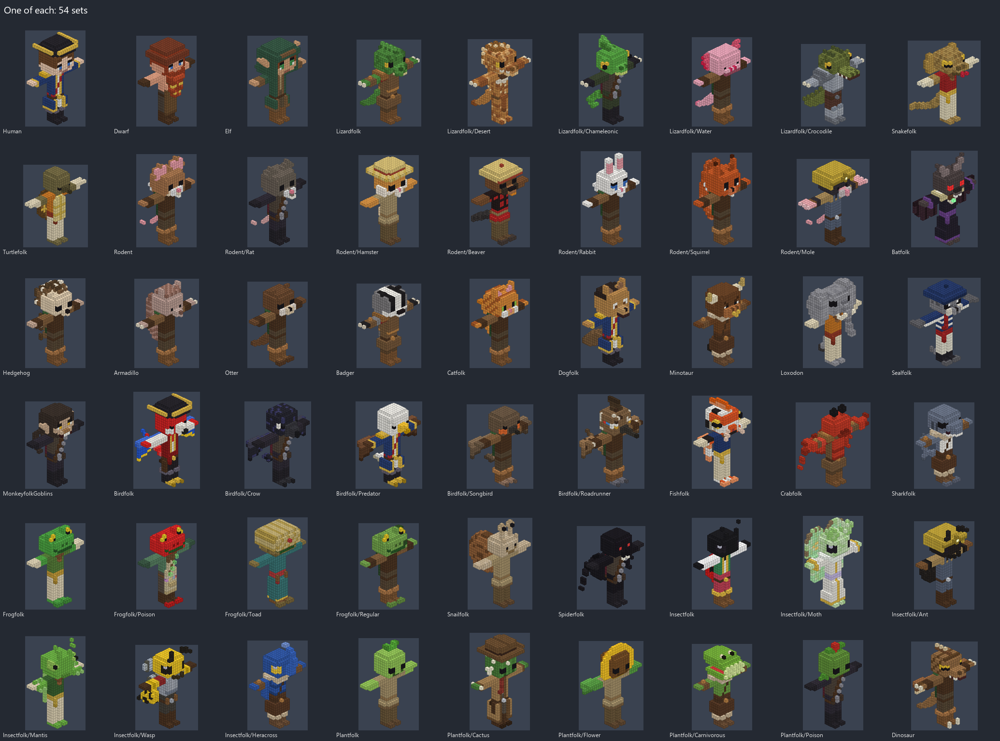

# Characters

Character models for every species and sub-species in `Brainstorming/Species.txt`, drawn on
`Character_Bigger.vox`, the figure every unit wears (2026-11-05). 54 sets, a folder each: 712
rig-ready designs that keep the base figure's body voxel for voxel, so they bake with the game's
skeleton and all 56 of its animations; 162 more of them recoloured in the VoxelRidgeInspiration
treatments; and 47 concepts of free proportions where a species suggests a body of its own. Nothing
in the game was changed: the models wait here, as the shapes in `../Shapes/` do, until one is
brought in. `Character_Bigger.vox` and `BaseCharacter.vox` beside this file are the game's own
figures and were not touched.



Every folder has a `Preview.png` (each model from the front and its left, then from the back and its
right), `layouts.json` (each model's rig layout, below) and, where there are concepts, `Concepts/`
with a preview of its own. `manifest.json` lists every file: its set, role, canvas, bounds, voxel and
colour counts, glass and glowing voxels, hash, and whether its layout needs the centre option.
`RigTest/` has renders of sample models baked and animated in a scratch copy of the game.

## What the user decided

Asked four questions before any model was made (2026-11-04), the user chose:

- **Body plan: rig-ready plus concepts.** At least ten models a kind that keep Character_Bigger's
  T-pose, limb positions and heights, so they can be baked with the current skeleton and animations,
  each species told apart by its head, colours, clothes and what rides on the bones; and concepts of
  free proportions where the species suggests them, marked as such.
- **Grouping: also generic parent models.** A folder for every kind, the slashed entries split
  (Hedgehog / Armadillo, Otter / Badger, Catfolk / Dogfolk, Fishfolk / Crabfolk / Sharkfolk with
  the hammerheads among the sharks); a folder inside its species for each sub-species; and at least
  ten generic models in each species that has sub-species (Lizardfolk, Rodent, Plantfolk, Birdfolk,
  Frogfolk, Insectfolk).
- **Location: here, `MagicaVoxel/Characters/`**, beside Character_Bigger.vox, the game unchanged.
- **Colour: full colour, mixed styles.** Skin, fur, scales, eyes, clothes and armour each their own
  colours, with some models in the VoxelRidge treatments (Cartoon, TwoColor, CratePalette).

## The sets

Each row links its preview. Names follow `<Set>_<NN>_<Design>[_<Treatment>].vox`, the set's path
joined by underscores (`Lizardfolk_Desert_03_GilaBrute.vox`); a concept is
`<Set>_Concept_<NN>_<Design>.vox` in the set's `Concepts/`.

<!-- index: written by _generator/build.py -->
| Set | Designs | Treatments | Concepts | The designs |
| --- | ---: | ---: | ---: | --- |
| [Human](Human/Preview.png) | 20 | 3 | 0 | Officer, Sharpshooter, Gunslinger, Bruiser, Ranger, Monk, Ironclad, Barbarian, Shieldbearer, FieldMedic, Psychic, WhiteMage, Necromancer, Apothecary, Pyromancer, Captain, Noble, Farmer, Bard, Scholar |
| [Dwarf](Dwarf/Preview.png) | 16 | 3 | 3 | Smith, Miner, Ironbeard, Hearthguard, Berserker, Runepriest, Engineer, Thunderer, Captain, Brewer, Mountaineer, Longbeard, Slayer, Merchant, Prospector, Shieldmaiden |
| [Elf](Elf/Preview.png) | 16 | 3 | 3 | WoodRanger, HighMage, Nightblade, Marksman, Druid, Seer, Bladedancer, Prince, Frostcaller, Tidecorsair, Sentinel, Minstrel, Commander, Deathweaver, Pathfinder, Sunsinger |
| [Lizardfolk](Lizardfolk/Preview.png) | 15 | 3 | 2 | Warrior, Shaman, Hunter, Sharpshooter, Gladiator, Scout, Monk, Officer, Alchemist, Berserker, Warden, Oracle, Bonecaller, Raider, Elder |
| [Lizardfolk/Desert](Lizardfolk/Desert/Preview.png) | 12 | 3 | 0 | ThornyDevil, Hornback, GilaBrute, Beardscale, Spinytail, Collarneck, FrillNomad, DuneStalker, Savannah, GoldSkink, DuneShaman, Sunscale |
| [Lizardfolk/Chameleonic](Lizardfolk/Chameleonic/Preview.png) | 12 | 3 | 0 | Veiled, Panther, Triceros, Leafling, Carpet, Parson, Twinhorn, Illusionist, Shadowskin, Mossranger, Dawnweaver, Marksman |
| [Lizardfolk/Water](Lizardfolk/Water/Preview.png) | 12 | 3 | 0 | Axolotl, MarineIguana, WaterDragon, FireNewt, Basilisk, SeaDrake, CaveOlm, Reefscale, Tidewarden, Leopard, Hellbender, Rivermarksman |
| [Lizardfolk/Crocodile](Lizardfolk/Crocodile/Preview.png) | 12 | 3 | 1 | Niletooth, Alligator, Gharial, Caiman, Saltjaw, Albino, Swampcaller, Mugger, Dwarfcroc, Marshal, Ironjaw, Bulwark |
| [Snakefolk](Snakefolk/Preview.png) | 14 | 3 | 3 | Cobra, KingCobra, Rattler, GreenMamba, CoralSnake, TreePython, Constrictor, SeaKrait, HornedViper, Albino, BlackMamba, Gaboon, Copperhead, Spitter |
| [Turtlefolk](Turtlefolk/Preview.png) | 14 | 3 | 2 | BoxMonk, Snapper, SeaRover, Tortoise, Softshell, Ridgeback, Painted, Leatherback, Stargazer, Musk, Diamondback, Mossback, Ironshell, Snapjaw |
| [Rodent](Rodent/Preview.png) | 13 | 3 | 0 | FieldMouse, HouseMouse, WhiteMouse, Dormouse, Gerbil, Vole, Jerboa, Pika, Chinchilla, Shrew, Piebald, Tinker, Brigadier |
| [Rodent/Rat](Rodent/Rat/Preview.png) | 13 | 3 | 0 | Sewer, PlagueDoctor, Bilge, Cutpurse, Ratcatcher, Gutter, Snowfur, Scavenger, Plaguecaller, RatKing, Smuggler, Sapper, Dockhand |
| [Rodent/Hamster](Rodent/Hamster/Preview.png) | 13 | 3 | 0 | Golden, Teddy, Winter, Panda, Roborovski, Banded, Campbell, Blackbear, Cinnamon, Cream, Wheelwright, Captain, Gourmand |
| [Rodent/Beaver](Rodent/Beaver/Preview.png) | 12 | 3 | 0 | Lumberjack, Dambuilder, Engineer, Riverwarden, Foreman, Boatman, Gnawer, Surveyor, Trapper, Sergeant, Carpenter, Rifleman |
| [Rodent/Rabbit](Rodent/Rabbit/Preview.png) | 13 | 3 | 1 | Snowshoe, Cottontail, Lop, Jackrabbit, Harlequin, Dutch, Moonhare, Warren, Thumper, Angora, Rex, Marsh, Sniper |
| [Rodent/Squirrel](Rodent/Squirrel/Preview.png) | 12 | 3 | 0 | Red, Grey, Black, Chipmunk, Flying, Fox, Albino, Tassel, Nutcracker, Prairie, Acorn, Treetop |
| [Rodent/Mole](Rodent/Mole/Preview.png) | 12 | 3 | 0 | Digger, StarNose, Sapper, Archivist, Tunnelsmith, Golden, Undermarshal, Burrowguard, Mudcaller, Grub, Blindseer, Prospector |
| [Batfolk](Batfolk/Preview.png) | 12 | 3 | 2 | Vampire, FlyingFox, Leafnose, Ghost, Hoary, Duskwing, Nightscout, Fruitbat, Longear, Echo, Belfry, Wingblade |
| [Hedgehog](Hedgehog/Preview.png) | 12 | 3 | 0 | Quillback, Albino, Desert, Brambleguard, Pricklemonk, Thornbrute, Hedgemage, Tinker, Duelist, Pincushion, Gunner, Commodore |
| [Armadillo](Armadillo/Preview.png) | 12 | 3 | 0 | ThreeBand, PinkFairy, Giant, Nine, Rollguard, Hairy, Dunerunner, Plated, Burrowmonk, Shellsage, Tunneler, Earthshaker |
| [Otter](Otter/Preview.png) | 12 | 3 | 0 | River, Sea, Giant, Corsair, Brookmonk, Tidecaller, Smooth, Clawless, Netcaster, Riverguard, Skipper, Diver |
| [Badger](Badger/Preview.png) | 12 | 3 | 0 | Brock, Honey, Settwarden, American, Delver, Smith, Hog, Stinkstripe, Burrowlord, Ironclaw, Colonel, Earthwarden |
| [Catfolk](Catfolk/Preview.png) | 16 | 3 | 1 | Tabby, Tuxedo, Siamese, Lion, Tiger, SnowLeopard, Cheetah, Panther, Lynx, Calico, Sphynx, Persian, Serval, MaineCoon, Caracal, Jaguar |
| [Dogfolk](Dogfolk/Preview.png) | 16 | 3 | 1 | Shepherd, Husky, Bulldog, Dalmatian, Beagle, Poodle, Wolf, Jackal, Corgi, Doberman, Retriever, StBernard, Basset, Shiba, Fox, Greyhound |
| [Minotaur](Minotaur/Preview.png) | 12 | 3 | 2 | Labyrinth, Gladiator, Ironhorn, Whitebull, Smith, Highland, Spotted, Warlord, Earthsage, Bison, Yak, Commander |
| [Loxodon](Loxodon/Preview.png) | 13 | 3 | 2 | Monk, Templar, Bulwark, Shieldwall, Mammoth, Sage, Druid, Merchant, Forgemaster, Lightbearer, Earthcaller, Pygmy, Warden |
| [Sealfolk](Sealfolk/Preview.png) | 12 | 3 | 2 | Harbor, Walrus, SeaLion, Leopard, Elephant, Harp, Fur, Monk, Hooded, Selkie, Bearded, Ringed |
| [MonkeyfolkGoblins](MonkeyfolkGoblins/Preview.png) | 16 | 3 | 2 | Chimp, Macaque, Mandrill, Baboon, Capuchin, Howler, Orangutan, Gorilla, Lemur, Proboscis, Tarsier, Snubnose, Spider, Scrapper, Grimgrin, Boss |
| [Birdfolk](Birdfolk/Preview.png) | 14 | 3 | 2 | Macaw, Owl, Penguin, Toucan, Peacock, Pelican, Duck, Rooster, Pigeon, Kiwi, Puffin, Swan, Hummingbird, Kingfisher |
| [Birdfolk/Crow](Birdfolk/Crow/Preview.png) | 13 | 3 | 1 | Carrion, Raven, Magpie, Jackdaw, Rook, Chough, Plaguecrow, Sharpbeak, Ravenlord, Scarecrow, Stormcrow, Blackwing, Watcher |
| [Birdfolk/Predator](Birdfolk/Predator/Preview.png) | 13 | 3 | 1 | BaldEagle, GoldenEagle, Hawk, Peregrine, HornedOwl, BarnOwl, SnowyOwl, Vulture, Osprey, Harpy, Kestrel, Secretary, Condor |
| [Birdfolk/Songbird](Birdfolk/Songbird/Preview.png) | 13 | 3 | 0 | Robin, BlueJay, Cardinal, Canary, Goldfinch, Sparrow, Bluebird, Oriole, Wren, Chickadee, Nightingale, Swallow, Waxwing |
| [Birdfolk/Roadrunner](Birdfolk/Roadrunner/Preview.png) | 13 | 3 | 0 | Desert, Duster, Dustrider, Sandsniper, Courier, Mesa, Lesser, Dawnrunner, Mirage, Cactus, Trailboss, Rattlebeak, Prospector |
| [Fishfolk](Fishfolk/Preview.png) | 15 | 3 | 1 | Koi, Goldfish, Clownfish, Piranha, Angler, Puffer, Lionfish, Swordfish, Catfish, Salmon, Betta, Tuna, Blobfish, Moray, Tang |
| [Crabfolk](Crabfolk/Preview.png) | 13 | 3 | 1 | RedRock, BlueClaw, Shore, Fiddler, Hermit, KingCrab, Coconut, Spider, Lobster, Crayfish, Ghost, Sally, Armored |
| [Sharkfolk](Sharkfolk/Preview.png) | 14 | 3 | 1 | GreatWhite, Hammerhead, Tiger, Mako, WhaleShark, Goblin, Thresher, Bull, Blacktip, Nurse, Bonnethead, GreatHammer, Megalodon, Lemon |
| [Frogfolk](Frogfolk/Preview.png) | 12 | 3 | 1 | Pondkeeper, Bullfrog, Treeclimber, Horned, Glassfrog, Tomato, Goliath, Croaker, Marsh, Clawed, Prince, Swampsniper |
| [Frogfolk/Poison](Frogfolk/Poison/Preview.png) | 12 | 3 | 0 | Strawberry, Azure, Golden, Dyeing, Bumblebee, Mimic, Glowtoxin, Phantasmal, Emerald, Harlequin, Lovely, Blackjewel |
| [Frogfolk/Toad](Frogfolk/Toad/Preview.png) | 12 | 3 | 0 | Cane, Natterjack, Firebelly, Warlord, Smith, Bog, Oriental, Surinam, Brute, Bandit, Hermit, Gourd |
| [Frogfolk/Regular](Frogfolk/Regular/Preview.png) | 12 | 3 | 0 | Leopard, Wood, RedEyed, Whites, Green, Pickerel, River, Reedpiper, Chorus, Lilypad, Tadpole, Leaper |
| [Snailfolk](Snailfolk/Preview.png) | 13 | 3 | 1 | Garden, Roman, Cone, Conch, Nautilus, BananaSlug, Nudibranch, Apple, Treesnail, Ironshell, Glowshell, Moss, Racer |
| [Spiderfolk](Spiderfolk/Preview.png) | 13 | 3 | 2 | Widow, Tarantula, Jumper, Wolf, Orbweaver, Peacock, Crab, Trapdoor, Huntsman, Recluse, Weaver, Matriarch, Cellar |
| [Insectfolk](Insectfolk/Preview.png) | 13 | 3 | 0 | Ladybug, Firefly, Scarab, Dragonfly, Grasshopper, Cicada, Stag, Roach, Weevil, Jewel, Stick, Shieldbug, Locust |
| [Insectfolk/Moth](Insectfolk/Moth/Preview.png) | 12 | 3 | 1 | Luna, Atlas, RosyMaple, DeathsHead, Polyphemus, Tiger, Silk, Hawk, Comet, Dusk, Lantern, Peppered |
| [Insectfolk/Ant](Insectfolk/Ant/Preview.png) | 13 | 3 | 1 | Worker, Fire, Carpenter, Bullet, Leafcutter, Soldier, Honeypot, Weaver, Army, Queen, Scout, Velvet, Guard |
| [Insectfolk/Mantis](Insectfolk/Mantis/Preview.png) | 12 | 3 | 1 | Praying, Orchid, Ghost, DevilsFlower, Bladeking, DeadLeaf, Jade, Duelist, Sentinel, Shadow, Sage, Reaper |
| [Insectfolk/Wasp](Insectfolk/Wasp/Preview.png) | 13 | 3 | 1 | Yellowjacket, Hornet, Paper, MudDauber, TarantulaHawk, Honeybee, Bumblebee, Carpenter, Orchid, Warden, Queen, Stinger, Swarmcaller |
| [Insectfolk/Heracross](Insectfolk/Heracross/Preview.png) | 13 | 3 | 0 | Bluehorn, Hercules, Atlas, Goliath, Rhino, Cobalt, Ironhorn, Emerald, Sunhorn, Brawler, Stagknight, Thunderhorn, Gunner |
| [Plantfolk](Plantfolk/Preview.png) | 14 | 3 | 2 | Sproutling, Treant, Mossling, Porcini, Vinewalker, Gourdhead, Willow, Birch, Acorn, Bamboo, Lichen, Autumn, Cabbage, Bonsai |
| [Plantfolk/Cactus](Plantfolk/Cactus/Preview.png) | 13 | 3 | 0 | Saguaro, Barrel, PricklyPear, BunnyEars, MoonGraft, OldMan, Christmas, Cholla, GoldenBarrel, Star, Rosette, Desperado, Thornwarden |
| [Plantfolk/Flower](Plantfolk/Flower/Preview.png) | 12 | 3 | 0 | Sunflower, Daisy, Rose, Tulip, Lily, Lotus, Poppy, Dandelion, Orchid, Bluebell, Hibiscus, Marigold |
| [Plantfolk/Carnivorous](Plantfolk/Carnivorous/Preview.png) | 12 | 3 | 1 | Flytrap, Gnasher, Duskjaw, Snapper, Pitcher, MonkeyCup, Trumpet, Sundew, Dewdrop, CobraLily, Butterwort, Corpsebloom |
| [Plantfolk/Poison](Plantfolk/Poison/Preview.png) | 12 | 3 | 0 | PoisonIvy, Nightshade, Foxglove, Hemlock, DeathCap, FlyAgaric, Oleander, Belladonna, Wolfsbane, Mandrake, Sporecaller, Thornvine |
| [Dinosaur](Dinosaur/Preview.png) | 15 | 3 | 2 | Raptor, Tyrant, Triceratops, Stegosaur, Ankylosaur, Domehead, Crestback, Spinosaur, Dilophosaur, Pteranodon, Carnotaur, Iguanodon, Compy, Clawreaper, Utahraptor |
| **All 54 sets** | **712** | **162** | **47** | 921 files |
<!-- /index -->

## Rig-ready, and what that means here

A rig-ready model is Character_Bigger's body with things added and its voxels recoloured: every
voxel of the base body below the neck is still there, on the bone the base layout gives it, so the
arms, legs, hips and chest are exactly the base figure's. The head is free (each species draws its
own, still on the Head bone from z 20 up), and everything added says which bone it rides on: a tail
the hips, a shell, a pack, a cape or a pair of back wings the chest, feathers or a membrane under an
arm that arm's bones, ears, horns, beards, trunks and hats the head. `build.py` checks every one, and
all 874 pass:

- the base body's voxels are all there, each on its own bone;
- nothing riding on the torso is where a lowered arm hangs and swings (x 12-13 and 19-20, y 14-18,
  z 9-16), so the torso stays five wide and the clothes keep to it;
- nothing hangs under an arm at the body's depth (y 15-17, z 16 or lower): lowering the arm would
  fold it into the body. What hangs from an arm (feathers, a bat's membrane) is behind the body, at
  y 18, where a lowered arm folds it across the back;
- nothing on the chest is where the head turns (z 20 and up, y 19 or less, x 11-21): what rises
  behind the head starts at y 20;
- the feet stand on z 0, and no voxel fell off the canvas.

Below the hips a skirt, a robe or a coat's tails go with the leg they are on (x 16 and less the
right, 17 and more the left), but the middle column, x 16, goes with the hips: it is between the
legs, where no leg swings.

**Tested in the game.** Fourteen models were baked in a scratch copy of the game (never in `vcom/`):
a crocodile, a macaw, a bat, a snapping turtle, a crab, an atlas moth, a rabbit (whose ears make its
canvas 40 tall), a loxodon, a human officer, a dwarf smith, a lion, a hammerhead, a squirrel and a
triceratops. The game's MagicaVoxel importer read them all; `BakeCharacter.gd` put every voxel on a
bone (no "in no region" warning) and gave each its 56 animations; and `PreviewAnimations.gd`
rendered them standing, running, crouching, hunkered and striking with a sword, rifle in hand.
Tails, shells, wings, snouts, trunks, manes and pincers all went with their bones. `RigTest/` has the
renders.

## Baking one into the game

1. Copy the model into `vcom/Characters/` (any folder there).
2. Print its layout: `python _generator/layout.py <model.vox> res://Characters/<model>.vox`. It is
   Character_Bigger's joints, the model's own regions ahead of the base's (first match wins, so they
   claim its tail, wings and the rest), and `"center"`. Paste the constant into
   `Scripts/Characters/VoxelRig.gd` and the line it prints into `LAYOUTS`.
3. **VoxelRig centres the rig on the model's box**, and almost every model's box is not the base
   body's: a hat's brim, a snout, a tail or a pair of wings moves it, and the body would then sit off
   its joints. The layout's `"center"` says where the body's middle is; VoxelRig honours it with
   these lines in `_share_out()`, after `center_y` is worked out (tested in the scratch copy, not
   made in the game):

   ```gdscript
   	# A model whose tail, snout or wings take its box off its body's middle
   	# says where that middle is, so its body stays on the joints.
   	if layout.has("center"):
   		center_x = layout["center"].x
   		center_y = layout["center"].y
   ```

   Without that change, `layout.py ... --shift` writes a layout with no centre that moves the joints
   instead. That works with VoxelRig as it is (tested too), but the figure then stands off its tile's
   middle by as much as its box is off its body's: two voxels forward for the crocodile, whose tail
   is longer than its snout (`RigTest/Centre_vs_shift_top.png`, the centred one first).
4. Bake: `--headless --path . --script res://Scripts/Characters/BakeCharacter.gd -- res://Characters/<model>.vox res://Scenes/<model>.tscn`,
   and preview it with `PreviewAnimations.gd --scene res://Scenes/<model>.tscn`, as Docs/ANIMATIONS.md
   (section 1) has.
5. A unit wearing it still **paints its figure one flat colour**: `Unit._paint()` sets
   `CharacterModel.tint` to its character's colour (or the enemies' slate grey). The model's own
   colours show only on a figure whose tint is left unset, as the preview tool leaves it; keeping a
   species' colours in battle needs that changed, which was not done. Glass (goggles, vials, insect
   wings, dewdrops) and glowing colours (eyes, gems, runes, a lure, a lamp) are MagicaVoxel's Glass
   and Emit materials, which the game already reads on a figure: glass is see-through and a glowing
   colour glows at dusk and at night.

## What may not look right in motion

The checks keep the limbs clear of the body; a few things can still pass through each other while
animating, in this rigid rig, and are worth a look before a model goes into the game:

- A long cape or coat back, on the chest, passes through the legs in a full stride and a deep
  crouch. Most capes stop at the knee or above for that reason.
- A long beard, trunk or snout hangs in front of the chest, where a rifle is held: the gun passes
  through a dwarf's beard or a loxodon's trunk when aimed.
- Big ears, horns, frills and crests widen the head's box, which `HumanoidAnimations` reads
  (`_head_box`) to keep the hands and the slung sword clear of the head, so on such a model those
  poses sit a little further out.
- Pincers and big claws are where the hand grips: a gun's grip sits inside the crab's claw.
- Feathers and membranes behind the arms fold across the back when the arms hang straight down, and
  the two wings' voxels can then overlap behind the back. Units mostly hold a weapon, so the arms
  are rarely straight down.
- Back wings, spider legs and shells are on the chest and do not move by themselves.

## Colour and the treatments

The designs are full colour: a palette of the colours a model uses, ordered by what they are (hide,
hair, eyes, clothes, metal, glass, light). Palette place 255, the game's blood, is never used.
Every set has three treatment variants, one design each (which, its manifest entries say), made as
`knowledge/VARIATIONS.md` in VoxelRidgeInspiration has them:

- **Cartoon:** the figure's left half mirrored onto its right (so one-sided gear becomes a pair),
  each group's near shades merged into its commonest, colours a little brighter.
- **TwoColor,** as the user amended it on 2026-10-28: as few flat colours as possible, one for each
  family of similar materials (the hide; hair, horn, bone, shell and chitin; the face's marks; cloth
  and leather; metal and gems), glass and glowing colours kept apart.
- **CratePalette:** the exact geometry in the nearest colours of `../Blocks/BrightCrate1.vox`, its
  palette copied whole (checked against its recorded hash), glass and glowing colours each on a
  place no opaque colour uses, so they keep their materials.

## Concepts

Free proportions on a canvas of their own, made by `_generator/freebody.py`: arms hanging rather
than out, bodies as the species suggests. They are not rig-ready and the rig checks skip them: true
dwarves, tall elves, nagas, driders, crocodile and lizard brutes, a giant tortoise, a hulking
minotaur and loxodon, selkies and walruses, long-armed goblins, winged birds and bats, a merrow, a
koi and a slug on tails, a six-limbed ant and mantis, treants, a tyrant and a long-neck,
a broad crab, a crouching frog, a werewolf and a weretiger, a hare, a hornet, a moth with its wings
spread, an owl and a walking flytrap.

## What was decided without asking

- **No weapons are drawn.** The game hangs a unit's weapon in its hands as a prop; quivers, holsters,
  powder horns and scroll cases are drawn, as gear.
- **Outfits come from the game's classes** (`Brainstorming/Classes.txt`: tactician, sharpshooter,
  gunslinger, assault, scout, monk, heavy, barbarian, guardian, support, psychic, white mage, nature
  mage, the four elementalists, necromancer, apothecary) **and everyday folk** (peasant, noble,
  sailor, pirate, merchant, smith, bard, cleric, knight, miner, scholar, hunter, rogue, tribal,
  warrior, gladiator, ranger), in flintlock-era fantasy: `_generator/classes.py`.
- **Folder names** follow the list: `Lizardfolk/Chameleonic`, `Rodent/Hamster`,
  `Birdfolk/Predator` (eagles, hawks, falcons, owls, vultures), `Frogfolk/Regular`,
  `Insectfolk/Heracross`, and `MonkeyfolkGoblins` for "Monkeyfolk goblins", read as one kind:
  goblins who are monkey folk.
- **Heracross** is taken as horned beetle folk in general (rhinoceros, Hercules, atlas, goliath and
  stag beetles), some blue among them as a nod, none a copy of the Pokémon.
- **The generic sets** are the species without a sub-species' traits: generic lizardfolk, mice for
  rodents, macaws, owls, penguins and others for birdfolk, pond frogs, beetles and other insects,
  sprouts, treants and mushrooms for plantfolk.
- **A tall canvas where needed:** the models are 32 x 32 x 32, but 32 x 32 x 40 where ears, horns,
  hats or wings rise past the 32nd row, each placed in MagicaVoxel's scene centred on the ground
  (translation `0 0` and half its height). Concepts are on a canvas just big enough.
- **Each set has three treatment variants**, one of each, rather than every design in every
  treatment.

## Regenerating

The models are made by the Python generator in `_generator/` (Python 3 and Pillow), from
`Character_Bigger.vox` as a template: every file keeps its chunks (scene graph, layers, render and
camera settings, note) and replaces only the model, its palette and the materials of its glass and
glowing colours. It has no randomness of its own (patterns come from a hash of each voxel's
position), so the same code writes the same files.

```bash
cd MagicaVoxel/Characters/_generator
python build.py                     # every set, the manifest, Overview.png and this file's index
python build.py Catfolk Rodent/Rat  # only these sets (and their entries in the manifest)
python layout.py ../Catfolk/Catfolk_04_Lion.vox   # a model's layout for VoxelRig (above)
```

**A rebuild writes over the set's files**, so a model edited by hand in MagicaVoxel is lost when its
set is built again: save it under another name first (the generator writes only its own names).

What is where: `vox.py` reads and writes the files; `core.py` is the model (every voxel's colour,
group, bone and part), the base body, its bones and regions and each model's layout;
`heads.py` the heads and faces, ears, horns, snouts, beaks, hair, beards and hats; `outfits.py` the
clothes, armour and gear, with the rules for where a piece may go; `classes.py` the outfits;
`extras.py` tails, wings, shells, quills, fins, manes, antennae, claws and hides' patterns;
`treat.py` the treatments; `freebody.py` the concepts' bodies; `render.py` the previews; `build.py`
the build and its checks; and `species/` a module a family, each a list of designs, one line a
design: a new design is a line there, a new set a `Set` in its module's `SETS`.
