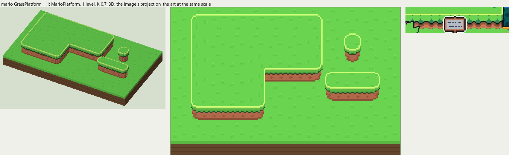
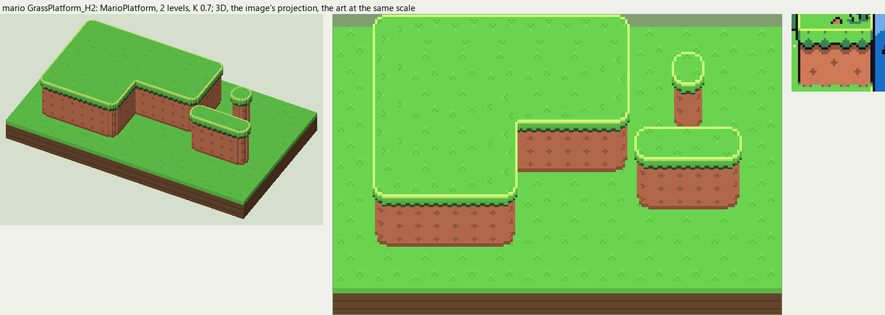
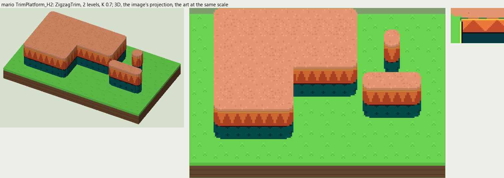

# mario terrain

2026-11-03/04: **3 styles, 147 complete VOX files**, the ground shapes of [mario.jpg](../../../mario.jpg), kit pieces on VCOM's grid in Base and the six variations. The files are in this image's folder, `Mario_<Style>_<Piece>[_<Treatment>].vox`. How a piece is made, placed, painted and checked: the [collection's README](../../terrain/README.md); every file: [FILES.md](../../terrain/FILES.md).

## GrassPlatform_H1

**MarioPlatform**, 1 level (16 voxels from its lower ground's top to its own): Paper Mario's raised ground: a flat top with a pale rim line, a fringe of grass tongues over warm soil marked with small crosses.

- **As drawn:** The low raised platform in the middle of the field and the field's own front edge: a face of 11 voxels drawn (rows 180-212 at x 420-460), 1 level.
- **Scale:** 48 of the image's pixels a tile, K 0.7; measured in the crop x 380-640, y 160-225 (beside the voxels above, at one scale).
- **Ground:** on top `Mario_Ground_Meadow`, below `Mario_Ground_Meadow`.
- **Colours:** rim_light #cdff78, fringe #61c94f, fringe_dark #226034, soil_shadow #643829, soil #ce7a57, soil_mark #ab6243, soil_dark #a05c3e, fill #be6e4e.
- **Pieces:** Fill, Straight, OuterCorner, InnerCorner, Ridge, RidgeEnd, Pillar, each in seven treatments: [every piece](previews/GrassPlatform_H1_pieces.png), [the seven treatments](previews/GrassPlatform_H1_treatments.png).

## GrassPlatform_H2

**MarioPlatform**, 2 levels (32 voxels from its lower ground's top to its own): Paper Mario's raised ground: a flat top with a pale rim line, a fringe of grass tongues over warm soil marked with small crosses.

- **As drawn:** The tall block at the top right: a face of 23 voxels drawn (rows 72-139 at x 560-600), 2 levels.
- **Scale:** 48 of the image's pixels a tile, K 0.7; measured in the crop x 520-640, y 50-150 (beside the voxels above, at one scale).
- **Ground:** on top `Mario_Ground_Meadow`, below `Mario_Ground_Meadow`.
- **Colours:** rim_light #cdff78, fringe #61c94f, fringe_dark #226034, soil_shadow #643829, soil #ce7a57, soil_mark #ab6243, soil_dark #a05c3e, fill #be6e4e.
- **Pieces:** Fill, Straight, OuterCorner, InnerCorner, Ridge, RidgeEnd, Pillar, each in seven treatments: [every piece](previews/GrassPlatform_H2_pieces.png), [the seven treatments](previews/GrassPlatform_H2_treatments.png).

## TrimPlatform_H2

**ZigzagTrim**, 2 levels (32 voxels from its lower ground's top to its own): Paper Mario's trimmed side: a band of orange with dark red triangles over a dark teal wall.

- **As drawn:** The peach path's edge at the right: a band of orange triangles 10 voxels drawn (rows 285-314) over a dark teal wall going on below the frame, 2 levels.
- **Scale:** 48 of the image's pixels a tile, K 0.7; measured in the crop x 600-720, y 260-340 (beside the voxels above, at one scale).
- **Ground:** on top `Mario_Ground_PeachDirt`, below `Mario_Ground_Meadow`.
- **Colours:** trim_light #f3983e, trim #ed7a3b, trim_dark #c54d29, trim_line #3c0e08, teal #085757, teal_dark #043940, fill #085757.
- **Pieces:** Fill, Straight, OuterCorner, InnerCorner, Ridge, RidgeEnd, Pillar, each in seven treatments: [every piece](previews/TrimPlatform_H2_pieces.png), [the seven treatments](previews/TrimPlatform_H2_treatments.png).
