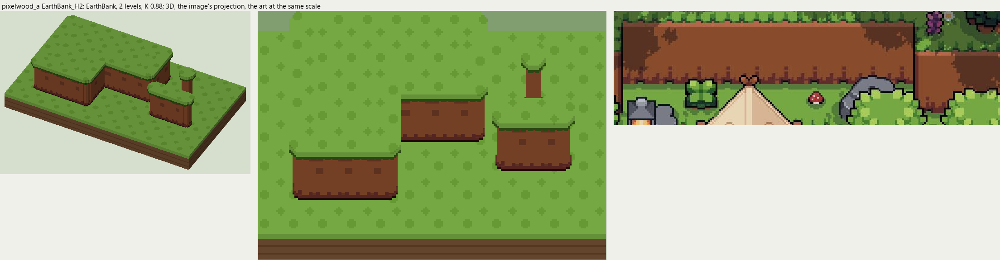

# pixelwood_a terrain

2026-11-03/04: **1 style, 49 complete VOX files**, the ground shapes of [pixelwood_a.jpg](../../../pixelwood_a.jpg), kit pieces on VCOM's grid in Base and the six variations. The files are in this image's folder, `PixelwoodA_<Style>_<Piece>[_<Treatment>].vox`. How a piece is made, placed, painted and checked: the [collection's README](../../terrain/README.md); every file: [FILES.md](../../terrain/FILES.md).

## EarthBank_H2

**EarthBank**, 2 levels (32 voxels from its lower ground's top to its own): a near-flat earth wall, a light band under the scalloped grass rim, darker blotches, a jagged dark foot.

- **As drawn:** The raised earth banks behind the camp: faces 34 art px from the rim to the foot (y 90-192 at x 300 and 450, 3x), 2 levels.
- **Scale:** 48 of the image's pixels a tile, K 0.88; measured in the crop x 80-720, y 70-260 (beside the voxels above, at one scale).
- **Ground:** on top `PixelwoodA_Ground_Meadow`, below `PixelwoodA_Ground_Meadow`.
- **Colours:** grass_edge #305315, bank_light #b36546, bank #884b2c, bank_dark #6c3a25, bank_foot #612b26, bank_line #280c0a, fill #784228.
- **Pieces:** Fill, Straight, OuterCorner, InnerCorner, Ridge, RidgeEnd, Pillar, each in seven treatments: [every piece](previews/EarthBank_H2_pieces.png), [the seven treatments](previews/EarthBank_H2_treatments.png).
