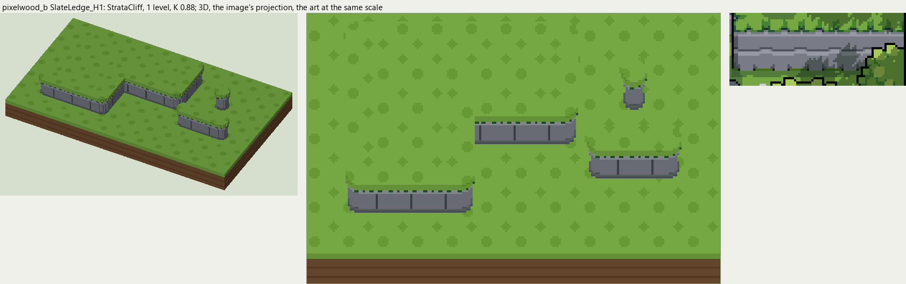

# pixelwood_b terrain

2026-11-03/04: **1 style, 49 complete VOX files**, the ground shapes of [pixelwood_b.gif](../../../pixelwood_b.gif), kit pieces on VCOM's grid in Base and the six variations. The files are in this image's folder, `PixelwoodB_<Style>_<Piece>[_<Treatment>].vox`. How a piece is made, placed, painted and checked: the [collection's README](../../terrain/README.md); every file: [FILES.md](../../terrain/FILES.md).

## SlateLedge_H1

**StrataCliff**, 1 level (16 voxels from its lower ground's top to its own): horizontal beds, each top edge standing out and lit, its foot tucked in and dark, joints staggered bed to bed.

- **As drawn:** The gray slate ledges between the grass terraces: two courses with lit top edges, 17 art px under a 3 px grass rim (y 475-557 at x 960 and 1040, 5x), 1 level.
- **Scale:** 80 of the image's pixels a tile, K 0.88; measured in the crop x 800-1210, y 430-600 (beside the voxels above, at one scale).
- **Ground:** on top `PixelwoodA_Ground_Meadow`, below `PixelwoodA_Ground_Meadow`.
- **Colours:** grass_edge #25562e, band #797c87, band_alt #71757f, band_light #9699a4, band_dark #555c5f, joint #43484e, fill #6e717b.
- **Pieces:** Fill, Straight, OuterCorner, InnerCorner, Ridge, RidgeEnd, Pillar, each in seven treatments: [every piece](previews/SlateLedge_H1_pieces.png), [the seven treatments](previews/SlateLedge_H1_treatments.png).
