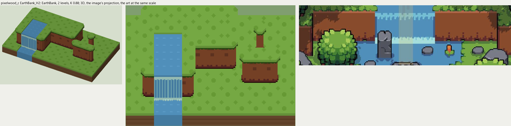

# pixelwood_c terrain

2026-11-03/04: **1 style, 63 complete VOX files**, the ground shapes of [pixelwood_c.jpg](../../../pixelwood_c.jpg), kit pieces on VCOM's grid in Base and the six variations. The files are in this image's folder, `PixelwoodC_<Style>_<Piece>[_<Treatment>].vox`. How a piece is made, placed, painted and checked: the [collection's README](../../terrain/README.md); every file: [FILES.md](../../terrain/FILES.md).

## EarthBank_H2

**EarthBank**, 2 levels (32 voxels from its lower ground's top to its own): a near-flat earth wall, a light band under the scalloped grass rim, darker blotches, a jagged dark foot.

- **As drawn:** The earth banks either side of the waterfall: faces 34 art px from the rim to the foot (y 140-245 at x 560 and 640, 3x), 2 levels; the river pours over them in a sheet with a foam lip and foams at the foot.
- **Scale:** 49 of the image's pixels a tile, K 0.88; measured in the crop x 0-736, y 120-330 (beside the voxels above, at one scale).
- **Ground:** on top `PixelwoodA_Ground_Meadow`, below `PixelwoodA_Ground_Meadow`; the Fall's top `PixelwoodC_Ground_River`; the Channel's top `PixelwoodC_Ground_River`; the Fall's pool `PixelwoodC_Ground_River`.
- **Colours:** grass_edge #305315, bank_light #b36546, bank #884b2c, bank_dark #6c3a25, bank_foot #612b26, bank_line #280c0a, fill #784228, water #508fba, water_light #81bdca, foam #aed9ce.
- **Pieces:** Fill, Straight, OuterCorner, InnerCorner, Ridge, RidgeEnd, Pillar and Fall, Channel, each in seven treatments: [every piece](previews/EarthBank_H2_pieces.png), [the seven treatments](previews/EarthBank_H2_treatments.png).
