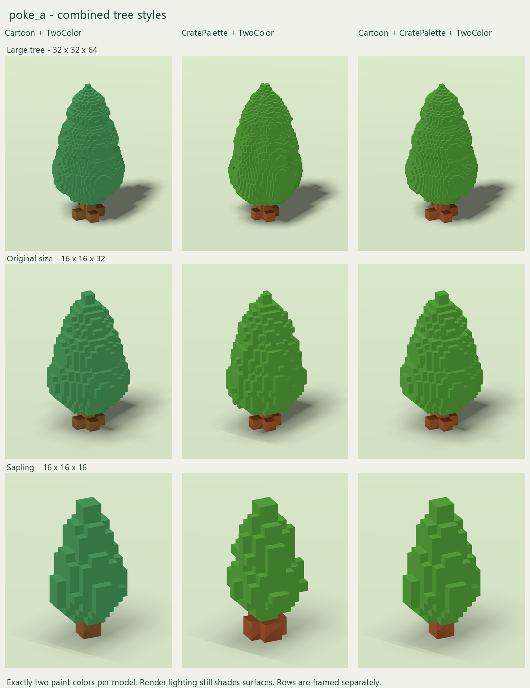

# Combined tree variations

Reusable definitions for all future images and model types are in [the shared variation specification](../../knowledge/VARIATIONS.md). This document records the poke_a implementation and its specific choices.

Nine new complete models: each requested combination for the large tree, original-size tree and sapling. All previous models remain unchanged. No cell files are generated.

| Tree / canvas | Cartoon + TwoColor | CratePalette + TwoColor | Cartoon + CratePalette + TwoColor |
| --- | --- | --- | --- |
| Large / 32 x 32 x 64 | [VOX](PokeA_ForestTree_Large_Cartoon_TwoColor.vox) | [VOX](PokeA_ForestTree_Large_CratePalette_TwoColor.vox) | [VOX](PokeA_ForestTree_Large_Cartoon_CratePalette_TwoColor.vox) |
| Original size / 16 x 16 x 32 | [VOX](PokeA_ForestTree_Cartoon_TwoColor.vox) | [VOX](PokeA_ForestTree_CratePalette_TwoColor.vox) | [VOX](PokeA_ForestTree_Cartoon_CratePalette_TwoColor.vox) |
| Sapling / 16 x 16 x 16 | [VOX](PokeA_Sapling_Cartoon_TwoColor.vox) | [VOX](PokeA_Sapling_CratePalette_TwoColor.vox) | [VOX](PokeA_Sapling_Cartoon_CratePalette_TwoColor.vox) |

## What each mixture keeps

- **Cartoon + TwoColor:** exactly the existing Cartoon geometry, reduced to one green (#3D7B4B) and one brown (#74502D). Exact quarter-turn symmetry is retained in geometry and painted color.

- **CratePalette + TwoColor:** exactly the original asymmetric geometry, with one green and one brown from the existing crate palette: slot 243, RGB (70,130,50), #468232; and slot 179, RGB (136,75,43), #884B2B. The brown is one the crate itself uses. These are the nearest matching palette colors to the earlier TwoColor treatment within the established green and bark groups.

- **Cartoon + CratePalette + TwoColor:** the existing Cartoon geometry and the same two crate-palette colors above. Exact quarter-turn symmetry is retained.

All foliage, roots, trunk and hidden wood cores follow their original material classification. There is no painted shading or color variation within either material. Preview lighting still creates highlights and shadows. CratePalette combinations retain the entire original RGBA palette for compatibility, but exactly two entries are used by voxels; unused colors do not appear on the tree.

## Verification

All nine serialized VOX files passed structural inspection without warnings. Their dimensions and coordinate sets exactly match their chosen geometry source. Each is face-connected and uses exactly two RGBA colors. Cartoon combinations pass exact quarter-turn equality including palette indices. CratePalette combinations retain the byte-identical reference palette. All twelve previously existing models retain their original hashes.

Godot 4.7 imported and rendered all nine complete files through the copied VCOM importer; raw and flattened voxel counts agree and exactly two indices are used in every file. The final error log is empty. The comparison sheet was visually reviewed. No combat/destruction behavior or game integration was changed or playtested. Existing runtime size constraints remain documented in README.md; complete models are the deliverables.

## Reproduction and records

Run `python output/poke_a/generate_mixtures.py` from the workspace root. It reads the existing original/Cartoon trees and the local crate-palette snapshot, writes only these nine mixed variants and their manifest, and verifies that previous models are unchanged. Preserve hand edits under new names before regenerating.

For previews, use `qa/preview_mixtures.gd` with the Godot command pattern in `qa/README.md`, then run `python output/poke_a/make_mixture_sheet.py`. Success in the render log is `MIXTURES_QA_PASS`.

Records: `mixtures-manifest.json`, `mixtures-vox-audit.json`, and `mixtures-godot-validation.json`. Render images are saved under `previews/` using the corresponding asset names. Comparison rows are framed separately; columns within a row use identical lighting and camera settings.

