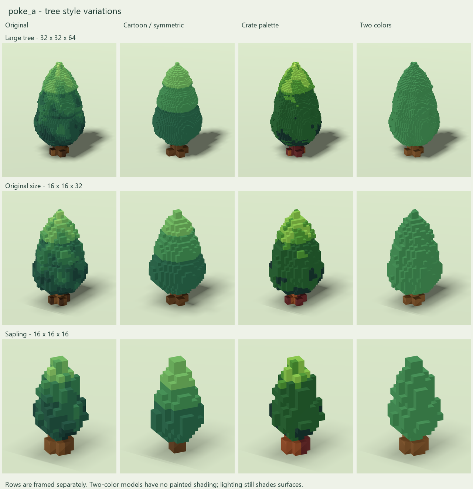

# Tree variations

Reusable definitions for all future images and model types are in [the shared variation specification](../../knowledge/VARIATIONS.md). This document records the poke_a implementation and its specific choices.

Nine new complete VOX models: three independent treatments of each existing tree. The originals are unchanged. All files remain directly in `output/poke_a/`; no cell pieces are generated.



| Tree / canvas | Cartoon | Existing crate palette | Two colors |
| --- | --- | --- | --- |
| Large, 32 x 32 x 64 | [VOX](PokeA_ForestTree_Large_Cartoon.vox) | [VOX](PokeA_ForestTree_Large_CratePalette.vox) | [VOX](PokeA_ForestTree_Large_TwoColor.vox) |
| Original size, 16 x 16 x 32 | [VOX](PokeA_ForestTree_Cartoon.vox) | [VOX](PokeA_ForestTree_CratePalette.vox) | [VOX](PokeA_ForestTree_TwoColor.vox) |
| Sapling, 16 x 16 x 16 | [VOX](PokeA_Sapling_Cartoon.vox) | [VOX](PokeA_Sapling_CratePalette.vox) | [VOX](PokeA_Sapling_TwoColor.vox) |

## Treatments

**Cartoon:** a newly sculpted, rounder three-tier crown, centered tip, balanced trunk and four matching roots. Geometry and palette indices are exactly invariant under 90-degree rotations around the trunk, and mirror symmetric. Every cardinal direction therefore has the same shape and painted colors. Three broad greenery colors and one bark color replace irregular painted leaf patches. This is a shape-and-color treatment, not just recoloring the asymmetric original. Canvases and occupied heights match their original counterparts.

**CratePalette:** the original voxel positions are preserved exactly. RGBA is a byte-for-byte copy of `VoxelXCOM/MagicaVoxel/Blocks/BrightCrate1.vox`'s palette. Foliage is mapped to its existing green slots 241-246; bark is mapped to brown slots 178-180, which the crate itself uses. Nearest RGB matches within those groups preserve the original light/dark color pattern without introducing any new color. The crate does not itself use green voxels, but those greens are in its saved palette. The local `crate-palette.json` snapshot preserves provenance and the exact palette for regeneration.

**TwoColor:** the original geometry is preserved exactly. Every leaf voxel, including hidden interior foliage, uses green **RGB (61,123,75)** / **#3D7B4B**. Every trunk, root and hidden wood-core voxel uses brown **RGB (116,80,45)** / **#74502D**. Only palette indices 1 and 2 are occupied. Unused palette entries repeat green, so there are no extra paint colors hidden elsewhere in the palette. No gradients, mottling or painted highlights remain. Physical illumination and shadows still shade surfaces in Godot/MagicaVoxel; the files remain ordinary diffuse materials so they can use the game's lighting normally.

These are separate alternatives, not cumulative combinations. For example, TwoColor keeps the original asymmetric geometry; it is not also the Cartoon treatment.

## Validation

- All nine saved binaries pass the structural auditor with no warnings.

- Every model remains one face-connected component and fits its original canvas.

- Serialized Cartoon geometry **and color indices** pass exact quarter-turn equality checks.

- CratePalette RGBA hash matches the reference palette: `b1a4e811c89d143b006c0a421443dd2e1b3b9da0b6588b176c4d072b67c279c2`.

- All six recolored models preserve their source coordinate sets exactly. TwoColor uses exactly two RGBA colors and preserves the wood/foliage classification voxel by voxel.

- All three originals retain their recorded SHA-256 hashes.

- Godot 4.7 imported and rendered all nine variants plus the three originals using the copied VCOM whole-model importer. Flattened counts match the source counts; the final error log is empty.

- Visually reviewed the complete comparison under consistent camera/lighting within each row. Rows are framed separately for legibility, so their displayed sizes are not a cross-row scale comparison.

The current game integration limits described in README.md still apply, especially the 62-voxel side limit of the separate VoxelModel mesher for the 64-tall asset. No game resources, gameplay rules or destruction behavior were changed or playtested.

## Reproduction

From the workspace root:

```powershell
python output/poke_a/generate_variations.py

```

This reads the three existing complete trees and local palette snapshot, then overwrites only the nine named variants and `variations-manifest.json`. Preserve manual edits under new names before regenerating. The generator does not run the original generators or write their files.

For previews, run the existing standalone Godot harness with `--script preview_variations.gd` (see `qa/README.md` for the command pattern), then:

```powershell
python output/poke_a/make_variation_sheet.py

```

Records: `variations-manifest.json`, `variations-vox-audit.json`, `variations-godot-validation.json`. Per-model renders are in `previews/` with matching asset stems.

## Combined treatments

See [combined styles](MIXTURES.md) for the subsequently requested two-color mixtures of these treatments.

