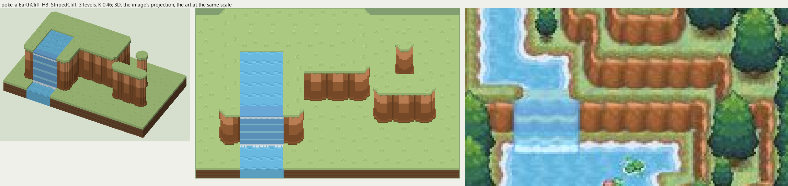

# poke_a terrain

2026-11-03/04: **1 style, 63 complete VOX files**, the ground shapes of [poke_a.jpg](../../../poke_a.jpg), kit pieces on VCOM's grid in Base and the six variations. The files are in this image's folder, `PokeA_<Style>_<Piece>[_<Treatment>].vox`. How a piece is made, placed, painted and checked: the [collection's README](../../terrain/README.md); every file: [FILES.md](../../terrain/FILES.md).

## EarthCliff_H3

**StripedCliff**, 3 levels (48 voxels from its lower ground's top to its own): the earth cliff of rounded columns most of the Pokemon maps draw: lit along the top, shaded toward the foot, a dark crease between columns, the top's grass hanging over in a jagged edge.

- **As drawn:** The orange ledges of the forest paths: faces 17 px drawn from the rim to the foot (y 223-239 at x 104 and 110), 22 voxels at 12.25 px a tile, 3 levels at 0.46; a rounded column a tile, a crease every 12 px (x 95, 107, 119, 131 at y 232). The falls (x 47-82) show light bands across the sheet.
- **Scale:** 12.25 of the image's pixels a tile, K 0.46; measured in the crop x 20-200, y 170-270 (beside the voxels above, at one scale).
- **Ground:** on top `PokeA_Ground_Meadow`, below `PokeA_Ground_Meadow`; the Fall's top `PokeA_Ground_River`; the Channel's top `PokeA_Ground_River`; the Fall's pool `PokeA_Ground_River`.
- **Colours:** face_light #d69261, face #a4683c, face_dark #89562f, face_line #704626, face_foot #73552d, fill #965e36, grass_edge #8d9355, water #69a7d7, water_light #8dcce2, foam #d8e8f0.
- **Pieces:** Fill, Straight, OuterCorner, InnerCorner, Ridge, RidgeEnd, Pillar and Fall, Channel, each in seven treatments: [every piece](previews/EarthCliff_H3_pieces.png), [the seven treatments](previews/EarthCliff_H3_treatments.png).
