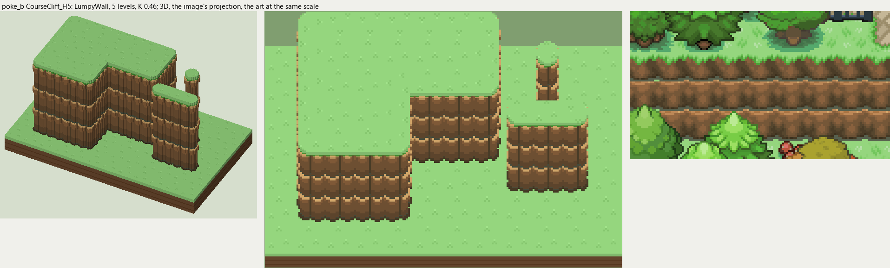

# poke_b terrain

2026-11-03/04: **1 style, 49 complete VOX files**, the ground shapes of [poke_b.png](../../../poke_b.png), kit pieces on VCOM's grid in Base and the six variations. The files are in this image's folder, `PokeB_<Style>_<Piece>[_<Treatment>].vox`. How a piece is made, placed, painted and checked: the [collection's README](../../terrain/README.md); every file: [FILES.md](../../terrain/FILES.md).

## CourseCliff_H5

**LumpyWall**, 5 levels (80 voxels from its lower ground's top to its own): rock or earth in rounded lumps, in one or more courses (each lit along its top, dark under it), topped by the grass hanging over or by a rim of the rock itself.

- **As drawn:** The three-course cliffs round the plaza and down the west side: 40 px drawn from under the grass rim to the foot (y 116-155 at x 20 and 26), 87 voxels, 5 levels; each course 16 px, lit along its top and dark at its foot over a gray-green gap, two rounded lumps a tile in line course over course (y 132).
- **Scale:** 16 of the image's pixels a tile, K 0.46; measured in the crop x 0-140, y 90-170 (beside the voxels above, at one scale).
- **Ground:** on top `PokeB_Ground_Meadow`, below `PokeB_Ground_Meadow`.
- **Colours:** face_top #d1a569, face_light #946841, face #7f5c3b, face_dark #6b5034, crevice #56462e, course_gap #505846, foot #463925, fill #755738, grass_edge #4ea038.
- **Pieces:** Fill, Straight, OuterCorner, InnerCorner, Ridge, RidgeEnd, Pillar, each in seven treatments: [every piece](previews/CourseCliff_H5_pieces.png), [the seven treatments](previews/CourseCliff_H5_treatments.png).
