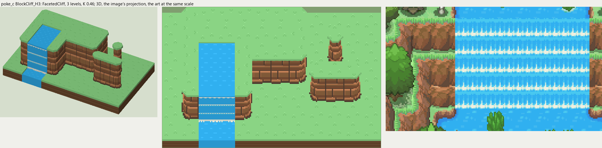

# poke_c terrain

2026-11-03/04: **1 style, 63 complete VOX files**, the ground shapes of [poke_c.png](../../../poke_c.png), kit pieces on VCOM's grid in Base and the six variations. The files are in this image's folder, `PokeC_<Style>_<Piece>[_<Treatment>].vox`. How a piece is made, placed, painted and checked: the [collection's README](../../terrain/README.md); every file: [FILES.md](../../terrain/FILES.md).

## BlockCliff_H3

**FacetedCliff**, 3 levels (48 voxels from its lower ground's top to its own): angular blocks in rows, each standing out its own amount, lit along its top and left edge, a dark crease below and to the right.

- **As drawn:** The red-brown block cliffs of the gorge and its terraces: each face 23 px drawn from the rim to the foot (y 166-188 and 198-220 at x 330), 50 voxels, 3 levels, a narrow grass ledge (8 px) between terraces; blocks 5-10 px across in rows of 4-11, lit along the top, dark below. The cascades beside them (x 340-456) step down in white foam lines every 16 px.
- **Scale:** 16 of the image's pixels a tile, K 0.46; measured in the crop x 280-470, y 150-260 (beside the voxels above, at one scale).
- **Ground:** on top `PokeC_Ground_Meadow`, below `PokeC_Ground_Meadow`; the Fall's top `PokeC_Ground_River`; the Channel's top `PokeC_Ground_River`; the Fall's pool `PokeC_Ground_River`.
- **Colours:** block_top #c88458, block_light #aa704a, block #946842, block_low #835539, crease #5e4738, foot #523c31, fill #845c3c, grass_edge #709e6a, water #30b0f0, water_light #48c8f0, foam #ecf0e2.
- **Pieces:** Fill, Straight, OuterCorner, InnerCorner, Ridge, RidgeEnd, Pillar and Fall, Channel, each in seven treatments: [every piece](previews/BlockCliff_H3_pieces.png), [the seven treatments](previews/BlockCliff_H3_treatments.png).
