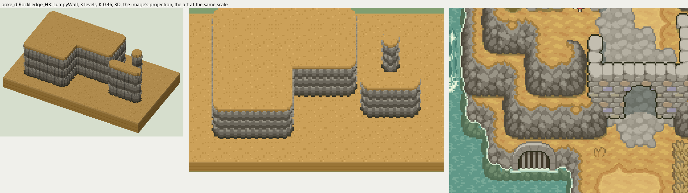
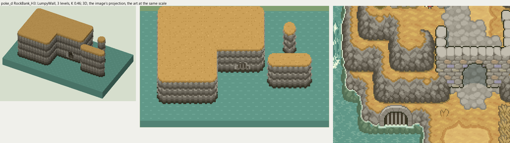
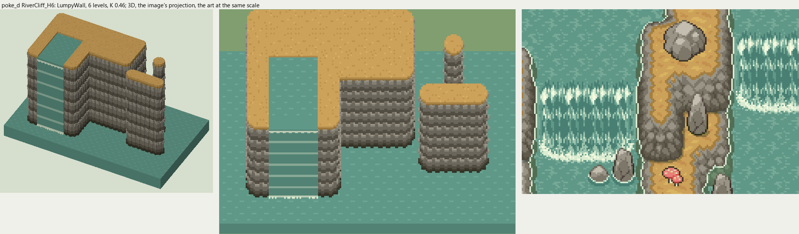
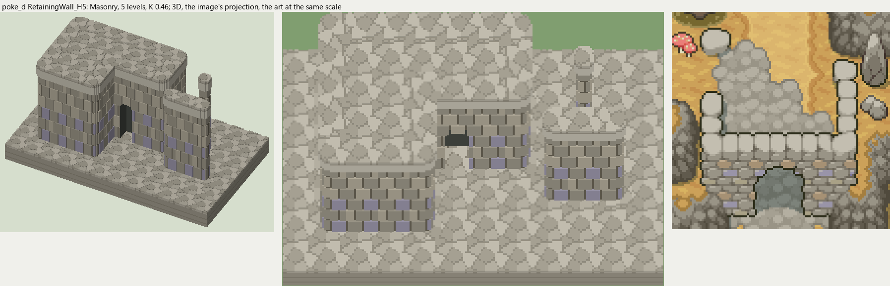

# poke_d terrain

2026-11-03/04: **4 styles, 224 complete VOX files**, the ground shapes of [poke_d.png](../../../poke_d.png), kit pieces on VCOM's grid in Base and the six variations. The files are in this image's folder, `PokeD_<Style>_<Piece>[_<Treatment>].vox`. How a piece is made, placed, painted and checked: the [collection's README](../../terrain/README.md); every file: [FILES.md](../../terrain/FILES.md).

## RockLedge_H3

**LumpyWall**, 3 levels (48 voxels from its lower ground's top to its own): rock or earth in rounded lumps, in one or more courses (each lit along its top, dark under it), topped by the grass hanging over or by a rim of the rock itself.

- **As drawn:** The gray crag ledges between the ochre terraces: 21 px drawn from the ochre rim to the dark foot (y 458-478 at x 500), 46 voxels, 3 levels; small rounded chunks in three staggered rows, lit on top, dark below.
- **Scale:** 16 of the image's pixels a tile, K 0.46; measured in the crop x 440-620, y 380-520 (beside the voxels above, at one scale).
- **Ground:** on top `PokeD_Ground_OchreFloor`, below `PokeD_Ground_OchreFloor`.
- **Colours:** grass_edge #a47e3f, face_light #999486, face #7d776a, face_dark #605a4d, crevice #504a3d, foot #3c3a2c, fill #6e685c.
- **Pieces:** Fill, Straight, OuterCorner, InnerCorner, Ridge, RidgeEnd, Pillar, each in seven treatments: [every piece](previews/RockLedge_H3_pieces.png), [the seven treatments](previews/RockLedge_H3_treatments.png).

## RockBank_H3

**LumpyWall**, 3 levels (48 voxels from its lower ground's top to its own): rock or earth in rounded lumps, in one or more courses (each lit along its top, dark under it), topped by the grass hanging over or by a rim of the rock itself.

- **As drawn:** The same crag where the ochre ground meets the river: 3 levels down to the water. Its Drain is the arched, barred outfall in the east bank (x 492-516, y 488-502): a ring of pale dressed stone, dark bars.
- **Scale:** 16 of the image's pixels a tile, K 0.46; measured in the crop x 440-620, y 380-520 (beside the voxels above, at one scale).
- **Ground:** on top `PokeD_Ground_OchreFloor`, below `PokeD_Ground_River`.
- **Colours:** grass_edge #a47e3f, face_light #999486, face #7d776a, face_dark #605a4d, crevice #504a3d, foot #3c3a2c, fill #6e685c, arch #aaa496, bars #403828, drain_dark #1e1c16.
- **Pieces:** Fill, Straight, OuterCorner, InnerCorner, Ridge, RidgeEnd, Pillar and Drain, each in seven treatments: [every piece](previews/RockBank_H3_pieces.png), [the seven treatments](previews/RockBank_H3_treatments.png).

## RiverCliff_H6

**LumpyWall**, 6 levels (96 voxels from its lower ground's top to its own): rock or earth in rounded lumps, in one or more courses (each lit along its top, dark under it), topped by the grass hanging over or by a rim of the rock itself.

- **As drawn:** The tall crag walls where the river falls (the islets between the falls and the banks beside them): the falls drop 47 px drawn from the foam lip to the foot (y 430-477 at x 190), 102 voxels, 6 levels; the green sheet shows light bands across it.
- **Scale:** 16 of the image's pixels a tile, K 0.46; measured in the crop x 150-330, y 380-500 (beside the voxels above, at one scale).
- **Ground:** on top `PokeD_Ground_OchreFloor`, below `PokeD_Ground_River`; the Fall's top `PokeD_Ground_River`; the Channel's top `PokeD_Ground_River`; the Fall's pool `PokeD_Ground_River`.
- **Colours:** grass_edge #a47e3f, face_light #999486, face #7d776a, face_dark #605a4d, crevice #504a3d, foot #3c3a2c, fill #6e685c, water #609888, water_light #9ec4ae, foam #daecd1.
- **Pieces:** Fill, Straight, OuterCorner, InnerCorner, Ridge, RidgeEnd, Pillar and Fall, Channel, each in seven treatments: [every piece](previews/RiverCliff_H6_pieces.png), [the seven treatments](previews/RiverCliff_H6_treatments.png).

## RetainingWall_H5

**Masonry**, 5 levels (80 voxels from its lower ground's top to its own): a built wall: staggered courses of dressed stone, a few of other stones among them, a coping.

- **As drawn:** The masonry wall under the cobbled terrace east of the river: 40 px drawn from the coping to the foot (y 422-461 at x 560 and 600), 87 voxels, 5 levels; a coping of big pale blocks, courses of gray stones with purple-gray and tan ones among them. Its Archway is the arched passage through it (y 440-462).
- **Scale:** 16 of the image's pixels a tile, K 0.46; measured in the crop x 530-640, y 360-470 (beside the voxels above, at one scale).
- **Ground:** on top `PokeD_Ground_Cobblestone`, below `PokeD_Ground_Cobblestone`.
- **Colours:** stone #999486, stone_light #b0a998, stone_alt #9994a8, stone_tan #a69174, joint #6a6457, coping #c3beb0, fill #8c8678, cave_dark #464a44.
- **Pieces:** Fill, Straight, OuterCorner, InnerCorner, Ridge, RidgeEnd, Pillar and Archway, each in seven treatments: [every piece](previews/RetainingWall_H5_pieces.png), [the seven treatments](previews/RetainingWall_H5_treatments.png).
