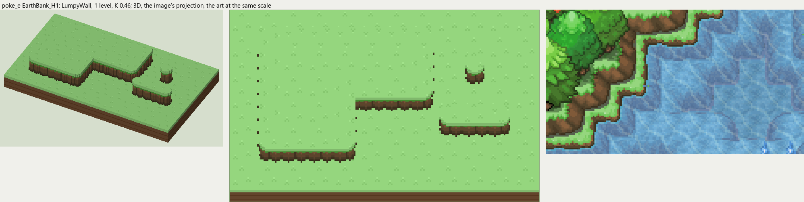
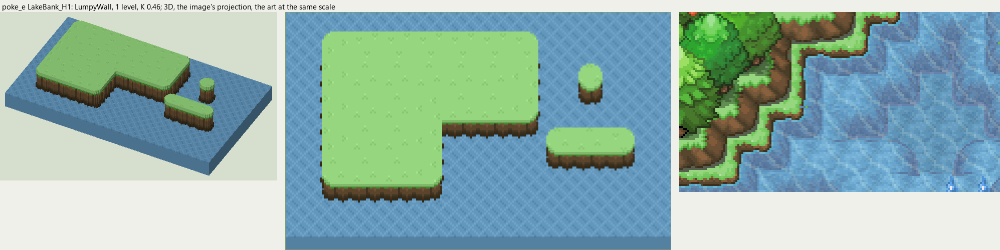

# poke_e terrain

2026-11-03/04: **2 styles, 98 complete VOX files**, the ground shapes of [poke_e.png](../../../poke_e.png), kit pieces on VCOM's grid in Base and the six variations. The files are in this image's folder, `PokeE_<Style>_<Piece>[_<Treatment>].vox`. How a piece is made, placed, painted and checked: the [collection's README](../../terrain/README.md); every file: [FILES.md](../../terrain/FILES.md).

## EarthBank_H1

**LumpyWall**, 1 level (16 voxels from its lower ground's top to its own): rock or earth in rounded lumps, in one or more courses (each lit along its top, dark under it), topped by the grass hanging over or by a rim of the rock itself.

- **As drawn:** The low earth banks along the forest edges: 9 px drawn from the rim to the foot (y 84-92 at x 110 and 116), 20 voxels, 1 level; poke_b's course in one row.
- **Scale:** 16 of the image's pixels a tile, K 0.46; measured in the crop x 40-200, y 80-170 (beside the voxels above, at one scale).
- **Ground:** on top `PokeE_Ground_Meadow`, below `PokeE_Ground_Meadow`.
- **Colours:** face_top #89613e, face_light #76583a, face #6b5034, face_dark #56462e, crevice #4a3c27, course_gap #565f4d, foot #3c301d, fill #6b5034, grass_edge #4ea038.
- **Pieces:** Fill, Straight, OuterCorner, InnerCorner, Ridge, RidgeEnd, Pillar, each in seven treatments: [every piece](previews/EarthBank_H1_pieces.png), [the seven treatments](previews/EarthBank_H1_treatments.png).

## LakeBank_H1

**LumpyWall**, 1 level (16 voxels from its lower ground's top to its own): rock or earth in rounded lumps, in one or more courses (each lit along its top, dark under it), topped by the grass hanging over or by a rim of the rock itself.

- **As drawn:** The same bank where the meadow drops into the lakes, 1 level down to the water.
- **Scale:** 16 of the image's pixels a tile, K 0.46; measured in the crop x 40-200, y 80-170 (beside the voxels above, at one scale).
- **Ground:** on top `PokeE_Ground_Meadow`, below `PokeE_Ground_Lake`.
- **Colours:** face_top #89613e, face_light #76583a, face #6b5034, face_dark #56462e, crevice #4a3c27, course_gap #565f4d, foot #3c301d, fill #6b5034, grass_edge #4ea038.
- **Pieces:** Fill, Straight, OuterCorner, InnerCorner, Ridge, RidgeEnd, Pillar, each in seven treatments: [every piece](previews/LakeBank_H1_pieces.png), [the seven treatments](previews/LakeBank_H1_treatments.png).
