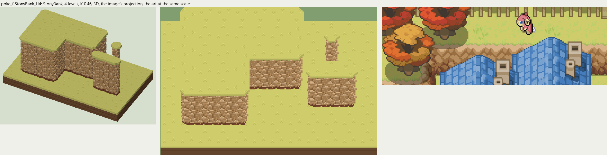

# poke_f terrain

2026-11-03/04: **1 style, 49 complete VOX files**, the ground shapes of [poke_f.png](../../../poke_f.png), kit pieces on VCOM's grid in Base and the six variations. The files are in this image's folder, `PokeF_<Style>_<Piece>[_<Treatment>].vox`. How a piece is made, placed, painted and checked: the [collection's README](../../terrain/README.md); every file: [FILES.md](../../terrain/FILES.md).

## StonyBank_H4

**StonyBank**, 4 levels (64 voxels from its lower ground's top to its own): a bank faced with rounded stones of several sizes, lit along their tops, dark seams, a dark foot.

- **As drawn:** The pale stony banks of the terraces round the town: 28 px drawn from the rim to the foot (y 83-110 at x 190), 61 voxels, 4 levels; rounded tan stones in rows, the top row lit, a dark band at the foot.
- **Scale:** 16 of the image's pixels a tile, K 0.46; measured in the crop x 0-200, y 50-120 (beside the voxels above, at one scale).
- **Ground:** on top `PokeF_Ground_DryMeadow`, below `PokeF_Ground_DryMeadow`.
- **Colours:** stone_light #d7b387, stone #b68d5f, seam #996f41, foot #79472f, fill #a0784c, grass_edge #b0c163.
- **Pieces:** Fill, Straight, OuterCorner, InnerCorner, Ridge, RidgeEnd, Pillar, each in seven treatments: [every piece](previews/StonyBank_H4_pieces.png), [the seven treatments](previews/StonyBank_H4_treatments.png).
