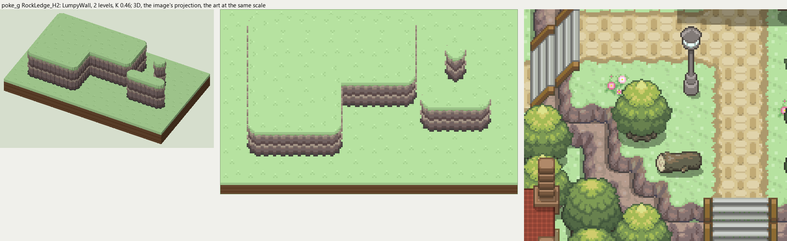

# poke_g terrain

2026-11-03/04: **1 style, 49 complete VOX files**, the ground shapes of [poke_g.png](../../../poke_g.png), kit pieces on VCOM's grid in Base and the six variations. The files are in this image's folder, `PokeG_<Style>_<Piece>[_<Treatment>].vox`. How a piece is made, placed, painted and checked: the [collection's README](../../terrain/README.md); every file: [FILES.md](../../terrain/FILES.md).

## RockLedge_H2

**LumpyWall**, 2 levels (32 voxels from its lower ground's top to its own): rock or earth in rounded lumps, in one or more courses (each lit along its top, dark under it), topped by the grass hanging over or by a rim of the rock itself.

- **As drawn:** The mauve-gray rock ledge running diagonally down the east side to the stairs: 12 px drawn from the grass rim to the dark foot where it runs straight (y 212-223 at x 340), 26 voxels, 2 levels; rounded chunks in two rows. The pond's brown rim is only 3 px (under half a level): the shore tiles of the ground collection cover it.
- **Scale:** 16 of the image's pixels a tile, K 0.46; measured in the crop x 300-470, y 150-300 (beside the voxels above, at one scale).
- **Ground:** on top `PokeG_Ground_Meadow`, below `PokeG_Ground_Meadow`.
- **Colours:** face_top #a69788, face_light #9c7f77, face #847270, face_dark #6a5755, crevice #504648, foot #474241, fill #786664, grass_edge #96c880.
- **Pieces:** Fill, Straight, OuterCorner, InnerCorner, Ridge, RidgeEnd, Pillar, each in seven treatments: [every piece](previews/RockLedge_H2_pieces.png), [the seven treatments](previews/RockLedge_H2_treatments.png).
