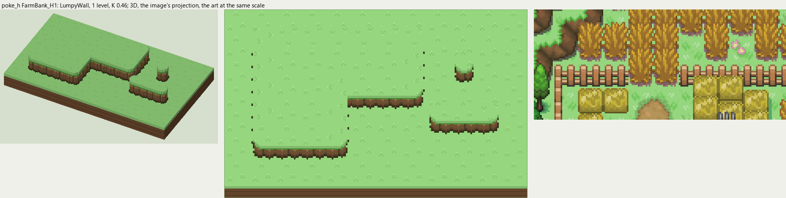
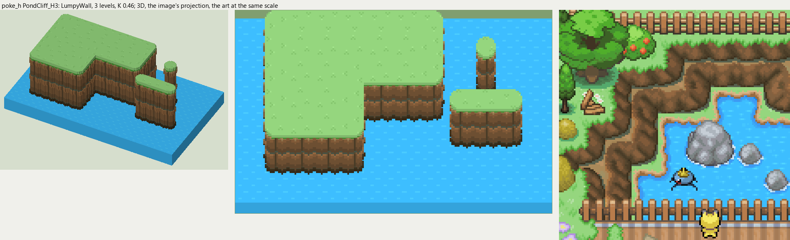

# poke_h terrain

2026-11-03/04: **2 styles, 98 complete VOX files**, the ground shapes of [poke_h.png](../../../poke_h.png), kit pieces on VCOM's grid in Base and the six variations. The files are in this image's folder, `PokeH_<Style>_<Piece>[_<Treatment>].vox`. How a piece is made, placed, painted and checked: the [collection's README](../../terrain/README.md); every file: [FILES.md](../../terrain/FILES.md).

## FarmBank_H1

**LumpyWall**, 1 level (16 voxels from its lower ground's top to its own): rock or earth in rounded lumps, in one or more courses (each lit along its top, dark under it), topped by the grass hanging over or by a rim of the rock itself.

- **As drawn:** The earth banks between the farm's terraces: 10 px drawn from the rim to the foot (y 212-221 at x 80), 22 voxels, 1 level; one course.
- **Scale:** 16 of the image's pixels a tile, K 0.46; measured in the crop x 100-260, y 190-260 (beside the voxels above, at one scale).
- **Ground:** on top `PokeH_Ground_Meadow`, below `PokeH_Ground_Meadow`.
- **Colours:** face_top #a9895a, face_light #946841, face #7f5c3b, face_dark #6b5034, crevice #56462e, course_gap #565f4d, foot #3c301d, fill #755738, grass_edge #4ea038.
- **Pieces:** Fill, Straight, OuterCorner, InnerCorner, Ridge, RidgeEnd, Pillar, each in seven treatments: [every piece](previews/FarmBank_H1_pieces.png), [the seven treatments](previews/FarmBank_H1_treatments.png).

## PondCliff_H3

**LumpyWall**, 3 levels (48 voxels from its lower ground's top to its own): rock or earth in rounded lumps, in one or more courses (each lit along its top, dark under it), topped by the grass hanging over or by a rim of the rock itself.

- **As drawn:** The cliff down to the pond in the southeast: 25 px drawn from the rim to the foot (y 342-366 at x 520 and 540), 54 voxels, 3 levels; two courses, lit along their tops.
- **Scale:** 16 of the image's pixels a tile, K 0.46; measured in the crop x 420-560, y 320-460 (beside the voxels above, at one scale).
- **Ground:** on top `PokeH_Ground_Meadow`, below `PokeH_Ground_Pond`.
- **Colours:** face_top #a9895a, face_light #946841, face #7f5c3b, face_dark #6b5034, crevice #56462e, course_gap #565f4d, foot #3c301d, fill #755738, grass_edge #4ea038.
- **Pieces:** Fill, Straight, OuterCorner, InnerCorner, Ridge, RidgeEnd, Pillar, each in seven treatments: [every piece](previews/PondCliff_H3_pieces.png), [the seven treatments](previews/PondCliff_H3_treatments.png).
