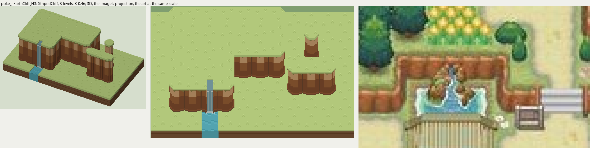

# poke_i terrain

2026-11-03/04: **1 style, 56 complete VOX files**, the ground shapes of [poke_i.jpg](../../../poke_i.jpg), kit pieces on VCOM's grid in Base and the six variations. The files are in this image's folder, `PokeI_<Style>_<Piece>[_<Treatment>].vox`. How a piece is made, placed, painted and checked: the [collection's README](../../terrain/README.md); every file: [FILES.md](../../terrain/FILES.md).

## EarthCliff_H3

**StripedCliff**, 3 levels (48 voxels from its lower ground's top to its own): the earth cliff of rounded columns most of the Pokemon maps draw: lit along the top, shaded toward the foot, a dark crease between columns, the top's grass hanging over in a jagged edge.

- **As drawn:** The orange ledges of the village terraces: 13 px drawn from the rim to the foot (y 288-300 at x 256), 22 voxels at 9.5 px a tile, 3 levels; a rounded column about a tile (creases at x 254, 266, 276 at y 293). Its NarrowFall is the spring falling down the ledge into the small pool above the bridge (x 278-290, 6 px wide).
- **Scale:** 9.5 of the image's pixels a tile, K 0.46; measured in the crop x 230-360, y 260-340 (beside the voxels above, at one scale).
- **Ground:** on top `PokeI_Ground_Meadow`, below `PokeI_Ground_Meadow`; the NarrowFall's pool `PokeI_Ground_Pond`.
- **Colours:** face_light #be9468, face #8d5931, face_dark #78472a, face_line #64422a, face_foot #6c4c32, fill #80522e, grass_edge #827842, water #6f9197, water_light #90a7a5, foam #bed0ca.
- **Pieces:** Fill, Straight, OuterCorner, InnerCorner, Ridge, RidgeEnd, Pillar and NarrowFall, each in seven treatments: [every piece](previews/EarthCliff_H3_pieces.png), [the seven treatments](previews/EarthCliff_H3_treatments.png).
