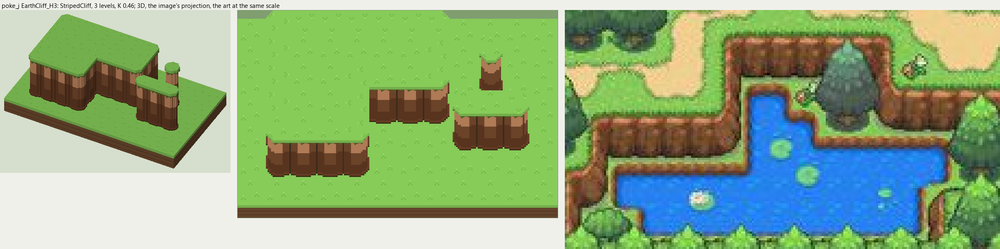
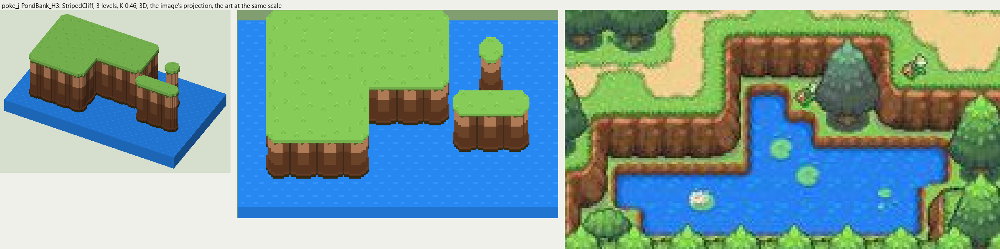

# poke_j terrain

2026-11-03/04: **2 styles, 98 complete VOX files**, the ground shapes of [poke_j.jpg](../../../poke_j.jpg), kit pieces on VCOM's grid in Base and the six variations. The files are in this image's folder, `PokeJ_<Style>_<Piece>[_<Treatment>].vox`. How a piece is made, placed, painted and checked: the [collection's README](../../terrain/README.md); every file: [FILES.md](../../terrain/FILES.md).

## EarthCliff_H3

**StripedCliff**, 3 levels (48 voxels from its lower ground's top to its own): the earth cliff of rounded columns most of the Pokemon maps draw: lit along the top, shaded toward the foot, a dark crease between columns, the top's grass hanging over in a jagged edge.

- **As drawn:** The brown ledges between the village's terraces: 18 px drawn from the rim to the dark foot (y 373-390 at x 470), 24 voxels at 12.25 px a tile, 3 levels; a rounded column a tile (creases every 12 px at y 420).
- **Scale:** 12.25 of the image's pixels a tile, K 0.46; measured in the crop x 360-560, y 360-470 (beside the voxels above, at one scale).
- **Ground:** on top `PokeJ_Ground_Meadow`, below `PokeJ_Ground_Meadow`.
- **Colours:** face_light #cc8f65, face #7c4e30, face_dark #673d25, face_line #483321, face_foot #3c3016, fill #6e462a, grass_edge #5e6e2d.
- **Pieces:** Fill, Straight, OuterCorner, InnerCorner, Ridge, RidgeEnd, Pillar, each in seven treatments: [every piece](previews/EarthCliff_H3_pieces.png), [the seven treatments](previews/EarthCliff_H3_treatments.png).

## PondBank_H3

**StripedCliff**, 3 levels (48 voxels from its lower ground's top to its own): the earth cliff of rounded columns most of the Pokemon maps draw: lit along the top, shaded toward the foot, a dark crease between columns, the top's grass hanging over in a jagged edge.

- **As drawn:** The same face where it drops to the two ponds: 19 px drawn (y 409-427 at x 400, 397-415 at x 520), 3 levels.
- **Scale:** 12.25 of the image's pixels a tile, K 0.46; measured in the crop x 360-560, y 360-470 (beside the voxels above, at one scale).
- **Ground:** on top `PokeJ_Ground_Meadow`, below `PokeJ_Ground_Pond`.
- **Colours:** face_light #cc8f65, face #7c4e30, face_dark #673d25, face_line #483321, face_foot #3c3016, fill #6e462a, grass_edge #5e6e2d.
- **Pieces:** Fill, Straight, OuterCorner, InnerCorner, Ridge, RidgeEnd, Pillar, each in seven treatments: [every piece](previews/PondBank_H3_pieces.png), [the seven treatments](previews/PondBank_H3_treatments.png).
