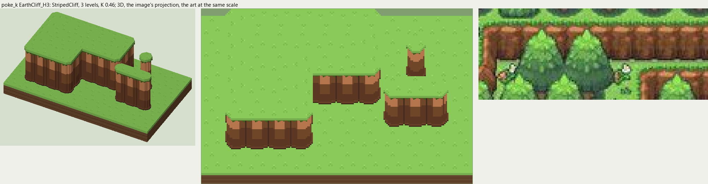
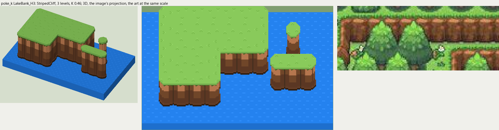

# poke_k terrain

2026-11-03/04: **2 styles, 98 complete VOX files**, the ground shapes of [poke_k.jpg](../../../poke_k.jpg), kit pieces on VCOM's grid in Base and the six variations. The files are in this image's folder, `PokeK_<Style>_<Piece>[_<Treatment>].vox`. How a piece is made, placed, painted and checked: the [collection's README](../../terrain/README.md); every file: [FILES.md](../../terrain/FILES.md).

## EarthCliff_H3

**StripedCliff**, 3 levels (48 voxels from its lower ground's top to its own): the earth cliff of rounded columns most of the Pokemon maps draw: lit along the top, shaded toward the foot, a dark crease between columns, the top's grass hanging over in a jagged edge.

- **As drawn:** The brown ledges stepping down the forest: 23 px drawn from the rim to the dark foot (y 181-203 at x 270), 25 voxels at 14.75 px a tile, 3 levels; a rounded column a tile.
- **Scale:** 14.75 of the image's pixels a tile, K 0.46; measured in the crop x 150-300, y 170-230 (beside the voxels above, at one scale).
- **Ground:** on top `PokeK_Ground_Meadow`, below `PokeK_Ground_Meadow`.
- **Colours:** face_light #d38a5b, face #835230, face_dark #6a4129, face_line #4e3623, face_foot #392515, fill #744a2e, grass_edge #506c26.
- **Pieces:** Fill, Straight, OuterCorner, InnerCorner, Ridge, RidgeEnd, Pillar, each in seven treatments: [every piece](previews/EarthCliff_H3_pieces.png), [the seven treatments](previews/EarthCliff_H3_treatments.png).

## LakeBank_H3

**StripedCliff**, 3 levels (48 voxels from its lower ground's top to its own): the earth cliff of rounded columns most of the Pokemon maps draw: lit along the top, shaded toward the foot, a dark crease between columns, the top's grass hanging over in a jagged edge.

- **As drawn:** The same face along the north and west shores of the two lakes, 3 levels down to the water.
- **Scale:** 14.75 of the image's pixels a tile, K 0.46; measured in the crop x 150-300, y 170-230 (beside the voxels above, at one scale).
- **Ground:** on top `PokeK_Ground_Meadow`, below `PokeK_Ground_Lake`.
- **Colours:** face_light #d38a5b, face #835230, face_dark #6a4129, face_line #4e3623, face_foot #392515, fill #744a2e, grass_edge #506c26.
- **Pieces:** Fill, Straight, OuterCorner, InnerCorner, Ridge, RidgeEnd, Pillar, each in seven treatments: [every piece](previews/LakeBank_H3_pieces.png), [the seven treatments](previews/LakeBank_H3_treatments.png).
