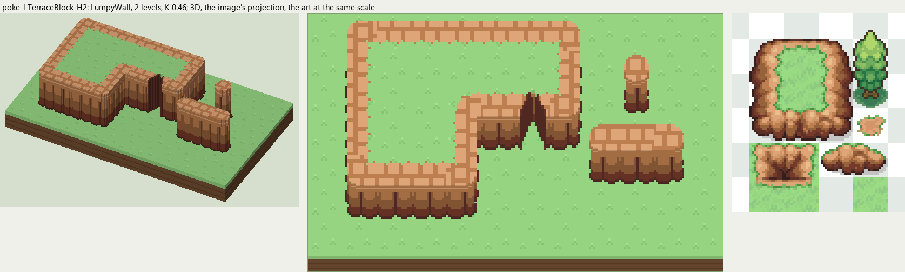

# poke_l terrain

2026-11-03/04: **1 style, 56 complete VOX files**, the ground shapes of [poke_l.png](../../../poke_l.png), kit pieces on VCOM's grid in Base and the six variations. The files are in this image's folder, `PokeL_<Style>_<Piece>[_<Treatment>].vox`. How a piece is made, placed, painted and checked: the [collection's README](../../terrain/README.md); every file: [FILES.md](../../terrain/FILES.md).

## TerraceBlock_H2

**LumpyWall**, 2 levels (32 voxels from its lower ground's top to its own): rock or earth in rounded lumps, in one or more courses (each lit along its top, dark under it), topped by the grass hanging over or by a rim of the rock itself.

- **As drawn:** The sheet's grass-topped terrace blocks: a wide band of lumpy earth round the grass on top, the face 12 px drawn from the band to the outline at the foot (y 146-157 at x 150), 26 voxels, 2 levels; big rounded lumps lit on top. The mound beside the block is this style's ridge pieces; its gully notch (x 128-160, y 160-176) is the Notch piece.
- **Scale:** 16 of the image's pixels a tile, K 0.46; measured in the crop x 120-200, y 100-192 (beside the voxels above, at one scale).
- **Ground:** on top `PokeL_Ground_Meadow`, below `PokeL_Ground_Meadow`.
- **Colours:** rim_light #dea678, rim #be7f50, face_light #be7f50, face #96623c, face_dark #763a2a, crevice #5d3027, foot #4e2923, fill #96623c.
- **Pieces:** Fill, Straight, OuterCorner, InnerCorner, Ridge, RidgeEnd, Pillar and Notch, each in seven treatments: [every piece](previews/TerraceBlock_H2_pieces.png), [the seven treatments](previews/TerraceBlock_H2_treatments.png).
