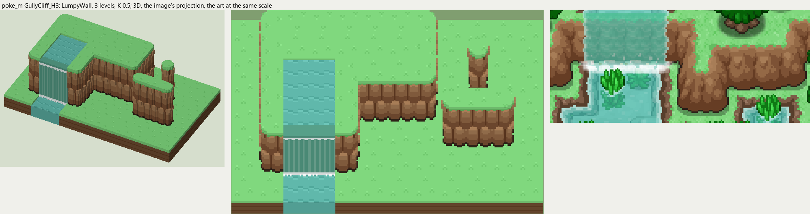
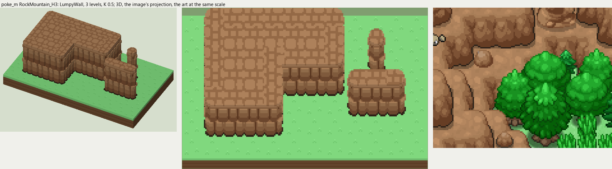

# poke_m terrain

2026-11-03/04: **2 styles, 112 complete VOX files**, the ground shapes of [poke_m.png](../../../poke_m.png), kit pieces on VCOM's grid in Base and the six variations. The files are in this image's folder, `PokeM_<Style>_<Piece>[_<Treatment>].vox`. How a piece is made, placed, painted and checked: the [collection's README](../../terrain/README.md); every file: [FILES.md](../../terrain/FILES.md).

## GullyCliff_H3

**LumpyWall**, 3 levels (48 voxels from its lower ground's top to its own): rock or earth in rounded lumps, in one or more courses (each lit along its top, dark under it), topped by the grass hanging over or by a rim of the rock itself.

- **As drawn:** The brown earth ledges of the gully and the river's steps: 26 px drawn from the grass rim to the outline at the foot (y 453-478 at x 420), 52 voxels at 0.5, 3 levels; rounded lumps lit on top. The river spills over them in three places (x 310-360 at y 432-466 the first).
- **Scale:** 16 of the image's pixels a tile, K 0.5; measured in the crop x 290-450, y 430-500 (beside the voxels above, at one scale).
- **Ground:** on top `PokeM_Ground_Meadow`, below `PokeM_Ground_Meadow`; the Fall's top `PokeM_Ground_ChannelWater`; the Channel's top `PokeM_Ground_ChannelWater`; the Fall's pool `PokeM_Ground_ChannelWater`.
- **Colours:** rim_light #ad815b, rim #946946, face_light #a77d57, face #946946, face_dark #7d5235, crevice #663d24, foot #302218, fill #8c6240, grass_edge #63bd61, water #57a089, water_light #76b29e, foam #f3faf9.
- **Pieces:** Fill, Straight, OuterCorner, InnerCorner, Ridge, RidgeEnd, Pillar and Fall, Channel, each in seven treatments: [every piece](previews/GullyCliff_H3_pieces.png), [the seven treatments](previews/GullyCliff_H3_treatments.png).

## RockMountain_H3

**LumpyWall**, 3 levels (48 voxels from its lower ground's top to its own): rock or earth in rounded lumps, in one or more courses (each lit along its top, dark under it), topped by the grass hanging over or by a rim of the rock itself.

- **As drawn:** The lumpy brown rock masses in the top corners: steps of big rounded lumps, the tallest face 25 px drawn from the lit top to the outline (y 7-31 at x 40), 50 voxels at 0.5, 3 levels; their tops the rock itself, lumpy and lit.
- **Scale:** 16 of the image's pixels a tile, K 0.5; measured in the crop x 0-140, y 0-110 (beside the voxels above, at one scale).
- **Ground:** on top `its own rock`, below `PokeM_Ground_Meadow`.
- **Colours:** rim_light #ad815b, rim #946946, face_light #a77d57, face #946946, face_dark #7d5235, crevice #663d24, foot #302218, fill #8c6240, grass_edge #63bd61.
- **Pieces:** Fill, Straight, OuterCorner, InnerCorner, Ridge, RidgeEnd, Pillar, each in seven treatments: [every piece](previews/RockMountain_H3_pieces.png), [the seven treatments](previews/RockMountain_H3_treatments.png).
