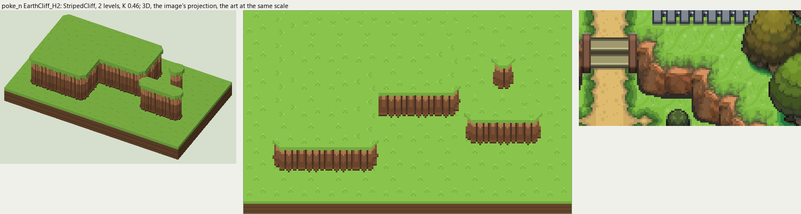
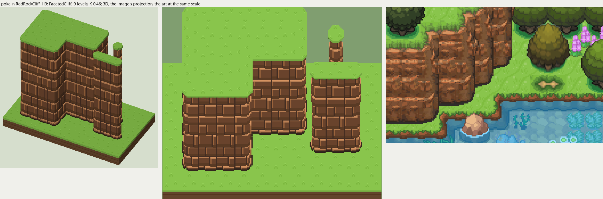

# poke_n terrain

2026-11-03/04: **2 styles, 98 complete VOX files**, the ground shapes of [poke_n.png](../../../poke_n.png), kit pieces on VCOM's grid in Base and the six variations. The files are in this image's folder, `PokeN_<Style>_<Piece>[_<Treatment>].vox`. How a piece is made, placed, painted and checked: the [collection's README](../../terrain/README.md); every file: [FILES.md](../../terrain/FILES.md).

## EarthCliff_H2

**StripedCliff**, 2 levels (32 voxels from its lower ground's top to its own): the earth cliff of rounded columns most of the Pokemon maps draw: lit along the top, shaded toward the foot, a dark crease between columns, the top's grass hanging over in a jagged edge.

- **As drawn:** The terraced earth cliffs round the village: faces 18 rows drawn from the rim to the dark foot (295-312 at x 352-362), 39 voxels, 2 levels.
- **Scale:** 16 of the image's pixels a tile, K 0.46; measured in the crop x 300-430, y 262-330 (beside the voxels above, at one scale).
- **Ground:** on top `PokeN_Ground_Meadow`, below `PokeN_Ground_Meadow`.
- **Colours:** face_light #cc8a59, face #8e5e3d, face_dark #795033, face_line #523828, face_foot #462e1e, fill #6e4a30, grass_edge #89c54c.
- **Pieces:** Fill, Straight, OuterCorner, InnerCorner, Ridge, RidgeEnd, Pillar, each in seven treatments: [every piece](previews/EarthCliff_H2_pieces.png), [the seven treatments](previews/EarthCliff_H2_treatments.png).

## RedRockCliff_H9

**FacetedCliff**, 9 levels (144 voxels from its lower ground's top to its own): angular blocks in rows, each standing out its own amount, lit along its top and left edge, a dark crease below and to the right.

- **As drawn:** The tall red-brown rock at the left edge above the lake: 65 px drawn from the grass rim to the dark foot (y 551-615 at x 20), 141 voxels, 9 levels, the tiers behind it shorter; broken beds of angular blocks 8-12 px drawn, each lit along its top edge (y 552, 562, 569, 579, 594 at x 20).
- **Scale:** 16 of the image's pixels a tile, K 0.46; measured in the crop x 0-190, y 515-635 (beside the voxels above, at one scale).
- **Ground:** on top `PokeN_Ground_Meadow`, below `PokeN_Ground_Meadow`.
- **Colours:** grass_edge #577935, block_top #d59361, block_light #b57546, block #7b4f34, block_low #68442a, crease #4f3528, foot #34271e, fill #71472c.
- **Pieces:** Fill, Straight, OuterCorner, InnerCorner, Ridge, RidgeEnd, Pillar, each in seven treatments: [every piece](previews/RedRockCliff_H9_pieces.png), [the seven treatments](previews/RedRockCliff_H9_treatments.png).
