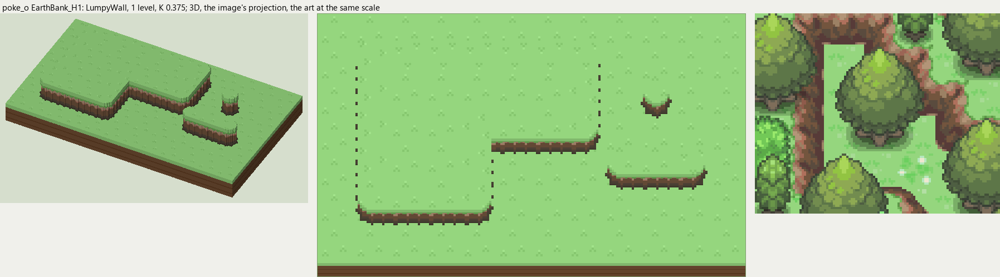
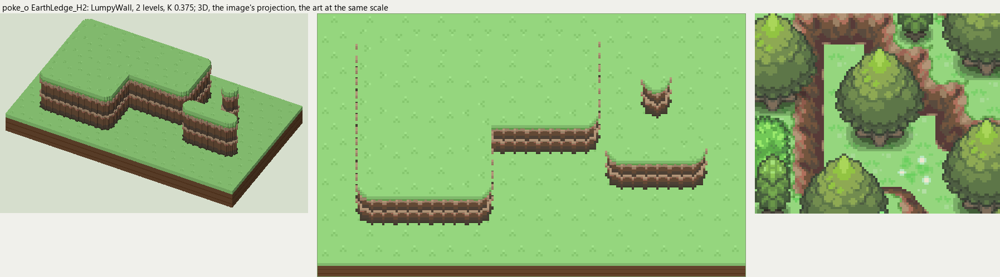
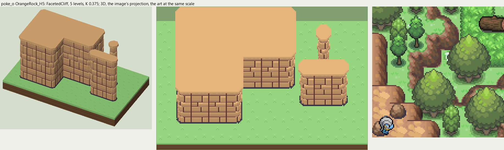
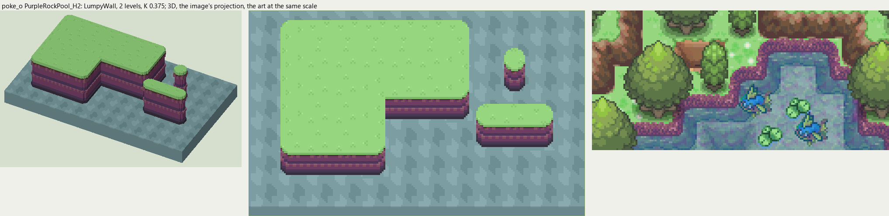

# poke_o terrain

2026-11-03/04: **4 styles, 196 complete VOX files**, the ground shapes of [poke_o.png](../../../poke_o.png), kit pieces on VCOM's grid in Base and the six variations. The files are in this image's folder, `PokeO_<Style>_<Piece>[_<Treatment>].vox`. How a piece is made, placed, painted and checked: the [collection's README](../../terrain/README.md); every file: [FILES.md](../../terrain/FILES.md).

## EarthBank_H1

**LumpyWall**, 1 level (16 voxels from its lower ground's top to its own): rock or earth in rounded lumps, in one or more courses (each lit along its top, dark under it), topped by the grass hanging over or by a rim of the rock itself.

- **As drawn:** The low mauve-brown banks of the forest terraces on the west side: 4 px drawn (y 368-371 at x 80), 11 voxels at 0.375, 1 level.
- **Scale:** 16 of the image's pixels a tile, K 0.375; measured in the crop x 0-110, y 130-220 (beside the voxels above, at one scale).
- **Ground:** on top `PokeO_Ground_Meadow`, below `PokeO_Ground_Meadow`.
- **Colours:** face_top #b39578, face_light #af705c, face #73553e, face_dark #5a4b3e, crevice #573b38, foot #453e31, fill #73553e, grass_edge #6fb358.
- **Pieces:** Fill, Straight, OuterCorner, InnerCorner, Ridge, RidgeEnd, Pillar, each in seven treatments: [every piece](previews/EarthBank_H1_pieces.png), [the seven treatments](previews/EarthBank_H1_treatments.png).

## EarthLedge_H2

**LumpyWall**, 2 levels (32 voxels from its lower ground's top to its own): rock or earth in rounded lumps, in one or more courses (each lit along its top, dark under it), topped by the grass hanging over or by a rim of the rock itself.

- **As drawn:** The taller ledges of the same terraces: 15 px drawn from the lit rim to the dark foot (y 129-143 at x 40), 40 voxels at 0.375, 2 levels.
- **Scale:** 16 of the image's pixels a tile, K 0.375; measured in the crop x 0-110, y 130-220 (beside the voxels above, at one scale).
- **Ground:** on top `PokeO_Ground_Meadow`, below `PokeO_Ground_Meadow`.
- **Colours:** face_top #b39578, face_light #af705c, face #73553e, face_dark #5a4b3e, crevice #573b38, foot #453e31, fill #73553e, grass_edge #6fb358.
- **Pieces:** Fill, Straight, OuterCorner, InnerCorner, Ridge, RidgeEnd, Pillar, each in seven treatments: [every piece](previews/EarthLedge_H2_pieces.png), [the seven treatments](previews/EarthLedge_H2_treatments.png).

## OrangeRock_H5

**FacetedCliff**, 5 levels (80 voxels from its lower ground's top to its own): angular blocks in rows, each standing out its own amount, lit along its top and left edge, a dark crease below and to the right.

- **As drawn:** The orange sandstone outcrop in the bottom-left corner: slabs lit along their tops, the top tier's face 28 px drawn (y 593-620 at x 10), 75 voxels at 0.375, 5 levels; the frame cuts off the rest. Its top is the rock itself.
- **Scale:** 16 of the image's pixels a tile, K 0.375; measured in the crop x 0-120, y 520-640 (beside the voxels above, at one scale).
- **Ground:** on top `its own rock`, below `PokeO_Ground_Meadow`.
- **Colours:** block_top #efbd84, block_light #e7b57b, block #d6a573, block_low #c69473, crease #6b4239, foot #3f3646, fill #c99772.
- **Pieces:** Fill, Straight, OuterCorner, InnerCorner, Ridge, RidgeEnd, Pillar, each in seven treatments: [every piece](previews/OrangeRock_H5_pieces.png), [the seven treatments](previews/OrangeRock_H5_treatments.png).

## PurpleRockPool_H2

**LumpyWall**, 2 levels (32 voxels from its lower ground's top to its own): rock or earth in rounded lumps, in one or more courses (each lit along its top, dark under it), topped by the grass hanging over or by a rim of the rock itself.

- **As drawn:** The purple rock rim of the inland pool at the bottom: 13 px drawn from the grass to the water (y 577-589 at x 470), 35 voxels at 0.375, 2 levels; small rounded stones.
- **Scale:** 16 of the image's pixels a tile, K 0.375; measured in the crop x 370-540, y 560-640 (beside the voxels above, at one scale).
- **Ground:** on top `PokeO_Ground_Meadow`, below `PokeO_Ground_InlandPool`.
- **Colours:** face_light #915e6d, face #834772, face_dark #5a4167, crevice #643e72, foot #3f3646, fill #6e446c, grass_edge #573b38.
- **Pieces:** Fill, Straight, OuterCorner, InnerCorner, Ridge, RidgeEnd, Pillar, each in seven treatments: [every piece](previews/PurpleRockPool_H2_pieces.png), [the seven treatments](previews/PurpleRockPool_H2_treatments.png).
