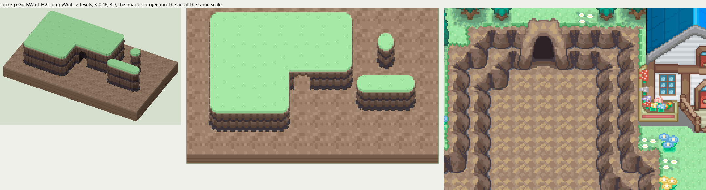

# poke_p terrain

2026-11-03/04: **1 style, 56 complete VOX files**, the ground shapes of [poke_p.png](../../../poke_p.png), kit pieces on VCOM's grid in Base and the six variations. The files are in this image's folder, `PokeP_<Style>_<Piece>[_<Treatment>].vox`. How a piece is made, placed, painted and checked: the [collection's README](../../terrain/README.md); every file: [FILES.md](../../terrain/FILES.md).

## GullyWall_H2

**LumpyWall**, 2 levels (32 voxels from its lower ground's top to its own): rock or earth in rounded lumps, in one or more courses (each lit along its top, dark under it), topped by the grass hanging over or by a rim of the rock itself.

- **As drawn:** The gray-brown crag walls of the gully down from the house: 16 px drawn from the grass to the gully's gravel floor (y 95-110 at x 350), 35 voxels, 2 levels, a pale rock rim along the top, deeper parts two such walls a tile apart (y 114-127 at x 270). Its CaveMouth is the cave at the gully's head (x 287-304, y 108-118).
- **Scale:** 16 of the image's pixels a tile, K 0.46; measured in the crop x 220-420, y 80-220 (beside the voxels above, at one scale).
- **Ground:** on top `PokeP_Ground_Meadow`, below `PokeP_Ground_RockyGully`.
- **Colours:** rim_light #ac927d, rim #9f826c, face_light #715a4e, face #654d3f, face_dark #443a40, crevice #373034, foot #3c383e, fill #654d3f, cave_dark #2d2226.
- **Pieces:** Fill, Straight, OuterCorner, InnerCorner, Ridge, RidgeEnd, Pillar and CaveMouth, each in seven treatments: [every piece](previews/GullyWall_H2_pieces.png), [the seven treatments](previews/GullyWall_H2_treatments.png).
