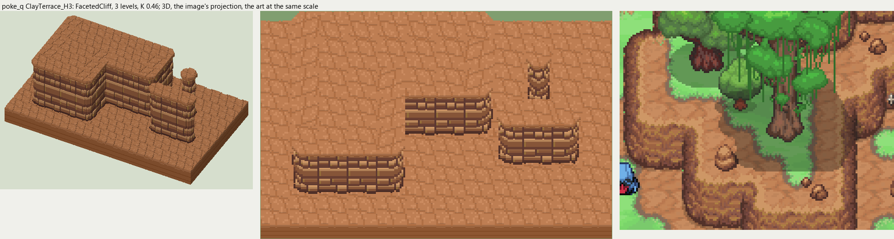
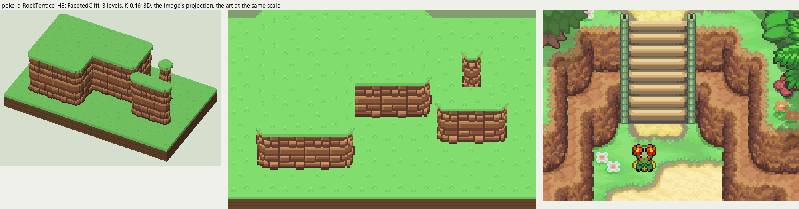
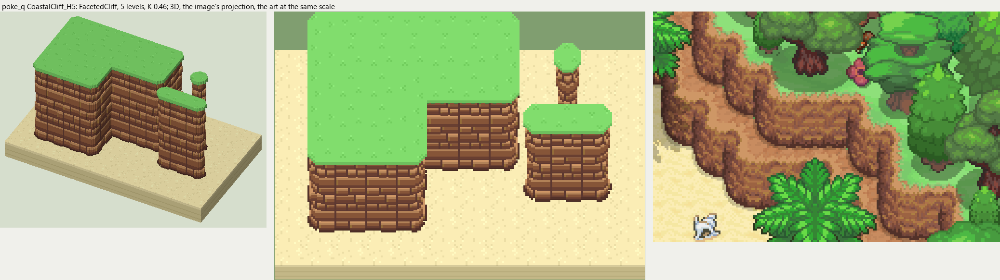

# poke_q terrain

2026-11-03/04: **3 styles, 147 complete VOX files**, the ground shapes of [poke_q.png](../../../poke_q.png), kit pieces on VCOM's grid in Base and the six variations. The files are in this image's folder, `PokeQ_<Style>_<Piece>[_<Treatment>].vox`. How a piece is made, placed, painted and checked: the [collection's README](../../terrain/README.md); every file: [FILES.md](../../terrain/FILES.md).

## ClayTerrace_H3

**FacetedCliff**, 3 levels (48 voxels from its lower ground's top to its own): angular blocks in rows, each standing out its own amount, lit along its top and left edge, a dark crease below and to the right.

- **As drawn:** The chunky orange rock between the summit's clay terraces: 24 px drawn from the clay's lit rim to the dark foot (y 180-206 at x 130), 52 voxels, 3 levels; clay above and below.
- **Scale:** 16 of the image's pixels a tile, K 0.46; measured in the crop x 110-260, y 120-240 (beside the voxels above, at one scale).
- **Ground:** on top `PokeQ_Ground_TerraceClay`, below `PokeQ_Ground_TerraceClay`.
- **Colours:** grass_edge #ce9766, block_top #ce9766, block_light #ad7f43, block #9c6342, block_low #7b4a39, crease #6b4239, foot #523129, fill #945a42.
- **Pieces:** Fill, Straight, OuterCorner, InnerCorner, Ridge, RidgeEnd, Pillar, each in seven treatments: [every piece](previews/ClayTerrace_H3_pieces.png), [the seven treatments](previews/ClayTerrace_H3_treatments.png).

## RockTerrace_H3

**FacetedCliff**, 3 levels (48 voxels from its lower ground's top to its own): angular blocks in rows, each standing out its own amount, lit along its top and left edge, a dark crease below and to the right.

- **As drawn:** The same rock under the jungle's grass terraces and beside the stairs, 3 levels.
- **Scale:** 16 of the image's pixels a tile, K 0.46; measured in the crop x 400-560, y 440-560 (beside the voxels above, at one scale).
- **Ground:** on top `PokeQ_Ground_Meadow`, below `PokeQ_Ground_Meadow`.
- **Colours:** grass_edge #568a4d, block_top #ce9766, block_light #ad7f43, block #9c6342, block_low #7b4a39, crease #6b4239, foot #523129, fill #945a42.
- **Pieces:** Fill, Straight, OuterCorner, InnerCorner, Ridge, RidgeEnd, Pillar, each in seven treatments: [every piece](previews/RockTerrace_H3_pieces.png), [the seven treatments](previews/RockTerrace_H3_treatments.png).

## CoastalCliff_H5

**FacetedCliff**, 5 levels (80 voxels from its lower ground's top to its own): angular blocks in rows, each standing out its own amount, lit along its top and left edge, a dark crease below and to the right.

- **As drawn:** The coastal cliffs down to the beach: tiers of 34-36 px drawn from the grass rim to the dark foot (y 632-667 and 668-701 at x 120; 660-712 at x 180), about 75 voxels, 5 levels; sand at the foot.
- **Scale:** 16 of the image's pixels a tile, K 0.46; measured in the crop x 60-240, y 600-720 (beside the voxels above, at one scale).
- **Ground:** on top `PokeQ_Ground_Meadow`, below `PokeQ_Ground_BeachSand`.
- **Colours:** grass_edge #568a4d, block_top #ce9766, block_light #ad7f43, block #9c6342, block_low #7b4a39, crease #6b4239, foot #523129, fill #945a42.
- **Pieces:** Fill, Straight, OuterCorner, InnerCorner, Ridge, RidgeEnd, Pillar, each in seven treatments: [every piece](previews/CoastalCliff_H5_pieces.png), [the seven treatments](previews/CoastalCliff_H5_treatments.png).
