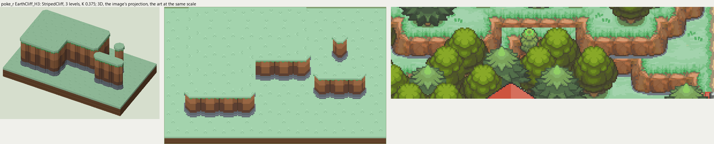
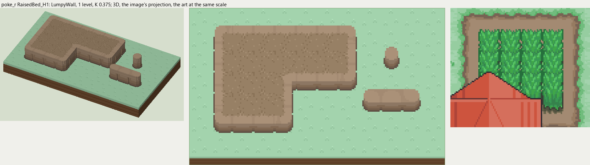

# poke_r terrain

2026-11-03/04: **2 styles, 98 complete VOX files**, the ground shapes of [poke_r.png](../../../poke_r.png), kit pieces on VCOM's grid in Base and the six variations. The files are in this image's folder, `PokeR_<Style>_<Piece>[_<Treatment>].vox`. How a piece is made, placed, painted and checked: the [collection's README](../../terrain/README.md); every file: [FILES.md](../../terrain/FILES.md).

## EarthCliff_H3

**StripedCliff**, 3 levels (48 voxels from its lower ground's top to its own): the earth cliff of rounded columns most of the Pokemon maps draw: lit along the top, shaded toward the foot, a dark crease between columns, the top's grass hanging over in a jagged edge.

- **As drawn:** The terraced ledges north of the village: 16 px of brown face over a 3 px gray stone foot (y 88-106 at x 400), 51 voxels at 0.375, 3 levels; a rounded column a tile (creases every 16 px at y 96).
- **Scale:** 16 of the image's pixels a tile, K 0.375; measured in the crop x 160-440, y 30-110 (beside the voxels above, at one scale).
- **Ground:** on top `PokeR_Ground_Meadow`, below `PokeR_Ground_Meadow`.
- **Colours:** face_light #b1774f, face #946341, face_dark #6b4a39, face_line #5a4232, face_foot #6f7882, fill #8c5a39, grass_edge #54af64.
- **Pieces:** Fill, Straight, OuterCorner, InnerCorner, Ridge, RidgeEnd, Pillar, each in seven treatments: [every piece](previews/EarthCliff_H3_pieces.png), [the seven treatments](previews/EarthCliff_H3_treatments.png).

## RaisedBed_H1

**LumpyWall**, 1 level (16 voxels from its lower ground's top to its own): rock or earth in rounded lumps, in one or more courses (each lit along its top, dark under it), topped by the grass hanging over or by a rim of the rock itself.

- **As drawn:** The two raised garden beds in the village: a border of light soil about 5 px wide round the crops, its front about 4 px drawn, 1 level; the bed's top is the garden soil.
- **Scale:** 16 of the image's pixels a tile, K 0.375; measured in the crop x 235-340, y 240-330 (beside the voxels above, at one scale).
- **Ground:** on top `PokeR_Ground_GardenSoil`, below `PokeR_Ground_Meadow`.
- **Colours:** rim_light #aa9178, rim #a38a72, face_light #a38a72, face #967b61, face_dark #876e58, crevice #786354, foot #645246, fill #967b61.
- **Pieces:** Fill, Straight, OuterCorner, InnerCorner, Ridge, RidgeEnd, Pillar, each in seven treatments: [every piece](previews/RaisedBed_H1_pieces.png), [the seven treatments](previews/RaisedBed_H1_treatments.png).
