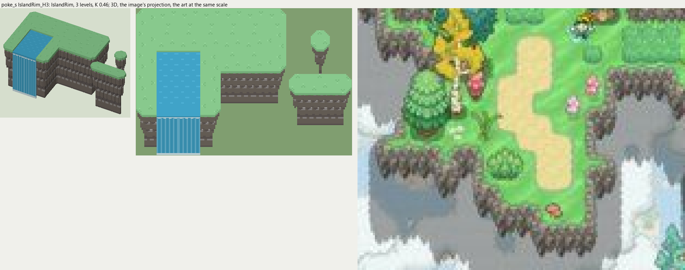
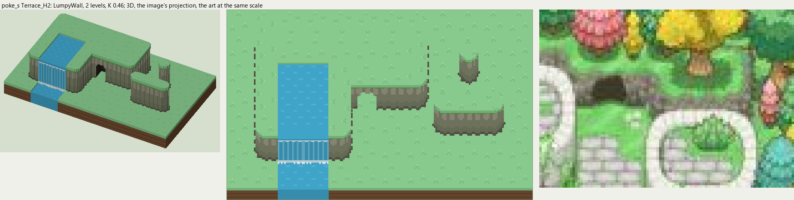
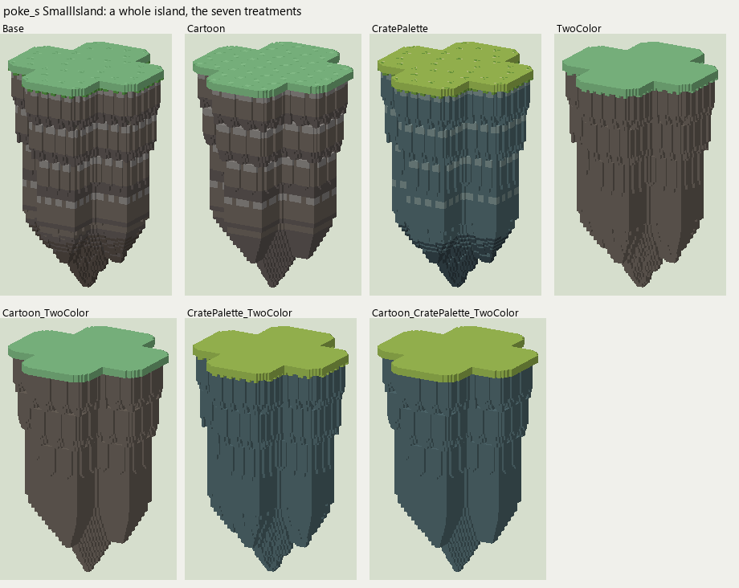
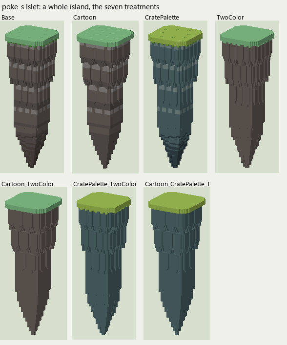

# poke_s terrain

2026-11-03/04: **2 styles, 147 complete VOX files**, the ground shapes of [poke_s.jpg](../../../poke_s.jpg), kit pieces on VCOM's grid in Base and the six variations. The files are in this image's folder, `PokeS_<Style>_<Piece>[_<Treatment>].vox`. How a piece is made, placed, painted and checked: the [collection's README](../../terrain/README.md); every file: [FILES.md](../../terrain/FILES.md).

## IslandRim_H3

**IslandRim**, 3 levels (48 voxels from its lower ground's top to its own): the rim of a floating island: rows of crags hanging under the grass, each row tucked in from the one above and tapering to points, nothing below.

- **As drawn:** The rim of the floating island: dark gray-brown crags hanging under the grass's edge, 13 px drawn (y 690-702 at x 360), 21 voxels at 10 px a tile, 3 levels, over the island's gray underside; no ground below. The rivers pour off it into the clouds (x 108-140 at y 700-740).
- **Scale:** 10 of the image's pixels a tile, K 0.46; measured in the crop x 290-440, y 600-720 (beside the voxels above, at one scale).
- **Ground:** on top `PokeS_Ground_Meadow`, below `nothing (it floats)`; the Fall's top `PokeS_Ground_River`; the Channel's top `PokeS_Ground_River`.
- **Colours:** rock_light #95918e, rock #736a61, rock_dark #635b58, rock_line #564d46, fill #69645c, grass_edge #5ba148, water #40a3c8, water_light #6ebedc, foam #d7ebf0.
- **Pieces:** Fill, Straight, OuterCorner, InnerCorner, Ridge, RidgeEnd, Pillar and Fall, Channel, each in seven treatments: [every piece](previews/IslandRim_H3_pieces.png), [the seven treatments](previews/IslandRim_H3_treatments.png).

## Terrace_H2

**LumpyWall**, 2 levels (32 voxels from its lower ground's top to its own): rock or earth in rounded lumps, in one or more courses (each lit along its top, dark under it), topped by the grass hanging over or by a rim of the rock itself.

- **As drawn:** The terraces inside the island: a greenish-gray stone face 7 px drawn under the grass (y 173-179 at x 250), 11 voxels at 10 px a tile, 2 levels. Its CaveMouth is one of the small dark alcoves in these faces (x 220-235, y 165-178); its Fall the rivers stepping down the terraces (x 108-140, y 600-640).
- **Scale:** 10 of the image's pixels a tile, K 0.46; measured in the crop x 200-300, y 140-210 (beside the voxels above, at one scale).
- **Ground:** on top `PokeS_Ground_Meadow`, below `PokeS_Ground_Meadow`; the Fall's top `PokeS_Ground_River`; the Channel's top `PokeS_Ground_River`; the Fall's pool `PokeS_Ground_River`.
- **Colours:** face_light #9b9a86, face #80846b, face_dark #747d62, crevice #646550, foot #564d46, fill #7a7c68, grass_edge #5ba148, cave_dark #28241e, water #40a3c8, water_light #6ebedc, foam #d7ebf0.
- **Pieces:** Fill, Straight, OuterCorner, InnerCorner, Ridge, RidgeEnd, Pillar and CaveMouth, Fall, Channel, each in seven treatments: [every piece](previews/Terrace_H2_pieces.png), [the seven treatments](previews/Terrace_H2_treatments.png).

## SmallIsland (a whole island)

The island rim's pieces laid out as `.##. / #### / #### / .##.` (rows from the back), its rock hanging 2 levels below them and tapering to a point: `PokeS_SmallIsland[_<Treatment>].vox`, one model on the grid.

## Islet (a whole island)

The island rim's pieces laid out as `## / ##` (rows from the back), its rock hanging 2 levels below them and tapering to a point: `PokeS_Islet[_<Treatment>].vox`, one model on the grid.
