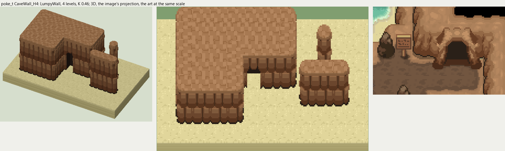
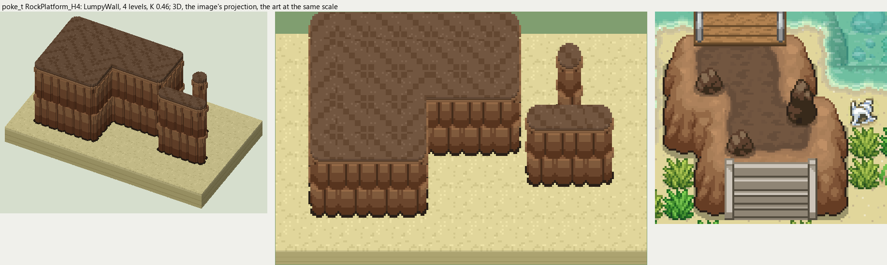

# poke_t terrain

2026-11-03/04: **2 styles, 105 complete VOX files**, the ground shapes of [poke_t.png](../../../poke_t.png), kit pieces on VCOM's grid in Base and the six variations. The files are in this image's folder, `PokeT_<Style>_<Piece>[_<Treatment>].vox`. How a piece is made, placed, painted and checked: the [collection's README](../../terrain/README.md); every file: [FILES.md](../../terrain/FILES.md).

## CaveWall_H4

**LumpyWall**, 4 levels (64 voxels from its lower ground's top to its own): rock or earth in rounded lumps, in one or more courses (each lit along its top, dark under it), topped by the grass hanging over or by a rim of the rock itself.

- **As drawn:** The cave's warm brown rock walls, stepping round the chamber: 27 px drawn from the rim to the dark outline (y 384-410 at x 60), 59 voxels, 4 levels; big rounded lumps, the cave's rock on top, its sand below. Its CaveMouth is the opening in the east wall (x 928-948, y 430-448).
- **Scale:** 16 of the image's pixels a tile, K 0.46; measured in the crop x 860-980, y 400-480 (beside the voxels above, at one scale).
- **Ground:** on top `PokeT_Ground_CaveRock`, below `PokeT_Ground_CaveSand`.
- **Colours:** rim_light #ad815b, rim #946946, face_light #946946, face #7d5235, face_dark #663d24, crevice #503420, foot #2a2018, fill #7d5235, cave_dark #281e18.
- **Pieces:** Fill, Straight, OuterCorner, InnerCorner, Ridge, RidgeEnd, Pillar and CaveMouth, each in seven treatments: [every piece](previews/CaveWall_H4_pieces.png), [the seven treatments](previews/CaveWall_H4_treatments.png).

## RockPlatform_H4

**LumpyWall**, 4 levels (64 voxels from its lower ground's top to its own): rock or earth in rounded lumps, in one or more courses (each lit along its top, dark under it), topped by the grass hanging over or by a rim of the rock itself.

- **As drawn:** The raised rock platforms inside the cave, topped with the damp dark floor and climbed by stairs: about 28 px drawn (the stairs' rise, y 498-525 at x 190), 61 voxels, 4 levels.
- **Scale:** 16 of the image's pixels a tile, K 0.46; measured in the crop x 140-260, y 420-530 (beside the voxels above, at one scale).
- **Ground:** on top `PokeT_Ground_DampCaveFloor`, below `PokeT_Ground_CaveSand`.
- **Colours:** rim_light #ad815b, rim #946946, face_light #946946, face #7d5235, face_dark #663d24, crevice #503420, foot #2a2018, fill #7d5235.
- **Pieces:** Fill, Straight, OuterCorner, InnerCorner, Ridge, RidgeEnd, Pillar, each in seven treatments: [every piece](previews/RockPlatform_H4_pieces.png), [the seven treatments](previews/RockPlatform_H4_treatments.png).
