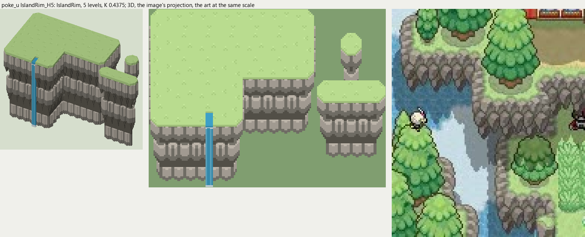
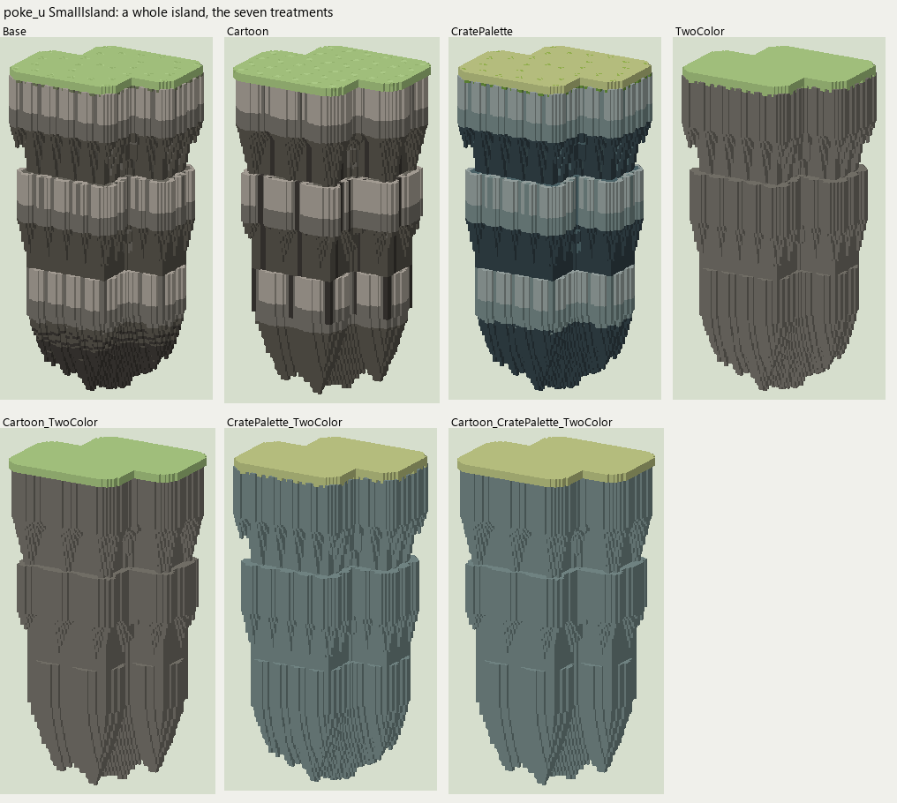
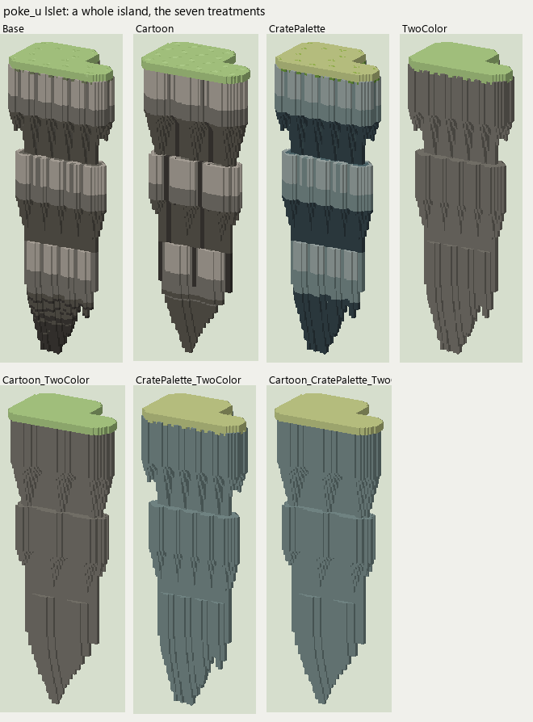

# poke_u terrain

2026-11-03/04: **1 style, 70 complete VOX files**, the ground shapes of [poke_u.jpg](../../../poke_u.jpg), kit pieces on VCOM's grid in Base and the six variations. The files are in this image's folder, `PokeU_<Style>_<Piece>[_<Treatment>].vox`. How a piece is made, placed, painted and checked: the [collection's README](../../terrain/README.md); every file: [FILES.md](../../terrain/FILES.md).

## IslandRim_H5

**IslandRim**, 5 levels (80 voxels from its lower ground's top to its own): the rim of a floating island: rows of crags hanging under the grass, each row tucked in from the one above and tapering to points, nothing below.

- **As drawn:** The rims of the floating islands: two rows of pointed gray crags hanging under the grass, 34 px drawn (y 279-312 at x 100), 78 voxels at 0.4375, 5 levels; no ground below. Its NarrowFall is the narrow ribbon of water off an island's edge, clipped by the frame in the art, so reconstructed.
- **Scale:** 16 of the image's pixels a tile, K 0.4375; measured in the crop x 0-130, y 230-384 (beside the voxels above, at one scale).
- **Ground:** on top `PokeU_Ground_Meadow`, below `nothing (it floats)`.
- **Colours:** rock_light #bcb4a9, rock #827e75, rock_dark #605c53, rock_line #423e3a, fill #757269, grass_edge #808a67, water #3ea0c7, water_light #68b9d8, foam #dcecf2.
- **Pieces:** Fill, Straight, OuterCorner, InnerCorner, Ridge, RidgeEnd, Pillar and NarrowFall, each in seven treatments: [every piece](previews/IslandRim_H5_pieces.png), [the seven treatments](previews/IslandRim_H5_treatments.png).

## SmallIsland (a whole island)

The island rim's pieces laid out as `.### / #### / ###.` (rows from the back), its rock hanging 2 levels below them and tapering to a point: `PokeU_SmallIsland[_<Treatment>].vox`, one model on the grid.

## Islet (a whole island)

The island rim's pieces laid out as `##. / ###` (rows from the back), its rock hanging 2 levels below them and tapering to a point: `PokeU_Islet[_<Treatment>].vox`, one model on the grid.
