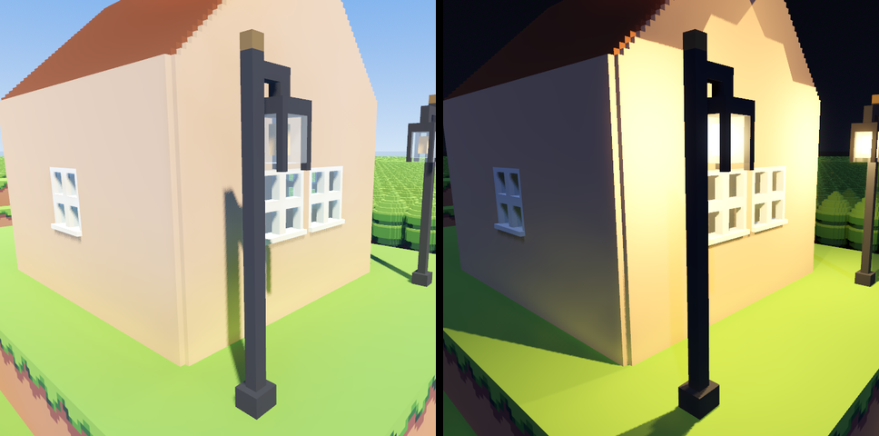

# Lamps

Lamps for combat maps, drawn in MagicaVoxel: models with voxels that glow at dusk and at night and
cast light round them in battle (`Docs/LIGHTS.md` has how, and what each number does). One so far,
the street lamp from the research into lights (2026-10-27), in TestMap in front of the house.



## StreetLamp1

`StreetLamp1.vox` is the whole lamp, one model 16 x 16 x 48 voxels (three cells tall): an iron post on
a plinth under a brass finial, an arm reaching out to a lantern of four iron corner posts, glass sides
and a glass bottom under an iron cap, and a bulb inside. Edit it here, as one model.

The game places pieces a cell (16 voxels) tall, so the lamp is cut into three, `StreetLamp1Bottom`,
`StreetLamp1Middle` and `StreetLamp1Top`, written here and into `../../vcom/Blocks/`, where the game
imports them; in the game they are three corner pieces, stacked by the brush `StreetLamp1`
(`Blocks/Pieces.tres`). After editing `StreetLamp1.vox`, cut it again:

```bash
python3 make_street_lamp.py --split   # cut StreetLamp1.vox as it is
python3 make_street_lamp.py           # draw it afresh from the script, then cut it
```

The second overwrites `StreetLamp1.vox`, losing any hand edit: copy it first, or cut only. Then open
the project once (or run Godot with `--import`) for the pieces to be imported again. The model must
stay 16 voxels across both ways; it can be any multiple of 16 tall (more pieces, named
`Middle1`, `Middle2` and so on, and the brush and kinds to match).

Its colours, above the Apollo palette every piece shares (`../Plants/LeafCluster1.vox`'s):

| Place | Colour | Material | Where |
|---|---|---|---|
| 185 | iron | diffuse | post, plinth, arm, hook, cap |
| 186 | the same iron | diffuse | the lantern's corner posts |
| 187 | brass | diffuse | the finial |
| 188 | pale glass | Glass, Transparency 0.85 | the lantern's sides and bottom |
| 189 | warm white | Emit, Emission 0.75, Power 2 | the bulb |

- **The bulb's Emit material is the lamp.** Emission is how brightly it glows (75%, about six times
  its colour); Power is its light (2: brightness 4, reaching 7 cells; each step more doubles both,
  0 gives none); the light is the bulb's colour. Change them here, in MagicaVoxel, or override them
  for the kind in Godot (`PieceKind.lamp`, `Docs/LIGHTS.md`).
- **Colour 186 is 185's iron apart** only so the game can leave the corner posts out of the lamp's
  own shadow (the top piece's `shadowless_colors` lists it): one voxel thick beside the bulb, they
  would throw hard wedges of shadow across the map. Anything else drawn right beside a bulb wants
  the same. The post, a colour 185, keeps its shadow.
- **The glass** casts no shadow, so the light gets out of the lantern.
- **Axes:** MagicaVoxel's x and y across, z up; the game turns them into Godot's x, -z and y. The arm
  reaches toward +x.
