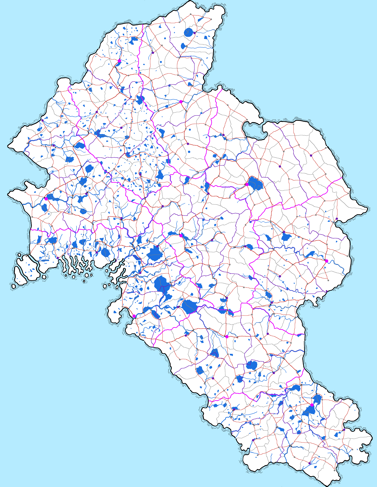

# Features of the world map images

This folder holds VCOM's new world map as a stack of pictures of one island. `WorldMapV1.png` is
the coast. Each later picture adds one kind of thing to an earlier one: kingdoms, heights, water,
duchies, counties, settlements, roads. `All.png` shows everything together. `Continent.png` is
the coast once more with a plain, standard outline, and `AllSimple.png` is everything in
`All.png` drawn on that outline. This file says what each picture holds, what every colour and
mark means, and how big everything is.

The folder `SourceData/` holds the same map as data: the rivers, the roads and the kingdoms'
borders as lines, every region as a map of numbers, and tables of all of it.
[The source data](#the-source-data) says what is there. The folder `Scripts/` holds the
programs that made the pictures, that data and this file, and that check them.

Every picture is 3100 × 4000 pixels and lines up with every other pixel for pixel, so a place has
the same (x, y) in all of them.

This is the island's new shape. It is to replace the map in `vcom/WorldMap/`, which the game
still uses.

## Contents

1. [Legend](#legend)
2. [The pictures](#the-pictures)
3. [Size and scale](#size-and-scale)
4. [Colours](#colours)
5. [What each picture holds](#what-each-picture-holds)
6. [How the layers sit on each other](#how-the-layers-sit-on-each-other)
7. [Reading the pictures back](#reading-the-pictures-back)
8. [The source data](#the-source-data)
9. [Decisions and assumptions](#decisions-and-assumptions)
10. [What the maps do not show](#what-the-maps-do-not-show)
11. [The 44 duchies](#the-44-duchies)
12. [The 220 counties and their capitals](#the-220-counties-and-their-capitals)

## Legend

What you see on `All.png`, and on the pictures that hold only part of it. `AllSimple.png` shows
the same on the plain coast.

| Mark | Colour | Meaning |
|---|---|---|
| Flat pale blue | `(181, 235, 255)` `#B5EBFF` | The sea |
| White | `(255, 255, 255)` `#FFFFFF` | Land |
| Black line round the land, about 7 px, soft-edged, with thin wave lines beside it | black and greys | The coast, as drawn by hand |
| Black line round the land, 7 px, hard-edged, on `Continent.png` and `AllSimple.png` | black `(0, 0, 0)` `#000000` | The coast, with a standard outline |
| Line 5 px wide | pink `(233, 0, 255)` `#E900FF` | Border between two kingdoms |
| Line 3 px wide | purple `(110, 30, 180)` `#6E1EB4` | Border between two duchies of one kingdom |
| Line 2 px wide | grey `(128, 128, 128)` `#808080` | Border between two counties of one duchy |
| Disc 27 px across | pink, as the kingdom borders | Capital of a kingdom (also capital of its duchy and county) |
| Disc 19 px across | purple, as the duchy borders | Capital of a duchy (also capital of its county) |
| Disc 13 px across | grey, as the county borders | Capital of a county |
| Winding line 2 to 7 px wide | blue `(28, 112, 224)` `#1C70E0` | River, wider the more water it carries |
| Filled shape | the same blue | Lake |
| Line 3 px wide | red `(200, 40, 30)` `#C8281E` | Highway: a road on the way between two kingdoms' capitals |
| Line 2 px wide | the same red | Any other road |
| Short bar across a road, 2 px wider than the road | dark brown `(60, 35, 15)` `#3C230F` | Bridge, where a road crosses a river; one crosses the sea, to the island town |
| A river edged on both banks in a border's colour, on `All.png` | pink, purple or grey, as the border | That border runs along the river |
| A road edged on both sides in a border's colour | purple or grey, as the border | That border runs along the road |
| Line 3 px wide, on `Rivers.png` only | brown `(196, 118, 44)` `#C4762C` | Watershed: the line between the land draining to one river mouth and to the next |

Nothing is named on any picture, and none has a key, compass or scale bar drawn on it.

## The pictures

| File | Shows | Starts from | Adds |
|---|---|---|---|
| `WorldMapV1.png` | The coast: sea, land and the inked shoreline | drawn by hand | |
| `WorldMapRegions.png` | The coast with nine numbered regions sketched on it | `WorldMapV1.png`, by hand | thin pink lines and the numerals 1 to 9 |
| `Continent.png` | The coast with a standard outline | `WorldMapV1.png` | nothing: the hand-drawn shoreline and its wave lines give way to one plain black line |
| `Kingdoms.png` | The nine kingdoms | `WorldMapV1.png` | kingdom borders |
| `Elevation.png` | How high the land is | nothing: a picture of its own, in greys | |
| `Rivers.png` | Rivers, lakes and watersheds | `WorldMapV1.png` | water and watershed lines |
| `Water.png` | Rivers and lakes | `WorldMapV1.png` | water (it is `Rivers.png` without the watershed lines) |
| `Duchies.png` | Kingdoms and their 44 duchies | `Kingdoms.png` | duchy borders |
| `Counties.png` | Kingdoms, duchies and the 220 counties | `Duchies.png` | county borders |
| `Settlements.png` | The same with the 220 capitals | `Counties.png` | a dot for each capital |
| `Roads.png` | The same with the roads | `Settlements.png` | roads and bridges |
| `All.png` | Everything but heights and watersheds | `Roads.png` and `Water.png` | nothing new: the water is put into `Roads.png`, lakes under the borders and rivers over them |
| `AllSimple.png` | Everything in `All.png`, on the standard outline | `All.png` and `Continent.png` | nothing new: `All.png`'s marks on `Continent.png`'s coast |

The first two were drawn by hand and are where everything starts. The rest were worked out from
them by program ([Decisions and assumptions](#decisions-and-assumptions) says how), in this
order: the heights and the water, shaped for nine kingdoms laid out as in the sketch; the
kingdoms' borders, drawn along the rivers and ridges of that land; then duchies, counties,
settlements and roads, each built on the one before; and `All.png`. `Continent.png` was then
made from `WorldMapV1.png` alone, and `AllSimple.png` from `All.png` and `Continent.png`.
`AllSimple.png` is the only picture on the standard outline: the others all keep the hand-drawn
coast.

The programs are in the folder `Scripts/`. Its `README.md` says which made what, and in what
order.

| File | Pixels | Kind | Size on disk |
|---|---|---|---:|
| `WorldMapV1.png` | 3100 × 4000 | 8-bit RGBA PNG | 1,020,782 bytes |
| `WorldMapRegions.png` | 3100 × 4000 | 8-bit RGBA PNG | 1,053,529 bytes |
| `Continent.png` | 3100 × 4000 | 8-bit RGBA PNG | 109,363 bytes |
| `Kingdoms.png` | 3100 × 4000 | 8-bit RGBA PNG | 1,035,298 bytes |
| `Elevation.png` | 3100 × 4000 | 16-bit greyscale PNG | 6,601,202 bytes |
| `Rivers.png` | 3100 × 4000 | 8-bit RGBA PNG | 1,213,639 bytes |
| `Water.png` | 3100 × 4000 | 8-bit RGBA PNG | 1,146,242 bytes |
| `Duchies.png` | 3100 × 4000 | 8-bit RGBA PNG | 1,087,327 bytes |
| `Counties.png` | 3100 × 4000 | 8-bit RGBA PNG | 1,194,398 bytes |
| `Settlements.png` | 3100 × 4000 | 8-bit RGBA PNG | 1,208,339 bytes |
| `Roads.png` | 3100 × 4000 | 8-bit RGBA PNG | 1,319,624 bytes |
| `All.png` | 3100 × 4000 | 8-bit RGBA PNG | 1,447,680 bytes |
| `AllSimple.png` | 3100 × 4000 | 8-bit RGBA PNG | 522,683 bytes |

## Size and scale

**One pixel is 335 m on the ground**, and a square pixel is 0.1122 km². That follows from one
decision, that the island is the size of Texas (695,662 km²): its land is 6,199,855 pixels, which
at 335 m a pixel is 695,779 km².

- **The sheet** is 3100 px wide and 4000 px tall: 1,038.5 km by 1,340 km.
- **The land** runs from x = 63 to x = 3057 and from y = 8 to y = 3991: 1,003 km from west to east
  and 1,335 km from north to south, about 12 degrees of latitude.
- **The land is almost exactly half the sheet:** 6,199,855 px of land, 6,200,145 px of sea and
  ink.
- **North is at the top.** The prevailing wind blows from the west, the left edge.
- **Coordinates** in this file are (x, y) in pixels from the top-left corner of the picture, x to
  the right (east) and y down (south).
- **The furthest points of land** are north (1562, 8), south (2689, 3991), west (63, 1200) and
  east (3057, 3597).
- **The mainland** is 6,169,342 px, 692,354 km². There are **14 islands** off its south-west,
  30,513 px, 3,424 km² in all.
- **The mainland's coast** is about 8,300 km long, measured along the pixels. (A coast has no one
  length: measured more finely it would be longer.)

To turn pixels into kilometres multiply by 0.335; kilometres into pixels, by 2.985.

| On the ground | In the picture |
|---|---|
| 1 km | 3 px |
| 10 km | 30 px |
| 30 km, a day on foot | 90 px |
| 50 km, a day on horseback | 149 px |
| 100 km | 299 px |
| 1,000 km | 2,985 px |
| 100 km² | 891 px, a square 30 px on a side |
| A county, 3,163 km² on average | 28,180 px, a square 168 px (56 km) on a side |
| A duchy, 15,800 km² on average | 140,900 px, a square 375 px (126 km) on a side |
| A kingdom, 77,309 km² | 688,873 px, a square 830 px (278 km) on a side |

**The marks are symbols, not to scale.** At 335 m a pixel nothing narrower than a few hundred
metres could be drawn at its true width, so lines and dots are drawn to be seen:

| Mark | In the picture | That would be, on the ground |
|---|---|---|
| The coast's ink, as drawn by hand | about 7 px (6 to 8 for most of its length) | 2.3 km |
| The coast's line in `Continent.png` and `AllSimple.png` | 7 px | 2.3 km |
| Kingdom border | 5 px | 1.7 km |
| Duchy border | 3 px | 1 km |
| County border | 2 px | 0.7 km |
| River | 2 to 7 px | 0.7 to 2.3 km (a real river carrying as much is 20 to 500 m wide) |
| Watershed line | 3 px | 1 km |
| Highway | 3 px | 1 km |
| Other road | 2 px | 0.7 km |
| Bridge mark over a river | 4 or 5 px wide, 9 to 20 px long | 1.3 to 1.7 km wide, 3 to 6.6 km long |
| The bridge over the sea | 4 px wide, 37 px long | 1.3 km wide, 12 km long |
| A border's colour beside a river or road it runs along | 1 px (grey), 1 to 2 px (purple) or 2 to 3 px (pink) on each side | 0.3 to 1 km |
| Kingdom capital's dot | 27 px across (radius 13) | 9 km |
| Duchy capital's dot | 19 px across (radius 9) | 6.4 km |
| County capital's dot | 13 px across (radius 6) | 4.4 km |

The middle of a line is where the thing is: a border's middle is the border, a road's middle the
road, a dot's middle the settlement. Lakes are the exception: a lake is drawn at its true size.

## Colours

Every colour added to the coast map is one flat colour with hard edges and no transparency (alpha
255), so anything can be picked out of a picture by its exact colour.

| Colour | Red, green, blue | Hex | Used for | In which pictures |
|---|---|---|---|---|
| Sea blue | 181, 235, 255 | `#B5EBFF` | The sea | all but `Elevation.png` |
| White | 255, 255, 255 | `#FFFFFF` | Land with nothing drawn on it | all but `Elevation.png` |
| Black and greys | 0, 0, 0 and in between | | The coast's ink, soft-edged, and the wave lines in the sea | all but `Elevation.png`, `Continent.png` and `AllSimple.png` |
| Black | 0, 0, 0 | `#000000` | The coast's line, hard-edged | `Continent`, `AllSimple` |
| Pink | 233, 0, 255 | `#E900FF` | Kingdom borders; kingdom capitals; in the sketch, the region lines and numerals | `WorldMapRegions`, `Kingdoms`, `Duchies`, `Counties`, `Settlements`, `Roads`, `All`, `AllSimple` |
| Purple | 110, 30, 180 | `#6E1EB4` | Duchy borders; duchy capitals | `Duchies`, `Counties`, `Settlements`, `Roads`, `All`, `AllSimple` |
| Grey | 128, 128, 128 | `#808080` | County borders; county capitals | `Counties`, `Settlements`, `Roads`, `All`, `AllSimple` |
| Blue | 28, 112, 224 | `#1C70E0` | Rivers and lakes | `Rivers`, `Water`, `All`, `AllSimple` |
| Brown | 196, 118, 44 | `#C4762C` | Watershed lines | `Rivers` only |
| Red | 200, 40, 30 | `#C8281E` | Roads | `Roads`, `All`, `AllSimple` |
| Dark brown | 60, 35, 15 | `#3C230F` | Bridges | `Roads`, `All`, `AllSimple` |

A border and the capital of the same rank share a colour: pink for kingdoms, purple for duchies,
grey for counties. A line is the border; a disc is the capital.

Four things to know when picking colours out by program:

- **The coast map is soft-edged.** Its ink is black with in-between greys along its edges and pale
  blues where it meets the sea, about 199,500 pixels in all, some of them a little transparent
  (alpha 229 to 254). Those are the only pixels in any picture that are not one of the colours
  above. `Continent.png` has none of them: it holds three colours and no others, the sea's blue,
  white and pure black, with hard edges and nothing transparent. Nor has `AllSimple.png`: it
  holds those three and the six colours of the marks.
- **101 of those pixels happen to be exactly the county grey** `(128, 128, 128)`. All lie in the
  ink's edge, off the land, so grey on land is always a county border or a county capital.
- **In `Roads.png`, `All.png` and `AllSimple.png` a border's colour is not only its line.** It is also
  drawn beside a road or a river that runs along the border (see
  [How the layers sit on each other](#how-the-layers-sit-on-each-other)). Take the borders' lines
  from `Kingdoms.png`, `Duchies.png` and `Counties.png`.
- **Land is every pixel of `WorldMapV1.png` whose red, green and blue are all 250 or more**
  (6,199,855 pixels, of which 6,197,155 are pure white). The ink and the sea are everything else.
  In `Continent.png` land is simply the white: 6,199,855 pixels again, the same ones but for 239
  that were moved where the hand-drawn sheets join.

How many pixels of each colour each picture holds:

| File | Sea | White | Pink | Purple | Grey | Blue | Brown | Red | Dark brown | Other shades |
|---|---:|---:|---:|---:|---:|---:|---:|---:|---:|---:|
| `WorldMapV1.png` | 5,877,528 | 6,197,155 |  |  | 101 |  |  |  |  | 325,216 |
| `WorldMapRegions.png` | 5,877,518 | 6,160,613 | 32,575 |  | 101 |  |  |  |  | 329,193 |
| `Continent.png` | 6,056,507 | 6,199,855 |  |  |  |  |  |  |  | 143,638 |
| `Kingdoms.png` | 5,877,528 | 6,130,041 | 67,297 |  | 101 |  |  |  |  | 325,033 |
| `Rivers.png` | 5,877,528 | 5,671,097 |  |  | 101 | 415,040 | 112,382 |  |  | 323,852 |
| `Water.png` | 5,877,528 | 5,783,338 |  |  | 101 | 415,040 |  |  |  | 323,993 |
| `Duchies.png` | 5,877,528 | 6,056,046 | 67,297 | 74,277 | 100 |  |  |  |  | 324,752 |
| `Counties.png` | 5,877,528 | 5,947,201 | 67,297 | 74,277 | 109,345 |  |  |  |  | 324,352 |
| `Settlements.png` | 5,877,528 | 5,909,753 | 72,346 | 83,972 | 132,049 |  |  |  |  | 324,352 |
| `Roads.png` | 5,877,482 | 5,765,155 | 71,225 | 82,673 | 130,197 |  |  | 140,878 | 8,152 | 324,238 |
| `All.png` | 5,877,482 | 5,382,223 | 66,956 | 79,371 | 125,921 | 395,910 |  | 140,878 | 8,152 | 323,107 |
| `AllSimple.png` | 6,056,425 | 5,385,007 | 66,956 | 79,207 | 125,827 | 395,902 |  | 140,878 | 8,152 | 141,646 |

("Other shades" are the coast's ink and its soft edges; in `Continent.png` and `AllSimple.png`
they are the black shoreline and nothing else. The grey column's 101 in the pictures without counties are the ink pixels
mentioned above; in `Duchies.png` and the pictures built on it one of them lies under the end of
a purple line, which leaves 100.)

`Elevation.png` uses no colours. It is one grey value a pixel, and the value is a height:
see [Elevation.png](#elevationpng-the-height-of-the-land).

## What each picture holds

### WorldMapV1.png: the coast

The island as drawn by hand, and the base of every other picture but `Continent.png`, which is
made from it.

- **Sea:** one flat blue, 5,877,528 px.
- **Land:** white, 15 pieces: the mainland and 14 islands.
- **The coast:** a black inked line round every piece of land, soft-edged and of uneven weight:
  about 7 px thick, between 6 and 8 px for most of its length. In the manner of a pen-and-ink map
  it has short thin wave lines in the sea beside it: about 1,260 strokes, standing 9 to 41 px off
  the land.
- **It was put together from hand-drawn sheets 400 px tall**, and the sheets do not quite meet.
  Where the coast crosses from one sheet to the next, at 13 places on rows 400, 800, 1200 and so
  on, the land's edge steps sideways by 3 to 11 px and the inked line is broken.
  [Continent.png](#continentpng-the-coast-with-a-standard-outline) lists the 13 and mends them.
- **Shapes worth knowing:**
  - a comb of narrow inlets and spits on the south-west coast (about x 500 to 1050, y 2080 to
    2370), with the islands off its west end;
  - a deep bay on the south-west coast at about (980, 2580);
  - a lagoon nearly shut in by land on the north-east coast at about (2090, 1060);
  - a cape on the east coast at (3018, 1712);
  - a ragged south-eastern end, whose tip at (3057, 3597) is the furthest east the land reaches.

The islands, largest first. Each belongs to the county named, which is in the Swamp, kingdom 7:

| Island | Area (km²) | Pixels | Middle (x, y) | County | Duchy |
|---:|---:|---:|---|---:|---:|
| 1 | 2,295 | 20,450 | (236, 2201) | 220 | 33 |
| 2 | 841 | 7,495 | (159, 2278) | 220 | 33 |
| 3 | 51 | 453 | (111, 2351) | 220 | 33 |
| 4 | 48 | 431 | (712, 2260) | 158 | 31 |
| 5 | 47 | 420 | (361, 2274) | 163 | 33 |
| 6 | 41 | 365 | (861, 2350) | 161 | 32 |
| 7 | 24 | 218 | (604, 2275) | 163 | 33 |
| 8 | 21 | 188 | (158, 2092) | 220 | 33 |
| 9 | 18 | 160 | (962, 2358) | 161 | 32 |
| 10 | 15 | 138 | (876, 2224) | 152 | 30 |
| 11 | 8 | 69 | (897, 2336) | 161 | 32 |
| 12 | 7 | 64 | (750, 2259) | 155 | 31 |
| 13 | 4 | 37 | (690, 2309) | 158 | 31 |
| 14 | 3 | 25 | (540, 2262) | 163 | 33 |

Islands 1, 2, 3 and 8 together are county 220, the only county that is not on the mainland.

### WorldMapRegions.png: the sketch of the nine regions

The coast with nine regions marked by hand, which the kingdoms were made from.

- **Thin pink lines**, 1 px wide, in five strokes, dividing the mainland into nine regions. The
  strokes have six small gaps (3 to 12 px), two at the coast and four where lines meet.
- **Pink numerals 1 to 9**, each about 65 px wide and 103 px tall, one in each region. These
  numbers are the kingdoms' numbers everywhere in this file.
- The islands are in no region.

The regions are unequal as sketched (the largest, 8, is 2.7 times the smallest, 2). `Kingdoms.png`
keeps their arrangement, makes all nine nearly the same size and runs their borders along the
lines of the land. 79% of the mainland is in the kingdom it was sketched in.

### Continent.png: the coast with a standard outline

`WorldMapV1.png` made plain: the same sea and the same land, with the hand-drawn shoreline
replaced by one standard line. It is meant as the outline to build on from here. **Only
`AllSimple.png` is built on it so far:** every other picture still has the hand-drawn coast under
it.

- **Three colours and no others:** the sea's blue `(181, 235, 255)`, white land, and pure black
  `(0, 0, 0)`. Hard edges, no shades in between, nothing transparent.
- **The coast is one black line 7 px wide** round every piece of land, the mainland and the 14
  islands alike: 143,638 px. It is every pixel within 7 px of land that is not land, so its inner
  edge is the land's own edge and the land is no smaller for it. 7 px is the weight of the
  hand-drawn line.
- **No gaps.** Every pixel beside the land is black, and no land is nearer than 7 px to the sea.
  Each of the 15 pieces of land has its own unbroken ring, and the sea is one piece: nowhere do
  two shores come so near that their lines shut the water out.
- **No wave lines.** Everything further than 7 px from land is sea: 6,056,507 px.
- **The land is the land of `WorldMapV1.png`, pixel for pixel, except at the 13 joins** between
  the hand-drawn sheets. There the rows either side of the join were slid sideways, less and less
  over 10 to 22 rows, until the two edges met halfway, so the coast runs through each join
  without a step. That moved 239 px of land: 239 added and 239 taken away, in patches of 6 to
  59 px, the coast shifting by 5 px at most. The land's area and the size of every island are
  unchanged.

The 13 joins. "Stepped" is how far the land's edge jumped sideways from the row above the join to
the row below it, and which way the lower sheet's coast lay from the upper's:

| Join at (x, y) | The coast stepped | Land moved (px) | What other pictures have there |
|---|---|---:|---|
| (814, 400) | 6 px west | 18 | |
| (1749, 400) | 6 px east | 18 | a river's mouth, and the end of a county border beside it |
| (438, 800) | 6 px west | 18 | a river's mouth |
| (1934, 800) | 6 px east | 18 | |
| (65, 1200) | 4 px west | 10 | |
| (2685, 1200) | 7 px east | 24 | |
| (67, 1600) | 5 px east | 11 | |
| (2686, 2400) | 5 px west | 11 | the end of a duchy border |
| (1187, 2800) | 3 px east | 6 | |
| (2501, 2800) | 4 px west | 10 | |
| (1565, 3200) | 6 px east | 18 | |
| (2683, 3200) | 11 px east | 59 | |
| (1941, 3600) | 6 px east | 18 | a river's mouth and the end of a county border |

At four of the joins another picture has a river or a border reaching the coast, drawn for the
coast as it was. [AllSimple.png](#allsimplepng-everything-on-the-standard-outline) fits those
four ends to this outline. Nothing else of the other pictures is within 3 px of a pixel that
changed.

### Kingdoms.png: the nine kingdoms

`WorldMapV1.png` with the kingdoms' borders and nothing else. The nine kingdoms are the nine
regions of the sketch, in the same arrangement and with the same neighbours, made nearly equal
in size and bounded by the lines of the land: rivers, lakes, watersheds and ridges.

- **Pink lines 5 px wide** are the borders between kingdoms: 67,297 px, about 4,060 km of border.
  They meet at 7 places inland and reach the coast at 9.
- Each line runs 3 px into the coast's ink, so pink and coast together close every kingdom off.
  Filling the white gives 9 pieces of mainland and the 14 islands, whether a fill spreads to four
  neighbours or to eight.
- The kingdoms' numbers are not drawn. A point well inside each kingdom, at least 50 km from any
  border: 1 (992, 947), 2 (1486, 686), 3 (1711, 1951), 4 (2196, 1304), 5 (2482, 2090),
  6 (592, 1455), 7 (1299, 2444), 8 (1913, 2901), 9 (2413, 3519).

**Each kingdom is also a biome**, one kind of country, and **the nine are roughly equal in
size**: each is within 0.3% of a ninth of the land, 77,111 to 77,513 km², from 0.26% under (the
Desert) to 0.26% over (the Swamp). Borders that keep to rivers and ridges cannot be moved to make
them exactly equal. The islands are counted with kingdom 7, the Swamp, which they lie off, so its
mainland is 74,089 km².

| Kingdom | Biome | Area (km²) | Duchies | Counties | Capital (x, y) | Borders kingdoms | Heights: lowest, median, highest (m) | Water | Lakes |
|---|---|---|---|---|---|---|---|---|---|
| 1 | Tundra Mountains | 77,175 | 4 | 24 | (981, 499) | 2, 3, 6 | 1, 809, 2620 | 7.6% | 232 |
| 2 | Volcanic Mountains / Ruins | 77,116 | 4 | 24 | (1487, 835) | 1, 3, 4 | 0, 579, 2794 | 3.9% | 46 |
| 3 | Temperate Mountains | 77,268 | 6 | 24 | (1487, 1935) | 1, 2, 4, 5, 6, 7, 8 | 5, 890, 3352 | 4.9% | 20 |
| 4 | Desert | 77,111 | 4 | 24 | (2031, 1515) | 2, 3, 5 | 0, 167, 1529 | 2.5% | 10 |
| 5 | Grassland | 77,384 | 5 | 25 | (2685, 2143) | 3, 4, 8 | 0, 65, 1688 | 3.5% | 54 |
| 6 | Evergreen Temperate Rainforest | 77,354 | 5 | 25 | (379, 1633) | 1, 3, 7 | 0, 105, 1017 | 8.4% | 56 |
| 7 | Swamp | 77,513 | 6 | 24 | (1102, 2596) | 3, 6, 8 | 0, 1, 1032 | 16.6% | 163 |
| 8 | Deciduous Forest | 77,457 | 5 | 25 | (1865, 2765) | 3, 5, 7, 9 | 0, 189, 2130 | 5.7% | 39 |
| 9 | Tropical Rainforest | 77,402 | 5 | 25 | (2565, 3326) | 8 | 0, 163, 1022 | 6.9% | 80 |

Kingdom 3 is the only one with no coast, and it touches every kingdom but 9. Kingdom 9 touches
only kingdom 8. The cold kingdoms are in the north and the tropical one in the south; the wet
ones (6, 7, 9) face the west wind or the warm south, and the dry ones (4, 5) lie east of the
central mountains, in their rain shadow.

How each kingdom is divided, and the numbers this file gives its duchies and counties:

| Kingdom | Duchies | Duchy sizes (km²) | Counties in each duchy | County sizes (km²) | Duchy numbers | County numbers |
|---:|---:|---|---:|---|---|---|
| 1 | 4 | 18,791 to 20,197 | 6 | 3,065 to 3,419 | 1 to 4 | 1 to 24 |
| 2 | 4 | 18,629 to 19,853 | 6 | 3,024 to 3,407 | 5 to 8 | 25 to 48 |
| 3 | 6 | 11,881 to 13,347 | 4 | 2,935 to 3,433 | 9 to 14 | 49 to 72 |
| 4 | 4 | 18,575 to 19,689 | 6 | 3,072 to 3,370 | 15 to 18 | 73 to 96 |
| 5 | 5 | 15,270 to 15,787 | 5 | 2,976 to 3,224 | 19 to 23 | 97 to 121 |
| 6 | 5 | 15,269 to 15,767 | 5 | 3,005 to 3,238 | 24 to 28 | 122 to 146 |
| 7 | 6 | 12,420 to 13,389 | 4 | 3,035 to 3,430 | 29 to 34 | 147 to 169, and 220 |
| 8 | 5 | 15,352 to 15,640 | 5 | 3,019 to 3,221 | 35 to 39 | 170 to 194 |
| 9 | 5 | 14,526 to 16,404 | 5 | 2,868 to 3,344 | 40 to 44 | 195 to 219 |

**Where the borders meet and end.** Three kingdoms meet at seven places:

| Kingdoms that meet | At (x, y) |
|---|---|
| 1, 2, 3 | (1458, 1413) |
| 2, 3, 4 | (1686, 1419) |
| 1, 3, 6 | (1033, 1548) |
| 3, 4, 5 | (2095, 1812) |
| 3, 6, 7 | (1251, 1806) |
| 3, 7, 8 | (1753, 2527) |
| 3, 5, 8 | (2030, 2488) |

and the borders reach the coast at nine (the border of 8 and 9 at both its ends):

| Border | Coast | At (x, y) |
|---|---|---|
| 1 and 2 | north | (1174, 203) |
| 1 and 6 | north-west | (582, 699) |
| 2 and 4 | north | (1825, 732) |
| 4 and 5 | east | (2811, 1457) |
| 6 and 7 | west | (254, 1882) |
| 5 and 8 | east | (2503, 2745) |
| 7 and 8 | south-west | (1259, 2847) |
| 8 and 9 | east | (2500, 3028) |
| 8 and 9 | south-west | (1717, 3293) |

**What the borders run along.** The first two of these kinds of line are drawn on other
pictures; the rest are found in `Elevation.png`:

- **rivers and lakes**: the blue of `Water.png`;
- **watershed lines**: the brown of `Rivers.png`, between the land draining to one river mouth
  and to the next;
- **ridges**: the high ground between two neighbouring rivers, or two branches of one;
- **brooks**: valleys that gather the water of 60 km² or more but carry less than the 15 m³/s a
  river is drawn from;
- **spurs**: the crests between such valleys.

| | Rivers | Lakes | Watershed lines | Ridges | Brooks | Spurs | Open ground |
|---|---:|---:|---:|---:|---:|---:|---:|
| Share of the borders' length | 26% | 7% | 16% | 20% | 10% | 17% | 4% |

(A share is the part of the borders' length within about 1 km of such a line, each stretch
counted under the first kind it fits, from left to right.) Measured from the pictures alone: 20%
of the pink on land lies on the blue of `Water.png` and 31% on or within 2 px of it; a further
15% is on or within 2 px of the brown of `Rivers.png`.

Border by border, with each border's length along the line:

| Border | Length (km) | Rivers | Lakes | Watershed lines | Ridges | Brooks | Spurs | Open ground |
|---|---:|---:|---:|---:|---:|---:|---:|---:|
| 1 and 2 | 466 | 26% | 11% | 12% | 29% | 12% | 9% | 1% |
| 1 and 3 | 199 | 33% | 3% | 6% | 35% | 9% | 11% | 3% |
| 1 and 6 | 376 | 21% | 13% | 8% | 39% | 8% | 6% | 5% |
| 2 and 3 | 88 | 15% | 14% | 12% | 49% | 0% | 11% | 0% |
| 2 and 4 | 257 | 11% | 0% | 12% | 8% | 16% | 38% | 14% |
| 3 and 4 | 254 | 44% | 8% | 7% | 10% | 19% | 12% | 1% |
| 3 and 5 | 291 | 32% | 0% | 20% | 8% | 12% | 27% | 1% |
| 3 and 6 | 132 | 12% | 4% | 1% | 54% | 7% | 11% | 12% |
| 3 and 7 | 348 | 23% | 5% | 7% | 28% | 9% | 19% | 9% |
| 3 and 8 | 114 | 20% | 38% | 27% | 0% | 5% | 7% | 2% |
| 4 and 5 | 310 | 3% | 0% | 31% | 0% | 21% | 44% | 1% |
| 5 and 8 | 207 | 36% | 5% | 15% | 17% | 8% | 14% | 5% |
| 6 and 7 | 443 | 41% | 2% | 23% | 16% | 4% | 11% | 2% |
| 7 and 8 | 226 | 28% | 13% | 6% | 7% | 10% | 33% | 4% |
| 8 and 9 | 351 | 29% | 6% | 44% | 6% | 3% | 12% | 0% |
| All | 4,061 | 26% | 7% | 16% | 20% | 10% | 17% | 4% |

So the borders among the mountain kingdoms (1, 2 and 3) keep mostly to ridges and rivers. The
border of the central mountains with the desert (3 and 4) follows the rivers at the mountains'
foot for nearly half its length, and the short border of 3 and 8 runs through lakes for over a
third of its. The border between 6 and 7 has to cross the many short valleys of the south-west
coast, and does it along their rivers and the watersheds between them. The border between 8 and
9 is mostly the watershed between their rivers. The desert's borders (2 and 4, 4 and 5) have
the fewest rivers to follow and keep to spurs, brooks and watersheds.

**How the lines were drawn.** In two steps. First the sketch's lines were moved, keeping their
smooth shapes, until all nine regions were exactly the same size (the islands counted with 7).
Then each border was drawn afresh as the cheapest line between its two ends through the country
within 30 km of that smooth line, where what a kilometre of border costs depends on what it runs
along:

| A kilometre of border along | Costs |
|---|---:|
| the largest rivers | 0.12 |
| a middling river | 0.18 |
| a watershed line | 0.24 |
| the smallest rivers drawn | 0.24 to 0.30 |
| a ridge between rivers | 0.42 |
| a lake (crossing it) | 0.50 |
| a spur or a brook | 0.62 |
| open ground | 1.1 on average: from 0.4 along the sharpest small crests and hollows to 1.4 where the ground is featureless |

Everything costs more the further it is from the smooth line: one and a half times as much 17 km
away, twice as much at 24 km, and steeply more over the last 6 km, so that no border runs along
the edge of what it is allowed. A border therefore follows whatever line of the land goes its
way for as long as it does, and cuts across to the next by the shortest way. A place where three
kingdoms meet is put where the three borders that reach it cost least together, within 22 km of
where the smooth lines met; an end at the coast is wherever on that stretch of coast is cheapest
to reach. Three of the seven meeting places lie the whole 22 km off and would have gone further
if let (tried with a limit of 30 km, they came to rest 26, 29 and 30 km away). Each shortens a
pointed corner the sketch gave a kingdom: the south-east corner of 2 (where 2, 3 and 4 meet), the
north-west end of 3 (where 1, 3 and 6 meet) and the east end of 7 (where 3, 7 and 8 meet).

Left at that, the kingdoms were up to 5.8% from a ninth of the land. So each border was then
pressed to one side or the other, a stretch of 40 km at a time, by making one side of the smooth
line cheaper than the other, until every kingdom was within 0.3%; and any pressing the areas
could do without was taken off. Four borders needed none and lie exactly where the land alone
puts them: 2 and 3, 3 and 6, 3 and 8, 7 and 8. Last, each line was smoothed a little (over about
1 km) and drawn. The borders ended 6.7 km from the smooth lines on average, and nowhere more
than 27 km.

**The heights and the water were made before the borders**, for nine kingdoms bounded by those
smooth lines, each kingdom's biome deciding its relief and its rain. The borders were then drawn
along the rivers and ridges that gave. Along a border the country is therefore sometimes the
neighbour's kind: where the border of the mountain kingdom 3 follows a river beyond the foot of
its mountains it takes in lowland, and where a lowland kingdom's border follows a ridge of the
central range it takes in high ground.

### Elevation.png: the height of the land

A picture with no colours: 16-bit greyscale, one value a pixel.

- **The value is the height above the sea in tenths of a metre.** 12,345 means 1,234.5 m.
- **0 is everything off the land.** On land the values run from 1 (0.1 m) to 33,521 (3,352.1 m).
- **Under a lake the value is the lake's bed**, not its surface.
- Most picture viewers show a 16-bit picture badly (nearly black, or banded). Read it by program:
  with Python's Pillow, `Image.open("Elevation.png")` gives mode `I;16`, and dividing its values
  by 10 gives metres.

The land is low on the whole: its mean height is 364 m and its median 175 m. 24% lies below 50 m,
25% above 500 m, 11% above 1,000 m and under 1% above 2,000 m. The highest point is 3,352 m at
(1947, 2157), in the Temperate Mountains.

Kingdom by kingdom:

| Kingdom | Biome | Lowest (m) | Median (m) | Highest (m) | Highest point (x, y) |
|---:|---|---:|---:|---:|---|
| 1 | Tundra Mountains | 1 | 809 | 2,620 | (905, 876) |
| 2 | Volcanic Mountains / Ruins | 0 | 579 | 2,794 | (1320, 510) |
| 3 | Temperate Mountains | 5 | 890 | 3,352 | (1947, 2157) |
| 4 | Desert | 0 | 167 | 1,529 | (1774, 1507) |
| 5 | Grassland | 0 | 65 | 1,688 | (2050, 2176) |
| 6 | Evergreen Temperate Rainforest | 0 | 105 | 1,017 | (802, 1320) |
| 7 | Swamp | 0 | 1 | 1,032 | (1324, 1833) |
| 8 | Deciduous Forest | 0 | 189 | 2,130 | (1981, 2509) |
| 9 | Tropical Rainforest | 0 | 163 | 1,022 | (1932, 3227) |

The land was shaped one kind of country at a time, before the kingdoms' borders were drawn, for
nine kingdoms bounded by smooth lines close to the sketch's:

- **1, 2 and 3 are one high country** in the north and middle of the island.
  - 1 is a fell plateau, highest in its middle.
  - 2 is a lava plateau with volcanic cones standing on it and one flooded caldera.
  - 3 is the steep central range.
- **7 is flat and within a few metres of the sea** almost everywhere (its median height is 1 m).
- **4 and 5 are long aprons** falling east from the central range to the sea.
- **6 is foothills and lowland** falling west to the sea.
- **8 and 9 are hill country**, to about 1,000 m.

The borders were then drawn along rivers and ridges, so each kingdom also holds strips of its
neighbours' kind of country, and the lowland kingdoms that border the central range reach up
its flanks: that is why the table gives the Grassland a top of 1,688 m at (2050, 2176),
the Swamp one of 1,032 m at (1324, 1833) and the Deciduous Forest one of 2,130 m at (1981, 2509),
where their own country is nowhere near so high.

The volcanoes of kingdom 2, by the height of their tops: 2,794 m at (1320, 511), 2,744 m at
(1387, 697), 2,543 m at (1553, 1242), 2,347 m at (1360, 324), 2,242 m at (1556, 1066), 2,067 m at
(1652, 933), 1,994 m at (1388, 976) and 1,497 m at (1521, 555). The caldera is the round lake at
(1549, 266), 492 km², its bed at 818 m inside a rim that rises to 1,478 m.

These heights were invented for this map: nothing in the game set them. The rivers were made on
them, and every river on the map runs downhill on this picture.

### Rivers.png and Water.png: rivers, lakes and watersheds

`Water.png` is the coast with the rivers and lakes. `Rivers.png` is the same with the watershed
lines as well. The blue is identical in the two: 415,040 px.

**Water covers 6.68% of the land**: lakes 4.56%, rivers 2.12%. (The rivers' share is of the map,
not of the ground: they are drawn far wider than they are.) Kingdom by kingdom, the last two
columns being the yearly run-off and the slope of the land that each kingdom's kind of country
was given when the water was worked out:

| Kingdom | Biome | Under water | Lakes | Rivers | Number of lakes | Run-off assumed (m a year) | Slope aimed at (m per km) |
|---:|---|---:|---:|---:|---:|---:|---:|
| 1 | Tundra Mountains | 7.6% | 6.1% | 1.5% | 232 | 0.52 | 21 |
| 2 | Volcanic Mountains / Ruins | 3.9% | 2.3% | 1.5% | 46 | 0.33 | 10 |
| 3 | Temperate Mountains | 4.9% | 3.1% | 1.9% | 20 | 1.05 | 33 |
| 4 | Desert | 2.5% | 1.8% | 0.7% | 10 | 0.006 | 3.6 |
| 5 | Grassland | 3.5% | 2.0% | 1.5% | 54 | 0.06 | 2.3 |
| 6 | Evergreen Temperate Rainforest | 8.4% | 4.7% | 3.7% | 56 | 2.1 | 4.4 |
| 7 | Swamp | 16.6% | 12.5% | 4.1% | 163 | 0.65 | 0.05 |
| 8 | Deciduous Forest | 5.7% | 4.1% | 1.6% | 39 | 0.42 | 12 |
| 9 | Tropical Rainforest | 6.9% | 4.3% | 2.6% | 80 | 1.35 | 6.5 |
| all | | 6.68% | 4.56% | 2.12% | 700 | | |

**Rivers**

- **291 river lines.** 67 reach the sea, 222 are tributaries that join another river, and 2 end
  in the desert's salt lake.
- **A river is drawn where it carries 15 m³/s or more**, so each line starts some way below its
  true source. The largest carries 1,878 m³/s at its mouth.
- **A lake of 60 km² or more always shows its stream out**, however small, down to the next
  river or the sea. 32 lines begin so with less than 15 m³/s, the least with 1.
- **Fourteen streams that do carry 15 m³/s are too short to draw:** 13 that reach the sea
  within 11 km of gathering it, and one that joins a larger river 2 px from where it gathers
  it. The largest of them carries 24 m³/s.
- **Width shows size:** 1.3 + 1.25 × (flow ÷ 40)^0.36 pixels, a quarter more in the Swamp and the
  Tropical Rainforest. That is 2 px at 15 m³/s, 3 px at 100, 4 px at 300, 5 px at 1,000 and 6 to 7
  px for the largest.
- **About 14,100 km of river** in all, measured along the lines as drawn. The longest single
  line is 472 km; half are under 23 km.
- **Rivers wander where their bed is nearly level** and run straighter where it is steep.
- **No river splits.** There are no deltas with several mouths.
- **In the Desert and the Grassland a river loses water** to its bed, and a lake to the sun.
  Seven rivers end with less than they carried higher up. They are drawn no narrower for it: a
  river's width is that of the most it has carried so far.
- A river mouth runs 3 px into the coast's ink, so the river is seen to reach the sea. Those are
  1,186 of the blue pixels; the other 413,854 are on land.
- Islands have no rivers.

The largest rivers that reach the sea, by the most water each carries. "Drawn from" is where
the line begins: where the river first carries 15 m³/s, or at the lake it runs out of:

| River | Most water it carries (m³/s) | Length of its main line (km) | Drawn from (x, y) | Starts in kingdom | Mouth (x, y) | Ends in kingdom |
|---:|---:|---:|---|---:|---|---:|
| 1 | 1,878 | 384 | (839, 1365) | 1 | (187, 1677) | 6 |
| 2 | 1,515 | 472 | (1325, 1123) | 2 | (1025, 2127) | 7 |
| 3 | 1,263 | 456 | (1215, 1221) | 1 | (195, 1247) | 6 |
| 4 | 1,203 | 384 | (1853, 1909) | 3 | (1055, 2267) | 7 |
| 5 | 1,090 | 392 | (1953, 2773) | 8 | (1099, 2615) | 7 |
| 6 | 611 | 185 | (2651, 3593) | 9 | (2607, 3159) | 9 |
| 7 | 452 | 208 | (2109, 3301) | 9 | (2575, 3141) | 9 |
| 8 | 370 | 130 | (2269, 3481) | 9 | (2357, 3795) | 9 |
| 9 | 326 | 249 | (1101, 823) | 1 | (1669, 747) | 2 |
| 10 | 294 | 150 | (787, 925) | 1 | (431, 809) | 6 |
| 11 | 275 | 295 | (1655, 1659) | 3 | (2023, 1125) | 4 |
| 12 | 267 | 249 | (2069, 3011) | 8 | (2499, 2887) | 8 |
| 13 | 256 | 122 | (2113, 3381) | 9 | (1823, 3479) | 9 |
| 14 | 233 | 221 | (1047, 787) | 1 | (941, 245) | 1 |

The five largest all reach the west and south-west coasts: rivers 1 and 3 through the Rainforest,
rivers 2 and 4 through the Swamp to the comb of inlets, and river 5 to the bay where the Swamp's
capital stands. The dry east has few and small rivers; the largest there, river 11, runs from the
central mountains through the Desert to the lagoon, and loses a third of its water on the way:
it carries 275 m³/s at the most and brings 181 to its mouth.

**Lakes**

- **700 lakes**, 31,710 km² in all, from 3 km² to 1,909 km². Half are under 11 km²; 61 are over
  100 km² and 6 over 500 km².
- **A lake is a flooded valley**: it follows its valley's shape, runs up side valleys as arms, and
  has one outlet. (Seven have none: see below.)
- **The kinds differ by kingdom:**
  - 1, Tundra Mountains: a few large ribbon lakes on the main rivers and hundreds of small tarns,
    gathered into lake districts with bare country between.
  - 2, Volcanic Mountains: crater lakes and the flooded caldera.
  - 3, Temperate Mountains: long lakes where rivers leave the mountains, and small high tarns
    above 1,500 m.
  - 4, Desert: a handful of small lakes, and the salt lake.
  - 5, Grassland: a few broad steppe lakes and scattered pools.
  - 6, Evergreen Temperate Rainforest: lakes on its big rivers.
  - 7, Swamp: three great shallow sheets, the largest lakes on the island, and hundreds of pools.
  - 8, Deciduous Forest: lakes on its rivers.
  - 9, Tropical Rainforest: lowland lakes and many pools.
- **Seven lakes have no outlet.** The salt lake at (2098, 1509), 1,050 km², is where two rivers
  end: it is as big as they can keep full against the desert sun. The other six are the crater
  lakes of kingdom 2, 21 to 32 km² each, which no stream enters or leaves.
- The islands carry a few small lakes (102 km² in all).

The twelve largest lakes:

| Lake | Area (km²) | Middle (x, y) | Kingdom | Note |
|---:|---:|---|---:|---|
| 1 | 1,909 | (1339, 2360) | 7 |  |
| 2 | 1,316 | (1559, 2519) | 7 |  |
| 3 | 1,145 | (1273, 2085) | 7 |  |
| 4 | 1,050 | (2098, 1509) | 4 | the desert's salt lake: no outlet |
| 5 | 690 | (2543, 3374) | 9 |  |
| 6 | 593 | (2070, 2999) | 8 |  |
| 7 | 492 | (1549, 266) | 2 | the flooded caldera among the volcanoes |
| 8 | 471 | (2609, 3278) | 9 |  |
| 9 | 462 | (866, 2074) | 7 |  |
| 10 | 410 | (820, 1102) | 1 |  |
| 11 | 409 | (1766, 2899) | 8 |  |
| 12 | 408 | (1152, 817) | 1 |  |

**Watersheds** (on `Rivers.png` only)

- **Brown lines 3 px wide**, 112,382 px, divide the mainland into **51 watersheds**. All the rain
  that falls inside one leaves the land at the same river mouth.
- They run from 1,789 km² to 61,803 km²; half are under 7,700 km², and 10 are over 20,000 km².
- One is the desert's closed basin, which drains to the salt lake and not to the sea.
- A river system gathering less than 1,500 km² has no watershed of its own: it is counted with the
  one beside it.
- No watershed line is drawn on any island.

### Duchies.png: the 44 duchies

`Kingdoms.png` with the duchies' borders.

- **Purple lines 3 px wide** are the borders between duchies of the same kingdom: 74,277 px, about
  6,730 km of border. Where two duchies of different kingdoms meet, the pink kingdom border is
  their border.
- A purple line stops at the pink and runs 3 px into the coast's ink, so every duchy is closed
  off.
- **Kingdoms 1, 2 and 4 have 4 duchies each; 5, 6, 8 and 9 have 5; 3 and 7 have 6.** Empty country
  (tundra, lava, desert) has few, large duchies; broken country (mountain valleys, swamp) has
  many, small ones.
- **A duchy is 11,881 to 20,197 km².** Within a kingdom the duchies are roughly equal: none is
  more than 7.7% from its kingdom's average. (The furthest in each kingdom, 1 to 9: 4.7%, 3.4%,
  7.7%, 3.6%, 2.0%, 1.9%, 3.9%, 1.0% and 6.2%.)

Where the borders run: 14% of their length along rivers (down the middle of the stream), 7% along
or across lakes, 28% along the watershed lines of `Rivers.png`, 14% along lesser ridges between
neighbouring rivers (ridges that are in `Elevation.png` but drawn on no picture), and 37% across
open country.

Every duchy is listed under [The 44 duchies](#the-44-duchies).

### Counties.png: the 220 counties

- **Grey lines 2 px wide** are the borders between counties of the same duchy: 109,245 px, about
  15,540 km of border. Where two counties of different duchies meet, the purple or pink line is
  their border.
- A grey line stops at the purple and the pink and runs 3 px into the coast's ink, so every
  county is closed off.
- **Each duchy has 4, 5 or 6 counties**: 6 in the large duchies of kingdoms 1, 2 and 4, 4 in the
  small duchies of 3 and 7, and 5 in the rest. So every kingdom has 24 or 25 counties.
- **A county is 2,868 to 3,433 km², 3,163 km² on average**, much the same everywhere on the
  island: about 56 km across, so all of it is within a day's ride of its capital. Within a duchy
  no county on the mainland is more than 3.5% from the duchy's average.
- **219 counties are on the mainland. The 220th is islands:** the two great islands off the Swamp
  and two islets beside them, 3,208 km², part of duchy 33. Every other islet belongs to the
  mainland county nearest it. No line is drawn on any island. The isles are as big as the islands
  are, which is 4.2% less than the average of duchy 33's four counties: the one county further
  than 3.5% from its duchy's average.

Where the borders run: 13% along rivers, 8% along or across lakes, 18% along the watershed lines,
20% along lesser ridges, and 41% across open country.

Every county is listed under
[The 220 counties and their capitals](#the-220-counties-and-their-capitals).

### Settlements.png: the 220 capitals

One dot for each county: its capital. These are the largest settlements; no smaller place is on
any picture.

| Dot | Colour | Radius | Pixels in each | How many |
|---|---|---:|---:|---:|
| Kingdom capital | pink | 13 px | 561 | 9 |
| Duchy capital | purple | 9 px | 277 | 35 |
| County capital | grey | 6 px | 129 | 176 |

- **The ranks nest.** A kingdom's capital is also the capital of its own duchy and of its own
  county, and a duchy's capital is also the capital of its own county. Each settlement has one
  dot, in the colour of the highest thing it is the capital of. So there are 220 dots, not 273:
  9 + 35 = 44 of them are duchy capitals, and all 220 are county capitals.
- **A dot is a filled disc** with hard edges. Its middle is the settlement.
- **Every dot lies wholly on the white of its own county**, with at least 2 px of white round it.
  To keep that, 16 dots stand a little off their settlement's true site, the furthest by 12 px
  (4 km).
- **Every kingdom, duchy and county has exactly one capital inside it**: one pink dot in each
  kingdom, one pink or purple dot in each duchy, one dot of any colour in each county.

Where the capitals stand:

- 148 of the 220 are within 4 km of a river on the map, 64 within 4 km of a lake, and 27 within
  6 km of the sea.
- They are low: half stand below 140 m. The highest is at 1,347 m, at (1803, 1797).
- Neighbours are 43 km apart at the median. The closest pair is 13 km apart, and the loneliest
  capital is 68 km from its nearest neighbour.

The kingdoms' capitals:

| Kingdom | Capital (x, y) | Duchy | County | Stands on | River there (m³/s) | Height (m) | To the sea (km) |
|---:|---|---:|---:|---|---:|---:|---:|
| 1 | (981, 499) | 3 | 13 | the largest river any of its duchy capitals has, in the north of the kingdom | 167 | 538 | 64 |
| 2 | (1487, 835) | 6 | 31 | the middle of the kingdom, on the largest river any of its duchy capitals has | 239 | 172 | 68 |
| 3 | (1487, 1935) | 11 | 57 | the main valley: its lowest duchy capital, on its biggest river | 585 | 273 | 168 |
| 4 | (2031, 1515) | 17 | 85 | where the desert's river reaches the salt lake | 47 | 140 | 124 |
| 5 | (2685, 2143) | 19 | 97 | its main river, in the lowlands | 202 | 18 | 63 |
| 6 | (379, 1633) | 24 | 122 | the island's greatest river, a little above its mouth | 1,646 | 26 | 31 |
| 7 | (1102, 2596) | 29 | 147 | the harbour at the mouth of the swamp's main river | 1,090 | 0 | 4 |
| 8 | (1865, 2765) | 37 | 180 | the middle of the kingdom, on a mid-sized river | 64 | 160 | 168 |
| 9 | (2565, 3326) | 40 | 195 | its main river | 370 | 68 | 57 |

Every capital is listed under
[The 220 counties and their capitals](#the-220-counties-and-their-capitals).

### Roads.png: roads and bridges

- **Red lines** are roads: 140,878 px. **Highways are 3 px wide**, every other road 2 px.
- **Dark brown bars** are bridges: 8,152 px in 143 marks. A bar is 2 px wider than its road, lies
  over the water and reaches 2 px on to each bank.
- **One bridge is over the sea.** It joins the island town at (217, 2104) to the mainland across
  the strait between them, at x 221 to 251, y 2080 to 2101, and is 29 px from shore to shore as
  drawn (9.7 km, the ink of both coasts included). It is the only thing drawn on the sea in any
  picture.
- **Where a road runs along a border**, the border's colour is drawn along both sides of the
  road, so that the road does not hide the border: 168 px in 5 places, 3 on county borders and
  2 on duchy borders. [How the layers sit on each other](#how-the-layers-sit-on-each-other) says
  more.

**The network**

- **Every one of the 220 capitals is on it**, and any can be reached from any other.
- **About 19,300 km of road**: 5,290 km of highway and 14,020 km of other road. That is 28 m of
  road for every km² of land.
- **351 roads between neighbouring settlements**, from 15 to 134 km long, 62 km at the median,
  which share stretches where they run together. They meet at 208 forks outside the settlements.
- **A settlement has 3 roads on average**, a kingdom's capital 3.9, the busiest 5.
- **Three settlements are dead ends:** the island town and (2856, 2103), (2679, 1214).
- **No road ends anywhere but at a settlement.**
- **Highways** are the cheapest ways by road between the capitals of kingdoms that share a
  border: the 15 pairs 1–2, 1–3, 1–6, 2–3, 2–4, 3–4, 3–5, 3–6, 3–7, 3–8, 4–5, 5–8, 6–7, 7–8 and
  8–9. They pass through the settlements on the way, and by highway alone any kingdom's capital
  can be reached from any other.
- Roads cross kingdom borders in about 59 places, duchy borders in about 96 and county borders
  in about 233.

**How roads treat the land**

- A road is the cheapest way over the ground between its two settlements, where steep ground,
  climbing, swamp, forest and high country all cost more. So roads keep to valleys and cross
  ranges at low passes.
- Set against straight lines between the same settlements, the roads are 12% longer, climb and
  drop 22% less, and meet under two fifths as much water.
- Half the length of road rises less than 0.3 in 100, 99% less than 4.3 in 100, and the steepest
  stretch anywhere 10.5 in 100.
- A road that would pass within 10 km of a third settlement goes through it.
- No road touches a lake, and no road touches a river except on a bridge. One road leaves the
  land: the road to the island town, on its bridge.

**Bridges**

- **146 bridges**: 145 over rivers and the one over the sea. (A few of the river bridges stand so
  close together that their marks run into one, which is why there are 143 marks.)
- **102 of the river bridges, 70%, are within 4 km of a settlement.** A bridge costs more the
  bigger the river and less beside a settlement, so roads make for a town's bridge.
- By the river's size: 58 over rivers of less than 40 m³/s, 36 over 40 to 100, 32 over 100 to
  300, 13 over 300 to 800, and 6 over the largest rivers, 5 of those at a settlement.
- 48 of the river bridges are on highways.
- **Every bridge has road, or a settlement, at both ends.** No pixel of a bridge lies on a lake.
  Eight of the marks touch a lake's edge, where a river is crossed just as it enters or leaves
  the lake.
- **A town's bridge is drawn just outside its dot**, never hidden under it.
- A bridge crosses its river squarely. No road forks on a bridge.
- Every river crossing is a bridge: none is marked as a ford.

### All.png: everything on one map

`Roads.png` with the rivers and lakes of `Water.png` added. It holds the coast, the water, the
three ranks of border, the capitals, the roads and the bridges. It does not hold the watershed
lines or the heights.

Nothing in it is moved: every mark is where it is in the picture it came from. It is drawn so
that no line hides another, which the next section describes.

### AllSimple.png: everything on the standard outline

Everything `All.png` draws, on the coast of `Continent.png`: the same water, borders, capitals,
roads and bridges in the same places, with the plain black shoreline under them in place of the
hand-drawn one, and no wave lines in the sea.

- **Nine colours and no others:** the sea's blue, white land and the black shoreline, as in
  `Continent.png`, and the six colours of the marks. Hard edges, nothing transparent.
- **Every mark is `All.png`'s, pixel for pixel**, but for 222 px at four of the 13 joins between
  the hand-drawn sheets, where the coast is not where it was. Roads, bridges and the capitals'
  dots are exactly `All.png`'s.
- **A river's mouth and a border's end run 3 px into the shoreline**, as they run into the
  hand-drawn ink in the other pictures: 132 places. The other 4 px of the line's width are
  unbroken black all the way round, except under the one bridge at sea.
- **It is layered as `All.png` is**: no river is under a border, and a border has its colour on
  both sides of a river or road that runs along it. 395,902 of the water's 415,040 px show.

What differs from `All.png`, all of it at joins:

| Join at (x, y) | In `All.png` | Here |
|---|---|---|
| (1749, 400) | a river's mouth | fitted to the new coast: cut back where it would run more than 3 px off the land, carried on where it would fall short. 8 px differ |
| (438, 800) | a river's mouth | the same. 3 px differ |
| (1941, 3600) | a river's mouth and a county border's end | the same. 7 px differ |
| (2686, 2400) | a patch of purple, 184 px, where a duchy border meets the coast | the border drawn as a plain line straight to the coast, 20 px of it new. 204 px differ |

The patch of purple is in `Duchies.png` and every picture built on it. Above that join the
hand-drawn coast stood 5 px further out than below it, which left a strip of land 7 px wide
hanging off the duchy to the south (20) by a neck 2 px wide; the duchies' picture inked the strip
over. It is the only place in any picture where a border's colour is neither a line, a dot nor
the edging of a river or road. On the mended coast there is no step, so here the border runs
straight to the sea at the join and the strip is plain land north of it, on duchy 19's side. The
areas this file gives still count the strip (12 km²) with duchy 20 and county 103.

## How the layers sit on each other

**No line hides another.** Where two lines cross, one passes over the other and both are plain
to see on either side. Where two run together, they are drawn side by side.

From the bottom up, in `All.png`, and in `AllSimple.png` on its plain coast:

1. The sea, the land and the coast's ink.
2. The bodies of the lakes.
3. Kingdom borders, then duchy borders, then county borders. (They never overlap each other: a
   lesser border stops where it meets a greater one.)
4. The rivers, and all other narrow water: the thin arms of lakes, and the small lakes.
5. Roads.
6. Bridges.
7. The capitals' dots.

**Rivers and borders**

- **A river is never under a border.** Where a border crosses a river the river runs over it:
  the border stops at one bank and goes on from the other.
- **A border that runs along a river is drawn on both its banks.** The border is the river
  there, so its colour is put along each bank, half the border's width on each: 2 to 3 px of
  pink, 1 to 2 px of purple, 1 px of grey. The river shows whole between them.
- A border counts as running along a river where its middle lies under the water for 12 px
  (4 km) or more on end. There are 197 such stretches: 64 on kingdom borders (about 730 km of
  border), 37 on duchy borders (830 km) and 96 on county borders (1,390 km).
- Borders also cross narrow water without running along it: 90, 36 and 166 times.
- The colour put on the banks is the one thing in `All.png` that no other picture has:
  21,521 px.

**Lakes and borders**

- **A border across a lake is a line across the lake**, as in the other pictures, with water
  showing on both sides of it. That is done only on a lake's body: where the lake is at least
  9 px (3 km) across and part of open water at least 17 px (6 km) across. 125 of the 700 lakes
  have such a body.
- **Narrower water is drawn over the borders, as a river is**: the thin arms of the larger
  lakes, and the 575 lakes too small for a line to cross without hiding much of them. A border
  that meets a small lake stops at its shore and goes on from the far shore; one that runs along
  a thin arm, for 12 px or one and a half times the arm's width if that is more, is drawn on
  both its shores.
- Of every lake a border crosses as a line, more than two thirds shows.

**Roads, bridges and dots**

- **A road that runs along a border has the border's colour on both sides of it**, as a river
  has: 5 places, 12 px or more each, drawn the same in `Roads.png`.
- **Roads hide a little of the borders** where they cross them: 1,121 px of kingdom line, 1,370 px
  of duchy line and 1,949 px of county line.
- **Bridges cover their rivers**, so a river is broken by each bridge over it.
- **Dots hide the water under them**, where a capital stands on a bank or a shore.
- **Nothing hides a dot.** Roads run up to a dot's rim and stop.

**What shows**

- 395,910 of the water's 415,040 px show in `All.png` (95.4%). Of the rest, 4,430 are under
  dots, 3,102 under bridges, and 11,598 under the lines of borders that cross lakes: 5,634
  under grey, 3,375 under purple and 2,589 under pink. No river is under a border anywhere.
- Of the borders' own lines, 82% of the kingdoms', 85% of the duchies' and 87% of the counties'
  show. The rest is under rivers, small lakes and roads, and nowhere is a border out of sight
  for long: no hidden point of a border's middle is more than 10.3 px (3.4 km) from where the
  border's colour shows.

## Reading the pictures back

Most of what follows is in the folder `SourceData/` as data, ready to use
([The source data](#the-source-data)). To get it from the pictures themselves:

- **To get a kingdom, duchy or county as a region**, fill the white from a point inside it:
  - `Kingdoms.png`: 9 pieces of mainland, and the 14 islands.
  - `Duchies.png`: 44 pieces of mainland.
  - `Counties.png` or `Settlements.png`: 219 pieces of mainland.
  The lines are closed whether a fill spreads to four neighbours or to eight. A region's area is
  its pixels times 0.1122 km², plus half the lines round it.
- **Do not fill regions in `Roads.png`, `All.png` or `AllSimple.png`.** Roads cut each county's
  white into several pieces, and in the last two so does the water.
- **To find the borders' lines**, take the pink of `Kingdoms.png`, the purple of `Duchies.png` and
  the grey of `Counties.png`, on land. In `Roads.png`, `All.png` and `AllSimple.png` those colours
  are also drawn beside roads and rivers that run along a border, and in the last two rivers lie
  over the lines.
- **To find the capitals**, take `Settlements.png` and remove what is the same in `Counties.png`:
  220 discs are left. A disc's middle is the average of its pixels, and its rank is its colour, or
  its size (561, 277 or 129 px).
- **To find the roads**, take every pixel of the roads' red or the bridges' dark brown in
  `Roads.png`. With the dots they make one connected network.
- **To find the water**, take the blue of `Water.png`. Rivers and lakes are the same blue and
  cannot be told apart by colour: a river is a line 2 to 7 px wide, a lake a filled shape (the
  smallest are about 6 px across).
- **To get a height**, read `Elevation.png` at the same (x, y) and divide by 10.
- **To get the land or the shoreline as a clean shape**, take the white or the black of
  `Continent.png`. Its land differs from the other pictures' by 239 px moved at the 13 joins.
- **To know which kingdom a point is in**, fill `Kingdoms.png` from it and see which of the
  points given under [Kingdoms.png](#kingdomspng-the-nine-kingdoms) the fill reaches.
- **To check that every kingdom, duchy and county has its capital**, find the capitals as above
  and count their middles in each white piece of `Kingdoms.png` (one pink in each), of
  `Duchies.png` (one pink or purple in each) and of `Counties.png` (one of any colour in each).
  The islands hold one grey dot, the isles' county's, on the largest.

## The source data

The pictures were drawn from data, and the folder `SourceData/` holds that data, so that nothing
has to be traced off a picture. Its `README.md` says what each file holds and how to read it.

| Files | Hold |
|---|---|
| `CountyMap.png`, `DuchyMap.png`, `KingdomMap.png` | The county, duchy and kingdom of every pixel of land, as a number |
| `Regions.json`, `Settlements.json` | Which county is in which duchy and kingdom; every capital, its rank and where it stands |
| `KingdomBorders.json` | The kingdoms' fifteen borders as smooth lines |
| `Rivers.json` | The 291 rivers as lines, with the water each carries and its width at every point |
| `LakeMap.png`, `Lakes.json` | The 700 lakes |
| `WatershedMap.png`, `Watersheds.json` | The 51 watersheds |
| `Roads.json` | The road network: the settlements and forks, the stretches of road between them as lines, the 351 roads and the 146 bridges |
| `Villages.json` | The 898 villages and 1,102 hamlets, and the villages' lanes and channels as lines, added on 2026-10-17 and drawn in the game's scene, on no picture |
| `DrainageDirection.png`, `DrainageFlow.png`, `DrainageLakes.png`, `Drainage.json` | How the water runs over the land, which the rivers, lakes and watersheds were drawn from. It holds every stream and pool too small to draw as well |
| `Ridges.png`, `Spurs.png`, `Brooks.png` | The lines of the land that borders follow and no picture draws |
| `TerrainMap.png`, `SketchRegionMap.png` | The kind of country each pixel of land was shaped as, and the sketch's nine regions, as numbers |
| `CountyMapAsDrawn.png` | The counties on the hand-drawn coast |
| `Measurements.json` | The measured figures this file's tables and counts were made from |

- **It is what the pictures were drawn from, not a copy of them.** The rivers of `Rivers.json`,
  drawn again with the lakes of `LakeMap.png`, are the blue of `Water.png` pixel for pixel, and
  the lines of `Roads.json` are the middles of the roads of `Roads.png`.
- **The region maps are on the standard outline**, the land of `Continent.png`, as
  `AllSimple.png` is. `CountyMapAsDrawn.png` is the same map on the hand-drawn coast, which the
  other pictures keep.
- **Coordinates are this file's**: (x, y) in pixels of the pictures.
- **The coast, the lakes' shores and the borders of duchies and counties are not there as
  lines.** They are the edges of patches: of `Continent.png`'s land, of `LakeMap.png`,
  `DuchyMap.png` and `CountyMap.png`.

## Decisions and assumptions

What was decided for the map before any of it was worked out:

1. The island is the size of Texas.
2. The wind comes from the west.
3. The nine regions of the sketch are each both a kingdom and a biome. That is a choice made for
   the game, not a claim about how countries form.
4. The nine kingdoms cover roughly equal areas, keeping the sketch's arrangement, with borders
   that follow the terrain of the map and do not look hand-drawn.
5. Each kingdom is divided into 4 to 6 duchies of roughly equal size, and each duchy into 4 to 6
   counties of roughly equal size.
6. Between 5 and 10 percent of the land is under water, spread to suit each kingdom's biome.
7. Pink for kingdoms, purple for duchies, grey for counties, in borders and capitals alike, and
   blue for water.
8. Roads that join every settlement, follow the land and cross rivers where a road would.
9. No line fully covers another, and rivers show over the borders.
10. The island town is joined to the mainland by a bridge.
11. A standard outline of the continent to build on (`Continent.png`): no wave lines, and the
    shores of the mainland and the islands as black lines with no gaps.
12. Everything on one map on that outline (`AllSimple.png`).

What was chosen in working it out, and could be chosen otherwise:

- **The exact shades** of purple, grey and blue (the pink is the sketch's own), and the colours
  of the roads, the bridges and the watershed lines.
- **The heights.** All of `Elevation.png` is invented: the high country, the volcanoes, the flat
  swamp. The rivers, the ridges the borders follow and the roads all depend on it.
- **The rain.** The yearly run-off given to each kingdom, which sets how big its rivers are.
- **Rivers drawn from 15 m³/s up, and below every lake of 60 km² or more**, and the widths
  they are drawn at.
- **How many duchies each kingdom has**, and how many counties each duchy has (chosen so that
  counties are the same size everywhere).
- **How equal "roughly equal" is:** kingdoms within 0.3% of a ninth of the land, duchies within
  8% of their kingdom's average, counties within 4% of their duchy's (the isles, whose size is
  the islands', are 4.2% from theirs).
- **Where borders run.** Each duchy and county is the land cheapest to reach from its capital,
  where crossing a river, a lake, a watershed or a ridge costs extra; that is what puts borders on
  those lines.
- **For the kingdoms' borders:** how far a border may lie from the smooth line that makes the
  kingdoms equal (30 km) and a meeting place from where those lines meet (22 km); and what a
  border would sooner follow, and by how much (the table under
  [Kingdoms.png](#kingdomspng-the-nine-kingdoms)).
- **Where capitals may stand:** no two in one duchy within 13 km of each other.
- **Which duchy capital is its kingdom's capital**: the one that does best on the size of its
  river, a sea harbour, and how near the kingdom's land is to it.
- **The islands as one county**, and all islands as part of the Swamp.
- **Which roads exist** (a pair of neighbouring settlements gets a road of its own unless going
  round by other roads is nearly as short), which are highways, and that every river crossing is a
  bridge.
- **Where the bridge to the island stands:** at the island town, where the strait is nearly at
  its narrowest (9.7 km as drawn; 7.9 km at the narrowest, 59 km to the south-east).
- **How lines that run together are drawn:** a border's colour on both sides of a river or road
  that runs along it for 12 px or more, and a border as a line only across open water; and how
  wide that colour is.
- **For `Continent.png`:** the line's width (7 px, the weight of the hand-drawn one); that it is
  hard-edged and pure black; that it lies outside the land's edge and not over the land; and that
  the 13 joins between the hand-drawn sheets are mended, by sliding the coast either side of each
  to meet halfway, which is the one change to the land's shape.
- **For `AllSimple.png`:** that `All.png`'s marks are taken as they are, and only the ends that
  meet the coast are fitted where the coast moved; and that the one patch of purple is drawn as a
  plain border, which is the one thing `All.png` has that this picture has not.
- **Every line's width and every dot's size.**

The sizes are meant to be believable. A county of 3,163 km² is about the size of an English
county (3,300 km² on average) and what a rider can cross in a day; a duchy is five of them; a
kingdom of 77,309 km² is a little smaller than Scotland.

## What the maps do not show

- **Names.** Nothing is named: no kingdom, duchy, county, settlement, river, lake or road.
- **Smaller settlements.** Only the 220 capitals are drawn: no towns, villages, castles or ports.
  (`SourceData/Villages.json` has villages and hamlets, which the game's scene draws.)
- **The biomes themselves.** A kingdom's biome is known from its number; no forest, marsh, dune or
  mountain is drawn.
- **Relief.** The heights are in `Elevation.png` only; no picture draws mountains or hills.
- **Small streams.** Rivers carrying less than 15 m³/s are not drawn unless they drain a large
  lake, so many valleys look dry. (`SourceData/` has them, in `DrainageFlow.png`.)
- **Sea routes, ports and anything else at sea** but the bridge to the island.
- **A key, a compass, a scale bar or a grid.**

Things that may look like mistakes and are not:

- A lake with a border drawn across it is shared between the counties on its shores.
- A river edged in a border's colour in `All.png` has that border running down it. So has a
  road, in five places.
- A border that stops at the shore of a small lake in `All.png` goes on from the far shore.
- The duchies are less equal (within 8%) than the counties (within 4%).
- The isles' county is smaller than the other three of its duchy: it is the islands, no more.
- A lowland kingdom's highest point can be far above the rest of it (2,130 m in the Deciduous
  Forest): its border runs along a ridge of the central range there.
- Some counties are long strips: land between a ridge and a border, or between two rivers.
- Kingdom 7's mainland is smaller than the other kingdoms' because the islands are counted with
  it.
- The grey of the county borders is also found in 101 pixels of the coast's ink.
- The hand-drawn coast is broken, and steps sideways, at 13 places on rows 400, 800, 1200 and so
  on: the joins between the sheets it was drawn on. Every picture but `Continent.png` and
  `AllSimple.png` has them.
- `Continent.png` lies under `AllSimple.png` and no other picture. The others' shoreline is the
  hand-drawn one, soft-edged, with wave lines, and up to 5 px away at the 13 joins.
- A patch of purple on the east coast at (2685, 2392), in `Duchies.png` and the pictures built on
  it, is a strip of land inked over where a duchy border meets a join. `AllSimple.png` draws a
  plain border there.
- A border's colour beside a river (in `All.png`) or beside a road (in `Roads.png` and `All.png`)
  is not a second border: it is the border that the river or road runs along.
- The bridge to the island town is drawn 9.7 km long. Most of that is the two coasts' ink, which
  is drawn far thicker than any shoreline is.

## The 44 duchies

Duchies are numbered 1 to 44 for this file, kingdom by kingdom; the numbers are drawn on no
picture. A duchy's capital is the purple dot inside it, or the pink one if it is also its
kingdom's capital. The counties' numbers are those of the next table. Duchy 33's fourth county,
220, is the islands.

| Duchy | Kingdom | Capital (x, y) | Its dot | Area (km²) | Counties | Counties' numbers | Height at capital (m) |
|---:|---:|---|---|---:|---:|---|---:|
| 1 | 1 | (795, 919) | purple | 18,791 | 6 | 1 to 6 | 1,092 |
| 2 | 1 | (1153, 1433) | purple | 20,197 | 6 | 7 to 12 | 479 |
| 3 | 1 | (981, 499) | pink: also the kingdom's capital | 19,113 | 6 | 13 to 18 | 538 |
| 4 | 1 | (997, 1049) | purple | 19,074 | 6 | 19 to 24 | 762 |
| 5 | 2 | (1257, 433) | purple | 19,853 | 6 | 25 to 30 | 706 |
| 6 | 2 | (1487, 835) | pink: also the kingdom's capital | 18,629 | 6 | 31 to 36 | 172 |
| 7 | 2 | (1599, 271) | purple | 19,316 | 6 | 37 to 42 | 612 |
| 8 | 2 | (1545, 1181) | purple | 19,317 | 6 | 43 to 48 | 1,211 |
| 9 | 3 | (1713, 1589) | purple | 13,347 | 4 | 49 to 52 | 760 |
| 10 | 3 | (1865, 2447) | purple | 13,261 | 4 | 53 to 56 | 474 |
| 11 | 3 | (1487, 1935) | pink: also the kingdom's capital | 13,297 | 4 | 57 to 60 | 273 |
| 12 | 3 | (1743, 1971) | purple | 12,711 | 4 | 61 to 64 | 697 |
| 13 | 3 | (1337, 1693) | purple | 11,881 | 4 | 65 to 68 | 457 |
| 14 | 3 | (2017, 2023) | purple | 12,771 | 4 | 69 to 72 | 395 |
| 15 | 4 | (1837, 1108) | purple | 19,516 | 6 | 73 to 78 | 128 |
| 16 | 4 | (2557, 1277) | purple | 19,689 | 6 | 79 to 84 | 414 |
| 17 | 4 | (2031, 1515) | pink: also the kingdom's capital | 18,575 | 6 | 85 to 90 | 140 |
| 18 | 4 | (2301, 1367) | purple | 19,331 | 6 | 91 to 96 | 317 |
| 19 | 5 | (2685, 2143) | pink: also the kingdom's capital | 15,480 | 5 | 97 to 101 | 18 |
| 20 | 5 | (2235, 2485) | purple | 15,496 | 5 | 102 to 106 | 37 |
| 21 | 5 | (2769, 1796) | purple | 15,351 | 5 | 107 to 111 | 8 |
| 22 | 5 | (2301, 2269) | purple | 15,270 | 5 | 112 to 116 | 80 |
| 23 | 5 | (2335, 1905) | purple | 15,787 | 5 | 117 to 121 | 79 |
| 24 | 6 | (379, 1633) | pink: also the kingdom's capital | 15,531 | 5 | 122 to 126 | 26 |
| 25 | 6 | (997, 1791) | purple | 15,767 | 5 | 127 to 131 | 32 |
| 26 | 6 | (349, 989) | purple | 15,320 | 5 | 132 to 136 | 2 |
| 27 | 6 | (709, 1591) | purple | 15,467 | 5 | 137 to 141 | 87 |
| 28 | 6 | (441, 1195) | purple | 15,269 | 5 | 142 to 146 | 64 |
| 29 | 7 | (1102, 2596) | pink: also the kingdom's capital | 12,766 | 4 | 147 to 150 | 0 |
| 30 | 7 | (1293, 2023) | purple | 13,062 | 4 | 151 to 154 | 3 |
| 31 | 7 | (795, 2073) | purple | 12,420 | 4 | 155 to 158 | 0 |
| 32 | 7 | (1153, 2241) | purple | 12,695 | 4 | 159 to 162 | 0 |
| 33 | 7 | (475, 2118) | purple | 13,389 | 4 | 163 to 165, and 220 | 0 |
| 34 | 7 | (1463, 2521) | purple | 13,181 | 4 | 166 to 169 | 1 |
| 35 | 8 | (2201, 2741) | purple | 15,640 | 5 | 170 to 174 | 114 |
| 36 | 8 | (1527, 2755) | purple | 15,560 | 5 | 175 to 179 | 79 |
| 37 | 8 | (1865, 2765) | pink: also the kingdom's capital | 15,535 | 5 | 180 to 184 | 160 |
| 38 | 8 | (1751, 3107) | purple | 15,370 | 5 | 185 to 189 | 96 |
| 39 | 8 | (2251, 3063) | purple | 15,352 | 5 | 190 to 194 | 122 |
| 40 | 9 | (2565, 3326) | pink: also the kingdom's capital | 16,404 | 5 | 195 to 199 | 68 |
| 41 | 9 | (2545, 3805) | purple | 15,384 | 5 | 200 to 204 | 149 |
| 42 | 9 | (2081, 3615) | purple | 15,836 | 5 | 205 to 209 | 100 |
| 43 | 9 | (2829, 3529) | purple | 15,253 | 5 | 210 to 214 | 104 |
| 44 | 9 | (1925, 3363) | purple | 14,526 | 5 | 215 to 219 | 68 |

## The 220 counties and their capitals

Counties are numbered 1 to 220 for this file, duchy by duchy; the first county listed in each
duchy is the one that holds the duchy's capital. The numbers are drawn on no picture.

- **Capital (x, y)** is the middle of the county's dot.
- **Dot** is its colour: pink for a kingdom's capital, purple for a duchy's, grey for a county's.
- **Area** counts the county's share of the lines round it and any islets that belong to it.
- **Height** is the ground's at the capital.
- **Roads** is how many of the 351 roads between settlements end at the capital.
- **Sea** and **Nearest river** are straight-line distances from the capital.

| County | Duchy | Kingdom | Capital (x, y) | Dot | Area (km²) | Height (m) | Roads | Sea (km) | Nearest river (km) |
|---:|---:|---:|---|---|---:|---:|---:|---:|---:|
| 1 | 1 | 1 | (795, 919) | purple | 3,103 | 1,092 | 4 | 91 | 3 |
| 2 | 1 | 1 | (709, 737) | grey | 3,065 | 416 | 3 | 24 | 3 |
| 3 | 1 | 1 | (754, 691) | grey | 3,071 | 509 | 3 | 28 | 3 |
| 4 | 1 | 1 | (722, 1077) | grey | 3,194 | 207 | 4 | 125 | 2 |
| 5 | 1 | 1 | (884, 960) | grey | 3,178 | 1,242 | 2 | 119 | 23 |
| 6 | 1 | 1 | (984, 759) | grey | 3,180 | 1,144 | 4 | 105 | 10 |
| 7 | 2 | 1 | (1153, 1433) | purple | 3,320 | 479 | 4 | 235 | 2 |
| 8 | 2 | 1 | (1291, 1503) | grey | 3,374 | 358 | 4 | 227 | 0 |
| 9 | 2 | 1 | (1025, 1478) | grey | 3,287 | 438 | 3 | 205 | 2 |
| 10 | 2 | 1 | (1149, 1252) | grey | 3,419 | 698 | 3 | 244 | 0 |
| 11 | 2 | 1 | (938, 1386) | grey | 3,388 | 356 | 3 | 177 | 3 |
| 12 | 2 | 1 | (1290, 1293) | grey | 3,409 | 775 | 3 | 223 | 22 |
| 13 | 3 | 1 | (981, 499) | pink | 3,234 | 538 | 4 | 64 | 1 |
| 14 | 3 | 1 | (795, 444) | grey | 3,186 | 151 | 2 | 4 | 49 |
| 15 | 3 | 1 | (1122, 311) | grey | 3,093 | 191 | 3 | 34 | 2 |
| 16 | 3 | 1 | (1055, 620) | grey | 3,184 | 1,225 | 4 | 109 | 23 |
| 17 | 3 | 1 | (898, 611) | grey | 3,188 | 1,202 | 3 | 60 | 22 |
| 18 | 3 | 1 | (982, 305) | grey | 3,227 | 142 | 2 | 25 | 1 |
| 19 | 4 | 1 | (997, 1049) | purple | 3,102 | 762 | 2 | 166 | 0 |
| 20 | 4 | 1 | (1187, 997) | grey | 3,162 | 1,058 | 3 | 182 | 17 |
| 21 | 4 | 1 | (1023, 1197) | grey | 3,190 | 539 | 4 | 210 | 0 |
| 22 | 4 | 1 | (1078, 1011) | grey | 3,130 | 1,318 | 4 | 177 | 18 |
| 23 | 4 | 1 | (1110, 820) | grey | 3,224 | 1,128 | 3 | 152 | 1 |
| 24 | 4 | 1 | (849, 1201) | grey | 3,266 | 1,204 | 2 | 166 | 29 |
| 25 | 5 | 2 | (1257, 433) | purple | 3,256 | 706 | 4 | 77 | 3 |
| 26 | 5 | 2 | (1244, 661) | grey | 3,407 | 1,032 | 5 | 140 | 3 |
| 27 | 5 | 2 | (1463, 617) | grey | 3,267 | 730 | 3 | 69 | 2 |
| 28 | 5 | 2 | (1223, 215) | grey | 3,308 | 20 | 3 | 4 | 3 |
| 29 | 5 | 2 | (1474, 476) | grey | 3,308 | 467 | 4 | 83 | 2 |
| 30 | 5 | 2 | (1331, 372) | grey | 3,307 | 1,197 | 3 | 65 | 28 |
| 31 | 6 | 2 | (1487, 835) | pink | 3,152 | 172 | 3 | 68 | 1 |
| 32 | 6 | 2 | (1705, 773) | grey | 3,061 | 13 | 4 | 4 | 15 |
| 33 | 6 | 2 | (1535, 917) | grey | 3,077 | 237 | 3 | 73 | 2 |
| 34 | 6 | 2 | (1277, 789) | grey | 3,024 | 728 | 2 | 130 | 1 |
| 35 | 6 | 2 | (1577, 704) | grey | 3,127 | 67 | 4 | 28 | 2 |
| 36 | 6 | 2 | (1304, 914) | grey | 3,188 | 765 | 3 | 134 | 3 |
| 37 | 7 | 2 | (1599, 271) | purple | 3,178 | 612 | 3 | 51 | 2 |
| 38 | 7 | 2 | (1475, 182) | grey | 3,144 | 225 | 2 | 32 | 3 |
| 39 | 7 | 2 | (1652, 493) | grey | 3,215 | 71 | 2 | 30 | 3 |
| 40 | 7 | 2 | (1567, 116) | grey | 3,302 | 98 | 3 | 23 | 32 |
| 41 | 7 | 2 | (1736, 158) | grey | 3,205 | 85 | 2 | 21 | 21 |
| 42 | 7 | 2 | (1535, 376) | grey | 3,272 | 336 | 2 | 71 | 2 |
| 43 | 8 | 2 | (1545, 1181) | purple | 3,226 | 1,211 | 3 | 150 | 47 |
| 44 | 8 | 2 | (1528, 1056) | grey | 3,137 | 1,204 | 4 | 114 | 29 |
| 45 | 8 | 2 | (1621, 1409) | grey | 3,260 | 465 | 3 | 165 | 1 |
| 46 | 8 | 2 | (1690, 1023) | grey | 3,254 | 482 | 3 | 88 | 28 |
| 47 | 8 | 2 | (1329, 1129) | grey | 3,160 | 912 | 3 | 172 | 2 |
| 48 | 8 | 2 | (1442, 1265) | grey | 3,280 | 668 | 4 | 189 | 2 |
| 49 | 9 | 3 | (1713, 1589) | purple | 3,293 | 760 | 4 | 187 | 2 |
| 50 | 9 | 3 | (1889, 1624) | grey | 3,433 | 862 | 2 | 173 | 2 |
| 51 | 9 | 3 | (1548, 1507) | grey | 3,316 | 932 | 3 | 204 | 13 |
| 52 | 9 | 3 | (1663, 1746) | grey | 3,305 | 1,081 | 3 | 241 | 3 |
| 53 | 10 | 3 | (1865, 2447) | purple | 3,225 | 474 | 3 | 194 | 2 |
| 54 | 10 | 3 | (2005, 2360) | grey | 3,414 | 1,112 | 3 | 157 | 21 |
| 55 | 10 | 3 | (1767, 2399) | grey | 3,316 | 361 | 3 | 217 | 1 |
| 56 | 10 | 3 | (1749, 2283) | grey | 3,306 | 490 | 2 | 233 | 3 |
| 57 | 11 | 3 | (1487, 1935) | pink | 3,310 | 273 | 3 | 168 | 2 |
| 58 | 11 | 3 | (1589, 2185) | grey | 3,325 | 746 | 4 | 182 | 2 |
| 59 | 11 | 3 | (1519, 2045) | grey | 3,417 | 462 | 4 | 168 | 3 |
| 60 | 11 | 3 | (1510, 1827) | grey | 3,244 | 986 | 3 | 192 | 3 |
| 61 | 12 | 3 | (1743, 1971) | purple | 3,127 | 697 | 3 | 246 | 0 |
| 62 | 12 | 3 | (1720, 2179) | grey | 3,165 | 804 | 4 | 225 | 3 |
| 63 | 12 | 3 | (1803, 1797) | grey | 3,233 | 1,347 | 2 | 237 | 0 |
| 64 | 12 | 3 | (1820, 1914) | grey | 3,186 | 1,078 | 3 | 273 | 2 |
| 65 | 13 | 3 | (1337, 1693) | purple | 3,035 | 457 | 4 | 180 | 2 |
| 66 | 13 | 3 | (1437, 1537) | grey | 2,935 | 1,301 | 3 | 240 | 15 |
| 67 | 13 | 3 | (1469, 1689) | grey | 2,967 | 982 | 3 | 210 | 1 |
| 68 | 13 | 3 | (1193, 1636) | grey | 2,944 | 285 | 3 | 173 | 3 |
| 69 | 14 | 3 | (2017, 2023) | purple | 3,135 | 395 | 2 | 220 | 1 |
| 70 | 14 | 3 | (1889, 2173) | grey | 3,263 | 1,200 | 3 | 221 | 15 |
| 71 | 14 | 3 | (1923, 2029) | grey | 3,170 | 906 | 4 | 241 | 2 |
| 72 | 14 | 3 | (2019, 1847) | grey | 3,203 | 1,098 | 3 | 234 | 12 |
| 73 | 15 | 4 | (1837, 1108) | purple | 3,181 | 128 | 3 | 54 | 4 |
| 74 | 15 | 4 | (1872, 863) | grey | 3,296 | 46 | 3 | 29 | over 60 |
| 75 | 15 | 4 | (1865, 1153) | grey | 3,348 | 114 | 3 | 51 | 2 |
| 76 | 15 | 4 | (2031, 983) | grey | 3,223 | 9 | 2 | 4 | 47 |
| 77 | 15 | 4 | (1816, 1298) | grey | 3,217 | 118 | 5 | 90 | 1 |
| 78 | 15 | 4 | (2014, 1131) | grey | 3,249 | 8 | 3 | 4 | 3 |
| 79 | 16 | 4 | (2557, 1277) | purple | 3,348 | 414 | 3 | 49 | over 60 |
| 80 | 16 | 4 | (2413, 1020) | grey | 3,219 | 45 | 2 | 4 | over 60 |
| 81 | 16 | 4 | (2539, 1500) | grey | 3,370 | 370 | 3 | 91 | over 60 |
| 82 | 16 | 4 | (2679, 1214) | grey | 3,327 | 16 | 1 | 4 | over 60 |
| 83 | 16 | 4 | (2678, 1429) | grey | 3,231 | 530 | 3 | 38 | over 60 |
| 84 | 16 | 4 | (2458, 1190) | grey | 3,193 | 252 | 3 | 60 | over 60 |
| 85 | 17 | 4 | (2031, 1515) | pink | 3,119 | 140 | 5 | 124 | 3 |
| 86 | 17 | 4 | (2217, 1626) | grey | 3,072 | 178 | 4 | 160 | 46 |
| 87 | 17 | 4 | (1941, 1324) | grey | 3,106 | 95 | 3 | 73 | 3 |
| 88 | 17 | 4 | (1798, 1445) | grey | 3,104 | 465 | 3 | 131 | 31 |
| 89 | 17 | 4 | (2120, 1480) | grey | 3,094 | 87 | 3 | 109 | 28 |
| 90 | 17 | 4 | (2092, 1683) | grey | 3,080 | 371 | 3 | 177 | 19 |
| 91 | 18 | 4 | (2301, 1367) | purple | 3,231 | 317 | 3 | 85 | over 60 |
| 92 | 18 | 4 | (2400, 1619) | grey | 3,304 | 197 | 3 | 137 | over 60 |
| 93 | 18 | 4 | (2213, 1114) | grey | 3,235 | 12 | 3 | 4 | 60 |
| 94 | 18 | 4 | (2144, 1306) | grey | 3,191 | 65 | 5 | 51 | 45 |
| 95 | 18 | 4 | (2333, 1244) | grey | 3,218 | 133 | 3 | 61 | over 60 |
| 96 | 18 | 4 | (2375, 1469) | grey | 3,152 | 375 | 3 | 127 | over 60 |
| 97 | 19 | 5 | (2685, 2143) | pink | 3,060 | 18 | 4 | 63 | 1 |
| 98 | 19 | 5 | (2529, 2114) | grey | 3,135 | 38 | 3 | 107 | 1 |
| 99 | 19 | 5 | (2856, 2103) | grey | 3,086 | 8 | 1 | 4 | 34 |
| 100 | 19 | 5 | (2688, 2007) | grey | 3,108 | 58 | 4 | 53 | 32 |
| 101 | 19 | 5 | (2699, 2303) | grey | 3,091 | 44 | 2 | 25 | 44 |
| 102 | 20 | 5 | (2235, 2485) | purple | 3,054 | 37 | 4 | 70 | 3 |
| 103 | 20 | 5 | (2499, 2455) | grey | 3,111 | 2 | 3 | 4 | 2 |
| 104 | 20 | 5 | (2431, 2605) | grey | 3,159 | 2 | 3 | 5 | 1 |
| 105 | 20 | 5 | (2180, 2388) | grey | 3,035 | 56 | 3 | 100 | 2 |
| 106 | 20 | 5 | (2255, 2577) | grey | 3,138 | 26 | 4 | 60 | 2 |
| 107 | 21 | 5 | (2769, 1796) | purple | 3,069 | 8 | 2 | 4 | 11 |
| 108 | 21 | 5 | (2597, 1765) | grey | 3,040 | 65 | 3 | 56 | 47 |
| 109 | 21 | 5 | (2863, 1588) | grey | 3,056 | 12 | 3 | 4 | over 60 |
| 110 | 21 | 5 | (2669, 1649) | grey | 3,045 | 144 | 3 | 63 | 59 |
| 111 | 21 | 5 | (2740, 1830) | grey | 3,141 | 3 | 3 | 4 | 2 |
| 112 | 22 | 5 | (2301, 2269) | purple | 3,093 | 80 | 2 | 95 | 3 |
| 113 | 22 | 5 | (2252, 2052) | grey | 2,976 | 91 | 4 | 162 | 3 |
| 114 | 22 | 5 | (2528, 2331) | grey | 3,057 | 28 | 4 | 43 | 30 |
| 115 | 22 | 5 | (2204, 2213) | grey | 3,131 | 108 | 3 | 131 | 3 |
| 116 | 22 | 5 | (2406, 2173) | grey | 3,013 | 85 | 4 | 103 | 33 |
| 117 | 23 | 5 | (2335, 1905) | purple | 3,224 | 79 | 4 | 141 | 3 |
| 118 | 23 | 5 | (2442, 1779) | grey | 3,162 | 106 | 4 | 105 | 58 |
| 119 | 23 | 5 | (2489, 1959) | grey | 3,072 | 98 | 4 | 96 | 34 |
| 120 | 23 | 5 | (2224, 1815) | grey | 3,211 | 135 | 4 | 176 | 3 |
| 121 | 23 | 5 | (2222, 1971) | grey | 3,118 | 98 | 3 | 182 | 2 |
| 122 | 24 | 6 | (379, 1633) | pink | 3,197 | 26 | 5 | 31 | 2 |
| 123 | 24 | 6 | (452, 1553) | grey | 3,025 | 66 | 4 | 26 | 0 |
| 124 | 24 | 6 | (207, 1578) | grey | 3,131 | 7 | 2 | 4 | 30 |
| 125 | 24 | 6 | (425, 1857) | grey | 3,105 | 24 | 4 | 55 | 0 |
| 126 | 24 | 6 | (264, 1781) | grey | 3,074 | 13 | 4 | 4 | 25 |
| 127 | 25 | 6 | (997, 1791) | purple | 3,157 | 32 | 4 | 110 | 3 |
| 128 | 25 | 6 | (1125, 1805) | grey | 3,132 | 94 | 3 | 112 | 12 |
| 129 | 25 | 6 | (885, 1802) | grey | 3,136 | 147 | 3 | 108 | 1 |
| 130 | 25 | 6 | (756, 1831) | grey | 3,238 | 123 | 4 | 93 | 2 |
| 131 | 25 | 6 | (935, 1624) | grey | 3,104 | 142 | 4 | 166 | 1 |
| 132 | 26 | 6 | (349, 989) | purple | 3,085 | 2 | 2 | 4 | 0 |
| 133 | 26 | 6 | (516, 910) | grey | 3,005 | 72 | 3 | 44 | 1 |
| 134 | 26 | 6 | (476, 752) | grey | 3,145 | 14 | 2 | 4 | 1 |
| 135 | 26 | 6 | (412, 1085) | grey | 3,014 | 100 | 3 | 41 | 13 |
| 136 | 26 | 6 | (224, 1177) | grey | 3,071 | 14 | 2 | 25 | 3 |
| 137 | 27 | 6 | (709, 1591) | purple | 3,049 | 87 | 4 | 107 | 2 |
| 138 | 27 | 6 | (840, 1485) | grey | 3,173 | 237 | 4 | 143 | 2 |
| 139 | 27 | 6 | (598, 1611) | grey | 3,134 | 52 | 3 | 78 | 1 |
| 140 | 27 | 6 | (593, 1756) | grey | 3,041 | 90 | 4 | 104 | 3 |
| 141 | 27 | 6 | (700, 1452) | grey | 3,070 | 196 | 4 | 96 | 2 |
| 142 | 28 | 6 | (441, 1195) | purple | 3,041 | 64 | 4 | 65 | 2 |
| 143 | 28 | 6 | (609, 1191) | grey | 3,064 | 139 | 3 | 99 | 3 |
| 144 | 28 | 6 | (663, 1358) | grey | 3,031 | 286 | 3 | 88 | 2 |
| 145 | 28 | 6 | (341, 1195) | grey | 3,023 | 45 | 2 | 46 | 3 |
| 146 | 28 | 6 | (428, 1369) | grey | 3,110 | 103 | 3 | 15 | 3 |
| 147 | 29 | 7 | (1102, 2596) | pink | 3,177 | 0 | 3 | 5 | 5 |
| 148 | 29 | 7 | (1006, 2519) | grey | 3,226 | 0 | 2 | 4 | 17 |
| 149 | 29 | 7 | (1148, 2754) | grey | 3,100 | 0 | 2 | 4 | 0 |
| 150 | 29 | 7 | (1242, 2546) | grey | 3,264 | 0 | 3 | 54 | 0 |
| 151 | 30 | 7 | (1293, 2023) | purple | 3,204 | 3 | 3 | 97 | 2 |
| 152 | 30 | 7 | (1088, 2025) | grey | 3,327 | 0 | 4 | 41 | 2 |
| 153 | 30 | 7 | (1366, 2135) | grey | 3,270 | 4 | 4 | 114 | 3 |
| 154 | 30 | 7 | (1225, 1977) | grey | 3,261 | 2 | 3 | 85 | 3 |
| 155 | 31 | 7 | (795, 2073) | purple | 3,035 | 0 | 2 | 22 | 1 |
| 156 | 31 | 7 | (784, 1982) | grey | 3,119 | 2 | 3 | 51 | 2 |
| 157 | 31 | 7 | (929, 2030) | grey | 3,071 | 1 | 3 | 30 | 2 |
| 158 | 31 | 7 | (611, 2036) | grey | 3,195 | 1 | 2 | 21 | 1 |
| 159 | 32 | 7 | (1153, 2241) | purple | 3,099 | 0 | 4 | 35 | 0 |
| 160 | 32 | 7 | (1399, 2316) | grey | 3,151 | 2 | 4 | 117 | 2 |
| 161 | 32 | 7 | (1058, 2279) | grey | 3,226 | 0 | 3 | 3 | 3 |
| 162 | 32 | 7 | (1204, 2323) | grey | 3,218 | 1 | 4 | 54 | 2 |
| 163 | 33 | 7 | (475, 2118) | purple | 3,387 | 0 | 2 | 4 | 2 |
| 164 | 33 | 7 | (441, 1998) | grey | 3,364 | 1 | 3 | 41 | 2 |
| 165 | 33 | 7 | (308, 2004) | grey | 3,430 | 1 | 3 | 20 | 3 |
| 166 | 34 | 7 | (1463, 2521) | purple | 3,287 | 1 | 4 | 124 | 1 |
| 167 | 34 | 7 | (1411, 2354) | grey | 3,265 | 2 | 3 | 123 | 3 |
| 168 | 34 | 7 | (1316, 2623) | grey | 3,243 | 2 | 3 | 72 | 25 |
| 169 | 34 | 7 | (1633, 2447) | grey | 3,385 | 6 | 4 | 176 | 3 |
| 170 | 35 | 8 | (2201, 2741) | purple | 3,056 | 114 | 4 | 94 | 3 |
| 171 | 35 | 8 | (2198, 2909) | grey | 3,203 | 153 | 5 | 97 | 3 |
| 172 | 35 | 8 | (2096, 2760) | grey | 3,067 | 302 | 4 | 129 | 32 |
| 173 | 35 | 8 | (2392, 2816) | grey | 3,221 | 85 | 3 | 36 | 20 |
| 174 | 35 | 8 | (2071, 2583) | grey | 3,093 | 230 | 4 | 122 | 14 |
| 175 | 36 | 8 | (1527, 2755) | purple | 3,065 | 79 | 3 | 74 | 12 |
| 176 | 36 | 8 | (1373, 2815) | grey | 3,152 | 150 | 4 | 25 | 42 |
| 177 | 36 | 8 | (1478, 2953) | grey | 3,090 | 323 | 3 | 27 | 42 |
| 178 | 36 | 8 | (1627, 2874) | grey | 3,136 | 163 | 4 | 83 | 3 |
| 179 | 36 | 8 | (1592, 2707) | grey | 3,117 | 82 | 3 | 101 | 3 |
| 180 | 37 | 8 | (1865, 2765) | pink | 3,163 | 160 | 4 | 168 | 3 |
| 181 | 37 | 8 | (1863, 2556) | grey | 3,028 | 129 | 3 | 191 | 4 |
| 182 | 37 | 8 | (1951, 2767) | grey | 3,136 | 193 | 2 | 175 | 0 |
| 183 | 37 | 8 | (1874, 2909) | grey | 3,108 | 261 | 4 | 125 | 3 |
| 184 | 37 | 8 | (1723, 2696) | grey | 3,101 | 91 | 2 | 139 | 3 |
| 185 | 38 | 8 | (1751, 3107) | purple | 3,052 | 96 | 3 | 47 | 2 |
| 186 | 38 | 8 | (1682, 3151) | grey | 3,102 | 69 | 2 | 27 | 1 |
| 187 | 38 | 8 | (1610, 3031) | grey | 3,086 | 180 | 3 | 48 | 24 |
| 188 | 38 | 8 | (1936, 3106) | grey | 3,099 | 400 | 3 | 91 | 21 |
| 189 | 38 | 8 | (1842, 3208) | grey | 3,031 | 378 | 4 | 47 | 29 |
| 190 | 39 | 8 | (2251, 3063) | purple | 3,085 | 122 | 4 | 83 | 3 |
| 191 | 39 | 8 | (2436, 3044) | grey | 3,047 | 152 | 2 | 22 | 28 |
| 192 | 39 | 8 | (2094, 3045) | grey | 3,095 | 222 | 3 | 134 | 3 |
| 193 | 39 | 8 | (2339, 2949) | grey | 3,106 | 66 | 4 | 49 | 3 |
| 194 | 39 | 8 | (2189, 3221) | grey | 3,019 | 181 | 4 | 123 | 3 |
| 195 | 40 | 9 | (2565, 3326) | pink | 3,300 | 68 | 4 | 56 | 0 |
| 196 | 40 | 9 | (2486, 3463) | grey | 3,216 | 148 | 5 | 105 | 3 |
| 197 | 40 | 9 | (2471, 3164) | grey | 3,344 | 58 | 3 | 34 | 0 |
| 198 | 40 | 9 | (2649, 3283) | grey | 3,283 | 74 | 3 | 26 | 14 |
| 199 | 40 | 9 | (2384, 3341) | grey | 3,260 | 150 | 4 | 93 | 3 |
| 200 | 41 | 9 | (2545, 3805) | purple | 3,109 | 149 | 3 | 25 | 2 |
| 201 | 41 | 9 | (2421, 3754) | grey | 3,047 | 166 | 2 | 23 | 23 |
| 202 | 41 | 9 | (2750, 3864) | grey | 3,061 | 63 | 2 | 4 | 20 |
| 203 | 41 | 9 | (2617, 3666) | grey | 3,127 | 407 | 5 | 72 | 20 |
| 204 | 41 | 9 | (2391, 3656) | grey | 3,041 | 90 | 4 | 48 | 0 |
| 205 | 42 | 9 | (2081, 3615) | purple | 3,246 | 100 | 3 | 24 | 1 |
| 206 | 42 | 9 | (2292, 3674) | grey | 3,136 | 198 | 3 | 40 | 3 |
| 207 | 42 | 9 | (2282, 3506) | grey | 3,160 | 206 | 4 | 96 | 2 |
| 208 | 42 | 9 | (2090, 3494) | grey | 3,130 | 216 | 3 | 60 | 2 |
| 209 | 42 | 9 | (2118, 3738) | grey | 3,164 | 67 | 2 | 23 | 3 |
| 210 | 43 | 9 | (2829, 3529) | purple | 3,124 | 104 | 4 | 4 | 0 |
| 211 | 43 | 9 | (2874, 3344) | grey | 3,088 | 160 | 2 | 13 | 3 |
| 212 | 43 | 9 | (2898, 3692) | grey | 3,019 | 77 | 2 | 16 | 2 |
| 213 | 43 | 9 | (2787, 3687) | grey | 3,035 | 112 | 5 | 33 | 2 |
| 214 | 43 | 9 | (2674, 3510) | grey | 2,987 | 228 | 5 | 49 | 3 |
| 215 | 44 | 9 | (1925, 3363) | purple | 2,882 | 68 | 4 | 51 | 3 |
| 216 | 44 | 9 | (1721, 3339) | grey | 2,979 | 4 | 2 | 4 | 2 |
| 217 | 44 | 9 | (2207, 3369) | grey | 2,924 | 196 | 4 | 116 | 2 |
| 218 | 44 | 9 | (2239, 3289) | grey | 2,871 | 144 | 2 | 122 | 2 |
| 219 | 44 | 9 | (1898, 3430) | grey | 2,868 | 55 | 2 | 27 | 3 |
| 220 | 33 | 7 | (217, 2104) | grey | 3,208 | 0 | 1 | 3 | 35 |
