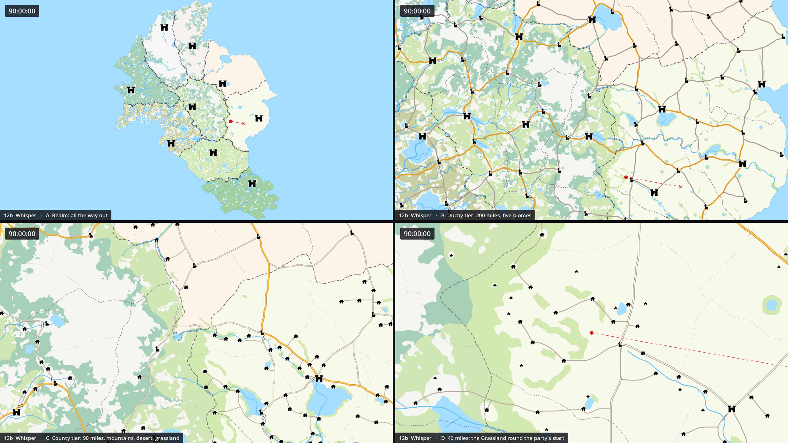
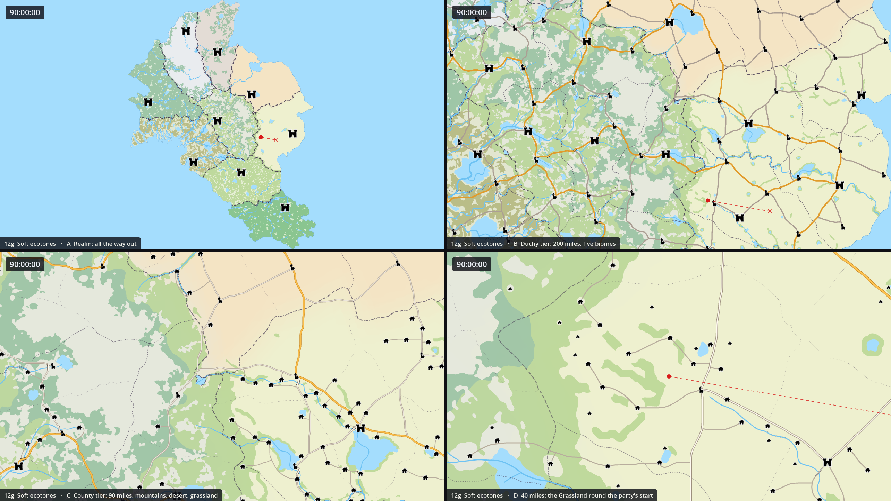

# 12 · Biome ground colours, explored

Proposal 12 gave the open land a colour: each kingdom, which is a biome, a pale ground of its own
country's colour (pictured on the map as it was before the look was applied; that picture is no
longer kept, and `BEFORE=1 harness/render.sh 12` draws it again). When this folder was made the open
land was all one white. It explores the idea on the map
as it was on 2026-10-19: 25 variants, `a` to `y`, each pictured at the same four views and described
fully enough to be adopted later without this conversation. The harness draws the pictures and never
changes the scene.

**Applied: [12b, the whisper](#12b--whisper)**, on 2026-10-19, at the user's choice: 12's palette at
40% of its strength. The user asked for each biome's colour and intensity to be easy to change, as
they mean to tune them, so in the game the ground is one material, `vcom/Resources/MapGround.tres`
(drawn by `vcom/Scripts/WorldMap/MapGround.gdshader`): select it, and each biome under its Shader
Parameters is a group of two, its Color and its Intensity, with an Overall Intensity over all nine;
the editor shows a change at once. `Docs/MAP.md`, "Its look", has it in full. The other variants
were pictured on the white land, before it: the harness takes the ground off for those that draw no
ground of their own (`StyleKit.without_ground()`), and any other variant's ground replaces it, so
each draws again as pictured.

**In short.** The variants answer five questions, and most combine:

- **Which colours, how strong** (a to e). 12's own palette fails two tests: two neighbouring biomes
  are only 2.7 apart (CIEDE2000; about 2 is the least an eye tells apart side by side), and to a
  red-green colour-blind eye the Temperate Mountains and the Evergreen Rainforest are one colour
  (1.3 apart). `d`, lightness steps, fixes both: no two neighbours under 7.9 apart, 5.7 for a
  deuteranope.
- **Where a colour starts and stops** (f to i): the kingdoms' borders, the land's own country,
  soft blends, county by county, or only along the borders.
- **What the land says** (j to o): height, snow and rock, green valleys along rivers, fields round
  the settlements, a sandy strand, the wind from the west.
- **How it is drawn** (p to r, x): marks, paper, watercolour, pictures.
- **When it shows** (s, t, v) and **what else carries it** (u, w, y): by the zoom, by the season,
  with relief, through the forests.

**Recommended:** `d`'s palette as the base, its edges softened by `g`, with `k`'s snow and rock and
`l`'s green valleys as the land's own touches, fading close in as `s` does, so that the roads keep
their contrast where the player chooses one. All of it is one shader on the land and three pictures.
[Choosing](#choosing) has the reasons and the alternatives. The whisper the user took is the lightest
step toward it: its material holds a palette already, so `d`'s colours are nine values on it.

| File | What it is |
|---|---|
| `applied.png` | 12b, the whisper, as applied, at the four views |
| `stronger-option.png` | 12g, soft ecotones, at the same four views: 12's palette at full strength, blended across the borders |

The rest of the pictures (the map at these views before the ground, every other variant, and two
sheets of all of them side by side) were removed by the user once the whisper was chosen, and the
two kept were renamed for what they are (they were `b-whisper.png` and `g-soft-ecotones.png`). Each
variant's section names the style that draws its picture again, `harness/render.sh 12NN`, written
to `MapStyles/` (or `OUT_DIR=`) as it was pictured; `harness/render.sh 1200` draws the map at these
views without its ground.

## Contents

- [How to read the pictures](#how-to-read-the-pictures)
- [Measured](#measured)
- The variants: [the palette](#the-palette-and-its-strength) (a to e), [where it starts and
  stops](#where-a-colour-starts-and-stops) (f to i), [what the land says](#what-the-land-says) (j to
  o), [how it is drawn](#how-it-is-drawn) (p to r, x), [when it shows and what carries
  it](#when-it-shows-and-what-carries-it) (s to w, y)
- [How to adopt any of them](#how-to-adopt-any-of-them)
- [Choosing](#choosing)

## How to read the pictures

Each picture is four views of 1280 by 720, the game's window, captioned in the bottom left; open
them at full size.

| Panel | View | Centred on | Why |
|---|---|---|---|
| A, top left | All the way out (the Realm tier, 832 miles tall) | The land's middle | The nine biomes as the island: the biome map itself |
| B, top right | The Duchy tier, 200 miles tall | (6800, 6400) | Five biomes meet: the Temperate Mountains, the Desert, the Grassland, the Swamp's north and the Evergreen Rainforest's edge; roads, towns, borders over the ground |
| C, bottom left | The County tier, 90 miles tall | (7021, 6084), where the Temperate Mountains, the Desert and the Grassland meet | A three-way meeting close enough for villages and lanes |
| D, bottom right | 40 miles tall | The party's start, county 115, in the open Grassland | Close in, where the ground shows most between the forests: hamlets, roads, a river |

The party has been sent east towards the capital of kingdom 5, so its route shows, as in every
`MapStyles` picture. The settlements are the Penflower Ink pack's pictures, a bought asset: think
before sharing these outside the repo.

The map at these views before the ground, its open land white, is drawn by `harness/render.sh 1200`
(its picture, and the sheets of every variant side by side, are not kept). `../00-current-look.png`
is the map as it now is, the whisper's ground included, at the four standard views.

## Measured

**The palettes.** Every pair of neighbouring biomes (15 pairs: the kingdoms' borders) compared in
CIEDE2000, as seen and as seen with deuteranopia (Machado et al. 2009, full strength, the harness's
`colour_check.py`):

| Palette | Variants | Lightness (L*) | Closest neighbours | With deuteranopia |
|---|---|---|---|---|
| 12's | a, f to r, s to w | 88 to 94 | 2.7, the Swamp and the Deciduous Forest | 1.3, the Temperate Mountains and the Evergreen Rainforest |
| 12's at 40%, as applied | b | 95 to 98 | 1.2, the Swamp and the Deciduous Forest | 0.6: the Temperate Mountains and the Evergreen Rainforest, the Deciduous and Tropical forests, the Swamp and the Deciduous Forest |
| Bold atlas | c, i, r, s, t | 81 to 91 | 5.2, the Deciduous and Tropical forests | 3.1, the Volcanic and Temperate Mountains |
| Lightness steps | d | 76 to 97 | 7.9, the Grassland and the Deciduous Forest | 5.7, the same |
| Earth tones | e | 77 to 95 | 3.6, the Desert and the Grassland | 2.8, the same |

**The lines on it.** A coloured ground takes contrast from every line drawn over it. On each
palette's darkest ground, as a share of the contrast against white (CIE76):

| Palette | Darkest ground | Border ink | A road's edges | A lane's edges |
|---|---|---|---|---|
| 12's | L* 88 (the Volcanic Mountains) | 87% | 70% | 60% |
| 12's at 40%, as applied | L* 95 (the Volcanic Mountains) | 95% | 88% | 84% |
| Bold atlas | L* 81 | 92% | 65% | 67% |
| Lightness steps | L* 76 (the Deciduous Forest) | 87% | 60% | 65% |
| Earth tones | L* 77 | 83% | 46% | 41% |

The borders' dark ink holds up on any of them. The roads' and lanes' warm grey edges lose the most,
on warm grounds above all: earth tones cost a road more than half its contrast. That is the main
argument for keeping the ground light where the roads matter (close in: `s`).

**The heights** (`k`, `v`): rock over 1,200 m covers 5.4% of the land, all in the three mountain
kingdoms; snow over a snowline of 2,145 m in the south falling to 1,550 m in the north covers 1.8%
(8.6% of the Temperate Mountains, 5.3% of the Tundra, 2% of the Volcanic Mountains). Winter's
snowline (840 m in the south, 130 m in the north) covers a third of the land, 93% of the Tundra.

**What it costs.** A flat palette, in the scene or through the shader, nothing: 0.32, 0.23 and 0.19
ms of GPU at views B, C and D, as the map without a ground. The shader's parts that read one picture (height,
snow, valleys, fields, strand) were within 0.1 ms of that. The dearest add a little at the Duchy
tier, measured over 120 frames a view on the RTX 3060 laptop: soft ecotones 0.15 ms (17 reads a
pixel), paper 0.3, pictograms 0.4, the watercolour wash 0.65 and the area symbols 0.7 (nine places
looked at a pixel, at two spacings). No variant adds a draw call but `u`'s relief, which adds two.
The whisper as applied costs nothing measurable either (0.32, 0.22 and 0.19 ms, with or without it),
since `MapGround.gdshader` picks a county's colour once a vertex: picked in each pixel, from a table
of the nine made in every pixel, it had tripled the map's GPU time. A part ported to it from
`harness/shaders/ground.gdshader` that reads a picture has to read it in the pixel, but nothing that
is the same all over a county should be.

## The palette and its strength

### 12a · As proposed, on today's look

*Its picture is not kept: `harness/render.sh 1201` draws it again.*

**What it is.** Proposal 12 unchanged, on the map as it then was: each kingdom's open land a flat, pale
ground in its biome's colour, meeting its neighbour's exactly on the kingdom's border; the forests a
shade deeper and more solid than the map's 0.38, so they still stand out on a ground that is no
longer white.

**Values.** Ground by biome: 1 Tundra Mountains #e9ecef, 2 Volcanic Mountains #e3dcd5, 3 Temperate
Mountains #e5e8dc, 4 Desert #f4e4c4, 5 Grassland #eef0cf, 6 Evergreen Temperate Rainforest #dcebd8,
7 Swamp #e2e6cf, 8 Deciduous Forest #e6efd6, 9 Tropical Rainforest #d9ecce. Forests: conifer
#86b894 at 0.72, broadleaf #acd085 at 0.7, swamp #a9ad6c at 0.72, tropical #6fb87b at 0.75.

**How to adopt.** On the ground's material, `vcom/Resources/MapGround.tres`, applied with `b`: each
biome's Color as above, at Intensity 1. And the four forest kinds' `color` on their scenes
(`Scenes/ConiferForest.tscn` and the rest). No scene edit: every county names its biome already.

**Trade-offs.** The palette's neighbours are close (2.7) and two collapse to one colour for a
deuteranope ([Measured](#measured)). The deeper forests are a second change to the look.

### 12b · Whisper

*Applied on 2026-10-19, at the user's choice. The picture (`applied.png`) is the harness's; the
scene, drawn at these views, came out the same but for a shade on 22 pixels.*

**What it is.** 12's hues at 40% of their strength, the forests left as they were: the biome is a
hint under everything, felt more than seen. The cheapest change that still says "desert here,
tundra there", and the least likely to cost a line its contrast.

**Values.** 12's palette mixed 40% from white (`strength` 0.4). On the screen: 1 #f6f7f9, 2 #f4f1ee,
3 #f5f6f1, 4 #fbf4e7, 5 #f8f9ec, 6 #f1f7ef, 7 #f3f5ec, 8 #f5f9ef, 9 #f0f7eb.

**How it was adopted.** As one material, so that each biome's colour and intensity is changed in one
place, as the user asked: `vcom/Resources/MapGround.tres`, drawn by
`vcom/Scripts/WorldMap/MapGround.gdshader`, on every county and the island in a lake, each naming its
biome (its kingdom's) as an instance parameter. Each biome's Color is 12's own and its Intensity
0.4, Overall Intensity 1. No forest change. `Docs/MAP.md`, "Its look", has the rest.

**Trade-offs.** All the way out the biomes are only just told apart (the Swamp and the Deciduous
Forest 1.2 apart, the Tundra 1.7 from white); the deuteranope problem of 12's palette is worse at
this strength: three pairs of neighbours 0.6 apart ([Measured](#measured)). Every line keeps 84% of
its contrast or more.

### 12c · Bold atlas

*Its picture is not kept: `harness/render.sh 1203` draws it again.*

**What it is.** The same hues as 12, about twice as strong, as a school atlas's biome map: the
realm reads as nine countries at a glance, all the way out. The forests a shade deeper again, so
they keep their edge.

**Values.** 1 #d5dee8, 2 #dcc7bd, 3 #d4dbc3, 4 #f2d398, 5 #e6e9ad, 6 #bcdcc8, 7 #c6cfa0, 8 #cde4ae,
9 #b0d9a2. Forests: conifer #4e8e68, broadleaf #7cae56, swamp #7a873a, tropical #3c8e4a, each at
0.6 to 0.62.

**How to adopt.** As `a` with these colours.

**Trade-offs.** Strong enough to compete with the lines: a road's edges keep 65% of their contrast on
the darkest ground. Better far out than close in (see `s`).

### 12d · Lightness steps

*Its picture is not kept: `harness/render.sh 1204` draws it again.*

**What it is.** Every biome differs from each of its neighbours in lightness as well as in hue, so
the biomes stay apart in greyscale, on a dim screen and to a red-green colour-blind eye. The
Temperate Mountains, which border seven biomes, are the lightest; the rest sit on three steps
chosen so that no two neighbours share one (a three-colouring of the kingdoms' neighbour graph,
which has a cycle of seven round the mountains, so two steps would not do).

**Values.** 1 #dce2ea (L* 90), 2 #c9b9ae (76), 3 #f6f6f1 (97), 4 #f8e8bb (92), 5 #cdcc93 (81),
6 #c2d6c9 (84), 7 #e0e3c8 (89), 8 #adc193 (76), 9 #d2e6c9 (89). Forests as 12's. Closest neighbours
7.9 apart, 5.7 with deuteranopia.

**How to adopt.** As `a` with these colours.

**Trade-offs.** The darkest steps (L* 76) are the darkest grounds here, and the Grassland's olive is
heavy over the east; a road's edges keep 60% of their contrast there. With `s`'s fade the problem
goes where it matters. The lightness order (mountains light, the Deciduous Forest dark) is chosen by
the graph, not by the country: a lighter Deciduous Forest would need its neighbours shifted.

### 12e · Earth tones

*Its picture is not kept: `harness/render.sh 1205` draws it again.*

**What it is.** The ground in stone, ash, sand, straw, loam and clay: no green and no blue, which are
left to the forests and the water. A green on the map then always means forest, where battles are
met, and a blue always water.

**Values.** 1 #e6e7e6, 2 #d0c0b4, 3 #f4f0e7, 4 #f3ddaf, 5 #e2d4a9, 6 #d4cebf, 7 #efe6cc, 8 #cdbd99,
9 #ecdcbb. Forests as 12's.

**How to adopt.** As `a` with these colours.

**Trade-offs.** The roads suffer most of any palette: their warm grey edges keep only 46% of their
contrast on the darkest ground, a lane's 41%. Neighbours 3.6 apart (2.8 for a deuteranope). The
rainforests become brown country under green forest, which reads oddly where little forest grows.

## Where a colour starts and stops

### 12f · By the land, not the kingdom

*Its picture is not kept: `harness/render.sh 1206` draws it again.*

**What it is.** The biomes as the land was shaped (`SourceData/TerrainMap.png`), not as the kingdoms
were later drawn along rivers and ridges: on 3.9% of the land the country is a neighbour's, so a
desert runs on a little past its kingdom's border and a range crosses into the grassland, and the
colour no longer jumps at every political line. The ground says what the country is like, the
border whose it is. Blended over 1 km where the biomes meet, which hides the picture's 335 m pixels
close in.

**Values.** 12's palette, from `TerrainMap.png`; `soft_units` 10.

**How to adopt.** Needs the ground shader ([below](#how-to-adopt-any-of-them)) with `source` 1 and the
terrain map imported as an id map (nearest filtering, no mipmaps, lossless). The county polygons'
own colours are no longer used.

**Trade-offs.** A party crossing a border sees no change in the ground, and a change of ground
where there is no border; whether that is a feature is the user's call. Edges follow the pixels of
the source picture, softened, not the scene's smooth lines.

### 12g · Soft ecotones

*Its picture is kept beside the applied whisper's, as `stronger-option.png`.*

**What it is.** Where two biomes meet their colours blend over some 14 km, as real country changes:
the steppe greens toward the forest, the desert's sand fades into the grassland's straw. No hard
edge in the ground at all; a kingdom's border is drawn by its line alone.

**Values.** 12's palette from `KingdomMap.png`, averaged over a disc of 140 units (17 taps on a
golden-angle spiral, the sea left out).

**How to adopt.** The ground shader with `source` 1 and `soft_units` 140; the kingdom map as an id
map.

**Trade-offs.** 17 texture reads a land pixel: still nothing measurable here, but the dearest of the
ground's parts. Combines with any palette; with `d`'s the blend passes through in-between
lightnesses, which is fine.

### 12h · County patchwork

*Its picture is not kept: `harness/render.sh 1208` draws it again.*

**What it is.** Each county its biome's colour made a little lighter or darker, warmer or cooler (up
to 4%, the same for a county every time), like a hand-coloured estate map: the counties show in the
ground itself at every zoom, even where their dotted borders are faint or not yet shown (they come
at 100 miles now), and the biome still reads by its hue.

**Values.** 12's palette; each county `lightened` or `darkened` by up to 0.04 and its red and blue
moved apart by up to 0.02, from a generator seeded with its name.

**How to adopt.** The ground's material gives every county of a biome one colour, so the patchwork
is the counties' own: each county's `color` varied once, in the scene, which the material mixes from,
so that it shows through by one less the intensity (all of it at 0, none at 1); or a shade a county as
a second instance parameter in `MapGround.gdshader`.

**Trade-offs.** Busier: 220 patches where there were 9. It makes the counties as visible far out as
the duchies, which 19a's later county borders were meant to avoid.

### 12i · Biome bands at the borders

*Its picture is not kept: `harness/render.sh 1209` draws it again.*

**What it is.** The biome's colour only in a band 26 screen pixels wide inside each kingdom's
border, fading to white within: proposal 03's kingdom band, in the biome's colour. Every kingdom is
framed by its country; the middle of the map is left white for the roads and settlements.

**Values.** The bold palette; `band_px` 26, falling off with the square of the distance; read from
`harness/data/kingdom_edge.png` (how far each pixel is from a kingdom's border, as the scene draws
them).

**How to adopt.** The ground shader with `band_px` 26 and the edge picture imported (mipmaps,
linear, lossless). Run `harness/tools/make_data.py` again after moving a kingdom border by hand, or
the band stays where the border was.

**Trade-offs.** The band keeps its width on the screen, so far out the whole of a small country is
band; close in a party in a kingdom's middle sees no biome at all.

## What the land says

### 12j · Uplands and lowlands

*Its picture is not kept: `harness/render.sh 1210` draws it again.*

**What it is.** 12's grounds made cooler and darker with height and warmer near sea level: the shape
of the land in the ground's tone, without a relief's shading. The mountain kingdoms darken toward
their spines, the river plains glow warm.

**Values.** `height_shade` 0.45 toward #b8bdcc (multiplied) from a height value of 0.12 to 0.85
(elevation.png's square root of the height's share of 3,352 m); `low_shade` 0.5 toward #fff7e6 under
0.3.

**How to adopt.** The ground shader with the heights picture (`harness/data/elevation.png`,
3100 by 4000, mipmaps, linear, lossless; 12 MB of video memory, 16 with mipmaps, or a quarter at
half the size, which this would not miss).

**Trade-offs.** Darker grounds in the mountains cost the lines there a little; at 45% it is subtle.

### 12k · Snow and bare rock

*Its picture is not kept: `harness/render.sh 1211` draws it again.*

**What it is.** Whatever the biome, bare rock above about 1,200 m and snow above the snowline, both
edges softened and ragged; the biome's own colour, at 70%, below. The heights become country of
their own: the passes and peaks a party would cross.

**Values.** Rock (#ccc7c2) from a height value of 0.6 (1,207 m); snow (#f7f9ff) from 0.8 (2,145 m)
in the south, the snowline 0.12 lower at the sheet's top (1,550 m in the far north); edges softened
over 0.025 and moved by noise up to 0.03. Rock on 5.4% of the land, snow on 1.8% ([Measured](#measured)).

**How to adopt.** The ground shader with the heights picture, `rock_from`, `snow_from`, `snow_north`.

**Trade-offs.** White snow is the land's old white: a party there sees a bright patch with dark
lines on it, which reads well. The snowline is a guess at a climate, not measured.

### 12l · Green river valleys

*Its picture is not kept: `harness/render.sh 1212` draws it again.*

**What it is.** In the dry country a green strip follows every river, as oases and water meadows
do: wide along the great rivers, a thread along a stream. Fullest in the Desert, none in the four
wet biomes, which are green already. Where the water is, the land lives.

**Values.** #c9e0a8 by `harness/data/wetness.png` (each river of `SourceData/Rivers.json` drawn four
times its width, blurred over 3.4 km) times 0.85, times each biome's share: Desert 1.0, Grassland
0.8, Volcanic 0.6, Temperate Mountains 0.45, Tundra 0.35, the rest 0.

**How to adopt.** The ground shader with the wetness picture (1550 by 2000, made by
`harness/tools/make_data.py`; mipmaps, linear, lossless) and the `dry` shares. Make it again if the
rivers change.

**Trade-offs.** The strips follow the rivers as `Rivers.json` has them; a river reshaped by hand in
the scene keeps its old strip until the picture is made again from the scene's lines.

### 12m · Fields round the settlements

*Its picture is not kept: `harness/render.sh 1213` draws it again.*

**What it is.** Where people live the land is farmed: a patchwork of fields in wheat, pasture and
fallow, thick round the towns and thinning between the villages, over 12's grounds at 75%. Far out,
where a field is under a few pixels, an even tint instead. The wild land, where battles are met, is
what is left.

**Values.** Fields of 20 map units (2 km, turned 30 degrees so no grid shows), each #efe2a6,
#d6e7b5 or #e7d9bd at random, present where `harness/data/farmland.png` (every settlement a disc by
its rank, 26 to 4 px, blurred over 4 km) times 1.1 beats a random threshold; `strength` 0.75.

**How to adopt.** The ground shader with the farmland picture (1550 by 2000; mipmaps, linear,
lossless). Make it again when settlements are added or moved.

**Trade-offs.** The fields are drawn, not grown: they ignore forests and slopes and run under the
forests' see-through fill. A natural first step toward the ground meaning something to play: the
settled land as safe country.

### 12n · A coastal strand

*Its picture is not kept: `harness/render.sh 1214` draws it again.*

**What it is.** A pale sand strand along the sea, a few kilometres deep and ragged: beaches and
dunes, which frame the island and soften the line where the land meets the water. Seen in view A;
the other views have little coast.

**Values.** #f6ebc8 where `harness/data/coast.png` (the share of the sea within 2.7 km, blurred
twice) plus noise passes 0.35 to 0.55; `coast_strength` 1.

**How to adopt.** The ground shader with the coast picture (1550 by 2000; mipmaps, linear,
lossless).

**Trade-offs.** Too thin to see far out and too uniform close in, where real coasts are cliffs as
often as beaches; a cliff coast would want the heights.

### 12o · The wind from the west

*Its picture is not kept: `harness/render.sh 1215` draws it again.*

**What it is.** The island's weather comes from the west (a decision of the map's from the start), so
its west is wetter and its east drier: 12's grounds tinted greener toward the west coast and warmer
and browner toward the east, across every biome, tilted a little to follow the island's lie. A
gradient no border interrupts, under the biomes' own steps.

**Values.** Each ground multiplied by a tint from (0.9, 1.0, 0.92) in the west to (1.0, 0.92, 0.8)
in the east, by a smoothstep from 0.12 to 0.9 of the sheet's width (with a fifth of its height
added); `moisture` 1.

**How to adopt.** The ground shader with `moisture` and its two tints; no picture.

**Trade-offs.** Strong in the east, where the Desert and the Grassland were warm already: the two
draw closer. A rain shadow (drier east of each range) would want the heights.

## How it is drawn

### 12p · Area symbols

*Its picture is not kept: `harness/render.sh 1216` draws it again.*

**What it is.** Each biome's ground carries a small mark of its own, as topographic maps mark sand,
marsh and rock: ice crosses on the Tundra, cinders on the Volcanic Mountains, rock strokes on the
Temperate Mountains, dune arcs in the Desert, grass tufts on the Grassland, leaves in the Evergreen
Rainforest, marsh tufts in the Swamp, rings in the Deciduous Forest, stipple in the Tropical
Rainforest. The biome reads by its mark in greyscale and to any eye.

**Values.** 15 screen pixels apart at every zoom (two spacings a power of two apart, faded across as
the zoom moves, as proposal 07's tree marks), on 80% of the places, jittered, in a brown ink
(0.33, 0.28, 0.2) at 30%, over 12's grounds at 70%. Each mark is drawn by the biome under its own
place, so none spills into a neighbour.

**How to adopt.** The ground shader with `pattern` (ten ints, by biome) and its colour, size and
spacing; no picture beyond the id map.

**Trade-offs.** A texture over everything, which the forests' see-through fill shows through; at 30%
it stays under the lines. The marks read as texture far out and as marks close in.

### 12q · Paper and mottle

*Its picture is not kept: `harness/render.sh 1217` draws it again.*

**What it is.** 12's grounds with a broad mottle and a fine grain over them, anchored to the map and
keeping their size on the screen at every zoom: the hand-coloured paper of an old atlas, which
matches the settlements' pen-and-ink pictures.

**Values.** A mottle about 260 screen pixels across and a grain about 9, darkening up to 35% of the
way toward a brown (0.55, 0.42, 0.25) times 1.25 (land.gdshader's paper, as proposals 25 and 26 used
it).

**How to adopt.** The ground shader with `paper` 0.35.

**Trade-offs.** Dirty rather than aged if pushed: 0.55 looked like stains, hence 0.35. Moves with the
map, so it never swims.

### 12r · Watercolour wash

*Its picture is not kept: `harness/render.sh 1218` draws it again.*

**What it is.** The atlas palette blended where biomes meet, the pigment pooled darker along those
edges and mottled across each wash, on a faint paper: a painter's map, each biome a wash laid by
hand, the borders inked over it.

**Values.** The bold palette at 85% from `KingdomMap.png`, `soft_units` 70, `wash` 0.6 (darker by up
to 60% of the change in colour across the blend, times nine, plus a mottle 120 px across), `paper`
0.2.

**How to adopt.** The ground shader with `source` 1, `soft_units`, `wash` and `paper`.

**Trade-offs.** The prettiest here and the least like the map's present clean look; the pooled
edges read as a second border line beside the kingdom's.

### 12x · Biome pictograms

*Its picture is not kept: `harness/render.sh 1224` draws it again.*

**What it is.** Little pictures scattered sparsely over each biome, as a fantasy map shows its
country: snowflakes on the Tundra, volcanoes, peaks, cacti, grass, conifers, reeds, round trees,
palms, over a ground of 12's hues at only 35%: the country told by pictures more than by colour.

**Values.** 58 screen pixels apart on 22% of the places, 0.62 of a place across, in a brown ink
(0.32, 0.27, 0.2) at 55%. Each picture is a shape of a few strokes and discs in the shader.

**How to adopt.** The ground shader with `icon` (ten ints, by biome) and its colour, spacing and
density. For real the pictures would better be a small atlas of drawn icons in the Penflower Ink
pack's manner, placed by the same rule.

**Trade-offs.** Busy close in, where a picture can sit beside a settlement's and be taken for one;
they say nothing more than the colour does, but they say it in the settlements' language.

## When it shows, and what carries it

### 12s · Biomes far out, quiet close in

*Its picture is not kept: `harness/render.sh 1219` draws it again.*

**What it is.** The atlas palette whole at and over 400 miles tall, where the map is about the realm,
fading to a quarter of it at and under 40 miles, where it is about the road ahead: the rule 14b gave
the borders, given to the ground. All the way out the island is a biome map; close in the roads and
forests have the white land back.

**Values.** `strength_far` 1 at `fade_far_miles` 400, `strength_near` 0.25 at `fade_near_miles` 40,
by the logarithm of the height between (the view's height worked out in the shader from the screen's
size and the map's scale).

**How to adopt.** The ground shader with the four fade settings. No script: the shader reads the
zoom itself.

**Trade-offs.** None found; the strongest argument for any strong palette.

### 12t · Quiet far out, biomes close in

*Its picture is not kept: `harness/render.sh 1220` draws it again.*

**What it is.** The other way round: the land nearly white far out, where the kingdoms' borders and
the rivers lead, and the biome's colour coming up as the view closes in: the country the party is
in, felt where the party is.

**Values.** `strength_far` 0.15 at 400 miles, `strength_near` 0.9 at 60 miles.

**How to adopt.** As `s`, the other way round.

**Trade-offs.** Strong colour exactly where the roads need their contrast ([Measured](#measured)).

### 12u · With shaded relief

*Its picture is not kept: `harness/render.sh 1221` draws it again.*

**What it is.** 12's grounds under proposal 13's shaded relief: the biome says what the country is,
the relief where its ranges and valleys run. Proposal 17's Terrain mode is this pair.

**Values.** `harness/data/hillshade.png` (lit from the north-west at 45 degrees, a fifth from the west
and the north, heights three times exaggerated), up to 32% shade toward (0.25, 0.28, 0.4) and 8%
light, on two polygons over the land and the forests (`StyleKit.add_relief()`).

**How to adopt.** Proposal 13's two polygons and shaders after `Forests`, with 12's ground (any of
the palettes) under them.

**Trade-offs.** Two more full-sheet polygons and 12 MB of picture (16 with mipmaps). The relief and
`j` both say "height", one by shading, one by tone; one is enough.

### 12v · The seasons

*Its picture is not kept: `harness/render.sh 1222` draws it again.*

**What it is.** The ground follows the campaign's clock (the map's `MapClock`): spring greener and
fresher, summer 12's grounds, autumn golden with the broadleaf forests turned, winter with snow over
the north and the heights, the land browned, the lakes frozen pale and the broadleaf woods bare. One
view, all the way out, in each of the four.

**Values.** Four palettes and snowlines (see `harness/styles/1222_ground_seasons.gd`): spring snow
from a height of 0.82 (0.08 lower in the north), summer 0.9, autumn 0.8 (0.1), winter 0.5 (0.3); the
broadleaf forests #a8d885, #acd085, #d9a65a and #c4bba4 at 0.7; frozen lakes #e4eff4.

**How to adopt.** The ground shader with the palette and snowline set from the clock: one uniform
each, set once a season (or blended over a few days); the broadleaf kind's colour on its scene's
root and the lakes' colour, which cost a redraw of the lakes and the forests when they change. The
clock would need a calendar: it counts days down now, with no date.

**Trade-offs.** A campaign of a few months shows one or two seasons. Winter is the most striking, and
the one that would change play if snow slowed the party.

### 12w · Forests in the biome's family

*Its picture is not kept: `harness/render.sh 1223` draws it again.*

**What it is.** 12's grounds, and every piece of forest in a deeper shade of its own biome's hue
rather than of its kind of tree: grey-green in the Tundra, olive-brown on the Volcanic Mountains, a
gold-olive scrub in the Desert, deep green in the rainforests. Ground and forest are one family per
biome, told apart by depth, and no forest's green clashes with its ground.

**Values.** Forests by biome at 0.6: 1 #7f9a92, 2 #8f8a6e, 3 #7c9c76, 4 #a9a066, 5 #97b064, 6 #4f8a69,
7 #86894a, 8 #73a457, 9 #3f8d50. A piece's biome is its county's kingdom (from its name,
`County125Forest3`).

**How to adopt.** Each forest piece's `color` set by its biome, in the scene (2,459 pieces), instead
of by its kind's scene; or nine forest kinds' scenes, by biome, if the kinds were regrouped.

**Trade-offs.** The forests stop saying which kind of tree they are (conifer, broadleaf, swamp,
tropical), which proposal 07's marks could say instead.

### 12y · The forests carry the biome

*Its picture is not kept: `harness/render.sh 1225` draws it again.*

**What it is.** The open land stays white, as it was before `b`; instead every piece of forest takes its biome's
colour, so half the land, the wild half, is a biome map by itself. No new layer and no shader, and
the white ground keeps every line at its full contrast.

**Values.** Forests by biome at 0.5: 1 #9fb3b8, 2 #b39b8a, 3 #8fae86, 4 #c9b16a, 5 #a9c26a, 6 #5e9a7d,
7 #9a9a52, 8 #86b85f, 9 #3f9a55.

**How to adopt.** As `w`'s forests, with no ground: Overall Intensity 0 on `vcom/Resources/MapGround.tres`
(or kept low, under the forests' colours).

**Trade-offs.** Where little forest grows (the Desert, the Grassland) the biome hardly shows. The
forests are a little stronger than now (0.5 against 0.38).

## How to adopt any of them

**Since `b` the game has a ground to build on**: `vcom/Resources/MapGround.tres`, a `ShaderMaterial`
of `vcom/Scripts/WorldMap/MapGround.gdshader`, on every county and on the island in a lake, each
polygon naming its biome (its kingdom's number) as the instance parameter `biome`. It holds a Color
and an Intensity a biome and an Overall Intensity, and mixes each polygon's own colour, the land's
white, toward its biome's (`Docs/MAP.md`, "Its look").

**Flat palettes are values on it** (a, c, d, e): each biome's Color as the variant gives it, at
Intensity 1 for the palette as pictured (the harness's `strength` is the Intensity). Their forests
go on the four kinds' scenes. `h` varies each county's own colour too, in the scene; `w` and `y`
colour the 2,459 forest pieces in the scene, `y` with the ground at Overall Intensity 0. The editor
shows all of them as the game does.

**Everything else is a part of `harness/shaders/ground.gdshader`**, which every other variant here is
a setting of (each part off at its default), to be ported into `MapGround.gdshader`:

1. Copy the part's uniforms, and its lines in `fragment()`, after the mix toward the biome's colour,
   which stands in for the ground shader's palette and `strength`. Copy too the two lines of its
   `vertex()` that give the pixel its place in the map's units (`world`, which the pictures are read
   by) and the zoom (`px_per_unit`). Leave the biome's colour picked in `vertex()`: what is the same
   all over a county belongs there, and only what reads a picture in the pixel
   ([Measured](#measured), "What it costs").
2. The variants that find the biome a pixel at a time rather than a county (`f`, `g`, `r`, and the
   marks of `p` and `x`) need the id map as well: `SourceData/KingdomMap.png` or `TerrainMap.png`
   imported into `vcom/WorldMap/` (filter off, no mipmaps, lossless: a blended id is no id), the
   colour then the material's for the id read.
3. Import the pictures the chosen parts read into `vcom/WorldMap/`: whichever of
   `harness/data/elevation.png`, `wetness.png`, `farmland.png`, `coast.png` and `kingdom_edge.png`
   (mipmaps, linear, lossless; a compressed format would band their gradients). The half-size ones
   are 3 MB of video memory each, the full-size 12.
4. Set each part's settings on the material as its variant gives them, and time the map at 200
   miles against 0.32 ms of GPU (`EXTRA="--timing=120" harness/render.sh 0`).

`harness/tools/make_data.py` makes the pictures from `MapCreation/` and the scene: run it again
after moving a kingdom border (`kingdom_edge`), a river (`wetness`), a settlement (`farmland`) or the
coast. Then update `Docs/MAP.md` ("Its look": the land takes its biome's colour), `README.md`'s look
table and `CLAUDE.md`'s line on `MapGround.gdshader`, and draw the current look again
(`harness/render.sh 0 91`).

**What the map would not need to change:** MapDetail never touches the land, and a material on a
polygon costs no rebuild. BorderSwitch, the tiers and the forests' see-through fill work as before.

## Choosing

| | Changes | Needs | GPU at the Duchy tier | Notes |
|---|---|---|---|---|
| a | 12's palette | values on the material | as now | close neighbours; one colour to a deuteranope |
| b | 12's at 40% | **applied**, 2026-10-19 | as before it | subtle |
| c | a stronger palette | values on the material | as now | strong far out |
| d | lightness steps | values on the material | as now | the only palette safe for every eye |
| e | earth tones | values on the material | as now | roads lose half their contrast |
| f | the land's country | shader, terrain map | within 0.1 ms | colour and border apart |
| g | soft ecotones | shader, id map | +0.15 ms | no hard edge |
| h | county patchwork | scene colours | as now | counties visible far out |
| i | bands at the borders | shader, edge picture | within 0.1 ms | framed kingdoms, white middles |
| j | the height's tone | shader, heights | within 0.1 ms | relief by tone |
| k | snow and rock | shader, heights | within 0.1 ms | the heights a country of their own |
| l | green valleys | shader, wetness | within 0.1 ms | water gives dry country life |
| m | fields | shader, farmland | within 0.1 ms | the settled land shown |
| n | a strand | shader, coast | within 0.1 ms | thin |
| o | west wet, east dry | shader | within 0.1 ms | a climate across borders |
| p | area symbols | shader, id map | +0.7 ms | readable in greyscale |
| q | paper | shader | +0.3 ms | an atlas's paper |
| r | watercolour | shader, id map | +0.65 ms | painterly |
| s | fades close in | shader | within 0.1 ms | protects the roads |
| t | fades far out | shader | within 0.1 ms | strong where the roads matter |
| u | relief | two polygons, hillshade | a few hundredths | 17's Terrain mode; +2 draw calls |
| v | seasons | shader, the clock | within 0.1 ms | needs a calendar |
| w | forests by biome | scene colours | as now | the forests lose their kind |
| x | pictograms | shader, id map | +0.4 ms | the settlements' language |
| y | the forests carry it | scene colours | as now | the white ground kept |

*The map takes 0.32 ms of GPU at view B, with 12b's ground or without; "within 0.1 ms" are the parts timed only over 10
frames, where the laptop's clocks make single runs jump by a millisecond or more.*

**Recommended:** `d`'s palette, because it is the only one that keeps every neighbour apart for every
eye, with `g`'s soft edges (which also hides that its lightness order is the graph's, not the
country's), `k`'s snow and rock and `l`'s green valleys, which make the land itself say something,
all fading close in as `s` does, so that the roads keep their contrast where the player chooses one.
That is one shader, the kingdom map and two of the data pictures. A lighter first step is `y`: no
code, and the forests become the biome map. (The user took `b`, lighter still: from there `d` is
nine colours on the material, and `k`, `l` and `s` parts ported into its shader.)

**Avoid:** `e` (the roads lose half their contrast), `t` (strong ground exactly where the roads
need contrast), `h` (the counties far out again).

**For the user to decide:** whether the ground should follow the kingdoms or the land (`f`); whether
it should be quiet close in (`s`); whether seasons are wanted (`v`, and with them a calendar); and
whether colour, marks (`p`) or pictures (`x`) should carry the biome.

The pictures were rendered with `harness/render.sh 1200 1201 ... 1225` (the scripts
`harness/styles/1200_*` to `1225_*` hold every value; `1200_ground_now.gd` has the views, palettes
and helpers), and are drawn again the same on the scene with `b` applied: 1200 and 1225 take its
ground off first, and every other variant's own ground replaces it. Redrawn so, `b` and `g` came out
as their pictures here but for a shade on a few dozen pixels.
