# 20 · Fog of war, explored

`todo.txt` asks for a "Map fog of war on unvisited areas". Proposal 20 pictured one
(`20-fog-of-war.png`, kept here, on the map as it was before the look was applied): the land the
party has not seen under a paper-coloured veil, with only what everyone would know sketched over it,
and a ring of 30 miles round the party's start seen. This folder explores the idea on the map as it
was on 2026-10-19: 24
variants, `a` to `x`, each pictured at the same four views and described fully enough to be adopted
later without this conversation. Nothing here is applied: the harness draws the pictures and never
changes the scene.

**In short.** The variants answer five questions, and most combine:

- **What clears the fog** (a, b, o to r): a ring, the party's actual journey, whole counties, the
  maps a town sells, the height of the ground, the roads it meets.
- **What the fog looks like** (b to h, x): paper, night, grey, out of focus, clouds, an engraver's
  hatching, an old map, or no veil at all.
- **What everyone knows through it** (j to n): the realm, the roads, the forests, rumoured towns, or
  only the coast.
- **How knowledge ages** (i, s, t): fading with distance, remembered in grey, the fog returning.
- **Where it ends** (u to w): a surveyed line, a burnt edge, a soft horizon.

**Recommended:** the journey (`b`) as the mechanism, cleared by a sight that grows on high ground
(`q`); the realm known (`j`) under a paper veil, with the forests hatched through it (`l`) because
they decide battles, and rumoured towns (`m`) to give the party somewhere to go; a soft edge. And
county by county (`o`) as the alternative to weigh, for its simplicity. [Choosing](#choosing) has the
reasons.

| File | What it is |
|---|---|
| `20-fog-of-war.png` | Proposal 20 as first pictured, on the map as it was before the look was applied (moved here from `MapStyles/`) |
| `now.png` | The map with no fog at this folder's four views, as it was before 12b's ground, the party where the journey left it |
| `a-*.png` to `x-*.png` | One variant each, at the same four views (`a` round the party's start, as 20 had it) |
| `all-journey-view.png`, `all-edge-view.png` | Every variant side by side at 180 miles round the journey (view B) and 35 miles across its edge (view D) |

## Contents

- [How to read the pictures](#how-to-read-the-pictures)
- [How the fog is made](#how-the-fog-is-made)
- The variants: [what clears it](#what-clears-the-fog) (a, b, o to r), [how it
  looks](#what-the-fog-looks-like) (c to h, x), [what is known
  through it](#what-everyone-knows-through-it) (j to n), [how knowledge
  ages](#how-knowledge-ages) (i, s, t), [where it ends](#where-it-ends) (u to w)
- [How to adopt it](#how-to-adopt-it)
- [Choosing](#choosing)

## How to read the pictures

Every variant but `a` shows the same moment of a campaign: the party has travelled from its start,
county 115's town, by straight lines (as the Party travels) through the towns of counties 112 (a
duchy's capital), 116, 113 and 121 to county 69's (a duchy's capital), some 160 miles in 6 counties,
seeing 20 miles about it as it went; it is at county 69's town now, heading north for county 72's.

| Panel | View | Centred on | Why |
|---|---|---|---|
| A, top left | All the way out (832 miles tall) | The land's middle | How much of the island is fog: nearly all of it |
| B, top right | The Duchy tier, 180 miles tall | (7410, 7104), the journey's middle | The whole of what was seen and the fog round it |
| C, bottom left | The County tier, 70 miles tall | (6759, 6779), the party | Where the party is: its next leg runs north into the fog |
| D, bottom right | 35 miles tall | (7023, 6380), on the edge of its sight north of the last leg | The edge itself, half seen, half fog |

The party's route line runs north from the party. The settlements are the Penflower Ink pack's
pictures, a bought asset: think before sharing these outside the repo.

The pictures were drawn on the white land, just before 12b's ground was applied the same day
(`../12-biome-ground-colours/README.md`). Drawn again, each variant is as pictured over the scene as
it now is: the land the party has seen shows the ground's faint colours, and the fog over the rest
is laid as before (redrawn, `b` differed by at most 19 shades of 255, all of it the ground).

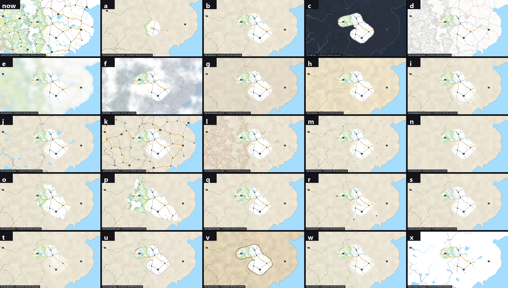

*Every variant at 180 miles round the journey (view B). `all-journey-view.png`; `all-edge-view.png`
is the same 35 miles across the edge.*

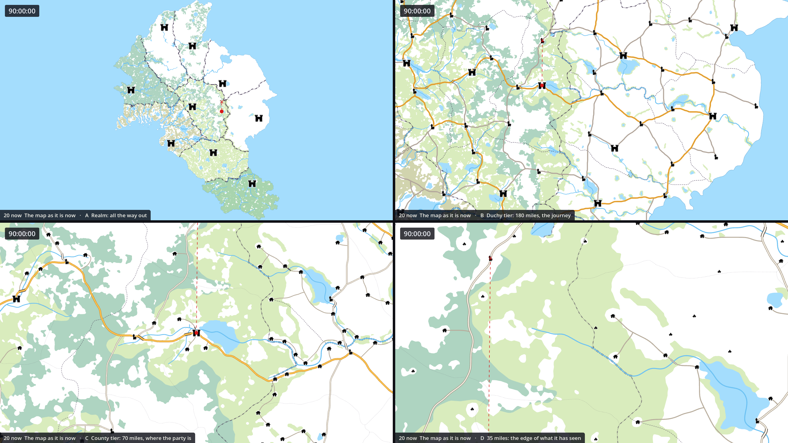

*The map at these views with no fog, as it was before 12b's ground. `now.png`.*

## How the fog is made

Every variant is the same four parts with different settings, which is also how the game would do
it ([How to adopt it](#how-to-adopt-it)):

1. **What the party has seen is a mask**, a picture of the whole MapCreation sheet at about 1 km a
   pixel (1,039 by 1,340, two channels): red how far explored, soft over the outer 30% of its sight;
   green how recently, 1 the newest. The party paints it as it travels: every point within its
   sight of where it has been (`StyleKit.fog_mask()`, given the journey as lines and a radius at each
   point). With mipmaps, which are the same picture blurred.
2. **The fog** is `harness/shaders/fog_veil.gdshader` on copies of the counties' outlines, so it lies
   on the land and the sea stays clear (or on one polygon over everything, for `c` and `f`), drawn
   over the land, forests, borders, water, roads and bridges and under the settlements and the party.
   Its look is a setting: a veil, the land in grey, out of focus, clouds or a hatched engraving, with
   grain, hill marks, a forest hatch, an edge line or a burnt band.
3. **What stays known** is drawn over the fog: copies of the chosen lines (the coast, the kingdoms'
   borders, the great rivers and lakes, the roads), each beside its own so the map's level of detail
   gives it the same tier and width, with `harness/shaders/map_line_fogged.gdshader`, the game's
   line shader drawing only where the fog is, in its own pattern or in the fog's ink.
4. **The settlements not yet seen are hidden**, but those the variant leaves known (the nine
   kingdoms' capitals, as 20 had it).

The fog and the known lines read the mask through one include, `fog_common.gdshaderinc`, so they
agree to the pixel on where the fog is, its ragged edge included.

## What clears the fog

### 20a · As proposed, on today's look

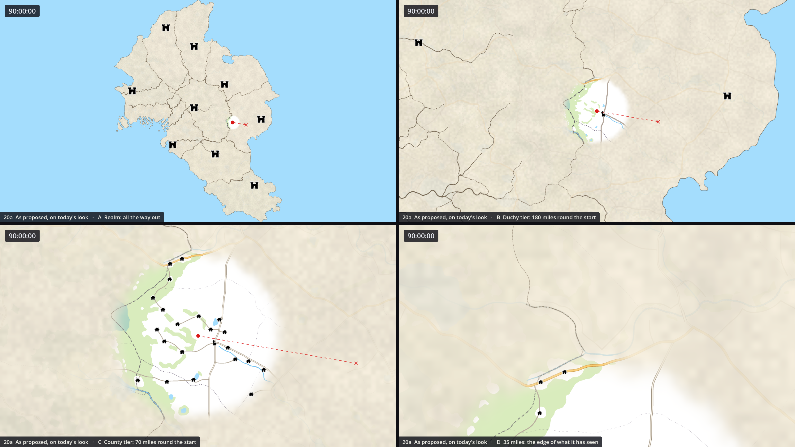

**What it is.** Proposal 20 unchanged, on the map as it then was: a ring of 30 miles round the party's
start is seen; the rest lies under a paper-coloured veil with a faint grain and a ragged edge,
through which the coast, the kingdoms' borders and the great rivers are sketched in a brown ink, and
the nine kingdoms' capitals show. The party at its start; the views are round it.

**Values.** Veil (0.93, 0.9, 0.83) at 93% with a grain of 7%; the ring a single point of the mask,
radius 483 units (30 miles), soft over its outer 30%, the edge moved by noise (two scales, 90 and
28 units across) by up to 0.25 of the mask's range; the sketch in (0.47, 0.41, 0.33) at 0.6 of each
line's width, each in its own pattern.

**How to adopt.** See [How to adopt it](#how-to-adopt-it); a ring is the mask's first stamp.

**Trade-offs.** A ring says nothing about where the party has been since; it is the start of `b`.

### 20b · The journey

**What it is.** What the fog clears is what the party has seen: everything within 20 miles of where
it has been, painted into the mask as it travels. After 160 miles through five towns, a broad band of
known land; the rest as 20 had it. This is the mechanism every variant after it builds on.

**Values.** As `a`, the mask painted along the journey's five legs at 322 units (20 miles).

**How to adopt.** The mask painted by the Party as it moves ([How to adopt it](#how-to-adopt-it)).

**Trade-offs.** Sight is a circle whatever the country; `q` and `r` vary it.

### 20o · County by county

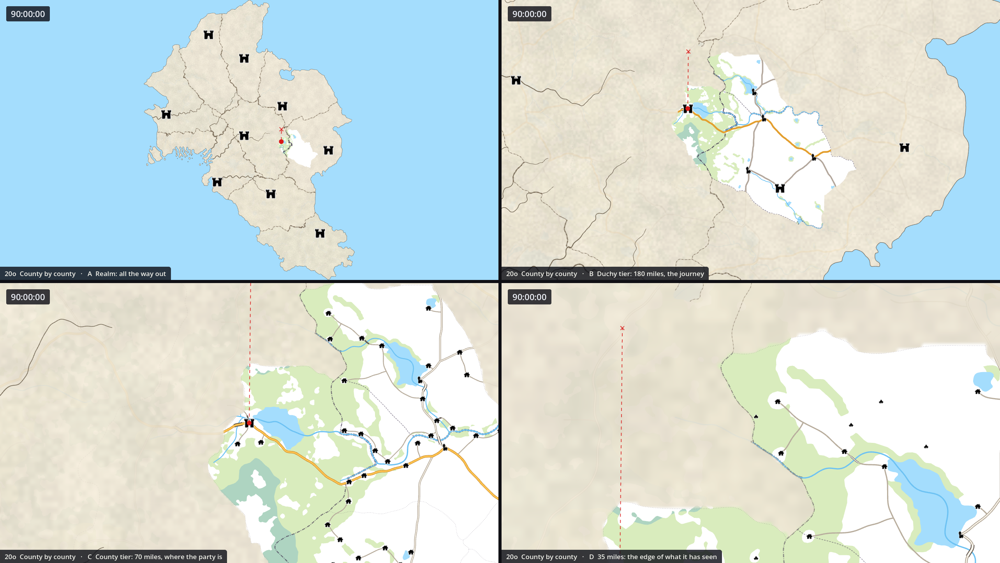

**What it is.** Setting foot in a county reveals the whole of it, at once, and nothing beyond: the
fog lies only on the counties not yet entered, each a copy of its own outline, so the edge is the
county's border exactly. The journey enters 6 counties. Exploring becomes a matter of whole counties,
which the map already counts in, and the frontier is always a border.

**Values.** No sight at all: the mask is the counties entered (from `SourceData/CountyMap.png`), and
the fog has no polygon over them.

**How to adopt.** A set of counties entered (by the county under the party at each step), saved with
the game; the fog a polygon per county, shown or hidden; the known lines' mask made from the set.
The simplest of all to keep and to save: a set of numbers, no picture.

**Trade-offs.** A party on a county's edge sees nothing over the border a mile away, and a large
county is revealed whole by a step inside it. Crisp, map-like and coarse.

### 20p · Towns sell their maps

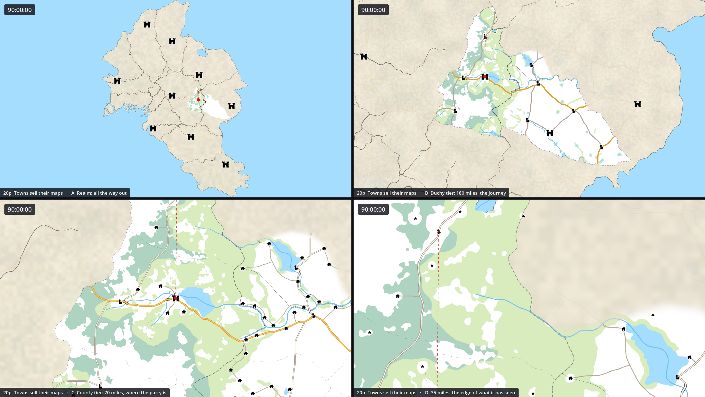

**What it is.** The party sees 15 miles about it, and in each duchy's capital it visits it gets the
duchy's map: every county of that duchy revealed whole. The journey passes two, so two duchies are
known besides the road. A town becomes a place to go for what it knows.

**Values.** The journey at 15 miles; the counties of the duchies of counties 112 and 69 revealed
whole: duchies 14 and 22, which are counties 69 to 72 and 112 to 116, 9 in all.

**How to adopt.** As `b`, and on entering a duchy's capital (or buying the map at its Market, as an
item that is used up at once) every county of its duchy added to the revealed set, as `o` keeps it.

**Trade-offs.** Gives the towns a use beyond hiring and trading. A duchy is large: two maps reveal
more than the whole journey's sight.

### 20q · Height sees further

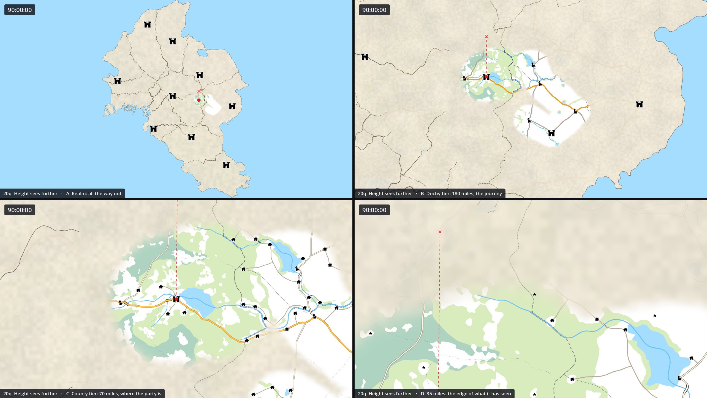

**What it is.** How far the party sees depends on the ground it stands on: about 12 miles at the
sea's edge and more on high ground, worked out every 2 miles along the way. A climb is worth making,
the band of known land swells over hills and narrows along valleys, and the map's own heights decide
it.

**Values.** 6 + 60 times the height's value in `harness/data/elevation.png` (the square root of its
share of 3,352 m) miles: about 24 at 300 m and 36 at 830 m; from 15.2 to 28.1 miles along this
journey, which keeps to fairly low country.

**How to adopt.** As `b`, each step's sight from the heights picture under the party.

**Trade-offs.** True line of sight (a range hiding the valley behind it) would mean a ray march over
the heights each step, some milliseconds; the radius alone is nearly free.

### 20r · Roads lead on

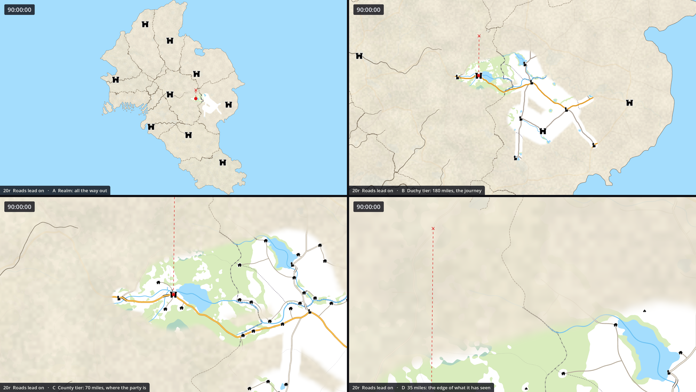

**What it is.** The party sees 15 miles about it, and every road it meets is known for 40 miles
either way from where it met it, 4 miles to each side: the road ahead, asked about at the last inn.
The known land reaches out along the network, so the map shows where a road goes before the party
takes it.

**Values.** A road (`Roads/Highways`, `Roads/Roads`) is met where it passes within 3 miles of the
journey: 13 roads on this one. Each stretch within 40 miles along the road of where it was met is
painted into the mask as a line at 4 miles.

**How to adopt.** As `b`, and on each step every road within 3 miles of the party painted 40 miles
each way.

**Trade-offs.** The known land is spidery: long arms of road in fog, which reads well at the Duchy
tier and oddly all the way out.

## What the fog looks like

### 20c · Night fog

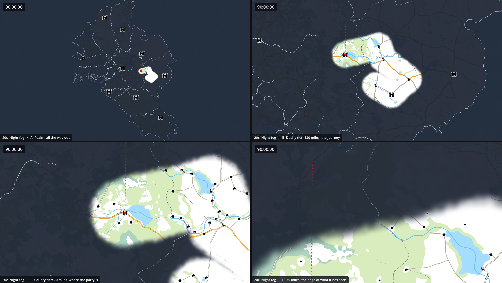

**What it is.** The unknown in a deep blue-black, over the sea as well as the land, as a strategy
game's unexplored map; the coast, the kingdoms' borders and the great rivers sketched in pale silver,
and the nine capitals. The known land is the only lit country on the map.

**Values.** Veil (0.1, 0.13, 0.19) at 92%, grain 5%, over the whole sheet; sketch (0.76, 0.82, 0.9).

**Trade-offs.** The strongest contrast between known and unknown, and the least like the map's paper
look; the settlements' black ink pictures vanish on it (only the capitals show, and badly).

### 20d · The unknown in grey

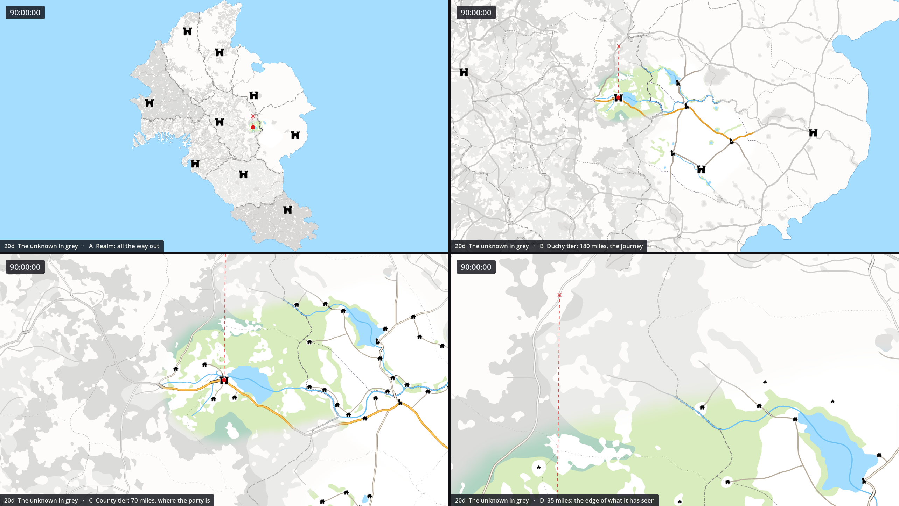

**What it is.** The land not yet seen is drawn as it is, but in grey and lighter: the shape of the
country is known, as from an old map, but not what is there now, and its settlements are hidden.
No sketch is needed: the lines show through in grey.

**Values.** The screen under the fog in greyscale (Rec. 601 weights), 40% of the way to white, with a
quarter of the veil's warm tint (`look` 1).

**How to adopt.** The veil shader reads the screen behind it (`hint_screen_texture`): Godot copies
the screen once for every polygon of the fog that reads it.

**Trade-offs.** Reveals the forests, roads and villages' lanes, everything but the settlements: the
geography is no secret, only its colour. Good for a game where the fog is about news, not maps.

### 20e · Out of focus

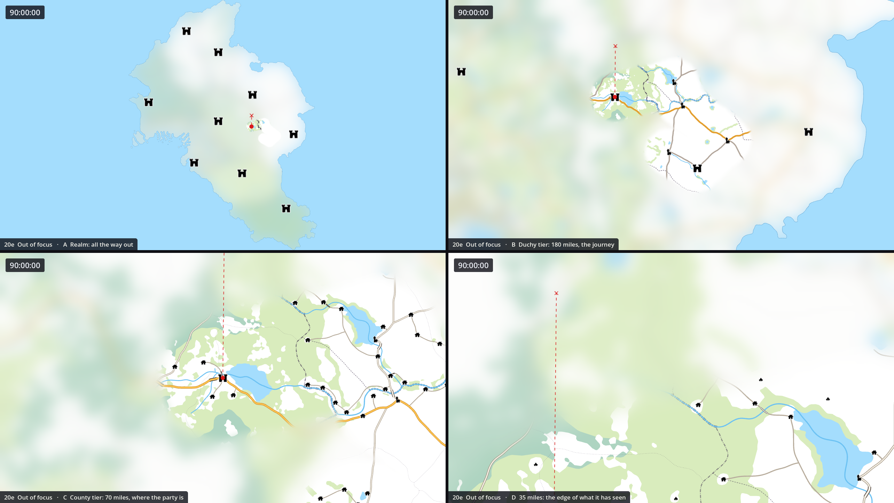

**What it is.** The land not yet seen is drawn as it is but blurred: its broad shapes, the colours of
forest and water, are there, and nothing can be made out. As a photograph's depth of field, the eye
goes to what is in focus: where the party has been.

**Values.** The screen under the fog read at mip level 3.5 (about 11 px of blur), 18% of the way to a
pale veil (`look` 2).

**How to adopt.** As `d`, with the screen texture's mipmaps (`filter_linear_mipmap`).

**Trade-offs.** The blur is in screen pixels, so the same at every zoom: far out it hides little.
Thin lines blur to nothing, broad colour survives.

### 20f · Clouds

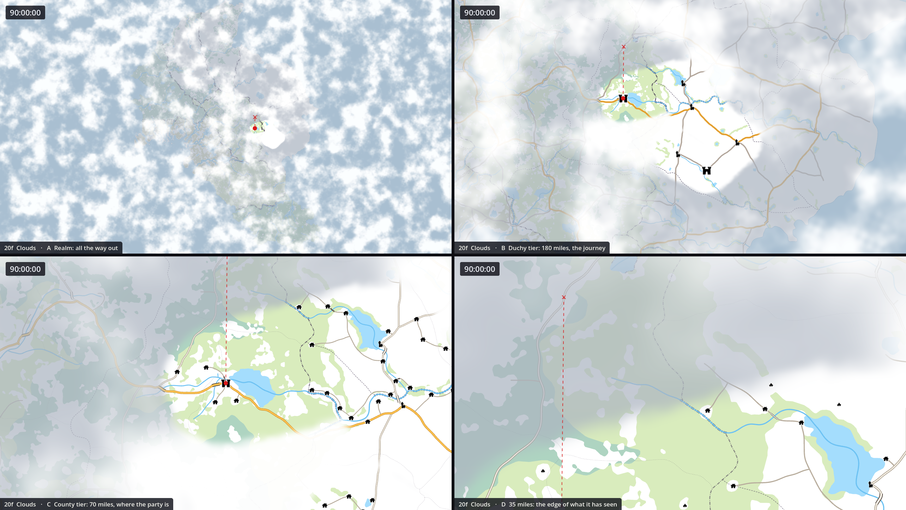

**What it is.** The unknown under soft white clouds with blue-grey shadows, over land and sea alike:
nothing shows through, not even the coast or the capitals, so every journey is a discovery. The
clouds part along the party's way.

**Values.** Four octaves of noise 650 map units across, shadow (0.82, 0.86, 0.92) times 0.82 to white,
at 96% (`look` 3); the edge ragged by 0.35 at 120 units. No known lines, no capitals.

**Trade-offs.** The most game-like, and the most absolute: a party cannot plan beyond what it has
seen. The clouds are still in a picture; for real they could drift slowly (a time offset in the
noise).

### 20g · Terra incognita, engraved

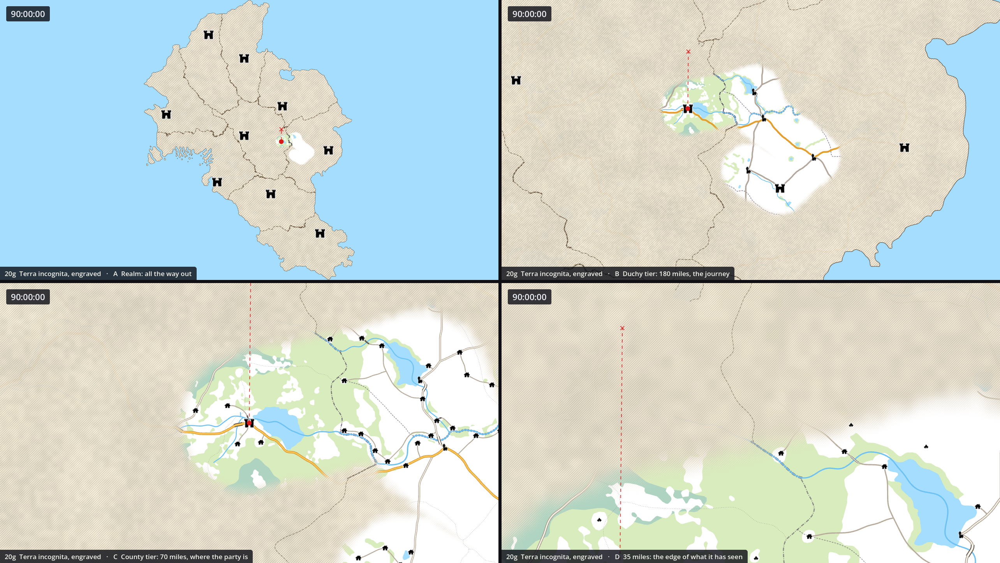

**What it is.** The unknown on a paper veil hatched by an engraver, as old maps filled what they did
not know; the coast and the kingdoms' borders sketched in the same ink. It says "not known" in a way
no flat tint does, and suits the settlements' pen-and-ink pictures.

**Values.** Veil (0.95, 0.92, 0.85) at 95%; diagonal lines 6 screen pixels apart, 18% of the spacing
wide, in (0.42, 0.33, 0.22) at 40% (`look` 4); sketch (0.38, 0.3, 0.2).

**Trade-offs.** The hatch is in screen space, so it stays put while the map pans under it: honest for
an engraving, odd while moving. In map space it would move with the map and change scale with the
zoom.

### 20h · An old map

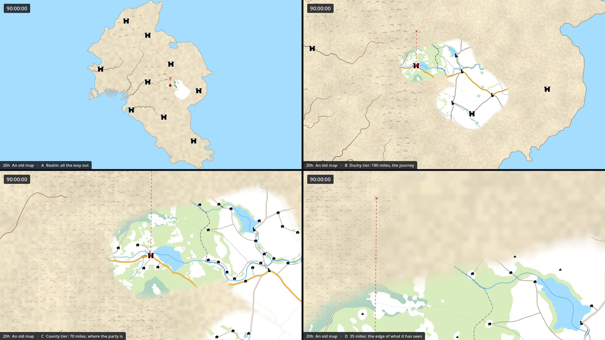

**What it is.** The unknown drawn from an old map: parchment, the coast and the great rivers sketched
in sepia, and hill marks wherever the land is high, as a medieval mapmaker drew ranges he had only
heard of. No borders, which an old map has out of date. The kingdoms' capitals, which every old map
has.

**Values.** Parchment (0.94, 0.89, 0.78) at 94%, grain 10%; a small arch wherever the height's value
is over 0.52 (about 900 m), 26 screen pixels apart on three places in four, larger where higher, in
(0.45, 0.35, 0.22) at 70%; sketch (0.46, 0.34, 0.2).

**Trade-offs.** Busy far out, where the hill marks cover the three mountain kingdoms; reads well close
in. The marks are drawn by the heights picture, so they are true to the land.

### 20x · Unmapped, not veiled

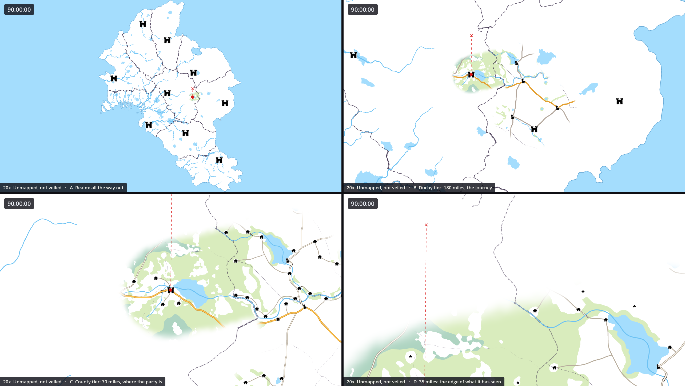

**What it is.** No veil colour at all: the land not yet seen is simply blank, the land's own white, as
an unfinished map is, with what everyone knows drawn on it in its own look (the coast, the kingdoms'
borders, the great rivers and lakes, the nine capitals). The sea stays blue. The map does not look
fogged, only incomplete.

**Values.** Veil white at 100%, no grain; known lines and lakes in their own look at their own width.

**Trade-offs.** The calmest of all, and the most like the map's present look; but the known land's
forests end abruptly at the edge, and the unknown and the known white ground are one colour.

## What everyone knows through it

### 20j · The realm is known

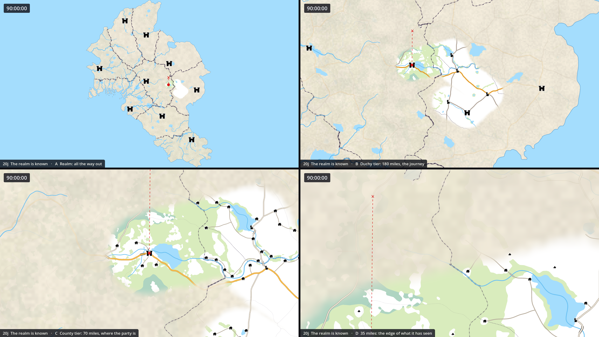

**What it is.** What every traveller knows is the realm itself, drawn whole and in its own look over
the fog: the coast, the kingdoms' borders with their dash-dots, the great rivers, the great lakes,
the nine capitals; exactly what the map shows all the way out (its Realm tier). The duchies,
counties, roads, forests and lesser places wait to be seen.

**Values.** Veil at 90%; known: the coast, every line under `Borders/Kingdoms` and
`BordersOverLakes/Kingdoms`, the rivers 12 units or wider, the lakes 100 units or more across, in
their own look.

**Trade-offs.** The fog then has a rule anyone can learn: what the Realm tier shows is known.

### 20k · The roads are known

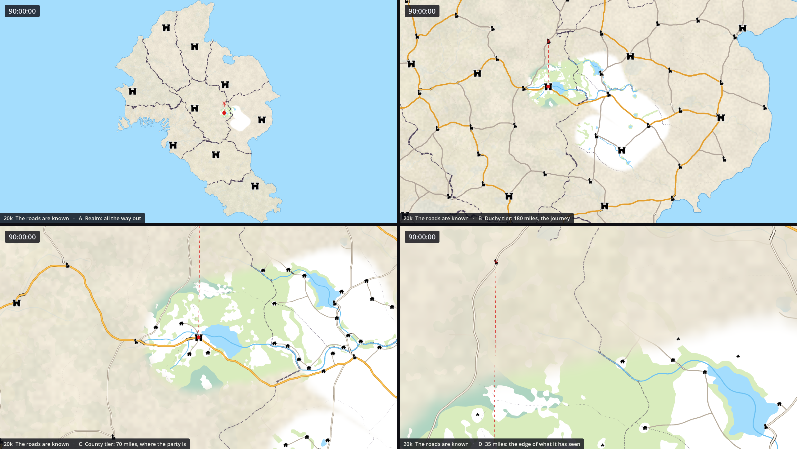

**What it is.** Roads are what travellers talk about: the highways and roads, with their bridges,
show over the fog in their own look, and so do the towns they join, with the coast and the
kingdoms' borders. The fog keeps the land between the roads: the forests, the villages and hamlets,
the lanes, the lesser borders. A party can plan a road journey from the start, and must explore to
find what lies off it.

**Values.** Veil at 90%; known: the coast, the kingdoms' borders, `Roads/Highways`, `Roads/Roads` and
the bridges on them, in their own look; the capitals of kingdoms, duchies and counties shown.

**Trade-offs.** The fog hides the least of the variants that still hide something; the forests,
where battles are met, stay unknown, which may be the point.

### 20l · The forests show through

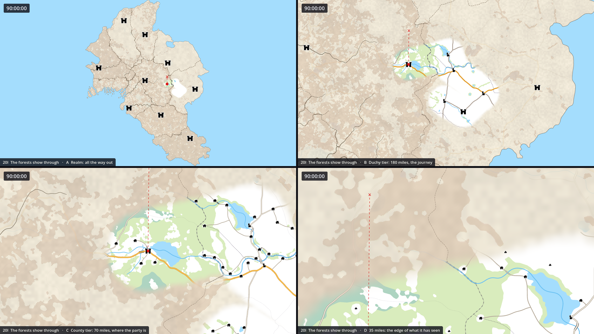

**What it is.** Forests are where battles are met, so their extent is common knowledge even where the
land is not: in the fog every forest is hatched in a rust ink, a warning rather than a picture. The
rest as `b`.

**Values.** Diagonal lines 6 screen pixels apart in (0.62, 0.3, 0.2) at 55%, wherever
`harness/data/forest_mask.png` (every forest of `SourceData/Forests.json`, its clearings cut out)
passes 0.35 to 0.65.

**How to adopt.** As `b`, with the forest picture (1550 by 2000) imported, or for real drawn from the
scene's forest pieces into it by a tool, since pieces are reshaped by hand.

**Trade-offs.** Gives away half the land's shape; but it is the half that matters to a party choosing
a way, and it keeps the encounters fair.

### 20m · Rumoured places

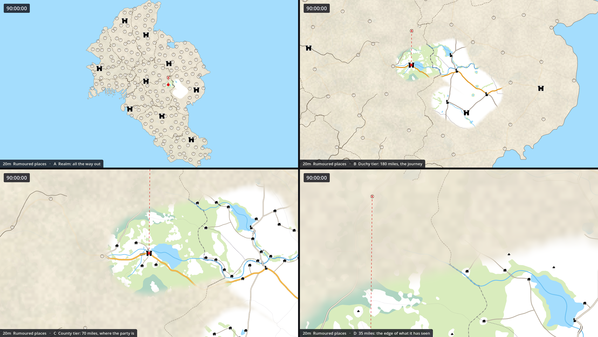

**What it is.** Every town the party has not seen is a faint ring with a question mark over the fog,
the same size on the screen at every zoom: its name and its place are known by hearsay, what it holds
is not. The villages and hamlets stay hidden. The rest as `b`. The map invites the party to go and
see.

**Values.** Every unseen capital of a duchy or a county: a white disc at 55% under a ring 7 screen
pixels across in (0.34, 0.28, 0.2) at 75% with a "?" (`harness/runtime/FogMarks.gd`).

**How to adopt.** A `Destination` would draw this itself while unseen (a `seen` flag), and its tooltip
would give its name and nothing of its locations.

**Trade-offs.** Many marks at once at the Duchy tier; a hearsay radius (towns within so many miles of
anywhere seen) would thin them.

### 20n · Only the coast

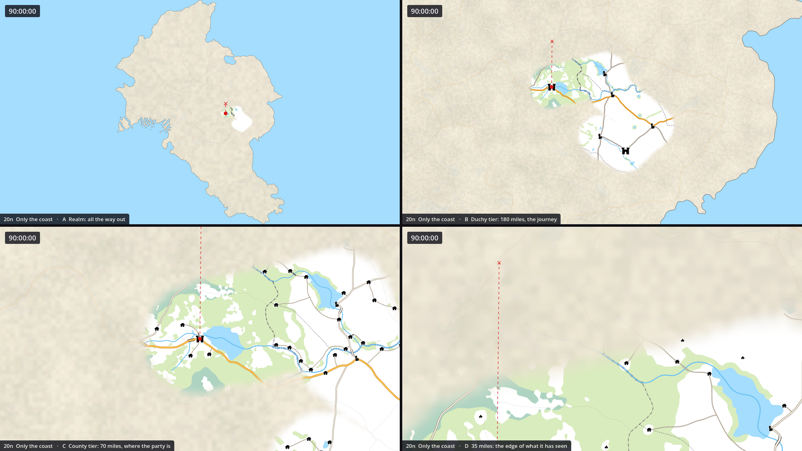

**What it is.** Nothing is known but the island's shape: the coast sketched in ink over the paper
veil, and no capital, border or river. The strongest sense of an unknown country, and the calmest map
at the start of a campaign.

**Values.** As `b` with only the coast known and no settlement kept.

**Trade-offs.** The kingdoms' capitals, which the menus and story may name from the start, are not on
the map until found.

## How knowledge ages

### 20i · Knowledge fades with distance

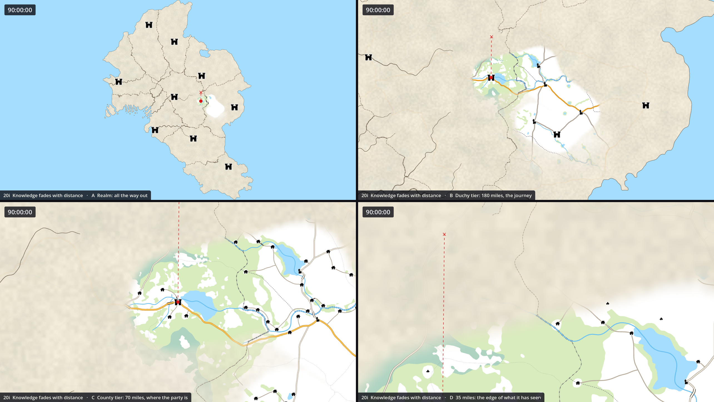

**What it is.** The fog is thin near what the party has seen and thickens the further it lies from
it: the land just beyond the party's sight is half known, guessed from what it saw, and the far side
of the realm is a blank. No hard frontier anywhere.

**Values.** Opacity from 35% where the mask blurred to its sixth mip level (about 64 km across) still
has something, to 95% where it has nothing.

**Trade-offs.** The near land shows through enough to read roads and forests a little way past the
sight, which may say more than wanted.

### 20s · Seen, remembered, unknown

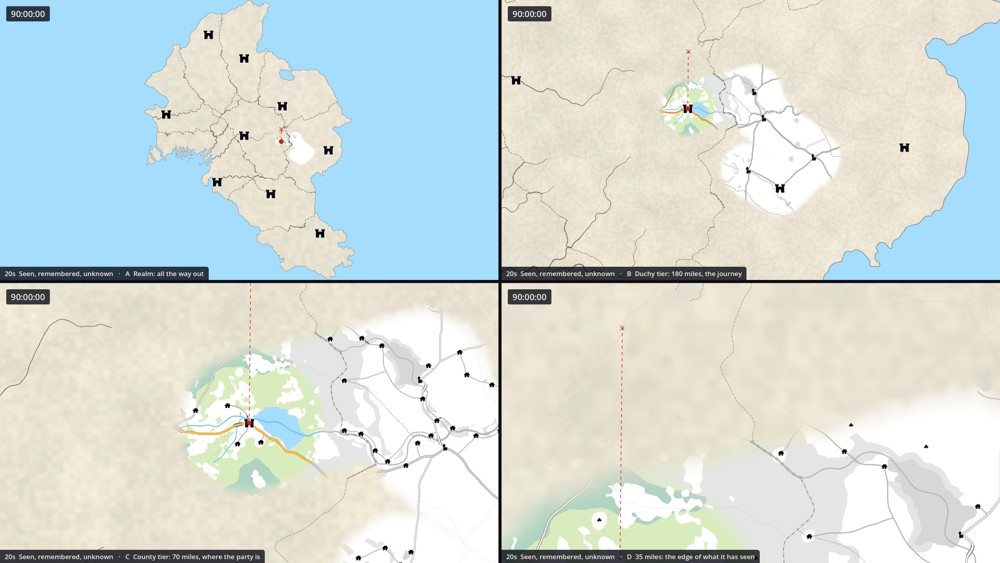

**What it is.** Three states, as a real-time strategy game's fog has: in sight now (20 miles round the
party) in full colour; seen before but out of sight in grey, remembered as it was; never seen under
the paper veil. On a campaign map nothing moves yet, but it says how old the party's knowledge of a
place is, and leaves room for things that do (other parties, events) to show only in sight.

**Values.** Sight 322 units round the party, softened over its outer 18%; the rest of the explored
land in greyscale, 15% toward white (`memory` 1, `memory_look` 1).

**Trade-offs.** Most of the known land is grey most of the time, which is a strong change to the
map's look for little until something on the map moves.

### 20t · The fog returns

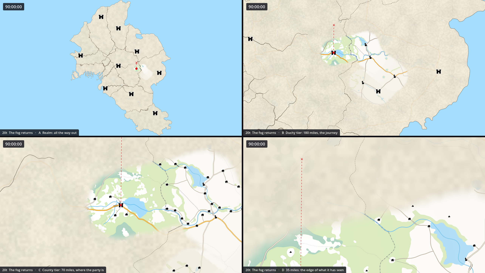

**What it is.** What the party saw long ago fades back under the veil, by how long ago: the start of
the journey is three quarters veiled again, the last leg clear. Knowledge goes out of date, so going
back is worth something.

**Values.** The mask's green painted with the time along the journey; `age_fade` 0.75.

**How to adopt.** The mask's green written with the campaign's clock (the day seen, scaled), and the
fade worked out from the days since: a uniform for today.

**Trade-offs.** A party crossing the realm forgets where it began. Good with `s`, where remembered
land is grey before it is lost.

## Where it ends

### 20u · A surveyed edge

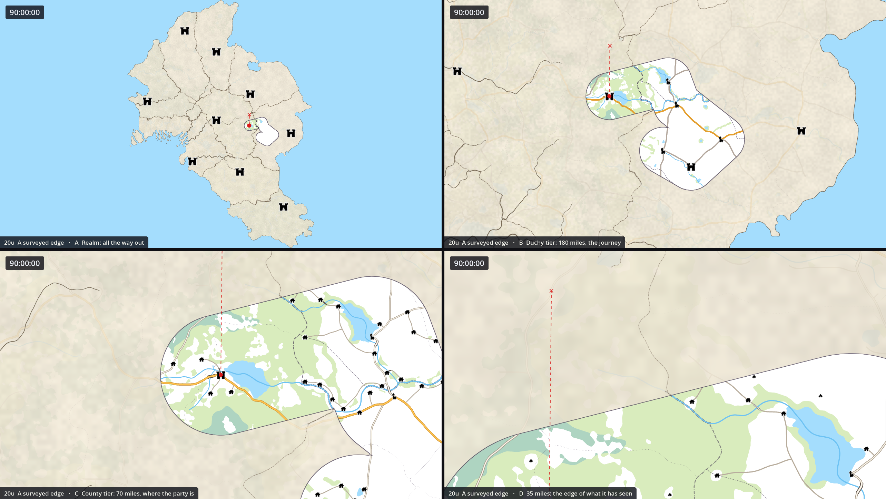

**What it is.** The fog cut sharp where the party's sight ended, with a fine ink line along the edge,
as a surveyor marks the limit of his survey: the frontier is a line on the map, plain at every zoom.

**Values.** `edge_soft` 0.04 (sharp), no raggedness; a line 1.6 screen pixels wide in the borders' ink
(0.24, 0.2, 0.3) at 85%, found from the mask's gradient on the screen.

**Trade-offs.** The edge line can be taken for a border; a dashed one (`rim_dash`) or another colour
would avoid it.

### 20v · Burnt parchment

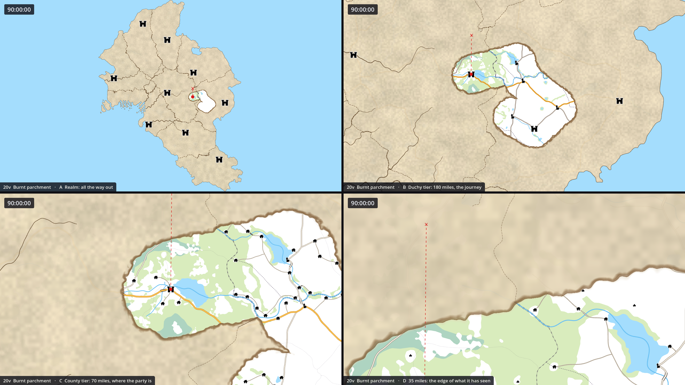

**What it is.** The unknown is the parchment beyond a burnt, ragged edge: a browned band along the
edge, darker paper with a heavier grain beyond, the edge torn by noise at two scales. The known land
seems cut out of an old map.

**Values.** Veil (0.9, 0.84, 0.72) at 95%, grain 12%; ragged by 0.45 at 70 units; a band 16 screen
pixels deep in (0.42, 0.26, 0.1) at 80% on the fog's side of the edge.

**Trade-offs.** Theatrical; the band is a strong frame round the known land at every zoom.

### 20w · A soft horizon

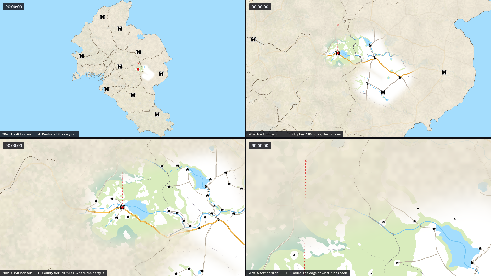

**What it is.** No edge at all: the veil comes in gradually over the outer 70% of the party's sight,
so what it saw clearly near its way fades into what it only glimpsed, and that into the unknown. The
quietest frontier.

**Values.** Sight 26 miles, soft over its outer 70%; `edge_soft` 1, no raggedness; veil at 90%.

**Trade-offs.** Where exactly the party has been is vague; the known land looks smaller than it is.

## How to adopt it

The harness's parts are the game's, in the order to build them:

1. **The mask.** An `Image` of the sheet at about 1 km a pixel (1,039 by 1,340, `FORMAT_RG8`) owned by
   a `FogOfWar` node in `Map.tscn` (or by `Campaign`, since it outlives the map's scene in a battle).
   The Party paints it at the end of every step (`Party.step_length`): every pixel within its sight
   of the step's line, red the most explored so far, green the clock (`StyleKit.fog_mask()` is the
   loop: 2.1 ms a step as it stands, less painting into a kept picture), then
   `ImageTexture.update()`. It must be saved
   with the game (there is no save yet), and `Campaign` should keep it across battles.
2. **The fog's layer.** A group after `Bridges` holding the veil: copies of the counties' outlines
   with one `ShaderMaterial` of `fog_veil.gdshader` (made once by a tool and saved in the scene, or
   built as the scene opens), or one polygon. It needs `fog_common.gdshaderinc` beside it, with its
   `#include` path changed to where they live.
3. **What stays known.** Rather than copies of lines, give the game's `MapLine.gdshader` the fog test
   itself: the mask as a global shader uniform (`map_fog` in `project.godot`'s `[shader_globals]`, as
   `tile_grid` is) and a per-material `fogged` setting, so each kind of line says whether the fog
   hides it, and drawn in the fog's ink or its own look there. The river, lake and coast lines, which
   have no material now, would get a plain one that does the same. The copies were the harness's
   shortcut, since it cannot change the game's shader.
4. **The settlements.** `Destination` gets a `seen` flag, set as the mask clears its point: unseen,
   it is hidden (or drawn as a rumour, `m`) and not pointed at; `MapDetail._wake_places()` already
   skips what is hidden.
5. **What it changes elsewhere.** The reticle's "Go here" over the fog; whether the party may be sent
   into fog at all (it may, in every variant here); `Forest.find_at()` and the encounters are
   untouched. Update `Docs/MAP.md`, `README.md` ("The new world map") and `CLAUDE.md`.

**What it costs.** Measured over 120 frames a view on the RTX 3060 laptop, at views B, C and D: the
map now 0.28, 0.22 and 0.19 ms of GPU; with the fog (`b`) 0.64, 0.54 and 0.42, about a third of a
millisecond more whatever its look (grey `d` 0.60, out of focus `e` 0.65, clouds `f` 0.58, the forest
hatch `l` 0.64; the hill marks `h` the dearest, 0.85, from looking up the heights at nine places a
pixel). The fog's copies of the counties' outlines add a draw call each in view: 104 more at view B
(918 against 814), 23 at C, 11 at D. One polygon over the whole sheet (`c`, `f`) adds one. For real,
the land's outline merged into one polygon once, by a tool, would cost one draw call and keep the sea
clear. Painting the mask in GDScript took 16.5 ms for the whole journey here, 160 miles at once, and
2.1 ms for one step of the party (50 units), most of that the harness's function making a fresh
picture each time: painting into one picture kept for the campaign would cost less, once a step.

## Choosing

| | What clears it | Looks | Known through it | Notes |
|---|---|---|---|---|
| a | a 30-mile ring | paper | sketch: coast, kingdoms, great rivers | 20 as proposed |
| b | the journey, 20 mi | paper | as a | the mechanism |
| c | as b | night, sea too | silver sketch | strongest contrast |
| d | as b | the land in grey | everything but settlements | geography no secret |
| e | as b | out of focus | blurred | depth of field |
| f | as b | clouds, sea too | nothing | most game-like |
| g | as b | engraved hatch | ink sketch | an old map's terra incognita |
| h | as b | parchment, hill marks | sepia coast and rivers | an old map |
| i | as b, thicker far off | paper | as a | no frontier |
| j | as b | paper | the Realm tier, in its own look | a rule anyone learns |
| k | as b | paper | roads and towns | plan by road |
| l | as b | paper | forests hatched | battles are fair |
| m | as b | paper | towns as "?" | somewhere to go |
| n | as b | paper | the coast only | most unknown |
| o | counties entered | paper | as a | simplest to keep |
| p | 15 mi and duchies' maps | paper | as a | towns worth visiting |
| q | sight by height | paper | as a | climbs worth making |
| r | 15 mi and roads 40 mi on | paper | as a | roads lead on |
| s | as b, and sight now | paper, memory in grey | as a | three states |
| t | as b, fading with age | paper | as a | knowledge goes stale |
| u | as b, sharp | paper, ink edge | as a | a surveyed frontier |
| v | as b, ragged | parchment, burnt edge | as a | theatrical |
| w | 26 mi, very soft | paper | as a | no edge at all |
| x | as b | none: blank land | the Realm tier, own look | an unfinished map |

**Recommended:** `b`'s journey, its sight by height as `q` has it; under `a`'s paper veil, with `j`'s
realm known in its own look (a rule a player can learn), `l`'s forest hatch (so a party is never set
upon somewhere it could not have known was forest) and `m`'s rumoured towns (somewhere to go); a soft
edge (`w`'s or `b`'s). It is one mask, one shader and the line shader's fog test. **Weigh against it
`o`**, county by county: crisp, coarse, and a set of numbers to save rather than a picture.

**For the user to decide** (20's own open questions, now with pictures): what is known at the start
(`j`, `k`, `n`); how far the party sees, and whether the ground changes it (`q`); whether the fog
returns (`t`); whether the sea is fogged (`c`, `f`); and how the fog looks, which is mostly a
question of the map's whole style (paper `b`, parchment `h` or `v`, or none, `x`).

The pictures were rendered with `harness/render.sh 2000 2001 ... 2024` (the scripts
`harness/styles/2000_*` to `2024_*` hold every value; `2000_fog_now.gd` has the journey, the views
and the helpers).
