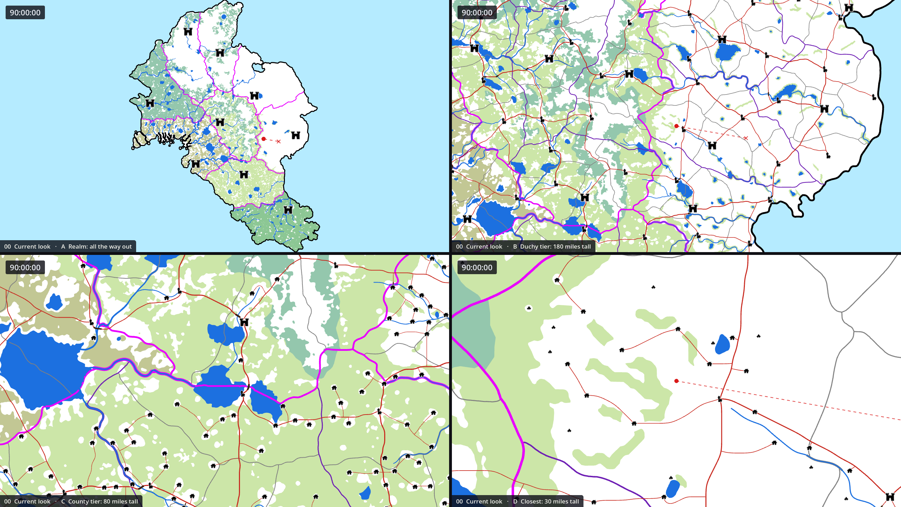
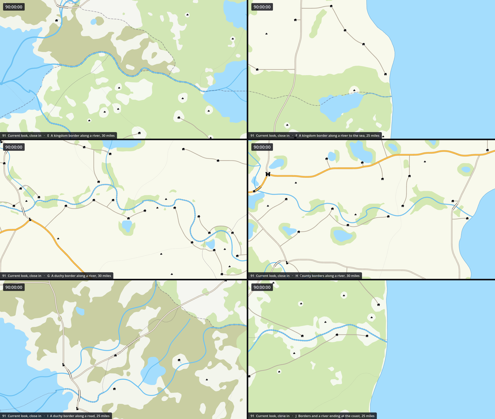
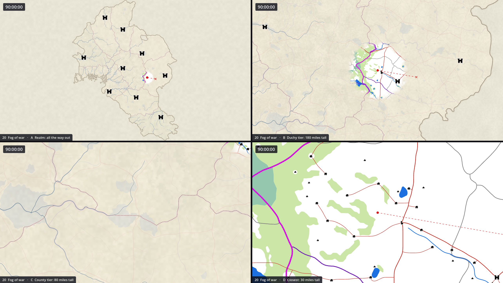

# Map styles

Proposals for the look of the new world map, `vcom/Scenes/Map.tscn`, to make it easier to read: to
tell at a glance what each line is, and to let the eye settle on what matters to the player. Each
proposal was applied to the real scene by a render harness and photographed in the game's own
renderer on 2026-10-18, as the scene was then. **Some are now in the game**, at the user's choice:
on 2026-10-18 02, 04, 05 (in a brighter blue) and 10 where it does not conflict with those,
balanced where they did; and on 2026-10-19 10b, 14b and 19a, variants of 10, 14 and 19 looked at
again on that look ([Revisited](#revisited-on-the-applied-look)), and 12b, the whisper, from the
variants of 12. [The current look](#the-current-look) shows the map as it now is and says what was
applied, and how. The rest are not.

There are 28 proposals. 01 to 21 each take on one part of the problem (the borders, the roads, the
water, the forests, the ground, names, what is shown where, colour vision) and most of them combine
freely; 22 to 27 are whole looks; 28 is the blend recommended here.

**No proposal's own picture is kept here any more.** 12 and 20 were explored further, each in a
folder of its own: [`12-biome-ground-colours/`](12-biome-ground-colours/README.md), 25 variants, of
which 12b is now applied (12's own picture was removed after), and
[`20-fog-of-war/`](20-fog-of-war/README.md), 24 variants, still open, which keeps 20's own picture
beside them. Every proposal is
described here all the same, and its script in `harness/styles/` draws its picture again, as it was
pictured: `BEFORE=1 harness/render.sh NN` ([The harness](#the-harness)). Where a proposal speaks of
a panel, that picture is the one meant.

| File | What it is |
|---|---|
| `00-current-look.png` | The map as it is now, at the four standard views ([How to read the pictures](#how-to-read-the-pictures)) |
| `91-current-look-close-in.png` | The map as it is now, close in: six views where borders meet rivers, roads and the sea |
| `12-biome-ground-colours/`, `20-fog-of-war/` | Proposals 12 and 20 explored on the map as it was on 2026-10-19: 25 and 24 variants, each described fully enough to be adopted later, with a README each ([12](12-biome-ground-colours/README.md), [20](20-fog-of-war/README.md)). 12's folder keeps two pictures, `applied.png` (12b, applied) and `stronger-option.png` (12g); 20's keeps every variant's and 20's own as proposed (`20-fog-of-war.png`). The harness draws the others again |
| `harness/` | The render harness: a style script per proposal (the source of truth for every value), the shaders, the runtime nodes, the tools that made the pictures it reads |

## Contents

- [The current look](#the-current-look)
- [Revisited on the applied look](#revisited-on-the-applied-look): 10, 14 and 19
- [How to read the pictures](#how-to-read-the-pictures)
- [The problem, measured](#the-problem-measured)
- [What a readable map does](#what-a-readable-map-does)
- [The proposals at a glance](#the-proposals-at-a-glance)
- The proposals: [borders](#01--quiet-borders) (01–03), [roads](#04--cased-roads) (04),
  [water](#05--one-water) (05–06), [forests](#07--forest-symbols) (07),
  [settlements](#08--symbols-far-out-pictures-close-in) (08), [the route](#09--route-planner) (09),
  [weights](#10--reweighted-same-colours) (10), [the ground](#11--political-pastels) (11–13),
  [zoom](#14--emphasis-follows-the-zoom) (14), [names and keys](#15--labels) (15–16),
  [what is shown](#17--map-modes) (17–20), [colour vision](#21--colour-blind-safe) (21),
  [whole looks](#22--google-maps) (22–27), [the recommendation](#28--recommended-blend) (28)
- [Recommended path](#recommended-path)
- [How to apply a style](#how-to-apply-a-style)
- [The harness](#the-harness)
- [What it costs](#what-it-costs)
- [Decided without asking, and open questions](#decided-without-asking-and-open-questions)

## The current look



*The map as it is now, at the four standard views. `00-current-look.png`.*



*Close in, where borders meet rivers, roads and the sea, and the borders are at their thinnest and
faintest: a county's dots along a river (H) are a fine edge on both banks.
`91-current-look-close-in.png`.*

Both are drawn from the scene by the harness: `harness/render.sh 0 91` writes them here, and is to
be run again whenever the look changes. The look is 02's patterned borders, 04's cased roads, 05's
one water and 10's paler forests, applied on 2026-10-18 and balanced where they conflicted, and since
2026-10-19 10b's roads, 14b's borders, 19a's county borders and 12b's ground. `Docs/MAP.md`, "Its
look" and "Level of detail", has it in full: the two shaders, the eleven materials in
`vcom/Resources/MapLines/` and the ground's `vcom/Resources/MapGround.tres`, every value, how the
zoom changes it, and how to draw a new line.

**The map is done for now.** After 12b the user closed the map's changes for the time being
(2026-10-19): this is its look until the map is taken up again, and every proposal and variant not
applied, 20's fog of war among them, waits here with what it needs to be adopted.

### 02, 04, 05 and 10, on 2026-10-18

On 2026-10-18 the user chose four of these for the game: "The patterned borders from image 02; the
cased roads from image 04; the one water approach from image 05, but use a slightly more vibrant
color, a bit closer to the current ocean color outside of the continent; the re-weighted lines from
image 10, where it does not conflict with any of the other approaches", the four balanced where
they conflict. They are in `Map.tscn` itself, route 2 [below](#two-routes), so the editor shows
them too. Where the look differs from the four as proposed:

- **Borders along rivers stay bands under the river.** 02 drew them on the water, as 01 did. With
  borders as thin as 02's, a border over a thin river hid the river, against 05's water as one
  network and the map's first rule, the user's: a river is never under a border. So the scene's own
  bands under the river were kept, as wide as the river and a plain border, with the rank's pattern
  along both banks: their materials shorten the pattern to the band's width (x0.553, x0.398 and
  x0.361 for kingdoms, duchies and counties) and draw the dots and dash ends square (`banks`), since
  a round dot under a river's middle is hidden whole. The seven bands along roads likewise, widened
  with their roads as 04 says. Borders along lakes' shores are drawn over the water, as 02 had them,
  and moved into `BordersOverLakes` for it, so that no layer needs a `z_index`.
- **The water is brighter**: the sea and lakes #a4ddfd (05's #a6d2f1), the rivers and channels
  #6dc2f3 (#78b6e6), the shoreline #68aad7 (#6f9fca): 05's moved 0.4 of the way toward the sea the
  map had, (0.71, 0.92, 1), in OKLCH lightness and hue, and made 15% more vivid, keeping 05's steps
  between the three.
- **The coast is a plain line** 8 units wide, 4 outside the land, which is what 05's line in coast
  mode drew, so it needs no shader. The ends of the borders and rivers in the sea were moved in in the
  scene, to 0.16 of their distance past the land's edge, with five round ends made square, rather
  than by the `sea_end_share` export 05 proposed: MapDetail needs no change, and the editor shows the
  ends inside the shoreline.
- **10 gave way** to 02, 04 and 05 on every width and alpha it set (the borders, the coast, the roads
  and bridges), which left it the forests: each kind's colour at 0.38 alpha, on its scene.
- **The lines have no texture.** `texture_mode` Tile alone gives a `Line2D` its UVs: a line drawn
  without the harness's white texture came out the same, to the pixel. This file said otherwise
  until then.
- A road's fill is the line's own colour (the harness's `fill` uniform gave the same pixels), so a
  road's colour in the inspector is its fill.

Route 2 rather than the style node recommended below, since the map is edited by hand: in the scene
the look shows in the editor, a line copied from one of its kind brings its look along, and the look
is still changed in one place, its kind's material. It costs nothing measurable: 0.29, 0.22 and 0.13
ms of GPU at views B to D, before and after, with the same draw calls.

The values it replaced are in [The problem, measured](#the-problem-measured), and the scene before it
is `Map.tscn` at commit d8b5ec7, with the four forest kinds' scenes; going back to those would lose
every hand edit made to them since. **The harness's styles were written for the scene as it was**:
run on the scene now, they apply over the applied look (05 would narrow the shoreline again, and
`StyleKit.along_lines(rank, "Lake")` finds nothing under `Borders`). `BEFORE=1 harness/render.sh N`
renders a proposal on a copy of the scene as it was, and of `MapDetail.gd`, taken from git into
`vcom/_probe/` for the run, and draws it as pictured: 05, and style 0 drawn so, came out as their
pictures to a pixel; 19 and style 0 again, once 14b and 19a had changed MapDetail, to within the
few pixels by a shade that two runs of the same differ by. The scene itself is never touched.
Without it, style 0 renders the scene as it is. Nothing in the repository writes the old look any
more: the scene generator's whole-scene part was taken out as it was applied (`Docs/MAP.md`, "Its
look").

### 10b, 14b and 19a, on 2026-10-19

From the three proposals [revisited](#revisited-on-the-applied-look) on that look, the user then
took the variant recommended in each:

- **10b, roads that keep their weight close in.** `Road.tres`'s casing is half the road (from 0.3)
  from 3 px across (from 4.5), and in the scene the roads are 16 wide (from 14) and the lanes 8 (7),
  the bridges on them 23.2 and 11.6, and the five borders' bands along roads 2 wider.
  `MapCreation/Scripts/scene/m2_scene.gd` writes the lanes and their bridges at the new widths, so
  a villages' splice keeps them.
- **14b, borders that follow the zoom.** In `MapDetail.gd`, on top of every line's rule, the
  borders' widths grow with the view's height by `border_growth` (0.3: 1.49 times as wide all the way
  out, 0.52 times all the way in), a band along a river or road on its border's part alone; and the
  kingdoms' and duchies' borders fade closing in, from whole at 240 miles to 0.55 and 0.7 of their
  alpha at 25 (`kingdom_border_faintest`, `duchy_border_faintest`). All are settings of the
  `Detail` node, to be tuned in the inspector.
- **19a, the county borders with the County tier.** Two lines of `MapDetail.SHOWN_FROM`.

They were checked by drawing the scene once they were applied (style 0) beside the three as the
harness drew them before (style 200): the same to the pixel, but for the caption. `Docs/MAP.md`
("Its look", "Level of detail") has them in full. With them, a road outweighs every border wherever
roads show, the kingdoms read all the way out, and the Duchy tier has lost its faintest layer.

### 12b, on 2026-10-19

Later the same day the user took 12b, the whisper, from the variants of 12 explored in
[`12-biome-ground-colours/`](12-biome-ground-colours/README.md#12b--whisper): each kingdom's open
land in its biome's colour from 12's palette, at 40% of its strength, the forests as they were.
They asked for each biome's colour and intensity to be easy to change, as they mean to tune them,
so the ground is one material rather than colours on the 234 polygons of land:
`vcom/Resources/MapGround.tres`, drawn by `vcom/Scripts/WorldMap/MapGround.gdshader`, with a group
for each biome, its Color and its Intensity, and an Overall Intensity over all nine. Each polygon
names its biome, its kingdom's, as an instance parameter, so the one material serves them all and
the colours meet exactly on the borders as drawn. Changed in the inspector, a colour shows at once
in the editor.

It was checked as the three before it: the scene drawn at 12's views (as style 1200 draws them,
without `without_ground()`) beside 12b's picture: the same but for a shade on 22 pixels. It costs
nothing measurable, once the shader picked each county's colour a vertex rather than a pixel, which
had tripled the map's GPU time. `Docs/MAP.md`, "Its look", has the colours, how to change them and
its gaps: at this strength the biomes are only just told apart, and to a red-green colour-blind eye
three pairs of neighbours are one colour.

## Revisited on the applied look

On 2026-10-19 the user asked for three of the proposals to be looked at again on the map as it then
was, with variants of each: 10 (reweighting), 14 (emphasis following the zoom) and 19 (progressive
disclosure). Each was measured with `harness/tools/line_weights.py`, which gives every kind of
line's width on the screen and its weight (the width of a black line carrying as much contrast
against the land) at any height of the view, and each variant was pictured. The variant recommended
in each was applied the same day ([The current look](#the-current-look)); the others are not.

| Proposal | The problem, measured | Variants, and the harness style that draws each | Applied |
|---|---|---|---|
| 10, reweighting | A road got lighter once its casing showed, and weighed half a kingdom border's all the way in; the county borders weighed a tenth of any other line | a, 10's own weights, which showed why they had given way (101); b, a road's casing half its width, from 3 px (102); c, county dots closer, wider and darker (103) | 10b |
| 14, emphasis follows the zoom | All the way out the kingdom borders were faint, half a great river's weight; all the way in they were the darkest line | a, the borders fade closing in (141); b, and are wider far out and thinner close in (142); c, and every road wider close in (143) | 14b |
| 19, progressive disclosure | Every Duchy-tier view carried some 80 faint county borders; 19's own lake rule caught 9 lakes, the smallest being 2 to 3 km across | a, county borders from 100 miles (191); b, lanes from 50 (192); c, all of 19, its lakes at 3 km (193); d, the county borders and lanes fading in instead of stepping (194) | 19a |

Styles 100, 140 and 190 draw the map as it was then at each one's views, and 200 the three applied,
together. Each starts from the map as it was when they were made, which `StyleKit.as_revisited()`
puts back in memory by taking 10b, 14b and 19a out again, so they draw as pictured without
`BEFORE=1`. The three applied cost nothing measurable, and 19a saves 81 of 914 draw calls at 180
miles.

## How to read the pictures

`00-current-look.png`, like each proposal's picture, is 2568 by 1448: four views of 1280 by 720,
the game's window, each captioned in its bottom left corner. Open them at full size: the
differences are a pixel or two wide.

| Panel | View | Centred on | What it shows |
|---|---|---|---|
| A, top left | All the way out (the Realm tier, 832 miles tall) | The land's middle | The island, the kingdoms, the great rivers and the nine capitals |
| B, top right | The Duchy tier, 180 miles tall | The party's start, county 115 | The borders (the counties' only on the map as it was: since 19a they come at 100 miles), every highway, road, river and lake, the towns: the busiest view for lines |
| C, bottom left | The County tier, 80 miles tall | (6150, 8500), where the Temperate Mountains meet the Deciduous Forest | Villages and lanes, a kingdom border along a river and through lakes, the densest settlements |
| D, bottom right | All but closest, 30 miles tall | The party's start | Hamlets, a kingdom and a duchy border, roads and lanes in close-up |

`91-current-look-close-in.png` is six views of the same size, two to a row, where the map's lines
meet, at 25 and 30 miles tall, where the borders are at their thinnest and faintest:

| Panel | View | Centred on |
|---|---|---|
| E, top left | A kingdom border along a river, 30 miles tall | (5715, 8450) |
| F, top right | A kingdom border along a river to the sea, 25 miles | (8330, 9120) |
| G, middle left | A duchy border along a river, 30 miles | (7870, 6842) |
| H, middle right | County borders along a river, 30 miles | (7850, 8450) |
| I, bottom left | A duchy border along a road, 25 miles | The middle of `Duchies32And34AlongRoad364` |
| J, bottom right | Borders and a river ending at the coast, 25 miles | (8330, 9700) |

In every picture the party has been sent east towards the capital of kingdom 5 (a point at (8100,
7520)), so its route line shows; the proposals that draw a route of their own (09, and 17 and 21 to 28,
which build on it) send it west instead, across the Temperate Mountains' forests, so that the route
has forest on it. The clock in the top left corner is the map's own. A few proposals show other
views and say so in their captions: 06 the Swamp's coast, 17 one view in four modes, 21 two views each
beside a colour-vision simulation. The settlements' pictures are the Penflower Ink pack's, a bought
asset, so think before sharing these pictures outside the repo.

## The problem, measured

The map drew these, from the bottom up, before the look was [applied](#the-current-look). Every
value is the scene's own as it was then.

| Layer | Nodes | Colour | Width at 220 miles tall (units) |
|---|---|---|---|
| `Sea` | 1 polygon | pale cyan (0.71, 0.92, 1) | |
| `Coast` | 84 lines | black | 46, half of it under the land: 23 outside |
| `Land` | 233 county polygons | white | |
| `Forests` | 2,459 pieces, 4 kinds | four greens at half alpha | |
| `Borders/Counties`, `Duchies`, `Kingdoms` | 443, 112, 71 lines | grey (0.5), purple (0.43, 0.12, 0.71), magenta (0.91, 0, 1) | 7, 10, 17 |
| `Lakes` | 700 polygons | blue (0.11, 0.44, 0.88) | |
| `Rivers`, `Channels` | 291, 26 lines | the lakes' blue | 6.7 to 24.8; 4 |
| `BordersOverLakes` | 100 lines | as the borders | as the borders |
| `Roads/Highways`, `Roads`, `Lanes` | 187, 362, 741 lines | red (0.78, 0.16, 0.12), all three | 10, 7, 4 |
| `Bridges` | 180 lines | dark brown (0.24, 0.14, 0.06) | 14 or 17; 9 on lanes |
| `Settlements` | 2,220 icons | black ink pictures | 26, 20, 16, 12 px high |
| `Party` | the dot and its dashed route | red (0.85, 0.1, 0.1) | a dot of 6 px radius, 2 px dashes |

What makes it hard to read, as measured on the pictures and the scene:

1. **Lines are told apart by hue alone.** MapDetail scales every line by one factor, so their widths
   stay in the scene's proportions, and those put different things at the same width. On the screen:

   | | A, 832 mi | B, 180 mi | C, 80 mi | D, 30 mi |
   |---|---:|---:|---:|---:|
   | Coast (outside the land) | 2.9 px | 5.0 | 6.7 | 9.6 |
   | Kingdom border | 2.1 | 3.7 | 5.0 | 7.1 |
   | Duchy border and highway | | 2.2 | 2.9 | 4.2 |
   | County border and road | | 1.5 | 2.0 | 2.9 |
   | Thinnest river | 1.5 | 1.5 | 2.0 | 2.8 |
   | Lane | | | 1.2 | 1.7 |

   A county border, a road and a small river are the same width at every zoom; so are a duchy border
   and a highway. All are solid lines with round ends. Nothing but colour says which is which.

2. **And the colours are nearly one lightness.** In CIELAB lightness (L*, 0 black to 100 white) the
   kingdom border is 57, the county border 54, the rivers and lakes 49, the roads 44, the party 46.
   Without hue (in greyscale, at a glance, on a dim screen, to a colour-blind eye) they are one grey.
   `harness/tools/colour_check.py original` prints these (`applied` gives the look as it is now).

3. **The party is the roads' colour.** Its dot and route line are (0.85, 0.1, 0.1), the roads (0.78,
   0.16, 0.12): a CIEDE2000 difference of 2.9, about the smallest difference anyone can see side by
   side. The one thing on the map that is the player's is drawn as one more road.

4. **The heaviest lines matter least to the player.** The coast (black, the widest line at every
   zoom) and the kingdom border (magenta, the second widest and the most saturated colour on the map)
   lead the eye. Roads, which the party travels, are thin red threads; forests, where battles are met,
   are pale fills under everything.

5. **A border along a river becomes a striped cable.** 258 `...Along...` lines draw a border's colour
   on both banks of the river, lake shore or road it follows, so it is not hidden under it: a kingdom
   border along a river is a magenta-blue-magenta stripe (panel C, between the two lakes), a new kind
   of line that is neither.

6. **Lakes punch holes.** They are the darkest, most saturated fill on the map, lightness 49 against
   the sea's 90, and the colour of the rivers, so the eye goes to them before the land round them.

7. **Settlements double their own clutter.** At the far end of the County tier some 300 icons are in
   and round the view, and each village stands in the clearing cut round it in the forest, a white
   disc that makes every icon twice as big and reads as a spot of its own (panel C).

8. **Nothing is named.** Every place is learnt by pointing at it. Google Maps is read mostly through
   its labels.

9. **To the 1 man in 12 with a red-green deficiency it is worse.** Simulated deuteranopia
   (style 90, `BEFORE=1 harness/render.sh 90`) turns the magenta and purple borders blue, the colour of
   the rivers (CIEDE2000 26.5 between duchy border and river becomes 11.3; kingdom border and river,
   33.1 becomes 13.1), and the roads into an olive grey near the county borders'. The forests all
   become one tan.

## What a readable map does

Every proposal draws on a handful of long-settled rules of map design:

- **Use more than hue** (Jacques Bertin, *Semiology of Graphics*, 1967): a mark can differ by size,
  lightness, pattern (texture), shape and colour. Hue alone is the weakest for telling kinds apart at
  a glance; lightness and pattern read even in greyscale. Printed maps tell borders by dash patterns
  (a dash and a dot for a nation, dashes for a province), roads by casings (a light fill between two
  dark edges), water by blue and by water lines.
- **A visual hierarchy, figure over ground** (Borden Dent, *Cartography: Thematic Map Design*): what
  matters is heavy, dark and saturated; context is light, thin and quiet. One map can only shout a few
  things.
- **Google Maps** keeps a muted ground, one light blue for all water with no coastline, roads white
  with grey casings and its major roads in yellow and orange, boundaries thin, grey and dashed, and
  labels in dark grey with white halos; it brings detail in only as the zoom makes room, and its
  boundaries all but vanish at street level, where roads are the subject.
- **OpenStreetMap's standard style** draws woodland with a pattern of tree symbols by leaf type
  (needle-leaved, broad-leaved) and its administrative borders as dash-dot lines in a quiet violet.
- **Relief and height** (Eduard Imhof, *Cartographic Relief Presentation*): shaded relief lit from
  the north-west, and colours by height, make the land itself legible: why the roads and rivers run
  where they do.
- **Strategy games** switch map modes (Crusader Kings, Europa Universalis) so that each question has
  its own view, draw realms as coloured edges rather than heavy lines, and, as XCOM's Geoscape does,
  keep the world quiet and the player's markers bright.
- **Colour vision**: about 8% of men of northern European descent have a red-green deficiency. The
  blue-orange axis survives every common one (Okabe and Ito's palette, 2008); check with a simulation
  (Machado, Oliveira and Fernandes, 2009, which the harness uses).

## The proposals at a glance

| # | Proposal | What changes | Kind | Needs new code | Applied |
|---|---|---|---|---|---|
| [01](#01--quiet-borders) | Quiet borders | Borders thinner, muted, see-through; drawn on the water where they follow it | Borders | No | |
| [02](#02--patterned-borders) | Patterned borders | Borders in one ink, told apart by dash-dot, dashes and dots | Borders | Line shader | 2026-10-18 |
| [03](#03--kingdom-edge-bands) | Kingdom edge bands | A soft band of the kingdom's colour inside each kingdom border | Borders | Land shader, a picture | |
| [04](#04--cased-roads) | Cased roads | Roads as light fills between dark edges; amber highways | Roads | Line shader | 2026-10-18 |
| [05](#05--one-water) | One water | Sea, lakes and rivers in one light blue; a fine shoreline | Water | One MapDetail export | 2026-10-18, bluer |
| [06](#06--coast-with-water-lines) | Coast with water lines | A fine shoreline with fading water lines off the coast | Water | Line shader | |
| [07](#07--forest-symbols) | Forest symbols | Tree marks by kind over a lighter fill | Forests | Forest shader | |
| [08](#08--symbols-far-out-pictures-close-in) | Symbols far out, pictures close in | Settlements as small rank symbols until 50 miles | Settlements | Destination change | |
| [09](#09--route-planner) | Route planner | The route cased, red through forest, days marked, odds of a battle | The party | Party change | |
| [10](#10--reweighted-same-colours) | Reweighted, same colours | Only widths and alphas: heavier roads, lighter borders and coast | Weights | No | Its forests, 2026-10-18; 10b, 2026-10-19 |
| [11](#11--political-pastels) | Political pastels | Kingdoms as pastel areas, thin borders, stippled forests | Ground | Forest shader | |
| [12](#12--biome-ground-colours) | Biome ground colours | Each kingdom's open land in its biome's pale colour | Ground | No | 12b, 2026-10-19 |
| [13](#13--shaded-relief) | Shaded relief | Hills shaded from the map's heights | Ground | Relief shader, a picture | |
| [14](#14--emphasis-follows-the-zoom) | Emphasis follows the zoom | Borders thin and fade as the view closes in; roads grow | Zoom | MapDetail change | 14b, 2026-10-19 |
| [15](#15--labels) | Labels | Names of kingdoms, duchies, settlements and lakes, ranked by zoom | Names | A labels node; names | |
| [16](#16--map-key-and-inspect) | Map key and inspect | A key; the line under the pointer lit and named | Help | A widget, an input | |
| [17](#17--map-modes) | Map modes | Travel, Political, Terrain and Danger views, switched freely | What is shown | A mode node, inputs | |
| [18](#18--focus-lens) | Focus lens | Full detail round the party, fading with distance | What is shown | Line shader | |
| [19](#19--progressive-disclosure) | Progressive disclosure | County borders, lanes and small lakes a tier later | What is shown | MapDetail's table | 19a, 2026-10-19 |
| [20](#20--fog-of-war) | Fog of war | Unseen land under a veil with a sketch of what all know | What is shown | Fog shader, a seen mask | |
| [21](#21--colour-blind-safe) | Colour-blind safe | 02 + 04 + 05 + 07 in a palette every eye can tell apart | Colour vision | As those | |
| [22](#22--google-maps) | Google Maps | The whole map in Google's manner | Whole look | As its parts | |
| [23](#23--colour-only-for-play) | Colour only for play | Greys for geography, colour for forests, the party and places to visit | Whole look | As its parts | |
| [24](#24--night-geoscape) | Night Geoscape | A dark map with glowing water, roads and markers | Whole look | As its parts | |
| [25](#25--parchment-atlas) | Parchment atlas | An old hand-coloured atlas, matching the ink settlement art | Whole look | As its parts | |
| [26](#26--pen-and-ink) | Pen and ink | Black ink on paper: everything by pattern and weight | Whole look | As its parts | |
| [27](#27--physical-map) | Physical map | The land coloured by height, quiet lines | Whole look | Land shader, pictures | |
| [28](#28--recommended-blend) | Recommended blend | 01, 02, 04–09, 12, 13, 15 and 19 together | The pick | As its parts | |

---

## 01 · Quiet borders

*Its picture is not kept: `BEFORE=1 harness/render.sh 01` draws it.*

**What it is.** The borders step back. All three ranks are drawn in one muted violet-grey family,
darkest for the kingdoms and lightest for the counties, thinner than now and see-through, so that
roads, water and settlements come forward. A border that follows a river or a lake's shore is drawn
*on* the water, as a plain border line down the river, as most maps draw it, instead of as a band of
its colour on both banks.

**Why.** Findings 4 and 5: the magenta kingdom border is the loudest line on the map and the borders
are the least useful lines to a traveller; and the border-along-river stripes are a kind of line of
their own. In panel C the kingdom border between the two lakes is now one violet line on the river.

**Values.**

| Rank | Colour | Width at 220 mi (was) | Group alpha |
|---|---|---|---|
| Kingdoms | #5c4773 (0.36, 0.28, 0.45) | 10 (17) | 0.7 |
| Duchies | #75668c (0.46, 0.4, 0.55) | 6.5 (10) | 0.55 |
| Counties | #807a8c (0.5, 0.48, 0.55) | 5 (7) | 0.38 |

**How to apply.** Properties only ([route 1 or 2](#how-to-apply-a-style)).

1. Under `Borders/<rank>` and `BordersOverLakes/<rank>`, every `Line2D`: `default_color` and, for
   the plain lines (those without `Along` in their name), `width`.
2. The group nodes `Borders/<rank>` and `BordersOverLakes/<rank>`: `modulate.a`. MapDetail fades the
   ranks by multiplying into the alpha it reads here as the scene opens, and BorderSwitch fades the
   two parent groups, so all three keep working.
3. The lines along rivers and lakes (`...AlongRiver...`, `...AlongLake...`): `width` the plain
   width, `width_curve` none, `z_index` 1 (over the water). The lines along roads keep their band,
   resized to the road's width plus the new border width either side.
4. Because those lines now draw at z 1, lift what must stay over them: `Roads` and `Bridges`
   `z_index` 2, `Settlements` 3, `Party` 4 (`StyleKit.lift_over_borders()`). A hovered settlement's
   own `z_index` 1 is relative, so it still rises over its neighbours.

**Cost.** None. **Combines with** everything; 02 and 03 replace it. **Trade-off:** with its river
shown, a border on a river hides the river's middle; the river shows either side of it.

---

## 02 · Patterned borders

*Applied on 2026-10-18 ([The current look](#the-current-look)). Its picture is not kept:
`BEFORE=1 harness/render.sh 02` draws it.*

**What it is.** Every border in one dark ink, its rank told by its pattern, as printed maps have done
for centuries: a kingdom's a long dash and a dot, a duchy's rounded dashes, a county's dots. A
pattern says "border" at a glance, where a solid line could be a road, a river or a border, and it
reads in greyscale and to every eye. Borders along rivers and lake shores are drawn on the water, as
in 01.

**Why.** Findings 1, 2 and 9: the borders' only difference from the roads and rivers is hue. With a
pattern they differ in kind.

**Values.** Ink #403350 (0.25, 0.2, 0.31). Lengths are in widths of the line (`map_line.gdshader`).

| Rank | Width (was) | Pattern | Group alpha |
|---|---|---|---|
| Kingdoms | 12 (17) | dash 3.2, gap 1.0, dot 0.85, gap 0.9 | 0.85 |
| Duchies | 8 (10) | dash 2.4 with round ends, gap 1.3 | 0.7 |
| Counties | 6 (7) | dots 0.85 across, 2.3 apart (its gap of 1.15 falls on both sides of each dot) | 0.5 |

**How to apply.**

1. Copy `harness/shaders/map_line.gdshader` into the project ([shaders](#shaders)) and make a
   `ShaderMaterial` for each rank with the values above (`dash`, `gap`, `dot`, `dot_gap`,
   `round_dashes`).
2. Every border `Line2D` (under `Borders/<rank>` and `BordersOverLakes/<rank>`): `texture_mode`
   Tile, `material` its rank's material (all lines of a rank share one), `default_color` the ink,
   `width` as above. (Applied: see [The current look](#the-current-look).)
3. The group alphas and the lines along water as in 01.

**Cost.** Nothing measurable (0.29 ms GPU at view B, as the map is now). **Combines with** 04, 05, 07
and every ground; part of 21, 24 to 26 and 28. **Trade-offs:** a dash pattern is laid along each line
from its start, in widths of the line, so as MapDetail changes a width while zooming the dashes slide
along a little (Google's re-lay at each zoom step too); and where two county borders meet, their dots
need not line up.

---

## 03 · Kingdom edge bands

*Its picture is not kept: `BEFORE=1 harness/render.sh 03` draws it.*

**What it is.** A kingdom's border becomes a thin dark line with a soft band of the kingdom's own
colour inside it, fading inward, as Paradox's strategy maps and hand-tinted atlases draw realms. Which
kingdom a place is in reads at any zoom, without colouring whole kingdoms or drawing a heavy line. The
duchy and county borders are 01's.

**Why.** Finding 4: a heavy line is a poor way to show an area. A band says "inside here" and which
side is which; the magenta line said only "edge".

**Values.** Kingdom colours: 1 #6f86c7, 2 #c76f8e, 3 #b8962e, 4 #d9824a, 5 #8f6fc7, 6 #3f9a9c,
7 #8f8c3f, 8 #c75a50, 9 #4f9e5c. The band: 26 screen pixels wide at full strength 0.75, fading to the
land's white with the cube of the distance. The kingdom border: #3d3448, 6 units, alpha 0.9.

**How to apply.**

1. Copy `land.gdshader` and the picture `harness/data/kingdom_edge.png` into the project
   ([shaders](#shaders), [pictures](#pictures)).
2. Every county polygon (`Land/KingdomN/DuchyNN/CountyNNN`): `color` its kingdom's colour, `material`
   one shared `ShaderMaterial` with `edge` the picture, `band_px` 26, `band_base` white,
   `band_strength` 0.75.
3. Kingdom borders as in 01 with the values above; duchies and counties as 01.

The picture holds, for every pixel of the MapCreation sheet, its distance from the nearest kingdom
border *as the scene draws it* (the `Line2D`s under `Borders/Kingdoms`, not the pixels' staircase),
so the band follows the line exactly at any zoom. **Run `harness/tools/make_data.py` again after
moving a kingdom border by hand**, or the band stays where the border was.

**Cost.** One texture read per land pixel; nothing measurable at views B to D. A 3100 by 4000 texture
of one byte a pixel: 12 MB of video memory, 16 with mipmaps. **Combines with** 04, 05, 07, 13; not with
11 or 12, which colour the ground too (a band over biome ground works, as 25 shows).

---

## 04 · Cased roads

*Applied on 2026-10-18 ([The current look](#the-current-look)). Its picture is not kept:
`BEFORE=1 harness/render.sh 04` draws it.*

**What it is.** Roads drawn as roads are on every road map: a light fill between two darker edges.
Highways amber, roads cream, lanes white; a bridge is its road carried over the water between dark
parapets. A cased line can only be a road, so roads stop being mistaken for borders and rivers, and
the red they were is left to the party. Below a few pixels across there is no room for a casing, and
a road is drawn as one solid line of a darker tone; the shader works that out from the line's own
width on the screen, so nothing has to follow the zoom.

**Why.** Findings 1 to 4: a road is the same width as a county border and nearly the party's colour,
and the network the player travels is one of the quietest things on the map.

**Values.** Widths are multiplied; the casing is the share of the half-width on each side.

| Kind | Width (was) | Fill | Casing | Casing share | Solid below | Solid colour |
|---|---|---|---|---|---|---|
| Highways | 20 (10) | #ffc451 | #b5761a | 0.28 | 4 px | #e09a2a |
| Roads | 14 (7) | #fffaf0 | #9c8f7d | 0.30 | 4.5 px | #a3958a |
| Lanes | 7 (4) | #ffffff | #b5aa9a | 0.34 | 5 px | #b8ad9d |
| Bridges | 1.45 × their road | their road's fill | #4b4038 | 0.42 (0.45 on lanes) | 3 px | #4b4038 |

**How to apply.**

1. `map_line.gdshader` as in 02; a material per kind with `fill_from_line` off, `fill`, `casing`,
   `casing_share`, `casing_min_px` and `narrow` from the table, and one per kind of bridge.
2. Every `Line2D` under `Roads/<kind>` and `Bridges`: Tile mode, the material, `width` as above.
   (Applied: see [The current look](#the-current-look).)
3. **A border along a road** (`...AlongRoad...`, 7 lines) is a band as wide as the road and the
   border either side: add to its width what its road gained (10 for a highway, 7 for a road, 3 for a
   lane). Which road it is under is the road with its middle point (`StyleKit.road_under()`, as
   MapDetail finds it).

**Cost.** Nothing measurable. **Combines with** everything; part of 17's Travel mode, 21, 22 and 28.
**Trade-off:** roads twice as wide take more of the map; that is the point, since they are the
network, but the lanes at the County tier then want 19's later arrival.

---

## 05 · One water

*Applied on 2026-10-18 ([The current look](#the-current-look)). Its picture is not kept:
`BEFORE=1 harness/render.sh 05` draws it.*

**What it is.** The sea, the lakes, the rivers and the Swamp's channels in one family of light blue, as
on Google Maps. Rivers are a shade deeper than standing water, so the thinnest still show. The black
coast becomes a thin darker-blue shoreline: the land's edge is the change from land to water and needs
no heavy line of its own.

**Why.** Findings 4 and 6: the coast is the heaviest line on the map and the lakes the darkest fill,
and neither is what the player needs most.

**Values.** Sea and lakes #a6d2f1; rivers and channels #78b6e6; the coast's line #6f9fca, 8 units
wide (from 46), so 4 show outside the land (from 23).

**How to apply.**

1. `Sea` `color`; every lake polygon `color` (not the islands in lakes, `Lake...Island...`, which are
   land); every `Line2D` under `Rivers` and `Channels` `default_color`.
2. Every coast line (`Coast/CoastOfCounty...`): `default_color` #6f9fca, `width` 8. No shader is
   needed for this one: the harness draws it with `map_line.gdshader`'s coast mode with no rings,
   which is the same thing.
3. **MapDetail's sea ends.** The borders and rivers that reach the sea were drawn to end some 10
   units out, in the middle of the old 23-unit coast line, and MapDetail keeps them there as the zoom
   changes (`_gather_sea_ends()`). Over a 4-unit shoreline they would show 6 units out over the sea.
   Add `@export var sea_end_share := 1.0` to MapDetail and use it in `_set_width()`:
   `line.set_point_position(end[0], edge + (drawn - edge) * _factor * sea_end_share)`, with
   `sea_end_share` 0.16 here (the harness's `StyleKit.trim_sea_ends()` does the same).

**Cost.** None. **Combines with** everything except the dark and paper looks (24 to 26), which have
their own water; part of 21, 27 and 28.

---

## 06 · Coast with water lines

*Its picture is not kept: `BEFORE=1 harness/render.sh 06` draws it, panels C and D on the Swamp's
fjords, where there is coast to see.*

**What it is.** The coast's black line becomes a fine dark shoreline with three faint water lines off
it, each fainter than the last: the engravers' way of framing land, and that of the hand-drawn regions
sketch, `MapCreation/WorldMapRegions.png`. It all comes from the coast's own lines, drawn in
`map_line.gdshader`'s coast mode: no new nodes. The water lines show only once the view is close
enough for them to stand a few pixels apart; far out it is a plain shoreline.

**Why.** Finding 4: the same heavy black line at every zoom. Water lines make the coast unmistakable
without weight, and they belong to the sea, not the land.

**Values.** The coast's lines 2.2 times as wide (101 units; 50.6 outside the land). Shoreline #29425c,
the inner 16% of the outer half (8 units). Three rings #47739b at alpha 0.6, 8% of the half-width
wide, each fainter, at 17, 31 and 46 units out; hidden while they would be under 2.5 px apart.

**How to apply.** `map_line.gdshader` on the 84 coast lines with `coast_mode` on and the values above
(`shore`, `shore_share`, `ring`, `rings`, `ring_share`, `ring_min_px`), the white texture and Tile mode,
`width` 101. MapDetail's sea ends at 0.7 (see 05).

**Cost.** Nothing measurable. **Combines with** 05 (its colours suit it; 28 uses two rings); used by
24 to 26. **Gap:** the lakes have no water lines (their outlines are polygons, not lines; a line along
each would do it).

---

## 07 · Forest symbols

*Its picture is not kept: `BEFORE=1 harness/render.sh 07` draws it.*

**What it is.** Forests are where the party is set upon, so they should read as woodland and nothing
else. Each piece keeps a light green fill, the four greens drawn closer together so the land is less
blotchy, and gets a scatter of small tree marks, the topographic map's woodland symbol: a conifer's
triangle, a broadleaf's round crown, a marsh tuft in the Swamp's own forest, packed round crowns in the
tropical forest. The kind is in the mark as well as the shade. The marks are anchored to the map and
keep about 15 pixels apart at every zoom: their spacing in the map's units is a power of two, and as
the zoom moves the next power fades in while the last fades out.

**Why.** Finding 4: the layer that decides where battles happen is the weakest on the map, and the
four kinds differ only by a green the eye cannot name.

**Values.**

| Kind | Fill, alpha | Mark | Mark colour, alpha | Mark size |
|---|---|---|---|---|
| Conifer | #c3dfc6, 0.65 | triangle on a stem | #2f6b47, 0.75 | 0.69 of a cell |
| Broadleaf | #d5e8bf, 0.65 | round crown on a stem | #4f7a28, 0.7 | 0.67 |
| Swamp | #d6dcb8, 0.65 | tuft of three on a line | #636b26, 0.8 | 0.69 |
| Tropical | #bfdfba, 0.7 | three overlapping crowns | #2a6b33, 0.6 | 0.69 |

A cell is 15 screen pixels; 80% of cells have a mark, each moved up to 22% of a cell from the middle.

**How to apply.** The best fit of any proposal: every piece of forest is an instance of its kind's
scene and sets no material of its own, so **four scene edits restyle all 2,459 pieces, and `Map.tscn`
does not change at all.**

1. Copy `forest.gdshader` into the project.
2. On each kind's scene root (`Scenes/ConiferForest.tscn`, `BroadleafForest.tscn`,
   `SwampForest.tscn`, `TropicalForest.tscn`): `material` a `ShaderMaterial` with `glyph` (1 conifer,
   2 broadleaf, 3 marsh, 4 dense crowns), `mark`, `cell_px`, `mark_size`, `density`, `jitter`,
   `fill_alpha` the fill's alpha; and `color` the fill with alpha 1 (the alpha is the shader's, so that
   the polygon's own alpha is left to MapDetail's fading).

**Cost.** About 0.25 ms more GPU at views B and C (each forest pixel tests nine cells at two
spacings). **Combines with** everything; part of 21, 25 and 26 (in ink) and 28. **Trade-offs:** while
zooming, marks fade between two spacings; and the marks run under the borders and roads, which is
right, but a forest far out (view A) reads as a texture more than as marks.

---

## 08 · Symbols far out, pictures close in

*Its picture is not kept: `BEFORE=1 harness/render.sh 08` draws it.*

**What it is.** From all the way out to 50 miles, a settlement is a small map symbol by its rank: a
kingdom's capital a ringed dot, a duchy's a square, a town a dot, a village a ring, a hamlet a small
dot, in dark ink with a white halo. Closer in it becomes the pack's picture, where there is room to
enjoy it (panel D). Some 300 drawings of houses at the far end of the County tier become 300 dots, and
the lines between them can be seen again.

**Why.** Finding 7, and an open question from the icons' first day: a kingdom's capital and a duchy's
look alike. Here they differ by shape.

**Values.** Heights in screen pixels: capital 15, duchy capital 11, town 8, village 6.5, hamlet 4.
Ink #2a2a2e, halo white at 0.95. Pictures under 50 miles (the hamlets' step). The symbols are drawn
in `harness/runtime/Symbols.gd`.

**How to apply.**

1. Make the five symbols as PNGs (`vcom/WorldMap/Symbols/`; `Symbols.gd` draws them at 64 px, so a
   probe can save them with `Image.save_png()`).
2. `Destination` gets `@export var far_icon: Texture2D`, `far_icon_height`, and a height of the view
   in miles under which it uses `icon` (50): in `_draw()` and `_icon_rect()`, pick the icon by the view's
   height (`get_viewport().get_visible_rect().size.y / _drawn_scale / MapCamera.UNITS_A_MILE`). Set
   them on `City.tscn`, `Town.tscn`, `Village.tscn` and `Hamlet.tscn`; the capitals of kingdoms need
   their own symbol, so either a `KingdomCity.tscn` or the symbol set per node on the nine.
3. Keep the click target at least 12 px across however small the symbol.

**Cost.** None at run time (symbols are smaller than pictures). **Combines with** everything; part of
28; 22 uses the symbols at every zoom. **Decide:** whether the old map's village (the same
`Village.tscn`) should get the far icon too.

---

## 09 · Route planner

*Its picture is not kept: `BEFORE=1 harness/render.sh 09` draws it, with the party sent west across
the Temperate Mountains' forests so that the route has forest on it.*

**What it is.** The party and where it is going become the loudest thing on the map, in a colour
nothing else uses: a blue "you are here" dot with a halo, the route over a white casing, red where it
runs through forest (where battles are met) and blue where it does not, a tick at each day's travel,
and a pin at the end saying how many days the trip takes and its chance of a battle, worked out from
the steps that end in forest. A dashed ring shows what two days' travel reaches.

**Why.** Finding 3, and the two questions the clock and the forests put to every trip: how long, and
how dangerous. The map can answer both before the party sets off.

**Values.** Route 4.5 px over a 2 px white casing each side; blue #1a73e8, red #d93a2b; the party a
dot of 6 px radius in #1a73e8 on a white disc of 8.5 and a halo of 15; ticks every `Party.miles_per_day` (25
miles) with the day's number; the odds 1 − 0.9^n for n steps ending in forest (`Party.step_length` 50
units, `Forest.tscn`'s 10%); the summary shown once the route is 140 px long on the screen.

**How to apply.** It is `Party._draw()`, which already draws the dot and the dashed route in screen
pixels (`harness/runtime/RouteOverlay.gd` is the drawing to port).

1. When a route is set (`_send_to()`), walk it every 10 units and split it into stretches in and out of
   forest with `Forest.find_at()`, counting the steps that end in forest; keep that until the route
   changes, and draw from it.
2. **First give `Forest.find_at()` the square index** `Docs/MAP.md` names in its known gaps: today it
   tries all 2,459 pieces, 4 to 5 ms a call, so a 1,000-unit route's 100 samples would stall a frame
   for half a second (the harness's 0.4 s at ready is that).
3. `Party`'s `dot_color` and `destination_color` exports become the blue, with the red for forest.

**Cost.** Nothing to draw; the sampling, with the index, well under a millisecond per route.
**Combines with** everything; part of 17, 21 to 28. **Decide:** the party has been "the red dot" since
the old map; here it is blue, so that red can mean danger.

---

## 10 · Reweighted, same colours

*Its forests' paler fill was applied on 2026-10-18, and its variant 10b,
[revisited](#revisited-on-the-applied-look) on that look, on 2026-10-19. Its picture is not kept:
`BEFORE=1 harness/render.sh 10` draws it.*

**What it is.** Every colour stays as it is; only widths and transparency change, to give the map a
hierarchy: the roads a little heavier, the borders much lighter, the coast half as heavy, the forests a
little paler. The smallest change that answers "too busy", and a measure of how much of the problem
is weight rather than colour (much of it, but the borders still read as coloured roads).

**Values.** Borders 9, 6 and 4.5 units (from 17, 10, 7), group alphas 0.75, 0.65, 0.5, their bands
along rivers resized to match; coast lines 24 units (from 46: 12 outside the land); highways 13 (10),
roads 8 (7), lanes 4.5 (4), bridges 3 (over highways) or 1 wider; forest alpha 0.38 (from 0.5); sea
ends at 12/23 (see 05).

**How to apply.** Properties only, as 01: widths, colours left alone, the group alphas, the forest
kinds' `color` alpha on their four scenes.

**Cost.** None. **Combines with** anything; 01 does the same with better colours.

---

## 11 · Political pastels

*Its picture is not kept: `BEFORE=1 harness/render.sh 11` draws it.*

**What it is.** Each kingdom's land a soft pastel of its own, as in a political atlas, its duchies a
shade apart; the kingdom is then the area itself, and its border only where two colours meet, so the
heavy lines go: a thin dark kingdom border, fainter duchy and county lines. The forests become a fine
stipple of darker dots over a light green wash, which keeps them readable over any pastel.

**Values.** Pastels by kingdom: 1 #d6e0f3, 2 #f3d6de, 3 #ebe4c9, 4 #f6dfc6, 5 #e2d8f3, 6 #d0ebe4,
7 #e4eac9, 8 #f3d9d0, 9 #d6ebcc; every even-numbered duchy 5% darker. Forests: fill #7fae7a at 0.22,
dots #2f5f35 at 0.55, 7 px apart, 0.9 of a cell, 70% of cells. Borders: kingdoms #463b52, 7 units,
alpha 0.9; duchies #6a6075, 4.5, 0.6; counties #857e8e, 3.5, 0.35; on the water as 01.

**How to apply.** Every county polygon's `color` (233), or 17's palette mode, which makes the pastels a
switchable map mode; the forests as 07 with `glyph` 5 (dots); the borders as 01.

**Cost.** About as 07. **Combines with** 04, 05, 15; replaces 12 and 03. **Trade-off:** the pastels
compete with the forests' greens; kingdoms 7 and 9 are greenish.

---

## 12 · Biome ground colours

*Its variant 12b was applied on 2026-10-19 ([The current look](#12b-on-2026-10-19)). Its picture is
not kept: `BEFORE=1 harness/render.sh 12` draws it.*

*Explored further in [`12-biome-ground-colours/`](12-biome-ground-colours/README.md): 25 variants on
the applied look, from its palette's failings (two neighbours one colour to a red-green
colour-blind eye) to snow, green valleys, fields and seasons. One of them, 12b, the whisper, its
colours at 40%, is the one applied.*

**What it is.** The open land is no longer one white: each kingdom, which is a biome, has a pale
ground of its own country's colour (snow-grey tundra, ash-brown volcanic land, sand desert, straw
grassland, moss-green rainforest), light enough for every line to read over it. Where the party is,
and what kind of country lies ahead, shows at a glance, as deserts and ice do on Google's land cover.
The forests are a shade deeper and more solid, so they stand out from a ground that is no longer white.

**Why.** `Docs/MAP.md`'s known gaps, as they read before 12b: "the open land is all one" and "the
see-through colours suit the white land; a land tinted later would change them". Both are taken up
here.

**Values.** Ground by kingdom: 1 Tundra Mountains #e9ecef, 2 Volcanic Mountains #e3dcd5,
3 Temperate Mountains #e5e8dc, 4 Desert #f4e4c4, 5 Grassland #eef0cf, 6 Evergreen Rainforest #dcebd8,
7 Swamp #e2e6cf, 8 Deciduous Forest #e6efd6, 9 Tropical Rainforest #d9ecce. Forests: conifer #86b894
at 0.72, broadleaf #acd085 at 0.7, swamp #a9ad6c at 0.72, tropical #6fb87b at 0.75. An island in a lake
takes the ground of the county round it.

**How to apply.** Every county polygon's `color`; the four forest scenes' `color`. No code.

**Cost.** None. **Combines with** 13 (it is 17's Terrain mode with 13), 07, 02, 04, 05; 28 uses it at
45% strength over an off-white.

---

## 13 · Shaded relief

*Its picture is not kept: `BEFORE=1 harness/render.sh 13` draws it.*

**What it is.** Hills and mountains shaded from the map's own heights, `MapCreation/Elevation.png`,
lit from the north-west as maps have been since the Swiss school: the faces turned from the light a
cool shade, those turned to it a touch warmer. It adds no line, yet shows where the ranges, valleys
and plains are, why the rivers and roads run where they do, and gives the eye landmarks to find its way
back by. It lies over the land and the forests, under the borders, the water and everything else.

**Values.** `harness/data/hillshade.png`: light from 315° (north-west) at 45° with a fifth each from
the west and the north, heights exaggerated three times; 128 is flat. Drawn by two polygons over the
sheet: one multiplying in up to 55% of a shade colour #404766 (0.25, 0.28, 0.4) on faces turned away,
one adding up to 12% of a warm light on faces turned to it.

**How to apply.**

1. Copy `relief.gdshader` and `relief_light.gdshader`, and import `hillshade.png` ([pictures](#pictures)).
2. Add two `Polygon2D` nodes to `Map.tscn` right after `Forests`: `ReliefShade` and `ReliefLight`, each
   with `polygon` the MapCreation sheet (0, 0) to (10385, 13400), `uv` (0, 0) to (1, 1) at the same
   corners, `texture` the white texture (for its UVs), and its shader with `relief` the picture.
   (`StyleKit.add_relief()`.)
3. Remake the picture with `make_data.py` if the heights ever change.

**Cost.** A few hundredths of a millisecond of GPU; the picture is 12 MB of video memory, 16 with
mipmaps (a quarter of that at half the size, which the soft relief would not miss). **Combines with** everything; part of
17's Terrain mode, 24 to 28. **Gap:** the heights are 335 m a pixel, so close in (panel D) the relief is
soft; and the sea is flat.

---

## 14 · Emphasis follows the zoom

*Its variant 14b, [revisited](#revisited-on-the-applied-look) on the applied look, was applied on
2026-10-19: the borders' growth and fading described here, at other values, and no growth for the
roads. Its picture is not kept: `BEFORE=1 harness/render.sh 14` draws it.*

**What it is.** Far out the map is about the realm: the kingdoms' borders are its strongest lines and
the roads thin threads. Close in it is about the road ahead: the roads widen and the borders thin and
pale, as on Google Maps, where a country's border all but vanishes at street level. Today one factor
scales every line alike, so the borders are heaviest exactly where the player chooses a road. Here
each kind of line has its own growth with the zoom.

**Values.** Against MapDetail's rule, borders' widths are multiplied by (view's miles / 220)^0.35 and
roads' by (miles / 220)^−0.3: at 832 miles borders 1.6 times as wide and roads 0.67; at 30 miles
borders half as wide and roads 1.8 times. The borders' alphas fade from whole at 400 miles to 0.45 at
25 (by the logarithm of the height), kingdoms at most 1, duchies 0.9, counties 0.75.

**How to apply.** In MapDetail: read each line's kind as the scene opens (`_gather_lines()`: under
`Borders` or `BordersOverLakes`, under `Roads` or `Bridges`, or other), add `border_growth` and
`road_growth` exports, and in `_set_width()` multiply by `pow(miles / true_width_view_miles, growth)`
for its kind, stepping as the widths do now; and fade the ranks' alphas by the same height in `_show()`.
The `...Along...` lines are a river's or road's width plus the border either side, so only their border
part should take the border's factor (or drop the bands, as 01 does).

**Cost.** None beyond what MapDetail does now. **Combines with** any of the border and road proposals.

---

## 15 · Labels

*Its picture is not kept: `BEFORE=1 harness/render.sh 15` draws it.*

**What it is.** Names, which are most of what makes Google Maps explain itself: a kingdom's name across
its land in wide-spaced capitals far out, the duchies' in small spaced capitals as the view closes in,
each settlement's beside its icon at a size by its rank, the great lakes in blue italics, all with a
white halo so they read over any line. Each kind shows over its own zooms, and a name that would run
into another or into an icon is left out, the higher ranks placed first.

**Nothing on the map has a name yet**, so the harness makes placeholders from the nodes' names (the
same every run, "Names are placeholders" in the corner); the kingdoms go by their biomes.

**Values.**

| Kind | Size (px) | Colour | Shows from / to | Placed |
|---|---|---|---|---|
| Kingdom | 15 to 24 by the zoom, letters spaced 5 | #54406b at 0.55, no halo | 200 miles and out | Across the land, two lines if long |
| Duchy | 11, spaced 2 | #614f73 at 0.85 | 90 to 480 miles | Across the land |
| Kingdom capital | 15 | #1a1a1f | always | Right of the icon, else left, above, below |
| Duchy capital | 13 | #212126 | under 480 | as above |
| Town | 12 | #333338 | under 240 | as above |
| Village | 11 | #45454d | under 100 | as above |
| Hamlet | 10 | #5c5c61 | under 40 | as above |
| Lake | 12, italic serif | #2166a8 | when the name fits inside it | In the middle |

Halos are 4 px of white at 0.6 to 0.92.

**How to apply.**

1. **Names.** A `display_name` for every settlement (they hold placeholders), and names for the
   kingdoms, duchies and lakes, for which there is nowhere yet: metadata on `Land/KingdomN` and
   `DuchyNN`, and on each lake polygon.
2. A labels node, `Node2D`, near the end of the map before `Party`, porting
   `harness/runtime/MapLabels.gd`. It redraws every frame in the harness; for real, place the labels
   once per zoom step and view, as MapDetail sets widths, and draw from that.
3. A font: the game's Open Sans SemiBold for everything but water; the harness takes the water's serif
   italic from the system (Georgia), which a shipped game should replace with a font of its own.

**Cost.** The renderer spends about 0.4 to 0.5 ms more CPU a frame drawing them (views B and C) and
the GPU 0.1 to 0.4 ms more, besides the script that places them, which the harness runs every frame;
cached placement leaves only the drawing. **Combines with** everything. **Decide:** whether places are
to be named, and by whom.

---

## 16 · Map key and inspect

*Its picture is not kept: `BEFORE=1 harness/render.sh 16` draws it.*

**What it is.** The map explains itself, in its present colours: a key in the corner (toggled with
`K`) shows every kind of line, area and icon, its samples read off the map's own nodes so that it stays
true to any style; and the line under the pointer lights up, with a tooltip saying what it is
("Kingdom border · Kingdom 3 | Kingdom 8", "Road · County 116 to County 112", "Lane to a village in
County 115"). Nothing on the map changes: the cheapest way to make every line identifiable, and it suits
any of the other proposals.

**How to apply.**

1. A widget built in code, as the HUD is (`CLAUDE.md`: "The HUD is written in code"), a `CanvasLayer`
   in `Map.tscn` porting `harness/runtime/Legend.gd`.
2. An input action, `toggle_map_key` (`K`, bound to nothing today, and a gamepad button: `Y` or
   `View`, unused on the world map), with its rows in `README.md`'s Controls and Gamepad, and a prompt
   in `MapReticle`'s list (`CLAUDE.md`, Conventions).
3. The pick: the nearest line to the pointer within a few pixels, from a grid of the lines' segments by
   square (as MapDetail keeps its lines by square), worked out only when the pointer moves; with the
   gamepad the pointer is the reticle. The words come from the node names now and should come from the
   names of 15 once there are some.

**Cost.** Nothing while idle. **Combines with** everything.

---

## 17 · Map modes

*Its picture is not kept: `BEFORE=1 harness/render.sh 17` draws it, one view 180 miles tall round
the party in each of the four modes.*

**What it is.** One map, four ways of looking at it, switched from a bar at the top (or keys 1 to 4),
as strategy games do: each mode shows what one question needs and quiets the rest.

| Mode | Shows | Quiets |
|---|---|---|
| Travel | Roads cased and loud (04), settlements, the route (09) | No borders, forests faint |
| Political | Kingdoms as pastel areas (11) with their borders and names (15) | No forests, roads faint |
| Terrain | The biomes' ground (12), shaded relief (13), forests strong, water | No borders, roads faint |
| Danger | Where battles are met: the forests in a red hatch; the route red through them | Everything else grey |

**Switching is free.** The land draws its colour from a palette its polygons index: each county's
`color` holds its kingdom's number in red and its duchy's in green (n / 255), and `land.gdshader`'s
palette mode looks the colour up, so a mode change sets one uniform instead of 233 colours. The forests
and roads take their colours from shared materials (`fill_override` and the road material's
parameters), and layers come and go by their group's alpha, which costs nothing. Nothing is rebuilt or
cut into triangles again.

**How to apply.** A `MapModes` node holding each mode's table (palette, forest look, road look, group
alphas, which overlays show), the shared materials of 04, 07 and 11, the land shader in palette mode,
the relief of 13 and the labels of 15; a mode bar built in code; inputs for the four modes (nothing
on the world map uses the keys `1` to `4`, which combat's reactions use; the gamepad's `LB` / `RB` or
the d-pad's left / right, unused on the world map, could cycle them), with Controls rows and prompts.
`BorderSwitch` keeps working: in a mode without borders, `B` could bring them back.

**Cost.** Each mode costs what its parts cost; switching, nothing. **Combines with**: it is the frame
that holds most of the others. **Decide:** which modes, and whether the map remembers the last one.

---

## 18 · Focus lens

*Its picture is not kept: `BEFORE=1 harness/render.sh 18` draws it.*

**What it is.** Detail gathers round the party and thins out with distance from it: within about 40
miles every border, road, lane and village is drawn as now; past about 90 the county and duchy
borders, the lanes and the lesser roads fade away and the villages and hamlets go, while kingdom
borders, highways, rivers, lakes, towns and cities stay as the frame of the map. A dashed ring shows two
days' travel. What the party can act on is crisp; the rest of the island is quieter context.

**Values.** Whole within 40 miles of the party, down to these shares beyond 90: kingdom borders 0.5,
duchy 0.12, county 0, highways 0.6, roads 0.22, lanes 0, bridges 0.25, channels 0, rivers 0.7, forests
0.55; villages and hamlets hidden beyond 90 miles, towns at 0.55.

**How to apply.** `map_line.gdshader`'s focus (`focus`, `focus_inner`, `focus_outer`, `focus_floor`)
on a shared material per layer, `forest.gdshader`'s on the four kinds. The party moves, so `focus` is
set every frame: best as one global shader uniform (`map_focus` in `project.godot`'s
`[shader_globals]`, as `tile_grid` is) that every material reads, set by `Party` with
`RenderingServer.global_shader_parameter_set()`. The settlements by distance in MapDetail's
`_wake_places()`, which already sorts them by square.

**Cost.** One uniform a frame. **Combines with** everything; an alternative to 20. **Trade-off:**
planning a long trip, the far end is in the faded zone; the destination could be a second focus.

---

## 19 · Progressive disclosure

*Its variant 19a, [revisited](#revisited-on-the-applied-look) on the applied look, the county
borders' move alone, was applied on 2026-10-19. Its picture is not kept:
`BEFORE=1 harness/render.sh 19` draws it.*

**What it is.** Each layer waits a tier longer before it comes in, so every view carries less: the
county borders wait for the County tier (100 miles) instead of the Duchy tier, the lanes, their bridges
and the smallest woods for the hamlets' step (50 miles), and lakes under 2 km across for the County
tier. Google Maps does the same, showing a road or a boundary only once there is room for it. The Duchy
tier, the busiest view as pictured (panel B), loses its county borders and its peppering of small lakes (a
known gap in `Docs/MAP.md`); the County tier loses its lanes until the view is close enough to tell
them from roads. The map's look is untouched.

**How to apply.** In `MapDetail.SHOWN_FROM`: move `Borders/Counties` and `BordersOverLakes/Counties`
from `Tier.DUCHY` to `Tier.COUNTY`, and `Roads/Lanes`, `Bridges/Lanes` and `Forests/Woods` from
`Tier.COUNTY` to `Tier.HAMLETS`; and add a third lake size (`county_lake_across`, 20 units) in
`_gather_water()`, so that lakes under it come with the County tier. `harness/runtime/ProgressiveDetail.gd`
does both. `Docs/MAP.md`'s tier table and `README.md`'s change with it.

**Cost.** Less: 832 draw calls at view B instead of 914, 231 at C instead of 333. **Combines with**
everything; part of 28. **Decide:** the villages now arrive at 100 miles without their lanes, which
come at 50.

---

## 20 · Fog of war



*Explored further in [`20-fog-of-war/`](20-fog-of-war/README.md), where this picture is kept: 24
variants on the map as it was on 2026-10-19, all built on a mask the party paints as it travels:
what clears the fog, how it looks, what stays known through it, how knowledge ages and where it
ends.*

**What it is.** `todo.txt`'s "Map fog of war on unvisited areas", as a style. Land the party has not
seen lies under a paper-coloured veil through which only what everyone would know shows, drawn as a
sketch: the coast, the kingdoms' borders, the great rivers and the nine capitals. Round the party the
land it has seen is drawn in full. Early in a campaign almost all of the island is fog, so the map is
calm by itself, and every journey fills it in. Here the seen land is a ring of 30 miles round the
party's start.

**Values.** The veil #ede6d4 at 0.93 with a faint grain, its edge ragged over 140 units. The sketch:
coast lines 0.16 of their width in #786954, kingdom borders 7 units dashed (2.2, 1.4) at 0.75, rivers
at least 12 wide at 0.45 of their width in a grey-blue. Settlements hidden under the fog but the
kingdom capitals.

**How to apply.**

1. A fog polygon covering the sea polygon's extent, after `Bridges` and before `Settlements`, with
   `fog.gdshader`; a `Sketch` group after it with the thin copies (`20_fog_of_war.gd` makes them).
2. **What has been seen** is a mask, not a circle: an `Image` of the sheet at about 1 km a pixel
   (1,039 by 1,340), into which `Party` paints a disc of its sight at each step, uploaded with
   `ImageTexture.update()`; the shader samples it. It belongs in the save game.
3. Settlements under the fog hidden and not clickable until seen (MapDetail's `_wake_places()` and
   `Destination.in_view` are the place).

**Cost.** One more full-screen polygon. **Decide:** what is known at the start (the capitals? the
roads?), the party's sight, whether forests show through the fog (they decide battles), and whether
the fog closes again.

---

## 21 · Colour-blind safe

*Its picture is not kept: `BEFORE=1 harness/render.sh 21` draws it: each view as everyone sees it,
and beside it through a simulation of deuteranopia (Machado et al. 2009, full strength), as style 90
draws the map as it was.*

**What it is.** Every kind of line differs in at least two of lightness, pattern and shape, and the
hues come from the blue-orange axis every common deficiency keeps: borders in a dark ink told apart by
pattern (02), roads cased (04) with highways in the Okabe-Ito orange, water one blue family (05),
forests marked by kind (07) in bluish greens that stay apart from the orange, the route in Okabe-Ito
blue and its forest stretches in vermilion.

**Values.** As 02, 04, 05 and 07, with: highways #f0a81c, casing #8a5a00, solid #d98e00; rivers and
channels #3b8fd4; forest fills conifer #b9dccb, broadleaf #cfe5cf, swamp #d3dcc8, tropical #b3d9c4;
route #0072b2, in forest #d55e00, party #0072b2.

**How to apply.** As those four proposals. **Check any final choice this way**: render it with
`EXTRA="--filter=deutan"` (or `protan`, `tritan`, `grey`, see [the harness](#the-harness)).

---

## 22 · Google Maps

*Its picture is not kept: `BEFORE=1 harness/render.sh 22` draws it.*

**What it is.** The whole map restyled in the manner of Google's own: a warm light-grey land, mint
woods, one light blue for all water with no coastline, white roads between grey casings and amber
highways, borders as thin grey dashes, settlements as small dots, names in dark grey with a white halo,
and the route in Google's blue. The look players already read without thinking.

**Values.** Land #f3f1ec; sea and lakes #a9d2f3; rivers and channels #8cc2ee; shoreline #97c3e6 at
0.3 of the coast's width. Woods: conifer #c4e2c3, broadleaf #d2eac6, swamp #d4dfbf, tropical
#bfe0bd (alpha 0.5 as now). Roads, widths ×2, ×2, ×1.75: highways #fcd581 casing #e3a43b; roads
#ffffff casing #d3cdc3; lanes #ffffff casing #ddd8cf; bridges their road's fill with #a8a29a edges.
Borders dashed: kingdoms #8f8499, 7 units, dash 2.4 gap 1.0; duchies #a69eae, 5, dash 1.6 gap 1.2;
counties #c2bcc6, 4, dash 0.9 gap 0.9; on the water. Settlements as 08's symbols at every zoom in
#5f6368. Labels as 15 in #3c4043. Route #1a73e8, forest stretches #ea4335.

**How to apply.** As its parts: 01's mechanics with 02's dashes, 04, 05, 08, 09 and 15.

**Cost.** 0.6 to 1 ms more GPU at views B to D, most of it the labels' text. **Trade-off:** familiar,
but it says "modern road map", not "medieval campaign".

---

## 23 · Colour only for play

*Its picture is not kept: `BEFORE=1 harness/render.sh 23` draws it.*

**What it is.** Everything that is only geography is drawn in quiet greys and grey-blues: the land, the
water, the coast, the borders, the roads, the rivers, and the settlements' pictures. Colour is kept for
what the player acts on: the forests, where battles are met, in a clear green with a hatch; the party
and its route in blue, red through forest; and gold round any settlement with something in it (here the
town with the hiring board and the market, labelled). The eye goes straight to the few things that
matter, the way XCOM's Geoscape keeps its world dark and its mission markers bright.

**Values.** Land #f2f2f0; sea #dfe5ea; lakes #c6d2dc; rivers #a7b8c6; shoreline #aab6c1. Borders
#8a8a8a, 9, 6, 4.5 units, alphas 0.6, 0.45, 0.3. Roads: highways #9c978f (×1.3), roads #b3aea6, lanes
#c4c0b9, bridges #8f8a83. Forests: fill #52b060 at 0.3 with a hatch of #2f8a3e at 0.4, 8 px apart.
Settlements tinted #6b6e73 (`icon_tint.gdshader`). The ring: #e8a317, 3 px, with the locations' names
in #6b4a00.

**How to apply.** As its parts; the icons' tint as a material on each settlement scene
(`icon_tint.gdshader`: a modulate cannot lighten black ink, a shader can); the ring in
`Destination._draw()` for a destination with `locations` (`harness/runtime/Highlights.gd`).

**Trade-off:** the strongest hierarchy here, at the price of a grey map; as more settlements get
something in them, the gold rings must stay few to keep their meaning.

---

## 24 · Night Geoscape

*Its picture is not kept: `BEFORE=1 harness/render.sh 24` draws it.*

**What it is.** A dark map, as XCOM's Geoscape and many strategy games' campaign maps are: a navy sea,
slate land lit by its own relief, a glowing cyan coastline with water lines, deep-blue lakes and bright
rivers, amber roads that glow, dim violet borders in patterns, light settlements and names, gold
capitals, the party and its route in cyan. Bright means important, and on a dark ground only a few
things can be bright. Easy on the eyes in long sessions, and it suits the game's dark menus.

**Values.** Land #1b2734; sea #0b1624; lakes #10304c; rivers #3d9be0. Coast: shoreline #5cc8f0 and two
rings #2a6f9e at 0.55, the coast's lines 1.6 times as wide. Relief: shade to near black (0, 0.02,
0.06) up to 55%, light up to 22%. Forests at 0.85: conifer #1f4a3c, broadleaf #2b4d2e, swamp #3b4628,
tropical #1d4f34. Borders as 02's patterns in violet: kingdoms #9a8fd6 (9 units, 0.75), duchies #7a74b0
(6, 0.6), counties #5c5888 (4.5, 0.5). Roads: highways #ffbd59, roads #c99247, lanes #8a6a3e, each over
a casing of its own colour at alpha 0.18, 14, 9 and 4 units wider (the glow); bridges #e0a64f. Icons
tinted #dfe7f2, capitals #ffd27a; labels light on dark halos; route #4fd1ff, in forest #ff6b5a,
casing #0b1624.

**How to apply.** As its parts; the glow is a copy of each road group drawn under it, wider and faint
(`StyleKit.add_casing()`), which MapDetail scales with the rest since it is in the same group.

**Cost.** About 1 ms more GPU at view C (labels, glows). **Trade-off:** forests are dark on dark;
the Danger mode of 17 would matter more here.

---

## 25 · Parchment atlas

*Its picture is not kept: `BEFORE=1 harness/render.sh 25` draws it.*

**What it is.** An old hand-coloured atlas, which is what the settlements' pen-and-ink pictures were
drawn for: parchment with a faint mottle and sepia hill shading, a sea-green sea framed by an inked
coast and water lines, the kingdoms' borders in red-brown dash-and-dot with a watercolour wash along
each side in the kingdom's colour (03's band), brown roads (solid, dashed, dotted by rank), forests as
inked trees over a green wash, and names in a serif. Every kind of line differs by pattern as much as
by colour, as engravers had to.

**Values.** Paper #ecdfbf with a mottle of #8a6a3e at 0.5; washes by kingdom 1 #7f93c4, 2 #c47f8f,
3 #b59a47, 4 #d18d5a, 5 #9480c0, 6 #5e9e98, 7 #8f9c52, 8 #c46a5c, 9 #6aa36f, 18 px at 0.5. Sea #bfd2c4;
lakes #a6c2b5; rivers #4f7f7a at 0.75 of their width. Coast: ink #3a2e22 and four rings #5f766c at 0.7,
the coast's lines 2.4 times as wide. Relief in sepia (0.42, 0.33, 0.2) up to 45%. Forests: wash
#a9b278 at 0.38, inked marks #41402a at 0.72 by kind, 15 px. Roads: highways solid #5b3a1e (×1.2),
roads dashed (2.4, 1.2) #5b3a1e, lanes dotted #7a5a3c, bridges #2e2014. Borders: kingdoms #8a2e1e (9,
dash-dot, 0.9), duchies #7a5236 (5.5, dashes, 0.7), counties #8f7656 (4.5, dots, 0.5). Labels in a
serif, ink #3b2a1a on #f1e6c8 halos. Route #2d5a87, in forest #a3261c; party #a3261c.

**How to apply.** As its parts; the land shader in palette mode (each county's `color` its kingdom and
duchy numbers, the palette the washes with the paper for kingdom 0), with `band_px` and `paper`.

**Cost.** About 1.4 ms more GPU at views C and D: the most expensive look here, from the land shader's
noise, the forests' marks and the labels. **Trade-off:** the warmest and most "of the world", and the
best match for the icon art; the busiest underlay, so it leans hardest on 19.

---

## 26 · Pen and ink

*Its picture is not kept: `BEFORE=1 harness/render.sh 26` draws it.*

**What it is.** Black ink on cream paper and nothing else, as an engraved map, matching the
settlements' ink drawings exactly: the sea the paper's own colour inside an inked coast and its water
lines, the lakes a pale wash, rivers as tapering ink lines, roads as double lines (highways wider),
lanes dashed, borders in the classic dash-dot, dashes and dots, forests as small inked trees with no
fill, faint grey hill shading. The only colour is the party's red. Every kind of line is told by its
pattern and weight alone: the strictest test of a map's hierarchy, since it reads in greyscale,
printed, and to every eye.

**Values.** Ink #1f1c18; paper #f6f0e1 with a grain of #9a8f78 at 0.25; sea #efe8d6; lakes #dcdfd8.
Rivers ink at half their width, channels at 0.6. Coast: ink shoreline and four rings at 0.6, 2.4 times
as wide. Relief in grey up to 30%, no light. Forests: marks only, ink at 0.8, 14 px. Roads: highways
×2.2 and roads ×2 as paper between ink casings (32% and 38%), lanes dashed (1.6, 1.1), bridges ×2.
Borders in ink: kingdoms 10 (dash-dot, 0.85), duchies 6.5 (dashes, 0.65), counties 5 (dots, 0.45).
Serif labels. Route #c0392b, in forest #5a1810.

**How to apply.** As its parts. **Cost.** About 1.8 ms more GPU at view C. **Trade-off:** beautiful
and coherent with the art, but forests are only marks, so a glance cannot tell their extent as well as
a fill does.

---

## 27 · Physical map

*Its picture is not kept: `BEFORE=1 harness/render.sh 27` draws it.*

**What it is.** The land coloured by its height, as school atlases and the Swiss school's maps do:
green lowlands rising through straw and tan to brown uplands, grey heights and white peaks, with shaded
relief over it. Forests are a soft green veil, water one blue, and every line is thin and quiet
(red-brown roads, 01's borders), so the island itself is the picture: where the mountains, valleys and
plains are reads before anything else.

**Values.** The ramp by the square root of the height's share of 3,352 m: 0 #a9cf94, 0.2 (134 m)
#c4dc9c, 0.36 (434 m) #e2e2a8, 0.5 (838 m) #e8d3a0, 0.62 (1,289 m) #d6b68a, 0.74 (1,836 m) #bf9c7c,
0.84 (2,365 m) #b0a59c, 0.93 (2,899 m) #dedad6, 1 #ffffff. Relief 60% and 16%. Forests #3f8a46 at 0.3.
Water as 05. Borders as 01 at 0.85 of its widths and 0.1 more alpha. Roads: highways #8f2f1f, roads
#9c4a33, lanes #a8664d at 0.7, bridges #5a2a1a.

**How to apply.** `land.gdshader` with `ramp` a `GradientTexture1D` of the stops above and
`ramp_mix` 1, `elevation` the picture `harness/data/elevation.png` (heights to 8 bits by their square
root, so the lowlands get the most steps); 13's relief; the rest as its parts.

**Trade-off:** forests and the green lowlands share a hue, so the forests' extent is soft; with 07's
marks it would be clear.

---

## 28 · Recommended blend

*Its picture is not kept: `BEFORE=1 harness/render.sh 28` draws it.*

**What it is.** The proposals that each fix one thing, put together with nothing that fights:
patterned borders (02) at quiet weights (01), drawn on the water where they follow it; cased roads
(04); one water (05) with a fine shoreline and two faint water lines (06); forest symbols (07); a warm
off-white ground with a light biome tint (12) and soft relief (13); symbols far out and pictures close
in (08); the route planner with a two-day ring (09); county borders, lanes and small lakes a tier later
(19); and the kingdoms named (15), the one name the map already has. Settlement names, the key (16) and
the map modes (17) are the next steps once there are names to show.

**Values.** Ground #faf8f2 taken 45% of the way to 12's biome colours. Relief 42% and 10%. Water
#a8d0ee; rivers #6faee3; shoreline #5f8fbb (20% of the half-width) and two rings #6f9cc4 at 0.4, the
coast's lines 1.4 times as wide; sea ends at 0.5. Borders in ink (0.27, 0.22, 0.33): kingdoms 11 units
dash-dot at 0.72, duchies 7 rounded dashes at 0.55, counties 5.5 dots at 0.38. Forests and roads as 07
and 04. Settlements as 08. Kingdom names as 15, from 200 miles out. Route as 09.

**Measured:** every pair of its line colours is at least 8 apart (CIEDE2000), and the closest pairs are
those that should be close and differ by pattern or width (a road's casing and a lane's; a duchy
border's dashes and a county border's dots); its lines span L* 48 to 85, where the map's spanned 44
to 57 before the look was applied (`colour_check.py recommended`).

**How to apply.** As its parts, in this order: 19 (one table), 05 and 06 (colours, MapDetail's sea
ends), 01 and 02 (borders), 04 (roads), 07 (four forest scenes), 12 (county colours), 13 (two nodes
and a picture), 08 (the destination change and five symbols), 09 (the party, after the forest index),
15 (kingdom names only). See [Recommended path](#recommended-path).

**Cost.** About 0.35 ms more GPU at views B and C than the map as it was.

---

## Recommended path

28 is the destination. It need not arrive at once, and every step is useful alone. (Applied so far,
as [The current look](#the-current-look) says: on 2026-10-18 02, 04, 05 and 10, 05's sea ends by
moving the points in the scene, not by the MapDetail export named below; on 2026-10-19 10b, 14b and
19a, the last the first part of 19's later tiers, and 12b, 12 at 40% of its strength.)

1. **Free and immediate** (properties and one table, no code): 19's later tiers; 05's water (with the
   one MapDetail export for the sea ends); 01's quiet borders, or 10's weights if the colours are to
   stay. Together these answer "too busy" more than anything else here.
2. **One shader for lines**: 02's patterns and 04's casings. After this, every line on the map says
   what it is without colour.
3. **The forests and the ground**: 07 (four scene edits, `Map.tscn` untouched), 12, 13.
4. **The party**: the forest index in `Forest.find_at()`, then 09.
5. **The settlements**: 08.
6. **Names**, once there are names: 15, then 16 and 17.

Check each step with 21's filters, and with [the harness](#the-harness) before and after.

If an overhaul is preferred to a blend, 25 (parchment) and 26 (ink) suit the icon art best, and 22
(Google) is the most familiar; each can take 19, 09 and 16 just the same.

## How to apply a style

**Source of truth:** each proposal's script, `harness/styles/NN_*.gd`, and the helpers it calls in
`harness/StyleKit.gd`. Where this file and the code disagree, the code made the pictures.

### Two routes

**Route 1, a style node (recommended).** A script, `vcom/Scripts/WorldMap/MapStyle.gd`, on a node
placed **first under the map's root** in `Map.tscn`, whose `_ready()` does what the style's `apply()`
does. When a scene opens, every node enters the tree before any is readied, and siblings are readied in
order, so the first child's `_ready()` can change every layer while none of the nodes that read them
has yet: `Camera` (MapCamera reads the coast's width to fit the land all the way out), `BorderSwitch`
and `Detail` (MapDetail reads every width, width curve and alpha it keeps). That is what the harness
does by changing the scene before it enters the tree. Nothing has been drawn yet either, so setting
widths, colours and materials then costs nothing beyond the loop itself (2 to 45 ms for these styles;
see [costs](#what-it-costs)).

```gdscript
## The new map's look, applied as the scene opens, before MapCamera, BorderSwitch
## and MapDetail read the widths and alphas they keep. The map's first child.
## See MapStyles/README.md.
class_name MapStyle
extends Node

@export var map_path: NodePath = ^".."

func _ready() -> void:
	var map := get_node_or_null(map_path) as Node2D
	if map == null:
		push_error("MapStyle: no map at '%s'; the map keeps its scene's look." % map_path)
		return
	# What the chosen style's apply() does, with StyleKit's helpers copied in.
```

- For: `Map.tscn` changes by one node; styles can be switched at run time (17's modes); trying one
  is a script, not a 13.6 MB edit.
- Against: the editor shows the scene's own colours, not the style. Do not make the node `@tool` to
  fix that: a tool script that changes nodes marks the scene changed, and saving it would bake the
  style into the scene.
- What a style's `ready()` does that needs MapDetail ready (the sea ends) becomes a MapDetail export
  (see 05), not code in the style node.

**Route 2, the scene itself.** For proposals that are only colours, widths and alphas (01, 05, 10, 12,
and the colours of the rest), set them in the editor: in the scene tree click the first child of a
group and shift-click the last, and the inspector sets a property on all of them at once; filter the
tree by `Along` to select the border bands. For the forests, edit the four kind scenes. Text edits of
`Map.tscn` work too (every `default_color` of a group is one exact string), but the file is 13.6 MB,
and a line the villages' or the forests' splice writes takes its look from `MapCreation/Scripts/scene/m2_scene.gd`,
which must carry the new values for it, as it carries the applied look's for the lanes, the bridges on
them and the channels. (Its whole-scene part, which wrote the scene afresh over hand edits, was taken
out when 02, 04, 05 and 10 were applied.) This is the route they were applied by, and 10b after
them: see [The current look](#the-current-look).

Either way, update `Docs/MAP.md` (what the scene holds, the level of detail), `README.md` ("The new
world map": its tables of colours and widths) and the summary in `CLAUDE.md`.

### Shaders

Copy them from `harness/shaders/` into `vcom/Scripts/WorldMap/`, beside the map's scripts and the two
shaders of the look as it is (`MapLine.gdshader`, `MapGround.gdshader`), named as the game names its
own (`map_line.gdshader` became `MapLine.gdshader`):

| Shader | Does | Used by |
|---|---|---|
| `map_line.gdshader` | A `Line2D` as a symbol: fill, casing, centre stripe, dashes, dots, dash-dots; a solid colour when too thin for a casing; coast mode (shoreline and water lines); a fade with distance from a point | 02, 04, 06, 18, 20, 21 to 28 |
| `forest.gdshader` | A forest piece: fill and a pattern of marks (conifer, broadleaf, marsh, dense crowns, dots, hatch) that keeps its size on the screen; a fill override and a distance fade | 07, 11, 17, 18, 21, 23, 25, 26, 28 |
| `land.gdshader` | The land: a height ramp, a band along the kingdoms' borders, a paper grain, a palette indexed by kingdom and duchy | 03, 17, 25, 26, 27 |
| `relief.gdshader`, `relief_light.gdshader` | Shaded relief, multiplied and added | 13, 17, 24 to 28 |
| `fog.gdshader` | The fog of war | 20 |
| `ground.gdshader` | The land as ground: a biome palette by an id map, soft ecotones, the height's tone, snow and rock, green valleys, fields, a strand, the wind's gradient, bands at the borders, per-biome marks and pictures, paper and wash, a fade by the zoom; every part off by default | 12's variants |
| `fog_veil.gdshader`, `fog_common.gdshaderinc` | The fog of war on a painted mask: a veil, grey, blur, clouds or hatching; hill marks, a forest hatch, memory, fading with age or distance, an edge line or a burnt band. The include decides how explored a point is, for this and the next | 20's variants |
| `map_line_fogged.gdshader` | The game's `MapLine.gdshader` drawing only in the fog: the lines the fog leaves known | 20's variants |
| `icon_tint.gdshader` | A settlement's icon in another colour | 23, 24 |
| `cvd_filter.gdshader` | Colour-vision simulations and greyscale, for checking only | the harness |

**A `Line2D` has UVs once its `texture_mode` is Tile**, with a texture or without: every line drawn
by `map_line.gdshader` needs that, and nothing more (the harness also gives its lines a 1 by 1 white
texture, which was thought needed until applying 02 and 04 showed the same picture without it, to
the pixel). UV.x then counts the line's widths along it and UV.y runs across it, so every length in
the shader is in widths: a pattern grows and shrinks with the line, which MapDetail holds near a
width on the screen.

**Share one material per kind of line**, as a `.tres`, never one per line: 443 county borders, one
`CountyBorder.tres`. Keep the line's own colour's alpha at 1 and give see-through amounts in the
shader (`fill_alpha`): the alpha that reaches the shader is then only MapDetail's and BorderSwitch's
fading, which every shader here multiplies in. The same for forests: `color` alpha 1, `fill_alpha` the
fill's.

**Noise in a shader at the map's scale needs an integer hash.** The map's coordinates run to 13,400
units; the usual `fract(sin(...))` or `fract(p * k)` hashes go coarse there in 32-bit floats and draw
squares (the harness's first paper grain did). The shaders here hash integers.

### Pictures

`harness/data/` holds the pictures some styles read, made by `harness/tools/make_data.py` from
`MapCreation/` and from `Map.tscn`'s own kingdom borders: `py -3.9 make_data.py <repo> <out folder>
[name ...]` (it needs numpy and Pillow; on this machine Python 3.9 has them; 25 s for all, a few
seconds for the four half-size ones). One byte a pixel; the first three are 3100 by 4000, one pixel to
a pixel of the MapCreation sheet, the last four half that:

| Picture | Holds | Used by |
|---|---|---|
| `hillshade.png` | Shaded relief, 128 flat | 13, 17, 24 to 28, 12u |
| `elevation.png` | The height, 255 × √(share of 3,352 m) | 27, 12's and 20's variants |
| `kingdom_edge.png` | Distance to the nearest kingdom border as the scene draws it, 255 × √(share of 160 pixels) | 03, 25, 12i |
| `wetness.png` | Nearness to a river: each river four times its width, blurred over 3.4 km | 12l |
| `farmland.png` | Nearness to people: every settlement a disc by its rank, blurred over 4 km | 12m |
| `coast.png` | Nearness to the sea, on land: 255 at the shore, nothing from about 5 km in | 12n |
| `forest_mask.png` | The forests of `SourceData/Forests.json`, their clearings cut out | 20l |

The biomes and counties are read straight from `MapCreation/SourceData/` (`KingdomMap.png`,
`TerrainMap.png`, `CountyMap.png`), as id maps, nearest.

For the game, copy them into `vcom/WorldMap/` and import each as a `Texture2D` with mipmaps on, linear
filtering and lossless compression (a compressed format would band the gentle gradients). Each takes
12 MB of video memory, 16 MB with mipmaps; the relief could be half the size. The harness reads them
from disk instead, which is most of its load time for the styles that use them. **`kingdom_edge.png`
is made from the scene's kingdom border lines: run the tool again after moving one by hand.**

### Code some proposals need

| Change | For | What |
|---|---|---|
| MapDetail `sea_end_share` | 05, 06, 10, 22 to 28 | Ends of borders and rivers in a narrower coast line (see 05) |
| MapDetail `SHOWN_FROM` and a third lake size | 19, 28 | Later tiers (see 19, and [Revisited](#revisited-on-the-applied-look): the size is 3 km, not 2). The county borders' move, 19a, is applied |
| MapDetail growth per kind, and fades or ramps by the zoom | 14, 19d | Borders and roads follow the zoom differently ([Revisited](#revisited-on-the-applied-look)). The borders' growth and fading, 14b, are applied; the roads' growth (14c) and the ramps (19d) are sketched in `harness/runtime/RevisitedDetail.gd` |
| Borders onto the water | 01 to 03, 11, 21 to 28 | `...AlongRiver/Lake...` lines at the plain width, no width curve, `z_index` 1; `Roads`, `Bridges` 2, `Settlements` 3, `Party` 4 |
| `Destination` far icons | 08, 22, 28 | A symbol and its height far out |
| `Destination` ring | 23 | A ring for a destination with locations |
| `Party._draw()` route and `Forest.find_at()` index | 09, 17, 21 to 28 | The route planner |
| A labels node, and names | 15, 22, 24 to 26, 28 | Names on the map |
| A key widget and an input | 16 | The key and inspect |
| A mode node, bar and inputs | 17 | Map modes |
| A seen mask painted by the party | 20 | Fog of war ([`20-fog-of-war/`](20-fog-of-war/README.md), "How to adopt it": the mask, the fog's layer, a fog test in `MapLine.gdshader`, a `seen` flag on `Destination`) |
| A ground shader on the land | 12's variants | 12b's is in the game: `MapGround.gdshader` and `Resources/MapGround.tres`, a colour and an intensity a biome, so a flat palette is only nine colours on it; the rest are `harness/shaders/ground.gdshader`'s parts ([`12-biome-ground-colours/`](12-biome-ground-colours/README.md), "How to adopt any of them") |

`harness/runtime/` holds the harness's versions of these (`RouteOverlay.gd`, `MapLabels.gd`,
`Legend.gd`, `Highlights.gd`, `Symbols.gd`, `ProgressiveDetail.gd`). They draw the pictures faithfully
but take shortcuts a game should not (labels placed every frame, forests sampled without an index,
symbols drawn pixel by pixel at start); each proposal says what the game version should do instead.
New inputs need their rows in `README.md`'s Controls and Gamepad and a prompt on screen (`CLAUDE.md`,
Conventions); HUD widgets are built in code.

### Checking an applied style

1. Before applying, render the proposal and style 0 with the harness, into an `OUT_DIR` of their own.
2. Apply it, then render style 0 again: it is now the scene's own look, and should match the proposal's
   picture wherever the style is applied in full (the harness's runtime overlays aside). A proposal
   written for the scene as it was is rendered with `BEFORE=1` ([the harness](#the-harness)).
3. `--headless --path . --quit-after 120` for new errors, and a play through all four tiers, panning,
   with the borders switched off and on (`B`), since the pictures cover four still views.
4. `harness/render.sh 0 91`, with no `OUT_DIR`, to draw this folder's pictures of the current look
   again.

10b, 14b and 19a were checked so: style 0 rendered after they were applied matches style 200
rendered before to the pixel, but for the caption, and the County tier, which 19a gives more lines
to set as it comes in, was timed coming in and going out (`Docs/MAP.md`, "What it costs").

## The harness

`harness/` renders any proposal from the real game, without changing the project.

```bash
BEFORE=1 MapStyles/harness/render.sh 7 28               # from the repo root, as pictured -> MapStyles/NN-name.png
MapStyles/harness/render.sh 0 91                        # the current look's two pictures -> MapStyles/
OUT_DIR=/some/dir MapStyles/harness/render.sh 0         # the scene as it is, somewhere else
EXTRA="--views=C,D --panels" BEFORE=1 MapStyles/harness/render.sh 5   # only some views, each also saved alone
EXTRA="--filter=deutan --tag=-deutan" BEFORE=1 MapStyles/harness/render.sh 28   # as a deuteranope sees it
EXTRA="--timing=120" OUT_DIR=/some/dir MapStyles/harness/render.sh 0   # GPU time over 120 frames a view
OUT_DIR=/some/dir MapStyles/harness/render.sh 102 142 191   # revisited variants, each on the map as it was then
```

The script copies the harness into `vcom/_probe/` for the run, runs Godot in a window (`--headless`
cannot draw; 1280 by 720, `--fixed-fps 60 --disable-vsync`), and deletes `_probe/` again, as
`CLAUDE.md` asks of probes. Set `GODOT=` if Godot is not at
`C:\Program Files\Godot\Godot_v4.7-stable_win64_console.exe`. A run takes about 30 seconds a style; a
probe that fails gives up after 3 minutes (a watchdog), and `render.sh` gives each run 5. Style 0 is the
scene exactly as it is, which makes it the way to check a style after applying it; it and 91, the
scene close in, draw this folder's pictures of the current look.

**`BEFORE=1`** renders on a copy of the scene as it was before 02, 04, 05 and 10 were applied (commit
d8b5ec7), of its four forest kinds, and of `MapDetail.gd`, which 14b and 19a have changed since,
taken from git into `_probe/before/` for the run: the proposals were written for that map, and draw
as pictured only on it. A style that gives the `Detail` node a script of its own built on MapDetail
(19's and 28's `ProgressiveDetail.gd`) has today's under it, so the probe also sets 14b's settings
back off there. The revisited styles need none of it: each puts the map back as it was when they
were made (`StyleKit.as_revisited()`). Pictures go to `MapStyles/` under the style's number and name
unless `OUT_DIR` says otherwise, so **give an `OUT_DIR`** to whatever is not to be kept here. Styles
0 and 91 write this folder's pictures of the current look: with `BEFORE=1` they would draw the old
look over them, so `render.sh` refuses them that way without an `OUT_DIR`.

| File | What it is |
|---|---|
| `render.sh` | Runs styles by number |
| `MapStyleProbe.gd`, `.tscn` | The probe: loads `Map.tscn`, applies the style before the map enters the tree, takes the views, writes the picture |
| `StyleKit.gd` | Helpers every style uses: finding layers, colouring, widths, casings, patterned lines, borders by rank, coast, relief, land and forest materials, sea ends; for the revisited variants, the map as they were made on (`as_revisited()`) and its tiers; the land without 12b's ground (`without_ground()`) |
| `styles/NN_name.gd` | One proposal each, its values and its description; `90_*` and `91_*` are checks, not proposals: the map as it is beside a colour-vision simulation, and close in; `1NN_*` are the variants of proposal NN revisited on 2026-10-19 (`1N0_*` the map as it was then, at their views), each starting from that map; `200_*` the three applied, together; `12NN_*` and `20NN_*` the variants of 12 and 20 explored on the map as it was on 2026-10-19 (`1200_*` the map at their views without 12b's ground, which was applied after they were pictured and which a variant's own ground replaces, and `2000_*` the map now at theirs, with the palettes, the journey and the helpers the variants share) |
| `shaders/` | The shaders ([above](#shaders)) |
| `runtime/` | Nodes some styles add while the map runs: route, labels, key, rings, symbols, the later tiers; `RevisitedDetail.gd`, a MapDetail with what of 14 and 19 was not applied: 14c's growth for the roads, 19's tiers, lake size and ramps; `FogMarks.gd`, the fog's rumoured places |
| `data/` | The pictures some styles read ([above](#pictures)) |
| `tools/make_data.py` | Makes `data/` |
| `tools/colour_check.py` | Lightness and CIEDE2000 differences of the line colours, normal and with deuteranopia |
| `tools/line_weights.py` | Every kind of line's width on the screen and weight at any height, now and in the revisited variants; their weight charts and 19's chart of tiers |
| `tools/finish.py` | The contact sheet, a table of costs from a render log, and side-by-side sheets of one view (`compare`) |

**Adding a style.** Write `styles/NN_name.gd`: a `RefCounted` with `const NAME` (and, optionally,
`const LABEL`, which captions it in place of its number: "14b"), and `apply(kit)`, which
changes the map through `kit` (`kit.map` is the map, not yet in the tree). Optionally `ready(kit)` to add
runtime nodes once the map is in the tree, `panels(kit)` to take other views than the standard four
(each `[letter, caption, centre or null, miles or 0 for all the way out, optional filter]`), and
`before_panel(kit, index, view)` to change something before a view is taken. Then
`render.sh NN`. Styles can build on each other (`preload("res://_probe/styles/04_cased_roads.gd")`,
as 21 and 28 do).

**What the probe does to take a view.** It turns off the camera's input and edge panning and the
party's, the border switch's and the menus' input, so the real mouse and keys cannot move anything;
sends the party towards (8100, 7520) and stops it, so its route shows; moves the camera; waits until
MapDetail has set every line in view and nothing is fading; stops every settlement's `_process` and
redraws it, so that the real pointer cannot raise a tooltip; then measures 20 frames (median CPU and GPU
time, draw calls) and captures one. The caption is drawn on a layer of its own.

**Filters.** `--filter=deutan`, `protan` or `tritan` puts `cvd_filter.gdshader` over the map (Machado,
Oliveira and Fernandes 2009, full strength, in linear light); `grey` shows lightness alone. A style's
`panels()` can give each view its own filter, as 21 does.

**Gotchas met on the way:** a style script that fails to compile used to leave Godot idle for good (the
probe now checks `can_instantiate()` and has a watchdog); an untyped `kit` makes `:=` unable to infer
types from it, so declare them (`var on_lane: bool = ...`); `return` is not allowed in a shader's
`fragment()` in Godot 4.7, so the line shader draws its symbol in a function; float hashes go coarse at
the map's coordinates (above).

## What it costs

Measured in a window at 1280 by 720 on the RTX 3060 laptop, Godot 4.7, the median of 120 frames a view
(`EXTRA="--timing=120"`). GPU time is the renderer's own measure. **View A is unreliable**: it is
measured first, while the GPU is still raising its clocks (the map as it was measured 0.41 ms and 1.76 ms
there in two runs of the same pass); B to D were steady to a few hundredths.

| # | Proposal | GPU B | GPU C | GPU D | Draw calls B / C / D |
|---|---|---:|---:|---:|---|
| 00 | The map as it was | 0.30 ms | 0.27 ms | 0.17 ms | 914 / 333 / 77 |
| 02 | Patterned borders | 0.29 ms | 0.27 ms | 0.17 ms | 914 / 332 / 77 |
| 03 | Kingdom edge bands | 0.29 ms | 0.27 ms | 0.17 ms | 914 / 332 / 77 |
| 04 | Cased roads | 0.30 ms | 0.27 ms | 0.17 ms | 914 / 333 / 77 |
| 07 | Forest symbols | 0.54 ms | 0.55 ms | 0.21 ms | 914 / 333 / 77 |
| 13 | Shaded relief | 0.34 ms | 0.30 ms | 0.20 ms | 916 / 335 / 79 |
| 22 | Google Maps | 1.35 ms | 1.10 ms | 0.75 ms | 1081 / 494 / 199 |
| 24 | Night Geoscape | 0.38 ms | 1.39 ms | 0.93 ms | 1204 / 590 / 225 |
| 25 | Parchment atlas | 0.92 ms | 1.64 ms | 1.51 ms | 1084 / 494 / 201 |
| 26 | Pen and ink | 0.90 ms | 2.11 ms | 1.30 ms | 1083 / 493 / 200 |
| 28 | Recommended blend | 0.65 ms | 0.69 ms | 0.44 ms | 945 / 344 / 189 |

- **Line shaders cost nothing measurable** (02, 04): the lines are thin, so few pixels run them.
- **Forest marks** cost about a quarter of a millisecond where forests fill the view.
- **The rest of the overhauls' cost is mostly their labels**: hundreds of strings with halos drawn every
  frame (the extra draw calls are the labels and the route). Placing the labels once per zoom step and
  drawing them from a cache, as 15 says, would remove most of it.
- **19 lowers the cost**: 832 draw calls at view B and 231 at C, against 914 and 333.
- **10b, 14b and 19a**, applied on 2026-10-19, cost nothing measurable; 19a takes view B to 833
  draw calls.
- With `todo.txt`'s Steam Deck target in mind (a GPU with perhaps a sixth of this one's throughput),
  the extra costs grow by about that factor: the dearest look here, 26 at view C, some 2 ms here and
  perhaps 10 to 15 there; 28, well under 1 ms here, a few there. Worth measuring on the device before
  choosing an overhaul.

**At load**, applying a style took 2 to 45 ms for those that only set properties and materials on the
scene's nodes (the forests' 2,459 pieces are most of it), and 85 to 250 ms for those that read the
harness's pictures from disk and make their mipmaps, which imported textures would not. The harness's
runtime parts took up to 0.8 s to ready: the route's forest sampling without an index (0.4 s), the
symbols drawn pixel by pixel in GDScript (0.25 s) and the labels' gathering; each is a shortcut of the
harness, and its proposal says what the game should do instead. `render.sh`'s log prints every one of
these per style, and `tools/finish.py costs <log>` tabulates them.

## Decided without asking, and open questions

**Decided without asking** (all open to change):

- The four views, their places and heights; the Swamp's coast for 06; the party's route in every
  picture, and the westward route for 09 and the looks that show it.
- Every colour, width, alpha, pattern and spacing, chosen by eye on these views.
- The kingdoms' colours for 03, 11, 25 and 17's Political mode.
- Placeholder names for 15 and the looks that use it, made from the nodes' names.
- The party drawn blue (09, 21 to 24, 28), so that red can mean danger; it has always been the red dot.
- Which proposals make up 28, and the order of the recommended path.
- A border along a river drawn on the river (01 and after) rather than on both banks. (Applied, it
  was kept on both banks instead: see [The current look](#the-current-look).)
- Applying 14b: the height at which a border is as wide as its node tied to MapDetail's
  `true_width_view_miles` (the sketch had a setting of its own, at the same 220), and the bands'
  patterns not laid again as the borders thin (`Docs/MAP.md`, known gaps).
- Applying 12b: one material for the nine biomes, the biome named on each polygon, 0.4 on each
  biome rather than once overall, no tint as the shader's defaults (`Docs/MAP.md`, "Decided with
  the user").

**For the user to decide:**

1. **A direction**: clean up the present look (01 to 10, 13, 19, then 28), or an overhaul (22 to 27)?
   Decided on 2026-10-18: a clean-up, 02, 04, 05 and 10 to begin with, and 10b, 14b, 19a and 12b on
   2026-10-19 ([The current look](#the-current-look)).
2. **Names**: are places to be named? 15, 22, 24 to 26 and 28 are only complete with them, and 16's
   tooltips would use them.
3. **The party's colour**: red, as it has always been, or blue, so that red can mean danger?
4. **Lanes and villages**: should the lanes come with the villages at 100 miles (as now) or at 50 (19)?
   Harness style 192 draws them at 50 (19b), and 194 a third way (19d): the lanes fading in from
   100 miles, whole by 60.
5. **New inputs**: a key for the map key (16) and for map modes (17), and their gamepad buttons.
6. **Fog of war (20)**: what is known at the start, how far the party sees, whether the fog returns.
   [`20-fog-of-war/`](20-fog-of-war/README.md) pictures each choice.
7. **How far the borders give way close in** (14b, as applied): how faint they may grow all the way
   in (`kingdom_border_faintest` 0.55, `duchy_border_faintest` 0.7), whether the county borders
   should fade too (`county_border_faintest`, 1), and how much they follow the zoom
   (`border_growth`, 0.3). All four are on the map's `Detail` node.
8. **The ground's colours** (12b, as applied): the user means to tune them, on
   `vcom/Resources/MapGround.tres`. 12's palette keeps three pairs of neighbours one colour to a
   red-green colour-blind eye; 12d's lightness steps would not, as nine colours on the material.
